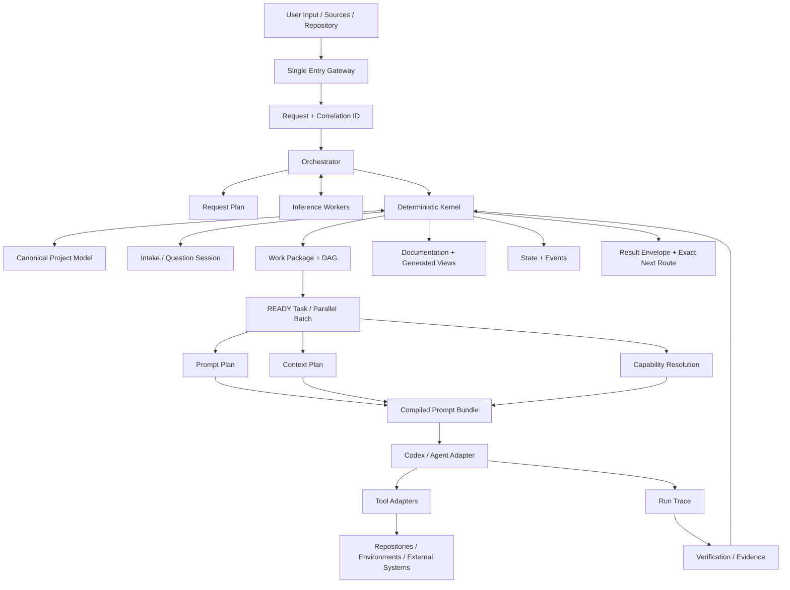

# Системная архитектура Harness

**Документ:** Project Harness  
**Версия:** 0.5.0  
**Дата:** 2026-08-18  
**Статус:** PROPOSED IMPLEMENTATION BASELINE — готов к реализации после подтверждения

## 1. Главные компоненты

### 1.1. Single Entry Gateway

Принимает natural-language input, attachments and optional project reference. Создаёт Request, correlation ID и безопасный read-only preclassification context.

### 1.2. Orchestrator

- классифицирует Request Class and Mode;
- выбирает Project Instance or Intake Session;
- строит Request Plan;
- показывает material questions/approvals;
- запускает только current route;
- агрегирует Result Envelope.

Orchestrator не является большим статическим prompt и не выполняет product work напрямую.

### 1.3. Deterministic Kernel

- schemas, registries and migrations;
- canonical storage and revision checks;
- constraints/policies/ADR materiality;
- Work Package/DAG/readiness;
- Prompt/Context/Capability composition;
- permission enforcement contracts;
- state transitions, events and transactions;
- structural/semantic validation;
- deterministic status and next-route selection.

### 1.4. Inference Workers

Создают candidates для extraction, classification, questions, architecture options, decomposition and semantic evaluation. Они не изменяют accepted state напрямую.

### 1.5. Adapters

- Agent Adapter — Codex first, другие через contracts;
- Model Profile/Adapter;
- Tool Adapter;
- Repository/Git Adapter;
- Source Parser;
- External System Adapter.

### 1.6. Validators

Deterministic validators, project toolchains and optional independent agents подтверждают output, diff scope, tests, documentation and semantic invariants.

### 1.7. Project Harness Instance

Project-local control plane in `.harness/`, generated human-readable views and links to the pinned Harness Distribution.

## 2. Сквозной поток данных



## 3. Control planes

```text
PRODUCT
PROJECT_CONTROL
HARNESS_DISTRIBUTION
EXTERNAL_SIDE_EFFECT
```

Product, Project Control and Distribution changes use separate Change Packs/workspaces. External side effects require explicit capabilities and approval according to policy.

## 4. Storage boundaries

Canonical entities are revisioned and machine-readable. Generated prompts, status views and combined documentation are reproducible outputs. Runs/evidence/events are append-only historical records.

## 5. Основные инварианты

1. Любой input получает Request and Result Envelope.
2. `QUERY` не создаёт product task без requested change.
3. Product task не исполняется до readiness and capability gates.
4. Consumer artifact exists before task becomes READY.
5. Prompt compiles JIT for one READY task/run.
6. Agent cannot expand governance, scope or permissions.
7. Actual writes are compared with declared sets.
8. Material ambiguity stops only affected route.
9. Completed run/evidence/history are immutable.
10. Blocker always contains recovery routes and resume condition.
11. Mixed-plane Change Pack is forbidden.
12. Provider billing/token accounting absent from kernel contracts.

## 6. Нормативные спецификации

- single entry: [`../12_Implementation_Specifications/01_Single_Entry_Request_Contract.md`](../12_Implementation_Specifications/01_Single_Entry_Request_Contract.md);
- canonical normalization: [`../12_Implementation_Specifications/18_Registries_Lifecycles_and_Contract_Normalization.md`](../12_Implementation_Specifications/18_Registries_Lifecycles_and_Contract_Normalization.md);
- Codex adapter: [`../12_Implementation_Specifications/15_Codex_Agent_Adapter.md`](../12_Implementation_Specifications/15_Codex_Agent_Adapter.md).
