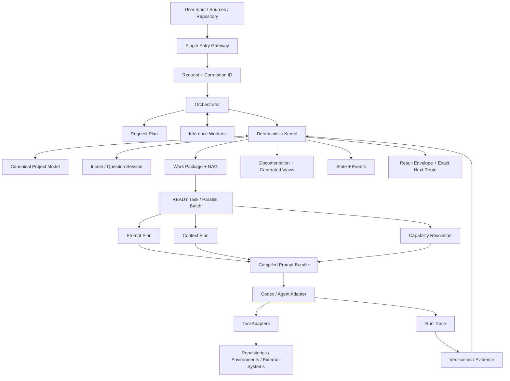

# Project Harness — полная архитектурная документация v0.5.0

**Документ:** Project Harness  
**Версия:** 0.5.0  
**Дата:** 2026-08-18  
**Статус:** GENERATED FULL DOCUMENT — редактировать тематические источники

Этот файл объединяет все редактируемые Markdown-источники комплекта. Machine-readable registries остаются отдельными canonical files и описаны в `registries/README.md`. Canonical precedence сохраняется у registries, schemas и отдельных source documents.

## Source inventory

- `README.md`
- `VERSION.md`
- `CHANGELOG.md`
- `REQUIREMENTS_COVERAGE.md`
- `MIGRATION_FROM_v0.1.0.md`
- `MIGRATION_FROM_v0.2.0.md`
- `MIGRATION_FROM_v0.3.0.md`
- `MIGRATION_FROM_v0.3.1.md`
- `MIGRATION_FROM_v0.4.0.md`
- `MIGRATION_FROM_v0.4.1.md`
- `00_Overview/01_Product_Vision.md`
- `00_Overview/02_Scope_Principles_and_Non_Goals.md`
- `00_Overview/03_Project_Agnostic_Foundation.md`
- `00_Overview/04_Terminology_and_Roles.md`
- `00_Overview/05_Project_Lifecycle_and_Profiles.md`
- `01_Architecture/01_System_Architecture.md`
- `01_Architecture/02_Canonical_Model_and_Generated_Artifacts.md`
- `01_Architecture/03_Agent_Model_Tool_Adapters_and_Context_Recovery.md`
- `01_Architecture/04_Deployment_Models.md`
- `01_Architecture/05_Constraints_Policies_and_Decisions.md`
- `01_Architecture/06_Prompt_IR_and_Compilation.md`
- `01_Architecture/07_Execution_Compatibility.md`
- `02_Intake/01_Project_Intake_and_Readiness_Gates.md`
- `02_Intake/02_Greenfield_and_Brownfield_Workflows.md`
- `02_Intake/03_Architecture_Proposal_and_Approval.md`
- `02_Intake/04_Project_Definition_and_Discovery.md`
- `03_Planning/01_Requirements_Traceability.md`
- `03_Planning/02_Roadmap_DAG_Tracks_and_Parallelism.md`
- `03_Planning/03_Task_Contract.md`
- `03_Planning/04_Routing_and_Skills.md`
- `03_Planning/05_Context_Packets.md`
- `03_Planning/06_Context_Planning_and_Overflow.md`
- `03_Planning/07_Implementation_Levels_and_Stage_Plans.md`
- `04_Execution/01_State_Machine.md`
- `04_Execution/02_Execution_Lifecycle.md`
- `04_Execution/03_Reports_Evidence_and_Validation.md`
- `04_Execution/04_Blockers_Recovery.md`
- `04_Execution/05_Run_Trace_Retry_and_Idempotency.md`
- `04_Execution/06_Prompt_Evaluation_and_Release.md`
- `04_Execution/07_Stage_Gates_Maturity_and_Level_Up.md`
- `05_Updates/01_Change_Pack_Protocol.md`
- `05_Updates/02_Impact_and_Replanning.md`
- `05_Updates/03_Transactional_Application.md`
- `05_Updates/04_Versioning_Migrations.md`
- `05_Updates/05_Execution_Policy_Contract_v0.5.1_WIP.md`
- `05_Updates/06_Executor_Protocol_v0.5.1_WIP.md`
- `05_Updates/07_Rootless_Podman_Sandbox_v0.5.1_WIP.md`
- `05_Updates/08_Disposable_Execution_Root_v0.5.1_WIP.md`
- `05_Updates/09_Local_Codex_CLI_Adapter_v0.5.1_WIP.md`
- `05_Updates/10_Exact_Result_Channel_v0.5.1_WIP.md`
- `05_Updates/11_Validated_Diff_and_Crash_Consistent_Apply_v0.5.1_WIP.md`
- `05_Updates/12_Governed_Automatic_Run_and_Public_CLI_v0.5.1_WIP.md`
- `05_Updates/13_Migration_Cleanup_Orphan_Recovery_v0.5.1_WIP.md`
- `05_Updates/14_Operator_Runbook_v0.5.1_WIP.md`
- `05_Updates/15_Podman_Security_Validation_v0.5.1_WIP.md`
- `06_Git/01_Git_Architecture.md`
- `06_Git/02_Worktrees_Ownership.md`
- `06_Git/03_Commit_Publish_Policy.md`
- `07_Security/01_Security_Trust_and_Supply_Chain.md`
- `07_Security/02_Data_Classification_and_Runtime_Permissions.md`
- `08_Distribution/01_Universal_Archive_Structure.md`
- `08_Distribution/02_Project_Local_Structure.md`
- `08_Distribution/03_User_Workflows.md`
- `08_Distribution/04_Operator_Runbook_v0.5.0.md`
- `08_Distribution/04_Project_Bootstrap.md`
- `08_Distribution/05_PH_F08_Release_Acceptance.md`
- `09_Delivery/01_MVP_Scope.md`
- `09_Delivery/02_Implementation_Roadmap.md`
- `09_Delivery/03_Acceptance_Criteria.md`
- `10_Contracts/01_Core_Contracts_Examples.md`
- `10_Contracts/02_Source_Precedence_and_Conflict_Resolution.md`
- `10_Contracts/03_Extended_Contracts_Examples.md`
- `11_Appendices/01_Capability_and_Lifecycle_Coverage.md`
- `11_Appendices/02_Project_Profile_Matrix.md`
- `11_Appendices/03_Independent_Completeness_Model.md`
- `11_Appendices/04_Risks_Decisions_and_Open_Questions.md`
- `11_Appendices/05_Documentation_Basis_and_Assumptions.md`
- `11_Appendices/06_Revision_Resolution_Matrix.md`
- `11_Appendices/07_Quality_Checklist.md`
- `11_Appendices/08_Source_Checksums.md`
- `11_Appendices/09_Canonical_Registries.md`
- `12_Implementation_Specifications/00_Implementation_Specifications_Index.md`
- `12_Implementation_Specifications/01_Single_Entry_Request_Contract.md`
- `12_Implementation_Specifications/02_Result_Envelope_and_Statuses.md`
- `12_Implementation_Specifications/03_Work_Packages_Tasks_and_Subtasks.md`
- `12_Implementation_Specifications/04_JIT_Prompt_Compilation.md`
- `12_Implementation_Specifications/05_Documentation_Traceability.md`
- `12_Implementation_Specifications/06_ADR_and_Decision_Policy.md`
- `12_Implementation_Specifications/07_Causal_Development_Sequence.md`
- `12_Implementation_Specifications/08_Safe_Parallel_Execution.md`
- `12_Implementation_Specifications/09_Ambiguity_and_Clarification_Policy.md`
- `12_Implementation_Specifications/10_Blockers_Recovery_and_Progression.md`
- `12_Implementation_Specifications/11_Verification_Testing_and_Test_Data.md`
- `12_Implementation_Specifications/12_Request_Trace_and_Logging.md`
- `12_Implementation_Specifications/13_Technology_Baseline.md`
- `12_Implementation_Specifications/14_Skill_Registry_and_Lifecycle.md`
- `12_Implementation_Specifications/15_Codex_Agent_Adapter.md`
- `12_Implementation_Specifications/16_Harness_Maintenance_Plane.md`
- `12_Implementation_Specifications/17_Documentation_Layers_and_Minimal_Mode.md`
- `12_Implementation_Specifications/18_Registries_Lifecycles_and_Contract_Normalization.md`
- `12_Implementation_Specifications/19_Semantic_Documentation_Validation.md`
- `12_Implementation_Specifications/20_Brownfield_Project_Onboarding.md`
- `12_Implementation_Specifications/21_Project_Start_Questionnaire.md`
- `12_Implementation_Specifications/22_Browser_GPT_Preparation_and_Codex_Handoff.md`
- `12_Implementation_Specifications/23_Contract_Hardening_v0.4.1.md`
- `12_Implementation_Specifications/24_Implementation_Levels_Stage_Planning_and_Brownfield_Maturity_v0.5.0.md`
- `registries/README.md`

---

<!-- SOURCE: README.md -->

Текущее дополнение PH-LW-12: [три blockers и операторский recovery](13_Local_Web_Manual_Companion/23_PH_LW_12_Blocker_Fixes.md). Фактическая повторная приёмка точных wheel/installer bytes — в новом PH_LW_12_FIX_TEST_REPORT.md Engine. Ниже сохранены предыдущие checkpoints.

Текущий этап — PH-LW-12: [операторский маршрут и границы приёмки](13_Local_Web_Manual_Companion/22_PH_LW_12_Operator_Acceptance.md). Фактический verdict — PH_LW_12_TEST_REPORT.md Engine. Automatic executor выключен; v0.5.1 WIP / NOT RELEASED. Ниже сохранены предыдущие checkpoints.

Текущий checkpoint — PH-LW-11, 2026-11-08: [Windows установка, resume и stop](13_Local_Web_Manual_Companion/19_PH_LW_11_Windows_Installation.md). Фактический verdict — в PH_LW_11_TEST_REPORT.md Engine; наличие EXE не означает GO. Automatic executor выключен; PH-LW-12 не начат. Далее сохранена история.

Текущий checkpoint — PH-LW-10, 2026-11-07: [Stage Gates, planning, level-up и обслуживание](13_Local_Web_Manual_Companion/18_PH_LW_10_Stage_Lifecycle.md). Фактические результаты — `PH_LW_10_TEST_REPORT.md` Engine. Automatic executor выключен; PH-LW-11 не начат. Ниже сохранены исторические checkpoints; их прежние ограничения не являются текущим test verdict.

Текущий checkpoint: [Task-level manual evidence intake](13_Local_Web_Manual_Companion/17_PH_LW_09_Task_Manual_Evidence.md). PH-F06 закрыт; повторная составная приёмка PH-LW-09 — PASS в назначенном scope. Исторические checkpoints ниже сохранены; полный релиз не принят.

### Текущий build — PH-LW-09, 2026-11-07

[Task/JIT и ручной цикл](13_Local_Web_Manual_Companion/16_PH_LW_09_Task_Run_Manual_Console.md): bounded result intake, отдельный consent на verification, complete/block/resume. Фактическая приёмка — `PH_LW_09_TEST_REPORT.md` в Engine. Automatic executor выключен; PH-LW-10 не выполнялся; полная v0.5.1 не выпущена (verdict — в отчёте). Ниже сохранены исторические checkpoints.

### Предыдущий build — PH-LW-08, 2026-11-07

[Подготовка и безопасное размещение](13_Local_Web_Manual_Companion/15_PH_LW_08_Preparation_and_Publication.md): действительные separate approvals, server-owned staging, initial validations, no-clobber publication, exactly one first JIT и recovery. Фактическая приёмка — `PH_LW_08_TEST_REPORT.md` в Engine. Automatic executor выключен, PH-LW-09 не выполнен, полный release не выпущен (verdict см. в отчёте).

### Предыдущий build — PH-LW-07, 2026-11-07

[Отдельные согласования и recovery](13_Local_Web_Manual_Companion/14_PH_LW_07_Separate_Approvals.md): четыре/пять осознанных решений, actor, exact bindings, companion receipts и invalidation. Фактический отчёт — `PH_LW_07_TEST_REPORT.md` в Engine. Подготовка Project Instance ожидает PH-LW-08; automatic executor выключен, полный release остаётся незакрытым (`NOT RELEASED`). Следующие checkpoints сохранены как история.

### Рабочие файлы и архивы — правило от 2026-11-07

Все рабочие файлы проекта — код, документация, планы, промпты, отчёты и evidence — хранятся в распакованных каталогах. Архив не должен быть единственным местом хранения файлов.

**После каждого этапа или правки Engine/Documentation ZIP собирать не нужно. Архивы создаются только по явному запросу пользователя для передачи в ChatGPT на анализ, когда это требуется.** Это указание заменяет прежнее требование обязательной упаковки после этапов в сохранённых планах/prompts. Исторические архивы, inputs и отчёты сохраняются неизменными; их hashes описывают соответствующие снимки, а не текущий workspace. Синхронизация документации, manifests и применимые проверки рабочих файлов продолжаются без обязательной ZIP-пары.

### Предыдущий build — PH-LW-06, 2026-11-07

[Опрос и manual GPT draft exchange](13_Local_Web_Manual_Companion/13_PH_LW_06_Interview_and_GPT_Exchange.md): typed ответы, actual readiness, bounded pack, strict JSON, diff до commit и recovery. Фактический отчёт — `PH_LW_06_TEST_REPORT.md` в Engine. Automatic executor выключен, PH-LW-07 не выполнялся; полный release остаётся незакрытым (`NOT RELEASED`). Следующие checkpoints сохранены как история.

### Предыдущий build — Windows manual migration remediation, 2026-11-07

[Миграция, recovery и границы Windows manual приёмки](13_Local_Web_Manual_Companion/12_Windows_Manual_Migration_Retest.md). Фактический отчёт — `PH_LW_05_WINDOWS_MANUAL_REMEDIATION_TEST_REPORT.md` в Engine. Ниже сохранены предыдущие checkpoints. Automatic executor не активирован; PH-LW-06 не выполнялся; полный release — **NO GO / NOT RELEASED**.

### Предыдущий build — Windows HTTP retest PH-LW-04/05, 2026-11-07

База PH-LW-05 перенесена в native Windows workspace и исправлена по результатам HTTP/importer приёмки. [Текущая область, команды и ограничения](13_Local_Web_Manual_Companion/11_PH_LW_04_05_Windows_HTTP_Acceptance.md). Фактический verdict и регрессии — `PH_LW_04_05_WINDOWS_ACCEPTANCE_TEST_REPORT.md` в Engine. Ниже сохранены исторические checkpoints: их NOT RUN относится к прежним сборкам. Полный `LOCAL_WEB_MANUAL`, automatic executor и v0.5.1 — **NO GO / NOT RELEASED**; PH-LW-06 не выполнялся.

### PH-LW-05 — MD/ZIP source importer, WIP (Windows/browser NOT TESTED)

The Local Web manual shell now provides «Документы»: controlled GREENFIELD intake, multiple MD/ZIP upload, immutable snapshots and source revisions, no-doc explicit choice, escaped text preview and safe retry/recovery. No accepted state or automated Codex is enabled. Real Windows NTFS/HTTP/Edge/Podman acceptance remains NOT RUN / NO GO. See [10_PH_LW_05_Document_Import_and_Source_Revisions.md](13_Local_Web_Manual_Companion/10_PH_LW_05_Document_Import_and_Source_Revisions.md) and the Engine `PH_LW_05_TEST_REPORT.md`.

### PH-LW-04 — HTTP + UI shell, WIP (Windows/browser NOT TESTED)

См. [Loopback HTTP, сессии/CSRF, UI shell и operator runbook](13_Local_Web_Manual_Companion/09_PH_LW_04_Loopback_HTTP_Session_and_UI_Shell.md). Новая команда `project-harness ui` запускает отдельный Flask+Waitress localhost server при наличии pinned зависимостей; project data и mutations за session, будущие формы disabled. Реальная Windows 11 x64/NTFS и Waitress/browser security acceptance ещё требуют запуска; полного GO v0.5.1 нет.

### PH-LW-03 — application service only (v0.5.1 WIP; native Windows NOT RUN)

См. [описание PH-LW-03 service/operation recovery](13_Local_Web_Manual_Companion/08_PH_LW_03_Application_Service_and_Operation_Recovery.md): один Python service над manual core, bounded draft API, межпроцессный OS guard с CLI, read-only status, идемпотентный журнал и fail-closed crash reconciliation. **Нет HTTP/UI, не включён automatic execution, Windows 11 x64/NTFS не проверен, полный v0.5.1 release блокирован.**

### PH-LW-02 — Windows manual core boundary (WIP; native Windows NOT RUN)

See [`13_Local_Web_Manual_Companion/07_PH_LW_02_Native_Windows_Manual_Core.md`](13_Local_Web_Manual_Companion/07_PH_LW_02_Native_Windows_Manual_Core.md) for supported path/lock semantics, fail-closed automatic boundary, Linux-targeted regression coverage and the native Windows CI entrypoint. This phase does not implement a Web UI or close the v0.5.1 automatic NO GO.

> **PH-LW-01 (0.5.1-WIP / not released):** [контракт Windows Local Web manual companion](13_Local_Web_Manual_Companion/00_Entry_And_Base.md) — карта 26 CLI/API, зависимостей, draft-only GPT и platform test baseline. Это design/fixtures, **не** реализованный Web-интерфейс и **не** Windows acceptance. Источник — предоставленные PH-051-11 ZIP, не заявленный PH-051-12 snapshot.

> **АКТУАЛЬНО — PH-051-11, 0.5.1-WIP / NOT RELEASED.** Текущие публичные `executor-doctor`, `execute-current`, `migrate-project` описаны в [операторском runbook v0.5.1](05_Updates/14_Operator_Runbook_v0.5.1_WIP.md), а реальная [Podman security matrix и стендовые требования](05_Updates/15_Podman_Security_Validation_v0.5.1_WIP.md) — отдельно. Действующие contract versions: `PROJECT_INPUT@4`, schema7, ID@3, statuses@6, contracts@6. Существующий `prepare` **не поддерживает новый `LOCAL_AUTOMATIC` intake** (fail-closed); отсутствие публичного opt-in нельзя обходить редактированием подписанного lock. **Real rootless Podman tests пока NOT TESTED / NO GO**. Тексты PH-051-01..10 и базовая v0.5.0 документация ниже сохранены как исторические checkpoints.

> **v0.5.1 WIP / PH-051-10 — NOT RELEASED.** Existing valid v0.5.0 Project Instances can explicitly execute `project-harness migrate-project --project <root>` into schema7 **manual-only** execution, retaining immutable history. Orphan/restart cleanup, bounded Podman termination and recoverable durable apply are implemented; real rootless Podman security acceptance remains **NOT RUN / NO GO**. See [PH-051-10 migration and cleanup](05_Updates/13_Migration_Cleanup_Orphan_Recovery_v0.5.1_WIP.md). Earlier sections below describe their historical implementation checkpoints.

### PH-051-06 (v0.5.1 WIP / NOT RELEASED)

[Exact Agent Result, bounded logs and ENV secret refs](05_Updates/10_Exact_Result_Channel_v0.5.1_WIP.md) documents internal behavior and security boundary. Automatic mode is still NO GO without real rootless Podman and stages PH-051-07–12.

> **PH-051-05 — 0.5.1 WIP / NOT RELEASED.** The single Codex CLI adapter
> now resolves pinned ACTIVE ADP/SBX profiles, builds current Run/JIT argv and
> forwards it only into RootlessPodmanRunner. This does **not** enable a public
> automatic route or trust agent output. Podman/image/real Codex flags were NOT
> TESTED here; manual handoff remains supported. See
> [PH-051-05 local adapter note](05_Updates/09_Local_Codex_CLI_Adapter_v0.5.1_WIP.md).

> **PH-051-04 — 0.5.1 WIP / NOT RELEASED.** Per-Run product-only
> snapshots, exact baseline/task/JIT binding and bounded read-only control
> projection are implemented as Python API, with `EXECUTION_BINDINGS`
> excluded from handoff ZIP. Automatic CLI, verification and apply are not
> enabled. Real rootless Podman security acceptance remains NOT RUN / NO GO.
> See [PH-051-04 note](05_Updates/08_Disposable_Execution_Root_v0.5.1_WIP.md).

> **v0.5.1 WIP / PH-051-03:** один Rootless Podman Sandbox runner и
> fail-closed Python `doctor`/OS self-tests добавлены **без** публичного
> `executor-doctor`/`execute-current`, автоматического изменения canonical
> product, egress или host fallback. Реальный Podman недоступен в стенде
> сборки: security acceptance `NOT RUN / release blocked`, manual handoff остаётся
> единственным публичным маршрутом.
> [Sandbox note](05_Updates/07_Rootless_Podman_Sandbox_v0.5.1_WIP.md),
> [Executor protocol](05_Updates/06_Executor_Protocol_v0.5.1_WIP.md).

## Project Harness — документация движка v0.5.0

**Документ:** Project Harness  
**Версия:** 0.5.0  
**Дата:** 2026-08-18  
**Статус:** IMPLEMENTATION LEVEL AND STAGE AWARE CORE RUNTIME BASELINE

Project Harness v0.5.0 добавляет управляемую глубину реализации поверх принятого product scope. Версия вводит пять последовательных Implementation Levels, Stage Plans, Stage Gates, immutable Stage Acceptance Reports, read-only Brownfield Maturity Assessment, same-level maintenance и явный level-up. Она не добавляет функции продукта автоматически и не расширяет разрешения исполнителя.

### PH‑F07 — единая инструкция оператора (2026-10-25)

Для **исполняемых** команд v0.5.0 используйте [сквозной operator runbook](08_Distribution/04_Operator_Runbook_v0.5.0.md) и [публичные workflows](08_Distribution/03_User_Workflows.md). Он связывает GPT/source/approvals, installed wheel или bundled entrypoint, external Codex Task cycle, предметную Gate proof, Stage planning, level-up, Brownfield, maintenance, recovery и конкретные schemas. Valid handoff **не** означает созданный production-код, а общий PASS verification **не** закрывает любой Gate evidence kind. Этот PH‑F07 checkpoint не равен PH‑F08 финальной приёмке.

### PH_F06 integration update — 2026-10-24

Проверенные границы зрелости, Brownfield evidence import и same-level maintenance:
[PH_F06 lifecycle notes](PH_F06_LIFECYCLE_NOTES.md).
Результаты отдельных и полных прогонов: [PH_F06 test report](PH_F06_TEST_REPORT.md).
Это scoped remediation v0.5.0, не финальная приёмка PH_F08.

### 1. Сквозной пользовательский поток

```text
Документация и исходники
→ внешний START_INTAKE
→ core outcome и project scope
→ обязательный target implementation level
→ Project Definition / Brownfield Baseline / Architecture / Technology approvals
→ Stage Plans от PROTOTYPE до target
→ детальные Work Packages и Tasks только active stage
→ один JIT Prompt Bundle для текущей READY Task
→ independent verification
→ deterministic final-baseline Gate readiness
→ governed STAGE_ACCEPTANCE_PREPARATION Task only for missing evidence
→ Stage Gate formal review
→ immutable acceptance baseline
→ следующая последовательная Stage либо TARGET_LEVEL_REACHED
```

`implementation_level` отвечает на вопрос «насколько глубоко и надёжно реализовать утверждённый scope». Он не заменяет `project_scope`, `project_profile`, `execution_mode` или `deployment_model`.

### 2. Что изменилось в v0.5.0

1. **Canonical scale.** `PROTOTYPE → ALPHA → BETA → MVP → RELEASE`; `MVP` означает Production MVP. `UNSURE` остаётся decision state и не записывается как уровень.
2. **Strict `PROJECT_INPUT@3` и target authority.** Во внешнем intake current target читается из `PROJECT_INPUT.yaml`; после подготовки immutable `PROJECT_INPUT_ACCEPTED` сохраняет initial accepted target, а единственный current-cycle target находится в Stage State с согласованными PROJECT/CURRENT_STATE projections.
3. **Stage-aware planning.** Outline создаётся для каждой стадии до target, но detailed Work Packages, atomic Tasks, Context/Prompt Plans и JIT bundles разрешены только active stage.
4. **Stage Gate.** Mandatory criterion закрывается только `PASS` либо обоснованным `NOT_APPLICABLE`; средние баллы запрещены.
5. **Immutable acceptance.** Для каждой принятой стадии фиксируются baseline, permitted-use boundary, known limitations и next-stage gaps.
6. **Brownfield maturity.** Assessment использует предоставленные и read-only evidence, не запускает repository commands автоматически и не меняет accepted maturity без approval.
7. **Level-up и maintenance.** Повышение цели активирует только ближайшую следующую стадию; bugfix без повышения остаётся отдельным same-level route.
8. **Migration.** v0.4.1 → v0.5.0 сохраняет immutable history, не угадывает уровень по старому `COMPLETED` и применяет изменения только после полной проверки копии.
9. **Crash-consistent Stage transactions.** `accept-stage` и `level-up` используют durable journal/backups, deterministic recovery, exact terminal digests и idempotent committed replay.
10. **Trusted Gate evidence.** Every closing `EVD-*` ref resolves at one exact project-local path and is checked for normalized schema, semantic kind, positive status, provenance, subject mapping, current product baseline and immutable SHA-256 binding.
11. **Self-contained Stage approval preparation.** `stage-status` exposes the exact Gate/baseline contract, while `prepare-stage-approval` writes a deterministic strict `DRAFT` record with complete result skeletons, evidence candidates and unresolved gaps without approving or mutating the project.
12. **Full same-level maintenance lifecycle.** Strict `start-maintenance`/`cancel-maintenance` records create and close accepted-stage WP/Tasks through the ordinary runtime, preserve maturity/acceptance history and block level-up only while the maintenance WP is open.

Нормативная спецификация: [`24_Implementation_Levels_Stage_Planning_and_Brownfield_Maturity_v0.5.0.md`](12_Implementation_Specifications/24_Implementation_Levels_Stage_Planning_and_Brownfield_Maturity_v0.5.0.md).

### 3. Быстрый запуск движка

```bash
cd /path/to/Project_Harness_Engine_v0.5.0  # source Engine root
python project-harness.py doctor
python project-harness.py --version
python project-harness.py demo --output-dir ./demo-output --keep-directory
python project-harness.py validate-handoff   --project ./demo-output/harness-demo-codex-handoff.zip
```

Для нового intake после анализа источников и определения core outcome требуется canonical target:

```text
PROTOTYPE | ALPHA | BETA | MVP | RELEASE
```

При ответе `UNSURE` подготовительный слой показывает рекомендацию с rationale, а readiness остаётся `WAITING_DECISION` до явного выбора.

### 4. Stage-aware runtime

Основные команды извлечённого Project Instance:

```bash
python .harness/engine/project-harness.py validate-project --project .
python .harness/engine/project-harness.py status --project .
python .harness/engine/project-harness.py stage-status --project .
python .harness/engine/project-harness.py next --project .
python .harness/engine/project-harness.py verify --project . --allow-command-execution
python .harness/engine/project-harness.py complete --project .   --result .harness/runtime/AGENT_RESULTS/<RUN-ID>.json
```

После последней ordinary mandatory Task оценивается readiness на final product baseline: при missing proof требуется bounded `STAGE_ACCEPTANCE_PREPARATION`; только при подтверждённом coverage возможен `VERIFYING`. Проект не получает ложный terminal `COMPLETED`: требуется formal Gate approval. Пользовательский цикл не требует чтения private Python code или ручного разбора Gate:

```text
stage-status → prepare-stage-approval → добавить/проверить evidence и formal fields → accept-stage
```

```bash
python .harness/engine/project-harness.py stage-status --project .
python .harness/engine/project-harness.py prepare-stage-approval \
  --project . \
  --output ../operator-records/prototype-stage-approval.yaml
python .harness/engine/project-harness.py accept-stage \
  --project . \
  --level PROTOTYPE \
  --approval ../operator-records/prototype-stage-approval.yaml
```

`stage-status` возвращает exact Plan/Gate refs, paths, revisions, Gate digest, canonical product `baseline_revision`, result counts и следующий операторский route. После последней ordinary mandatory Task runtime сначала оценивает Gate readiness: при missing exact-baseline evidence создаёт ровно один idempotent `STAGE_ACCEPTANCE_PREPARATION` WP/Task с первым JIT bundle, иначе сразу переводит Stage в `VERIFYING`. `prepare-stage-approval` затем пишет отдельный strict `SCHEMA-STAGE-APPROVAL@1` record: `record_state: DRAFT`, `approved: false`, `id/actor/approved_at: null`, все result statuses `UNKNOWN`. Evidence candidates являются подсказкой и не дают автоматический `PASS`. Сама команда не меняет Stage/Gate, не создаёт Work Package/Decision/Acceptance Report, не запускает repository commands и не изменяет product tree. Внутри Project Instance output разрешён только под `.harness/operator/APPROVALS/`; существующий файл требует explicit `--force`. Valid formal review с незакрытым mandatory result сохраняется как Gate-related `BLOCKED`; `resume-stage-gate` возвращает его в ACTIVE preparation либо VERIFYING, создавая новые revisions.

Каждый `PASS` после formal review обязан ссылаться на normalized immutable `.harness/evidence/EVD-*.yaml`, mapping’ить exact result, иметь compatible kind, positive status, provenance, current product baseline и digest-verifiable source. Изменение product tree или Gate revision делает старый approval stale. Подробный контракт: [`04_Execution/07_Stage_Gates_Maturity_and_Level_Up.md`](04_Execution/07_Stage_Gates_Maturity_and_Level_Up.md).

Same-level maintenance uses a separate governed route and the existing Task runtime:

```bash
python .harness/engine/project-harness.py start-maintenance --project . --plan ../operator-records/maintenance-plan.yaml
python .harness/engine/project-harness.py next --project .
python .harness/engine/project-harness.py verify --project . --allow-command-execution
python .harness/engine/project-harness.py complete --project . --result .harness/runtime/AGENT_RESULTS/<RUN-ID>.json
python .harness/engine/project-harness.py cancel-maintenance --project . --approval ../operator-records/maintenance-cancel.yaml
```

The plan is strict and exact-bound to `highest_accepted_level`, current target, last acceptance and accepted scope. Completion/cancel restores the previous route without invoking Stage acceptance or changing target/accepted maturity. Cancel is permitted only before completed/observed product-changing work and never performs automatic rollback. Open maintenance blocks `level-up`; terminal maintenance history does not.

Если принята target stage, project status становится `TARGET_LEVEL_REACHED`. Для дальнейшего движения требуется отдельный approval:

```bash
python .harness/engine/project-harness.py level-up   --project . --target MVP --approval ./level-up-approval.yaml
```

### 5. Brownfield maturity

Assessment выполняется без автоматического запуска build/test/deployment commands:

```bash
python project-harness.py assess-maturity   --workspace ./work/existing-project-intake   --evidence ./provided-evidence.yaml
```

`claimed_current_level`, `observed_candidate_level`, `highest_satisfied_candidate_level` и `highest_accepted_level` имеют разный смысл и не сворачиваются в одно `current_level`. Baseline acceptance разрешён только для `BROWNFIELD`/`HYBRID`, требует canonical `<assessment-id>@<positive-integer-revision>` и `sha256:<64 lowercase hex>`, открывает только exact file в `.harness/stages/ASSESSMENTS/` и создаёт отдельный report для каждой последовательно принятой стадии. Glob/latest fallback отсутствует; filename, exact envelope, internal id/revision и digest file bytes проверяются до Stage mutation. Затем отдельный freshness preflight связывает assessment с current product tree, canonical Stage State target, previous accepted level, immutable accepted claim и sequential candidate context. Drift или stale/other-base evidence возвращает structured `STALE`, создаёт только новую immutable validation revision и оставляет acceptance state неизменным.

### 6. Миграция v0.4.1 → v0.5.0

```bash
python project-harness.py migrate-project   --project /path/to/extracted-v0.4.1-project   --input /path/to/PROJECT_INPUT_v3.yaml
```

Для проекта без выполненных задач migration пересобирает stage-aware planning после подтверждения target. Для проекта с completed history история сохраняется, создаётся консервативная assessment/review route, а accepted level не выводится автоматически. Подробности: [`MIGRATION_FROM_v0.4.1.md`](MIGRATION_FROM_v0.4.1.md).

### 7. Canonical control-plane paths

```text
.harness/stages/STAGE_STATE.yaml
.harness/stages/PLANS/
.harness/stages/GATES/
.harness/stages/ACCEPTANCE/
.harness/stages/ASSESSMENTS/
.harness/stages/STATE_HISTORY/
.harness/stages/TRANSACTIONS/
.harness/operator/APPROVALS/  # optional safe in-project operator output
.harness/maintenance/PLANS/
.harness/maintenance/REPORTS/
.harness/maintenance/INDEX.yaml
.harness/maintenance/CURRENT.yaml
```

Uppercase directory names являются contract paths. Lowercase формы в пояснительных примерах не переопределяют Contract Catalog.

`TRANSACTIONS/<transaction-id>/TRANSACTION.yaml` сохраняет complete ordered write set, backups/staged paths, existed-before markers, old/new digests, status/timestamps, result digest и per-entry progress до первого canonical replace. Перед `APPLYING` durable journal, все backups и все staged digests проходят повторный preflight. `validate-project` автоматически reconciles pending transaction: full-new digests завершают commit, иначе verified backups восстанавливают full-old state; corruption или mixed `Stage indexes / CURRENT_STATE / NEXT_TASK / Acceptance` блокирует mutation без guess-based repair.

### 8. Состав комплекта

- [`00_Overview`](00_Overview) — product scope, роли и lifecycle;
- [`01_Architecture`](01_Architecture) — canonical architecture и control plane;
- [`02_Intake`](02_Intake) — documentation-first intake и approvals;
- [`03_Planning`](03_Planning) — traceability, DAG, Stage Plans и stage fence;
- [`04_Execution`](04_Execution) — task/run state, Stage Gates, maturity и level-up;
- [`05_Updates`](05_Updates) — Change Packs, migration и transactional updates;
- [`06_Git`](06_Git) — целевая Git architecture; публикация не входит в v0.5.0;
- [`07_Security`](07_Security) — trust boundaries и sensitivity taxonomy;
- [`08_Distribution`](08_Distribution) — distribution и project-local layout;
- [`09_Delivery`](09_Delivery) — реализованный Core boundary и roadmap;
- [`10_Contracts`](10_Contracts) — canonical examples;
- [`11_Appendices`](11_Appendices) — matrices, risks и validation basis;
- [`12_Implementation_Specifications`](12_Implementation_Specifications) — 24 normative specifications;
- [`registries`](registries) — seven machine-readable canonical registries;
- [`tools/validate_documentation.py`](tools/validate_documentation.py) — structural and semantic validator.

### 9. Canonical versions

```text
Engine distribution      0.5.0
Canonical schema         6
PROJECT_INPUT contract   SCHEMA-PROJECT-PREPARATION-INPUT@3
Project migration        MIG-ENGINE-0.4.1-TO-0.5.0

id_prefixes              2
project_profiles         1
statuses                 5
request_routing          2
capabilities             1
contracts                5
implementation_levels    1
```

`PROJECT_LOCK` фиксирует exact version и SHA-256 digest каждого registry.

### 10. Scope boundary

В v0.5.0 не входят automated Codex CLI/API Executor Adapter, rootless container sandbox, local commit/push/PR adapters, deployment execution route, declarative PROJECT skill authoring, parallel worktrees/leases и remote multi-user control plane. Эти механизмы не считаются реализованными из-за наличия архитектурных глав.

### 11. Проверка документации

```bash
python tools/validate_documentation.py . --build-aggregates
: "После отдельной сборки ZIP можно проверить архив:"
python tools/validate_documentation.py . --zip ../Project_Harness_Documentation_v0.5.0.zip
```

Validation проверяет exact registry views, Contract Catalog, lifecycle applicability, Stage contract examples, generated aggregates, manifest и ZIP tree. Runtime conformance подтверждается отдельным `TEST_REPORT_v0.5.0.md` архива движка.

### PH‑F01 interim verification record (2026-10-23)

The [PH‑F01 integration matrix](PH_F01_INTEGRATION_MATRIX.md) describes reproduction fixtures, actual public CLI/API stage-boundary status and negative Gate evidence tests. At the PH‑F01 checkpoint, PH‑F02 and PH‑F03 defects were still open; that record is retained as historical evidence. The current PH‑F02 patch closes the semantic Gate-proof regression, while the active-stage planner regressions remain intentionally RED until PH‑F03. This is not the final v0.5.0 release. The engine archive includes execution reports.

### PH‑F02 evidence hardening (2026-10-24)

Stage Gate accepts only exact subject-specific semantic proof, never a generic verification PASS; see `04_Execution/07_Stage_Gates_Maturity_and_Level_Up.md`. PH‑F03 subsequently adds the public active-stage planner; the PH‑F02 evidence contract remains unchanged.

### PH‑F03 public next-stage planner (2026-10-24)

После `accept-stage` либо `level-up` при `PLAN_ACTIVE_STAGE` теперь доступен
публичный цикл `prepare-active-stage-plan --project <root> --output <record>` →
`plan-active-stage --project <root> --plan <reviewed-record>` → `next`.
Он выпускает строго текущие Task/JIT, использует точный accepted scope,
Gate/Stage binding и crash-consistent commit; подробные поля и восстановление
см. `03_Planning/07_Implementation_Levels_and_Stage_Plans.md`.
Ограничения PH‑F02 на подлинные Gate evidence сохраняются.
Этот PH‑F03 checkpoint не является полным PH‑F08 release gate.

### PH‑F04 — runtime reachability (2026-10-24)

`next` и `stage-status` показывают исполнимое `next_operator_route` с точной CLI-командой или внешним prerequisite. `validate-project` проверяет фактическое существование continuation в CLI и согласованность Stage State/Plan/Gate/Task/Run; ожидание formal review не считается дефектом. Маршруты planning, Gate review/recovery, ordinary Task blockers, `TARGET_LEVEL_REACHED` и same-level maintenance различаются. Операторский status/route matrix приведён в [`08_Distribution/03_User_Workflows.md`](08_Distribution/03_User_Workflows.md).

### PH‑F08 — финальная интеграционная приёмка (2026-10-25)

Финальные сценарии I-01–I-14 проверены через публичный Engine CLI/API, отдельную установку wheel, `doctor`, validators и ZIP-манифесты. Итоги, полные реальные логи и release verdict см. в `PH_F08_TEST_REPORT.md` из Engine ZIP и [`08_Distribution/05_PH_F08_Release_Acceptance.md`](08_Distribution/05_PH_F08_Release_Acceptance.md). Semantic Gate proof, formal approvals, stage fence, immutable history и ограничения без локального Codex Executor неизменны.

PH-LW-11: [Windows установка и resume](13_Local_Web_Manual_Companion/19_PH_LW_11_Windows_Installation.md). Фактическая приёмка — отдельный Engine report; полный release остаётся NOT RELEASED.

Дополнение PH-LW-11: [long-path подготовка без изменения Windows settings](13_Local_Web_Manual_Companion/20_PH_LW_11_Long_Path_Preparation.md). Предыдущий report сохранён; фактические повторные проверки — в новом Engine report.

[PH-LW-11: ZIP-import при длинном app-data root](13_Local_Web_Manual_Companion/21_PH_LW_11_Long_App_Data_ZIP_Import.md). Текущий scoped fix и ограничения — в новом отчёте Engine.

---

<!-- SOURCE: VERSION.md -->

> **Current distribution: 0.5.1-WIP / NOT RELEASED, through PH-051-11.** Engine/package version `0.5.1`; canonical schema `7`, `PROJECT_INPUT@4`, ID-prefix registry `3`, lifecycle registry `6`, contract catalog `6` (5→6 documented collision decision). Read [operator runbook v0.5.1](05_Updates/14_Operator_Runbook_v0.5.1_WIP.md) and [security validation](05_Updates/15_Podman_Security_Validation_v0.5.1_WIP.md). Live rootless Podman security attestation is **NOT TESTED / NO GO** here. The remaining v0.5.0 version block below records historical, immutable baseline semantics; it is not the current wheel version.

> **Current delivered package:** `0.5.1-WIP`, PH-051-06 exact result channel,
> immutable kernel ART/Agent Result records, bounded logs and allowlisted ENV
> secret refs (after PH-051-01–05). No public automatic CLI, independent
> verification, product apply or final release. Real Podman security integration
> **NOT RUN / NO GO** on this host. See
> [PH-051-06 note](05_Updates/10_Exact_Result_Channel_v0.5.1_WIP.md).
>
> **Current delivered package:** `0.5.1-WIP`, PH-051-05 exact ADP/SBX-bound
> local Codex CLI adapter (after PH-051-01–04), sandbox-only argv/doctor API.
> No public automatic CLI, result acceptance, verification or apply; real rootless
> Podman tests and actual Codex CLI image/flags **NOT RUN** on packaging host.
> See [PH-051-05 note](05_Updates/09_Local_Codex_CLI_Adapter_v0.5.1_WIP.md).

> **Current delivered package:** `0.5.1-WIP`, PH-051-04 disposable execution root
> and bounded control projection after PH-051-01/02/03. Version remains 0.5.1; schema 7,
> PROJECT_INPUT@4, registries id_prefixes=3, statuses=6, contracts=6.
> Real Podman security checks **NOT RUN** in packaging environment;
> automatic public `execute-current` remains unavailable, manual handoff only.
> See [disposable-root note](05_Updates/08_Disposable_Execution_Root_v0.5.1_WIP.md).
> Historic v0.5.0 baseline information below remains as accepted.

## Версия комплекта Project Harness

**Документ:** Project Harness  
**Версия:** 0.5.0  
**Дата:** 2026-08-18  
**Статус:** STAGE AWARE CORE RUNTIME BASELINE

```text
0.5.0
```

### Семантика версии

v0.5.0 является minor release поверх принятого v0.4.1. Она добавляет новый управляемый lifecycle реализации, не меняя утверждённый product scope и не включая будущие executor/Git/deployment capabilities.

Версия фиксирует:

- documentation and engine distribution `0.5.0`;
- canonical project schema `6`;
- strict `PROJECT_INPUT@3` / `SCHEMA-PROJECT-PREPARATION-INPUT@3`;
- canonical levels `PROTOTYPE`, `ALPHA`, `BETA`, `MVP`, `RELEASE`;
- statuses registry `5`;
- contracts registry `5`;
- id-prefix registry `2` с `STG`;
- implementation-level registry `1`;
- migration `MIG-ENGINE-0.4.1-TO-0.5.0`;
- Stage State, Plans, Gates, Acceptance Reports и Maturity Assessments;
- `TARGET_LEVEL_REACHED` вместо преждевременного project completion;
- atomic stage acceptance и nearest-next-stage activation;
- read-only Brownfield maturity и separate same-level maintenance route;
- normalized immutable Gate evidence schema/resolver with exact path, kind, provenance, subject, baseline and digest validation;
- accepted Gate/Acceptance evidence binding snapshots verified by `validate-project`.

### Compatibility

- **Documentation release:** 0.5.0
- **Canonical project schema:** 6
- **PROJECT_INPUT schema:** 3
- **Engine distribution:** 0.5.0
- **Python runtime:** 3.11+
- **Direct project migration source:** engine 0.4.1 / schema 5
- **Documentation migration source:** v0.4.1
- **Legacy history:** immutable v0.4.1 records preserved
- **OS sandbox / automated executor / Git publication:** не заявлены

### Versioned components

```text
Harness kernel
Canonical schemas
Machine registries
Implementation Level Registry
Stage State / Plans / Gates / Acceptance / Assessments
Prompt and Context compiler
Project preparation templates
Project-local embedded runtime
Migration rules
Documentation package
```

`PROJECT_LOCK` фиксирует exact registry versions/digests и applied migration IDs. Accepted Stage baselines и completed Runs не переписываются при level-up или maintenance.

---

<!-- SOURCE: CHANGELOG.md -->

### PH-LW-06 — 2026-11-07 (WIP / NOT RELEASED)

Добавлены typed опрос, actual questions/readiness, отдельный browser GPT_PREPARATION template, JSON envelope v2, ограниченные export parts с hashes, policy/consent, preview/diff/commit/cancel/recovery и unverified provenance. UNKNOWN connectivity/documentation и blocking unknowns больше не дают READY_FOR_HANDOFF; UNSURE сохраняет WAITING_DECISION. Formal approvals PH-LW-07 и automatic executor не включены. Глава 13 Local Web описывает контракт и границы; точные результаты сохраняются в новом PH_LW_06_TEST_REPORT.md.

### Windows manual migration remediation — 2026-11-07 (WIP / NOT RELEASED)

Добавлена глава 12 Local Web: Windows fsync миграции, partial-copy/read-only cleanup, real process-exit recovery, ограничения symlink и Linux-only suites. Это дополнение к PH-LW-05, не следующий функциональный этап; полная поставка не принята.

### Windows HTTP retest PH-LW-04/05 — 2026-11-07 (WIP / NOT RELEASED)

Исправлены project GET, HTTP replay admission, malformed action/CSRF, duplicate multipart fields, snapshot ancestor junction checks, raw ZIP budget, source UI busy state и Windows transaction fsync. Дополнены реальные Waitress/Edge/NTFS tests и воспроизводимые PowerShell 5.1/7 CI scripts с точным учётом skips. Прежние reports и normative contracts сохранены; полный release не объявляется. См. новый acceptance report и главу 11 Local Web.

### PH-LW-04 — 2026-11-03 (0.5.1 WIP, not released)

Документирован отдельный localhost-only server/session bootstrap, HTTP route allowlist, CSP/CSRF, WSGI limits, static UI shell и запуск `project-harness ui`; прежняя PH-LW-03 service/manual/auto NO-GO граница сохранена. Native Windows/browser/Podman acceptance не заявляется без фактического прогона.

### PH-051-11 — operator docs and Podman security validation (2026-10-29, WIP)

- Согласованы текущие public `executor-doctor`/`execute-current`/migration, wheel/source/bundled entrypoint, GPT preparation template, operator runbook, strict ADP/SBX examples и fail-closed network/secret/debug limitations.
- Введена воспроизводимая Podman security matrix с честным `NOT TESTED / NO GO` без non-root Podman и pinned image; unit mocks не засчитываются как OS аттестация.
- Выявлен pre-existing `prepare` blocker (`LOCAL_AUTOMATIC` → `AUTOMATIC_EXECUTOR_NOT_IMPLEMENTED`), не обойдён изменением signed PROJECT_LOCK. Он отражён в отчёте как внешний scope blocker PH-051-12.
- Исправлено одно прямое нарушение source `doctor` packaging smoke: обход дерева manifest исключал **все** `MANIFEST.sha256`, даже nested documentation manifest, который был включён в root manifest; теперь исключается лишь root manifest.
- Это **не** PH-051-12 release/GO; v0.5.0 Stage/Gate/Brownfield/maintenance и последние PH-051-01..10 contracts не менялись.

### 2026-10-26 — PH-051-10 миграция, orphan и cleanup (v0.5.1 WIP / NOT RELEASED)

- Реализован `MIG-ENGINE-0.5.0-TO-0.5.1` для persisted Project Instance: проверенный staged sibling swap, durable recovery pre/post commit, safe `MANUAL_HANDOFF` default с null profiles/network NONE, schema7 и exact registry locks; accepted input, manual Runs и Stage histories immutable.
- Новый `execution_origin` на новых manual/automatic Run records, signed cleanup receipt, безопасное прекращение rootless Podman containers и проектно-ограниченная проверка orphan labels; старые incomplete Run partial outputs не используются для retry.
- Interrupted apply journal reconciled до recovery/quarantine; post-commit cleanup idempotent без redispatch. Real Podman security matrix всё ещё NOT RUN; PH-051-11/12 GO gate остаётся будущим.

### 2026-10-26 — PH-051-09 public governed automatic runtime (v0.5.1 WIP / NOT RELEASED)

- Added bounded project-scoped `executor-doctor` and `execute-current` CLI/Python APIs, current READY Task/Run phase journal, failure reason/status envelopes and read-only automatic/manual continuation in `next`/`status`/`stage-status`.
- Composed exact ADP/SBX Codex-in-Podman dispatch, independent SANDBOXED verifier, PH-051-08 committed apply/evidence and explicit/opt-in automatic Task completion. Validated Run/Apply Evidence binding before completion; preserved formal Stage Gate acceptance.
- Strictly reject manual automatic opt-in, unsupported egress/approval/debug overrides, missing sandbox doctor, secret leaks, invalid result, verification FAIL, write-scope/baseline mismatch and stale replay. No host fallback; unresolved crash/orphan recovery is PH-051-10.
- Integration Podman transport double does not count as a real container security test. Rootless Podman is unavailable on the packaging host; release remains NO GO pending PH-051-11/12.
- Detail: `05_Updates/12_Governed_Automatic_Run_and_Public_CLI_v0.5.1_WIP.md`.

### 2026-10-26 — PH-051-08 validated diff, secret scan and crash-consistent apply (0.5.1 WIP / NOT RELEASED)

- Implemented a bounded host-kernel `project_harness.apply` service; exact actual-vs-Task scope, expected artifacts, independent sandbox verification and normalized Run identity must agree before any canonical product write.
- Reject unsafe product paths/types/modes, stale baseline and literal secret leaks in changed files, Agent Result, bounded logs and verification diagnostics; no recursive copy or host executor fallback.
- External per-Run durable journal/backups, atomic same-directory file replacement, crash rollback/recovery and immutable Apply Evidence `EVD-APPLY-*` with signed control-plane boundary. Post-commit cleanup failure is not mislabeled rollback.
- No public `execute-current`, automatic completion, migration/orphan recovery or real Podman security GO; see `05_Updates/11_Validated_Diff_and_Crash_Consistent_Apply_v0.5.1_WIP.md`.

### 2026-10-26 — PH-051-06 exact Agent Result, secret ENV refs and bounded logs (0.5.1 WIP)

- One fixed `/output/agent-result.json`: reject unsafe file type, path, owner/mode, hardlinks, oversize, invalid UTF-8/JSON/schema or wrong current Run/Task.
- Kernel-published immutable Agent Result/ART metadata and bounded/redacted stdout/stderr, with control-plane fence; agent exit 0 alone is not independent PASS.
- Allowlisted `ENV:NAME` secret resolution, ephemeral protected Podman env-file, exact-value leak rejection in agent result/logs and read-only scan helper for later diff apply.
- No public automatic `execute-current`, no independent verifier/apply and no real Podman security acceptance; version remains WIP / NOT RELEASED. See `05_Updates/10_Exact_Result_Channel_v0.5.1_WIP.md`.

### 2026-10-26 — PH-051-05 Local Codex CLI Adapter (0.5.1 WIP)

- Bound ACTIVE CODEX_CLI_LOCAL ADP and ROOTLESS_PODMAN SBX through exact profile
  refs/digests in PROJECT_LOCK, current disposable Run/JIT argv, sandbox-only
  doctor/dispatch and bounded stdin/timeout/exit classification.
- Host environment/secret forwarding fails closed; result acceptance/verification,
  product apply, public CLI activation and formal release remain deferred.
- No real Podman security or Codex CLI flags validated in this environment;
  see `05_Updates/09_Local_Codex_CLI_Adapter_v0.5.1_WIP.md`.

### 2026-10-25 — PH-051-04 disposable execution root and control projection (0.5.1 WIP)

- Signed `EXECUTION_ROOT_PREPARED` journal boundary keeps `validate-project` PASS while rejecting prior tampering; product hardlinks are refused.

- Added per-Run product-only byte snapshots outside the canonical project with exact current Run/Task/JIT and source baseline binding.
- Read-only seven-file control projection, metadata-only project-local `EXECUTION_BINDINGS`, and export exclusion; unsafe links, FIFO, staleness and replay tampering fail closed.
- No Codex invocation, verification, apply, public automatic CLI or real Podman isolation acceptance; v0.5.1 remains WIP / NOT RELEASED.
- See `05_Updates/08_Disposable_Execution_Root_v0.5.1_WIP.md`.

### 2026-10-25 — PH-051-03 Rootless Podman runner and fail-closed self-tests (0.5.1 WIP)

- Added one `ROOTLESS_PODMAN` sandbox runner with strict immutable-image, disjoint mounts and bounded Podman-only process contract.
- `doctor` requires *actual* rootless Podman, pinned image and OS self-tests (UID, mounts, caps/NNP, network, cgroups, executable, termination); mock PASS is not isolation acceptance.
- No Podman is available in the build environment and real security integration is **NOT RUN / NO GO**. Egress stays blocked and no automatic public CLI route is added.
- See `05_Updates/07_Rootless_Podman_Sandbox_v0.5.1_WIP.md`; prior v0.5.0 accepted records remain unchanged.

### 2026-10-25 — PH-051-02 executor protocol and fake CLI (0.5.1 WIP)

- Added a sandbox-only Python `ExecutorAdapter` / single `CODEX_CLI_LOCAL` adapter
  with exact argv-template validation and deterministic preliminary failure mapping.
- Added fake CLI test scenarios without enabling any public automatic execution.
- No host process invocation, real Podman isolation, automatic apply or Stage
  runtime changes. See `05_Updates/06_Executor_Protocol_v0.5.1_WIP.md`.

### 2026-10-25 — PH-051-01 contracts and execution policy (0.5.1 WIP)

- Added `PROJECT_INPUT@4` safe manual execution defaults, schema7 locks with null profile bindings, exact profile contract schemas and `SBX` lifecycle.
- Resolved contract-catalog collision by `5 → 6` (normative v0.5.1 text states `4 → 5`); see `05_Updates/05_Execution_Policy_Contract_v0.5.1_WIP.md`.
- Automatic runtime/sandbox execution remains disabled; v0.5.0 accepted history stays untouched.

### 2026-10-25 — PH-F08 final integration acceptance / release packaging

- Проверены 14 сценариев I-01–I-14 и все 168 source regression/e2e тестов (включая 166 прежних); подготовлены согласованные Engine/Documentation ZIP, манифесты и тестовый отчёт.
- Сохранены публичные Stage/Gate/level-up/maintenance и Brownfield маршруты, strict semantic evidence и подтверждённые ограничения v0.5.0; новый runtime функционал не добавлен.
- Операторские шаги приведены в `08_Distribution/05_PH_F08_Release_Acceptance.md`; реальные тестовые результаты — в `PH_F08_TEST_REPORT.md` архива движка.

### 2026-10-24 — PH-F06 maturity / Brownfield / maintenance integration

- Preserve supplied normalized semantic proof and immutable source bindings in the public maturity-evidence import path; reject invalid proofs before normalized import.
- Reject Stage acceptance/assessment during open same-level maintenance and new level-up decisions before the current target cycle is accepted and idle.
- Keep a clean reserved Run executable after read-only assessment through a narrow trusted phase; do not trust pre-existing control-plane tampering.
- Add public-CLI full Prototype-to-MVP, maintenance-to-Release-planning, Brownfield, negative and migration coverage. See `PH_F06_TEST_REPORT.md` and `PH_F06_LIFECYCLE_NOTES.md`.
- v0.5.0, existing schema/registry/transaction contracts and historical reports retained; no PH-F07/PH-F08 or later-version implementation.


### PH-F07 operator documentation — 2026-10-25 (0.5.0 remediation, not PH-F08 release)

- Published a single operator runbook connecting installation/doctor, documentation-first GPT intake, strict approvals, handoff, external Codex Task cycle, subject-specific Gate proof, Stage planning, target-reached/level-up, Brownfield maturity and same-level maintenance.
- Aligned source/wheel/test commands, exact draft/approval schemas, operator record locations and reject/recovery status behavior with the existing CLI/API.
- Corrected outdated text implying that any PASS Task verification proves all Gate evidence kinds or that valid handoff is already production implementation. No normative contract, schema, registry, production implementation or version change.
- Final PH-F08 release acceptance is out of this package.

### PH‑F02 — semantic Gate evidence hardening (2026-10-24)

- Documented proof methods, required source contracts, human review and `BLOCKED → resume-stage-gate → VERIFYING` recovery.
- Clarified that a no-op/generic PASS does not certify document, test or external evidence; PH‑F03 remains separate.

## Changelog Project Harness

**Документ:** Project Harness  
**Версия:** 0.5.0  
**Дата:** 2026-08-18  
**Статус:** VERSION HISTORY


### 0.5.0 PH‑F04 — runtime reachability and status validation — 2026-10-24

- `next` and `stage-status` report the real public CLI continuation at Stage boundaries, including two-step `prepare-active-stage-plan` / `plan-active-stage`, formal Gate review, Gate/Task blocker recovery, target-reached and maintenance routes.
- New `validate-project` runtime reachability check rejects fabricated/unreachable routes, mismatched Stage Plan/Gate, future-stage READY Tasks, and inconsistent Run/blocker bindings; user review and external safety recovery remain explicit prerequisites rather than silent auto-approvals.
- Preserved PH‑F02 proof requirements, PH‑F03 idempotent current-stage planner, v0.4.1 compatibility, stage transaction recovery, formal approvals and accepted history.

### 0.5.0 PH‑F01 — baseline regression matrix — 2026-10-23

- Added `PH_F01_INTEGRATION_MATRIX.md` with normative issue-ID coverage, I-01–I-14 scenarios, four deterministic test fixture descriptions, known PH‑F02/PH‑F03 expected RED and PH‑F04 deferred reachability diagnosis.
- Kept the v0.5.0 requirements and documented operator contracts unchanged; runtime semantic fixes are explicitly deferred.
- PH‑F01 is a **pre-release expected RED** state, not renewed engine acceptance. Engine test logs/reports are distributed in the Engine archive.

### 0.5.0 M-01 documentation update — 2026-08-20

#### Added

- public governed `start-maintenance` and `cancel-maintenance` operator workflow;
- strict exact-bound maintenance plan/cancel contracts and examples;
- accepted-stage WP/Task/DAG/VFP/CTX/PPL/JIT lifecycle using the existing `next → verify → complete` runtime;
- immutable completion/cancellation reports, explicit previous-route restoration and terminal-only level-up unblocking.

#### Changed

- removed the private-stub model and documented `MAINTAIN_CURRENT_STAGE` as a supported public route;
- clarified that maintenance preserves target, accepted level, Stage Acceptance Reports, accepted Stage Plan/Gate revisions and completed Runs;
- clarified fail-closed cancel semantics after completed/observed or uncommitted product-changing work, with no invented automatic rollback;
- distinguished same-level product maintenance from Harness Distribution Maintenance Change Packs.


### 0.5.0 Q-01/Q-02 documentation update — 2026-08-20

#### Added

- deterministic final-baseline Gate-readiness lifecycle and governed `STAGE_ACCEPTANCE_PREPARATION` WP/Task flow;
- persisted `STAGE_GATE_BLOCKER` semantics, exact diagnostics and dedicated `resume-stage-gate` recovery;
- explicit distinction between malformed no-mutation approval failures and honest valid formal reviews that persist BLOCKED;
- current-stage-only preparation scope, idempotency, immutable revision history and operator workflows for both recovery branches.

#### Changed

- final ordinary Task documentation no longer claims an unconditional direct transition to `VERIFYING`;
- Gate-related BLOCKED now routes to `RESUME_STAGE_GATE`, while `prepare-stage-approval` remains the read-only record generator for VERIFYING/current snapshots;
- clarified that the command `prepare-stage-approval` creates no Work Package, while the runtime readiness evaluator may create one governed preparation WP only for exact missing evidence.

### 0.5.0 U-01 documentation update — 2026-08-20

#### Added

- self-contained Stage approval workflow `stage-status → prepare-stage-approval → add/review evidence and formal fields → accept-stage`;
- exact `stage-status` contract for Plan/Gate refs, revisions, digests, baseline, result counts, WPs, blockers and next operator route;
- strict deterministic `SCHEMA-STAGE-APPROVAL@1` DRAFT contract, safe output/`--force` semantics, public API and full generated example;
- evidence-candidate and unresolved-gap guidance with an explicit prohibition on automatic PASS/Decision/acceptance.

#### Changed

- removed operator guidance that required manual digest calculation or reading private Gate implementation;
- documented stale-record rejection after product/Gate drift and the exact formal fields required before `accept-stage`;
- documented that the `prepare-stage-approval` command performs zero Stage/product mutation and itself does not create `STAGE_ACCEPTANCE_PREPARATION` work.

### 0.5.0 — 2026-08-18

Minor release: implementation levels and stage-aware progression.

#### Added

- canonical `PROTOTYPE → ALPHA → BETA → MVP → RELEASE` registry with declarative criterion profiles;
- strict `PROJECT_INPUT@3` implementation section;
- Stage State, Stage Plans, Stage Gates, immutable Acceptance Reports and Maturity Assessments;
- `stage-status`, `assess-maturity`, `accept-stage` and `level-up` CLI routes;
- active-stage task/prompt fence and `STAGE_SCOPE_VIOLATION` classification;
- read-only Brownfield maturity assessment and baseline acceptance transaction;
- same-level maintenance route and target extension after `TARGET_LEVEL_REACHED`;
- explicit transactional migration from v0.4.1/schema 5;
- crash-consistent Stage transaction journal, immutable backups, deterministic recovery and committed-result replay;
- fault-injection conformance for canonical apply points, PREPARED/per-entry/COMMITTED journal failures, abrupt recovery, corruption/mixed-state blocking and level-up;
- `SCHEMA-GATE-EVIDENCE@1`, exact canonical `EVD-*` resolver and immutable evidence/source digest bindings for accepted Gates.

#### Changed

- canonical schema is v6; statuses v5, contracts v5 and ID prefixes v2;
- planner creates outlines to target but detailed atomic work only for active stage;
- final Task of a stage leads to `VERIFYING`, not project `COMPLETED`;
- project execution terminal for the current cycle is `TARGET_LEVEL_REACHED`;
- future-stage plans are provisional and are recomputed from the accepted baseline;
- `validate-project` reconciles non-terminal Stage transactions before canonical validation and verifies Stage indexes, Acceptance, `CURRENT_STATE` and `NEXT_TASK` against the latest completed transition;
- derived render failure after commit is a recoverable warning, not a false transition failure.

#### Fixed

- bound Brownfield baseline acceptance to the current product-tree digest, canonical Stage State target, previous accepted level, immutable accepted user claim and sequential candidate context;
- record freshness failures as new immutable `STALE` assessment revisions that preserve the source revision/tree and produce zero acceptance mutation;
- prevent stale or other-base evidence from closing accepted mandatory criteria and make multi-level baseline acceptance all-or-nothing for one exact current assessment;
- replaced Brownfield `assessment_ref` prefix-glob/latest fallback with exact canonical immutable revision resolution; `@1` cannot bind `@10`, and filename/envelope/internal id+revision/digest are verified before Stage mutation;
- made Stage Acceptance Reports persist the exact assessment ref returned by the resolver;
- made Stage State the sole prepared-project current target authority; synchronized PROJECT and CURRENT_STATE projections atomically during `level-up` while preserving immutable initial target in PROJECT_INPUT_ACCEPTED;
- made prepared-project maturity assessment, routing, status, rendering and validation consume the canonical Stage State target; external intake assessment still consumes current PROJECT_INPUT;
- prevented `ROLLED_BACK` journals from coexisting with fully committed canonical Stage state;
- prevented mixed Stage State, Acceptance Report, current indexes and `CURRENT_STATE` after interruption;
- made committed approval replay idempotent and rolled-back id reuse invalid.
- replaced string-only Gate evidence trust with fail-closed exact resolution, registry-kind, subject-mapping, provenance, positive-status and current-baseline checks;
- kept historical evidence readable while preventing legacy or unsupported-schema records from closing new Gates;
- persisted identical evidence ref/path/SHA-256 snapshots in accepted Gate and Acceptance Report, and made `validate-project` detect later evidence/source deletion or tampering;
- prevented runtime Task verification evidence from automatically claiming final Stage criteria or surviving product-tree changes as fresh evidence.

#### Safety and compatibility

- implementation level never grants new product scope or runtime permissions;
- maturity assessment never executes repository commands automatically;
- `SATISFIED_BY_BASELINE` is restricted to Brownfield/Hybrid and requires exact assessment evidence;
- immutable v0.4.1 history and accepted stage baselines are preserved;
- downgrade requests are non-destructive and return target-already-reached semantics.

#### Validation

- preserved v0.4.1 contract-hardening regressions;
- added registry, stage planning, Gate, maturity, migration, maintenance, level-up and crash-recovery conformance tests;
- release suite: 88/88 PASS across seven modules, including ten Brownfield freshness/context regressions and two CLI Brownfield reproductions.

### 0.4.1 — 2026-08-18

Patch release: contract hardening without a new user workflow.

#### Added

- strict Draft 2020-12 `PROJECT_INPUT@2` schema and idempotent v1 → v2 migration;
- separate `brownfield_baseline` approval for Brownfield/Hybrid and immutable Decision record;
- canonical sensitivity classes `SECRET` and `REGULATED`, with `UNKNOWN` restricted to intake uncertainty;
- protected control-plane snapshots, exact Agent Result channel checks and chained phase-boundary journal;
- direct `migrate-project` route from engine v0.4.0/schema 4;
- normative implementation specification 23 and v0.4.1 migration guide.

#### Changed

- successful Task status is `DONE`; successful Run status is `SUCCEEDED`;
- statuses registry is v4 and contracts registry is v3;
- canonical project schema is v5;
- Brownfield Baseline carries `accepted_by`, `accepted_at` and revision linkage;
- `verify` and `complete` require exact product digests relative to the last trusted phase boundary;
- new Run creation is blocked until a legacy Project Instance is explicitly migrated.

#### Compatibility

- immutable v0.4.0 Task/Run records remain byte-for-byte unchanged;
- legacy `Task: COMPLETED` and `Run: COMPLETED` are reported through explicit compatibility mappings;
- repeated migration returns `NO_ACTION` only after current-state validation passes.

#### Validation

- preserved all 14 v0.4.0 regression tests;
- added 30 contract-hardening and migration tests;
- release suite: 44/44 PASS.

### 0.4.0 — 2026-08-17

#### Added

- executable Core engine for Browser GPT preparation and governed Codex handoff;
- external `START_INTAKE` workspace and deterministic `prepare`;
- formal Session, Architecture Baseline, Project Lock and generated skill index contracts;
- specification 22 for Browser GPT → Codex Handoff;
- `validate-project` for mutable post-handoff state;
- conformance fixtures for greenfield and brownfield.

#### Changed

- initial questionnaire now runs only for a new Project Instance, not every process restart;
- bootstrap follows accepted baselines and Skill Gap Analysis rather than full skill authoring;
- Core/hardening dependencies are slice-specific;
- `PROJECT_LOCK` uses six exact canonical registry names, versions and digests;
- skills are resolved per project rather than regenerated per project;
- future compiled prompts are prohibited by the JIT handoff rule.

#### Fixed

- pre-bootstrap storage cycle;
- stale registry filenames and versions;
- missing startup contracts;
- brownfield route storage alignment;
- ambiguity between immutable handoff validation and mutable project-state validation.

### 0.3.1 — 2026-08-07

Patch release after final documentation audit. No new product subsystem is introduced.

#### Fixed

- renamed implementation packages to `WP-HARNESS-*` and reserved `HNS-REQ-*` for documentation requirements;
- synchronized Internal Operations with `registries/request_routing.yaml`;
- added missing lifecycle groups and corrected invalid example statuses;
- replaced unknown capability aliases and corrected Test Baseline prefix;
- normalized conflicting Brownfield, Parallel Batch, Project Definition, Task and Change Pack fields;
- added Request-level `idempotency_key` and transport mapping rule;
- added `registries/contracts.yaml` as canonical contract catalog;
- strengthened semantic validator and corrected Validation Report claims;
- normalized questionnaire assumption status and clarified that intake runs on the initial `PROJECT_START`, not every runtime restart.

#### Changed

- split delivery into Core MVP and Hardening without removing later mechanisms;
- assigned owner roles, resolve-before gates and ADR outputs to open implementation decisions.

### 0.3.0 — 2026-08-06

Сквозная переработка Project Harness как единой пользовательской точки входа и implementation-ready системы управления ИИ-агентами.

#### Added

- Request Class, Request Mode, Request и Request Plan contracts;
- единый public Result Envelope и ограниченный набор понятных статусов;
- Work Package для группировки пользовательского outcome и atomic Task hierarchy;
- JIT Prompt compilation только для READY task/run;
- exact documentation refs, stable section IDs и documentation impact;
- ADR materiality policy;
- artifact-producing dependencies и causal readiness;
- read/write resource sets для parallel batches;
- ambiguity policy с materiality, bounded question batches и reversible assumptions;
- recovery route contract без тупиковых состояний;
- Verification Profiles, Test Environment и Test Baseline contracts;
- pre-migrated test database template/isolated clone policy;
- Request Trace и correlation IDs;
- Technology Baseline and Technology Candidate contracts;
- Skill Registry, lifecycle and reuse-before-create policy;
- Codex Agent Adapter and structured agent result contract;
- PRODUCT, PROJECT_CONTROL и HARNESS_DISTRIBUTION maintenance planes;
- human-readable and machine-control documentation layers;
- machine-readable ID/profile/status/routing/capability registries;
- semantic documentation validation rules;
- brownfield onboarding with continuation, bug-fix, improvement and stabilization routes;
- mandatory documentation-first adaptive questionnaire;
- 21 detailed implementation specifications and one consolidated user/implementation guide;
- early walking-skeleton implementation roadmap.

#### Changed

- ordinary user query no longer creates a development task;
- intents, lifecycle phases and kernel operations are no longer mixed in one enum;
- Prompt Bundle is generated on demand rather than for the whole roadmap;
- shared read-only contracts are allowed in parallel execution;
- Run is one immutable attempt; retry creates a new Run;
- `PARTIALLY_COMPENSATED` is compensation status, not Change Pack lifecycle status;
- testing is proportional to task type and risk;
- brownfield repository is inspected read-only before any mutation;
- project start questions are derived from documentation and limited to material gaps;
- maintenance changes cannot be mixed with product changes;
- implementation roadmap is vertical and causal instead of subsystem-only;
- profile lists and identifier examples are normalized through registries.

#### Removed or deprecated

- separate canonical `Attempt` entity;
- `REQST`, `DECMP`, `ACTOR`, `PDF`, `CTXP`, `GRANT`, `LEASE`, `ECP` and other v0.2 aliases in new artifacts;
- `contract_set(A) ∩ contract_set(B) = ∅` as the sole parallelism rule;
- creation of ADR for every implementation task;
- automatic bulk compilation of future prompts;
- assumption that every task must have a code test;
- mixed-plane Change Packs;
- complex command-driven UX as the primary interface.

### 0.2.0 — 2026-08-02

Architecture revision introducing project-agnostic canonical model, greenfield/brownfield lifecycle, constraints, Prompt IR, Context Planning, adapters, capabilities, Run/Tool Invocation, evaluations and Change Packs. Historical details remain in [`MIGRATION_FROM_v0.1.0.md`](MIGRATION_FROM_v0.1.0.md).

### 0.1.0 — 2026-08-02

Initial architecture specification: distribution, engine, project-local instance, intake, architecture gate, requirements traceability, DAG/tasks, routing, context packets, state/evidence, updates, Git, security and MVP roadmap.

### PH‑F03 — governed next active-stage planner (2026-10-24)

- Added read-only `prepare-active-stage-plan` and governed `plan-active-stage`
  with strict `SCHEMA-ACTIVE-STAGE-PLAN-REVIEW@1` and exact context bindings.
- Each accepted-stage transition builds only the next Stage WPs, Tasks,
  dependency DAG, verification/context/prompt plans and first READY JIT.
- Documented accepted-scope fence, review of edited plans, stale/no-op behavior,
  idempotent commit replay and post-rollback draft renewal.
- PH‑F02 proof semantics, highest accepted level and immutable history are preserved;
  PH‑F04 onward remain separate remediation packages.

---

<!-- SOURCE: REQUIREMENTS_COVERAGE.md -->

## Нормализованные требования Project Harness

**Документ:** Project Harness  
**Версия:** 0.5.0  
**Дата:** 2026-08-18  
**Статус:** PROPOSED IMPLEMENTATION BASELINE — готов к реализации после подтверждения

Эта матрица описывает требования к самому Harness. Она не является requirements registry создаваемого project instance.

**Активных требований:** 226. Namespace намеренно разрежен: пропущенные номера зарезервированы для расширения тематических групп и не означают отсутствующее покрытие.

### 1. Product positioning and scope

| ID | Requirement | Coverage |
|---|---|---|
| HNS-REQ-001 | Harness является project-agnostic engine для software и software-infrastructure проектов. | [`00_Overview/01_Product_Vision.md`](00_Overview/01_Product_Vision.md) |
| HNS-REQ-002 | Universal kernel не содержит domain/path/stack конкретного project instance. | [`00_Overview/03_Project_Agnostic_Foundation.md`](00_Overview/03_Project_Agnostic_Foundation.md) |
| HNS-REQ-003 | Project profile предоставляет defaults, но не скрытые hard constraints. | [`00_Overview/05_Project_Lifecycle_and_Profiles.md`](00_Overview/05_Project_Lifecycle_and_Profiles.md) |
| HNS-REQ-004 | `CUSTOM` profile поддерживается без изменения universal kernel. | [`11_Appendices/02_Project_Profile_Matrix.md`](11_Appendices/02_Project_Profile_Matrix.md) |
| HNS-REQ-005 | Greenfield creation является обязательным end-to-end workflow. | [`02_Intake/02_Greenfield_and_Brownfield_Workflows.md`](02_Intake/02_Greenfield_and_Brownfield_Workflows.md) |
| HNS-REQ-006 | Brownfield workflow сохраняет reconciliation между docs и code. | [`02_Intake/02_Greenfield_and_Brownfield_Workflows.md`](02_Intake/02_Greenfield_and_Brownfield_Workflows.md) |
| HNS-REQ-007 | Material decisions остаются human-governed. | [`00_Overview/02_Scope_Principles_and_Non_Goals.md`](00_Overview/02_Scope_Principles_and_Non_Goals.md) |
| HNS-REQ-008 | Completeness измеряется независимыми dimensions, а не переносом одного source project. | [`11_Appendices/03_Independent_Completeness_Model.md`](11_Appendices/03_Independent_Completeness_Model.md) |
| HNS-REQ-009 | Product scope и non-goals зафиксированы явно. | [`00_Overview/02_Scope_Principles_and_Non_Goals.md`](00_Overview/02_Scope_Principles_and_Non_Goals.md) |

### 2. Intent, intake and Project Definition

| ID | Requirement | Coverage |
|---|---|---|
| HNS-REQ-010 | Harness принимает краткий Project Intent без готовой документации или repository. | [`02_Intake/01_Project_Intake_and_Readiness_Gates.md`](02_Intake/01_Project_Intake_and_Readiness_Gates.md) |
| HNS-REQ-011 | Все supplied sources инвентаризируются, хешируются и классифицируются. | [`02_Intake/01_Project_Intake_and_Readiness_Gates.md`](02_Intake/01_Project_Intake_and_Readiness_Gates.md) |
| HNS-REQ-012 | Отсутствие полной документации запускает discovery, а не обязательный blocker. | [`02_Intake/01_Project_Intake_and_Readiness_Gates.md`](02_Intake/01_Project_Intake_and_Readiness_Gates.md) |
| HNS-REQ-013 | Project Definition предшествует architecture and implementation. | [`02_Intake/04_Project_Definition_and_Discovery.md`](02_Intake/04_Project_Definition_and_Discovery.md) |
| HNS-REQ-014 | Project Definition содержит problem, users, outcomes, goals и success criteria. | [`02_Intake/04_Project_Definition_and_Discovery.md`](02_Intake/04_Project_Definition_and_Discovery.md) |
| HNS-REQ-015 | Scope разделён на in, out и deferred. | [`02_Intake/04_Project_Definition_and_Discovery.md`](02_Intake/04_Project_Definition_and_Discovery.md) |
| HNS-REQ-016 | Confirmed, assumed, proposed, unknown и conflicting различаются машинно. | [`00_Overview/04_Terminology_and_Roles.md`](00_Overview/04_Terminology_and_Roles.md) |
| HNS-REQ-017 | Assumption имеет owner, impact, validation plan и expiry/gate. | [`02_Intake/04_Project_Definition_and_Discovery.md`](02_Intake/04_Project_Definition_and_Discovery.md) |
| HNS-REQ-018 | Unknown имеет materiality, owner и resolution route. | [`02_Intake/04_Project_Definition_and_Discovery.md`](02_Intake/04_Project_Definition_and_Discovery.md) |
| HNS-REQ-019 | Project Definition проходит formal user gate. | [`00_Overview/05_Project_Lifecycle_and_Profiles.md`](00_Overview/05_Project_Lifecycle_and_Profiles.md) |

### 3. Requirements, constraints and decisions

| ID | Requirement | Coverage |
|---|---|---|
| HNS-REQ-020 | Requirement, Constraint, Invariant, Policy, Preference, Assumption, Decision и Waiver являются разными сущностями. | [`01_Architecture/05_Constraints_Policies_and_Decisions.md`](01_Architecture/05_Constraints_Policies_and_Decisions.md) |
| HNS-REQ-021 | Constraint имеет stable ID, source, scope, strength, precedence, enforcement и evidence refs. | [`01_Architecture/05_Constraints_Policies_and_Decisions.md`](01_Architecture/05_Constraints_Policies_and_Decisions.md) |
| HNS-REQ-022 | Constraints наследуются по workspace/project/environment/repository/track/task/run scope. | [`01_Architecture/05_Constraints_Policies_and_Decisions.md`](01_Architecture/05_Constraints_Policies_and_Decisions.md) |
| HNS-REQ-023 | Локальное правило не ослабляет ancestor hard constraint без waiver. | [`01_Architecture/05_Constraints_Policies_and_Decisions.md`](01_Architecture/05_Constraints_Policies_and_Decisions.md) |
| HNS-REQ-024 | Два несовместимых hard rules создают conflict/blocker, а не silent choice. | [`10_Contracts/02_Source_Precedence_and_Conflict_Resolution.md`](10_Contracts/02_Source_Precedence_and_Conflict_Resolution.md) |
| HNS-REQ-025 | Waiver ограничен authority, scope, reason и expiry. | [`01_Architecture/05_Constraints_Policies_and_Decisions.md`](01_Architecture/05_Constraints_Policies_and_Decisions.md) |
| HNS-REQ-026 | Constraints применяются на intake, architecture, planning, compile, route, runtime и release phases. | [`01_Architecture/05_Constraints_Policies_and_Decisions.md`](01_Architecture/05_Constraints_Policies_and_Decisions.md) |
| HNS-REQ-027 | User message не supersede ADR/security policy без decision route. | [`10_Contracts/02_Source_Precedence_and_Conflict_Resolution.md`](10_Contracts/02_Source_Precedence_and_Conflict_Resolution.md) |
| HNS-REQ-028 | Requirement связан с goals, constraints, architecture, tasks, checks и evidence. | [`03_Planning/01_Requirements_Traceability.md`](03_Planning/01_Requirements_Traceability.md) |
| HNS-REQ-029 | Constraint coverage проверяется отдельно от requirement coverage. | [`03_Planning/01_Requirements_Traceability.md`](03_Planning/01_Requirements_Traceability.md) |

### 4. Architecture and bootstrap

| ID | Requirement | Coverage |
|---|---|---|
| HNS-REQ-030 | Architecture proposer запускается после Project Definition readiness. | [`02_Intake/03_Architecture_Proposal_and_Approval.md`](02_Intake/03_Architecture_Proposal_and_Approval.md) |
| HNS-REQ-031 | Material architecture choice имеет alternatives или rationale отсутствия альтернативы. | [`02_Intake/03_Architecture_Proposal_and_Approval.md`](02_Intake/03_Architecture_Proposal_and_Approval.md) |
| HNS-REQ-032 | Architecture option показывает goal/requirement/constraint coverage, risks и reversibility. | [`02_Intake/03_Architecture_Proposal_and_Approval.md`](02_Intake/03_Architecture_Proposal_and_Approval.md) |
| HNS-REQ-033 | Inference-generated architecture остаётся candidate до gate. | [`01_Architecture/01_System_Architecture.md`](01_Architecture/01_System_Architecture.md) |
| HNS-REQ-034 | Accepted architecture фиксируется baseline и ADR/Decision. | [`02_Intake/03_Architecture_Proposal_and_Approval.md`](02_Intake/03_Architecture_Proposal_and_Approval.md) |
| HNS-REQ-035 | Material architecture update не переписывает старые decisions. | [`05_Updates/02_Impact_and_Replanning.md`](05_Updates/02_Impact_and_Replanning.md) |
| HNS-REQ-036 | Greenfield project имеет отдельный Bootstrap Plan. | [`08_Distribution/04_Project_Bootstrap.md`](08_Distribution/04_Project_Bootstrap.md) |
| HNS-REQ-037 | Bootstrap поддерживает dry-run, capabilities, checks и cleanup/rollback. | [`08_Distribution/04_Project_Bootstrap.md`](08_Distribution/04_Project_Bootstrap.md) |
| HNS-REQ-038 | Repository creation не выполняется до approved bootstrap capability. | [`06_Git/01_Git_Architecture.md`](06_Git/01_Git_Architecture.md) |
| HNS-REQ-039 | Brownfield bootstrap не перегенерирует existing project молча. | [`08_Distribution/04_Project_Bootstrap.md`](08_Distribution/04_Project_Bootstrap.md) |

### 5. Canonical model and compiled artifacts

| ID | Requirement | Coverage |
|---|---|---|
| HNS-REQ-040 | Harness хранит one canonical project model. | [`01_Architecture/02_Canonical_Model_and_Generated_Artifacts.md`](01_Architecture/02_Canonical_Model_and_Generated_Artifacts.md) |
| HNS-REQ-041 | Canonical, generated и immutable-history artifacts различаются. | [`01_Architecture/02_Canonical_Model_and_Generated_Artifacts.md`](01_Architecture/02_Canonical_Model_and_Generated_Artifacts.md) |
| HNS-REQ-042 | Generated artifacts имеют compiler/source revisions и hashes. | [`01_Architecture/02_Canonical_Model_and_Generated_Artifacts.md`](01_Architecture/02_Canonical_Model_and_Generated_Artifacts.md) |
| HNS-REQ-043 | Generated artifacts не редактируются как canonical source. | [`01_Architecture/02_Canonical_Model_and_Generated_Artifacts.md`](01_Architecture/02_Canonical_Model_and_Generated_Artifacts.md) |
| HNS-REQ-044 | Stable IDs не зависят от filenames или line numbers. | [`01_Architecture/02_Canonical_Model_and_Generated_Artifacts.md`](01_Architecture/02_Canonical_Model_and_Generated_Artifacts.md) |
| HNS-REQ-045 | Prompt представлен цепочкой Module → Spec → Plan → Bundle → Run. | [`01_Architecture/06_Prompt_IR_and_Compilation.md`](01_Architecture/06_Prompt_IR_and_Compilation.md) |
| HNS-REQ-046 | Instruction layers имеют формальный precedence. | [`01_Architecture/06_Prompt_IR_and_Compilation.md`](01_Architecture/06_Prompt_IR_and_Compilation.md) |
| HNS-REQ-047 | Untrusted content не попадает в trusted instruction layer. | [`07_Security/01_Security_Trust_and_Supply_Chain.md`](07_Security/01_Security_Trust_and_Supply_Chain.md) |
| HNS-REQ-048 | Prompt compilation детерминирована для одинаковых canonical inputs. | [`01_Architecture/06_Prompt_IR_and_Compilation.md`](01_Architecture/06_Prompt_IR_and_Compilation.md) |
| HNS-REQ-049 | Prompt Bundle имеет source map, output schema и hash. | [`10_Contracts/03_Extended_Contracts_Examples.md`](10_Contracts/03_Extended_Contracts_Examples.md) |
| HNS-REQ-050 | Unresolved variable/hard conflict/stale source блокируют compile. | [`01_Architecture/06_Prompt_IR_and_Compilation.md`](01_Architecture/06_Prompt_IR_and_Compilation.md) |
| HNS-REQ-051 | Prompt artifacts имеют lifecycle, canary и rollback. | [`04_Execution/06_Prompt_Evaluation_and_Release.md`](04_Execution/06_Prompt_Evaluation_and_Release.md) |
| HNS-REQ-052 | Deterministic kernel отделён от inference workers. | [`01_Architecture/01_System_Architecture.md`](01_Architecture/01_System_Architecture.md) |

### 6. Context, adapters and compatibility

| ID | Requirement | Coverage |
|---|---|---|
| HNS-REQ-060 | Agent, model и tool adapters/profiles разделены. | [`01_Architecture/03_Agent_Model_Tool_Adapters_and_Context_Recovery.md`](01_Architecture/03_Agent_Model_Tool_Adapters_and_Context_Recovery.md) |
| HNS-REQ-061 | Новый агент восстанавливает context без истории чата. | [`01_Architecture/03_Agent_Model_Tool_Adapters_and_Context_Recovery.md`](01_Architecture/03_Agent_Model_Tool_Adapters_and_Context_Recovery.md) |
| HNS-REQ-062 | Context Packet содержит previous/current/next и exact plan refs. | [`03_Planning/05_Context_Packets.md`](03_Planning/05_Context_Packets.md) |
| HNS-REQ-063 | Context Policy задаёт required classes, ranking, redaction и overflow. | [`03_Planning/06_Context_Planning_and_Overflow.md`](03_Planning/06_Context_Planning_and_Overflow.md) |
| HNS-REQ-064 | Context Plan показывает included/excluded sources и reasons. | [`03_Planning/06_Context_Planning_and_Overflow.md`](03_Planning/06_Context_Planning_and_Overflow.md) |
| HNS-REQ-065 | Mandatory constraints/acceptance/output contract нельзя silent truncate. | [`03_Planning/06_Context_Planning_and_Overflow.md`](03_Planning/06_Context_Planning_and_Overflow.md) |
| HNS-REQ-066 | Context conflict и source provenance сохраняются. | [`03_Planning/06_Context_Planning_and_Overflow.md`](03_Planning/06_Context_Planning_and_Overflow.md) |
| HNS-REQ-067 | Compatibility Plan проверяет capabilities, data policy, context, output и permissions. | [`01_Architecture/07_Execution_Compatibility.md`](01_Architecture/07_Execution_Compatibility.md) |
| HNS-REQ-068 | Fallback не расширяет data boundary или permissions. | [`01_Architecture/07_Execution_Compatibility.md`](01_Architecture/07_Execution_Compatibility.md) |
| HNS-REQ-069 | Отсутствие compatible executor создаёт blocker/options, а не silent degradation. | [`01_Architecture/07_Execution_Compatibility.md`](01_Architecture/07_Execution_Compatibility.md) |

### 7. Planning, routing and tasks

| ID | Requirement | Coverage |
|---|---|---|
| HNS-REQ-070 | Существует единая entry point и request decomposition. | [`03_Planning/04_Routing_and_Skills.md`](03_Planning/04_Routing_and_Skills.md) |
| HNS-REQ-071 | Каждый atomic route имеет один primary intent. | [`03_Planning/04_Routing_and_Skills.md`](03_Planning/04_Routing_and_Skills.md) |
| HNS-REQ-072 | Routing Decision показывается до side effects. | [`03_Planning/04_Routing_and_Skills.md`](03_Planning/04_Routing_and_Skills.md) |
| HNS-REQ-073 | Skill имеет inputs, outputs, capabilities, side effects, failures и eval fixtures. | [`03_Planning/04_Routing_and_Skills.md`](03_Planning/04_Routing_and_Skills.md) |
| HNS-REQ-074 | Roadmap является DAG и поддерживает decision/bootstrap/integration tasks. | [`03_Planning/02_Roadmap_DAG_Tracks_and_Parallelism.md`](03_Planning/02_Roadmap_DAG_Tracks_and_Parallelism.md) |
| HNS-REQ-075 | READY вычисляется с учётом constraints, plans, compatibility и ownership. | [`03_Planning/02_Roadmap_DAG_Tracks_and_Parallelism.md`](03_Planning/02_Roadmap_DAG_Tracks_and_Parallelism.md) |
| HNS-REQ-076 | При нескольких READY tasks применяется versioned deterministic tie-breaker. | [`03_Planning/02_Roadmap_DAG_Tracks_and_Parallelism.md`](03_Planning/02_Roadmap_DAG_Tracks_and_Parallelism.md) |
| HNS-REQ-077 | Task имеет один проверяемый expected result и explicit out-of-scope. | [`03_Planning/03_Task_Contract.md`](03_Planning/03_Task_Contract.md) |
| HNS-REQ-078 | Task Contract содержит constraints, prompt/context refs, capabilities, idempotency и rollback. | [`03_Planning/03_Task_Contract.md`](03_Planning/03_Task_Contract.md) |
| HNS-REQ-079 | Verification phases различают now/merge/release/optional. | [`03_Planning/03_Task_Contract.md`](03_Planning/03_Task_Contract.md) |

### 8. Permissions, execution and reliability

| ID | Requirement | Coverage |
|---|---|---|
| HNS-REQ-080 | Runtime permissions используют deny-by-default capability grants. | [`07_Security/02_Data_Classification_and_Runtime_Permissions.md`](07_Security/02_Data_Classification_and_Runtime_Permissions.md) |
| HNS-REQ-081 | Capability availability не означает permission. | [`07_Security/02_Data_Classification_and_Runtime_Permissions.md`](07_Security/02_Data_Classification_and_Runtime_Permissions.md) |
| HNS-REQ-082 | Grant ограничен task/run/resource scope, authority и expiry. | [`07_Security/02_Data_Classification_and_Runtime_Permissions.md`](07_Security/02_Data_Classification_and_Runtime_Permissions.md) |
| HNS-REQ-083 | Tool invocation проверяет grant технически до action. | [`07_Security/02_Data_Classification_and_Runtime_Permissions.md`](07_Security/02_Data_Classification_and_Runtime_Permissions.md) |
| HNS-REQ-084 | Task и Run имеют отдельные lifecycles. | [`04_Execution/01_State_Machine.md`](04_Execution/01_State_Machine.md) |
| HNS-REQ-085 | Run фиксирует exact Prompt/Context/Compatibility/revision hashes. | [`04_Execution/05_Run_Trace_Retry_and_Idempotency.md`](04_Execution/05_Run_Trace_Retry_and_Idempotency.md) |
| HNS-REQ-086 | Tool calls имеют side-effect and idempotency classification. | [`04_Execution/05_Run_Trace_Retry_and_Idempotency.md`](04_Execution/05_Run_Trace_Retry_and_Idempotency.md) |
| HNS-REQ-087 | Automatic retry разрешён только при safe retry conditions. | [`04_Execution/05_Run_Trace_Retry_and_Idempotency.md`](04_Execution/05_Run_Trace_Retry_and_Idempotency.md) |
| HNS-REQ-088 | Unknown idempotency трактуется как non-idempotent для automatic retry. | [`04_Execution/05_Run_Trace_Retry_and_Idempotency.md`](04_Execution/05_Run_Trace_Retry_and_Idempotency.md) |
| HNS-REQ-089 | Timeout не считается доказательством отсутствия external side effect. | [`04_Execution/05_Run_Trace_Retry_and_Idempotency.md`](04_Execution/05_Run_Trace_Retry_and_Idempotency.md) |
| HNS-REQ-090 | Cancellation использует safe points и сохраняет partial trace. | [`04_Execution/04_Blockers_Recovery.md`](04_Execution/04_Blockers_Recovery.md) |
| HNS-REQ-091 | External partial side effects имеют compensation/reconciliation path. | [`04_Execution/05_Run_Trace_Retry_and_Idempotency.md`](04_Execution/05_Run_Trace_Retry_and_Idempotency.md) |
| HNS-REQ-092 | Task Report, Run Trace, Evidence и State обновляются согласованно. | [`04_Execution/03_Reports_Evidence_and_Validation.md`](04_Execution/03_Reports_Evidence_and_Validation.md) |
| HNS-REQ-093 | Blocker содержит options, recommendation и resume condition. | [`04_Execution/04_Blockers_Recovery.md`](04_Execution/04_Blockers_Recovery.md) |
| HNS-REQ-094 | Task `DONE` требует PASS всех `REQUIRED_NOW`; merge/release checks представлены отдельными gates/tasks. | [`04_Execution/01_State_Machine.md`](04_Execution/01_State_Machine.md) |
| HNS-REQ-095 | Concurrent state writes используют lease/CAS/revision check. | [`04_Execution/01_State_Machine.md`](04_Execution/01_State_Machine.md) |

### 9. Validation and evaluations

| ID | Requirement | Coverage |
|---|---|---|
| HNS-REQ-100 | Structural validator проверяет schemas, refs, DAG, state, coverage and freshness. | [`04_Execution/03_Reports_Evidence_and_Validation.md`](04_Execution/03_Reports_Evidence_and_Validation.md) |
| HNS-REQ-101 | LLM self-review не является единственным validator. | [`04_Execution/03_Reports_Evidence_and_Validation.md`](04_Execution/03_Reports_Evidence_and_Validation.md) |
| HNS-REQ-102 | Compiler, constraint, routing, context, behavior, adversarial и recovery evals разделены. | [`04_Execution/06_Prompt_Evaluation_and_Release.md`](04_Execution/06_Prompt_Evaluation_and_Release.md) |
| HNS-REQ-103 | Deterministic assertions имеют приоритет для security/state properties. | [`04_Execution/06_Prompt_Evaluation_and_Release.md`](04_Execution/06_Prompt_Evaluation_and_Release.md) |
| HNS-REQ-104 | Cross-profile fixtures обнаруживают project leakage. | [`04_Execution/06_Prompt_Evaluation_and_Release.md`](04_Execution/06_Prompt_Evaluation_and_Release.md) |
| HNS-REQ-105 | Prompt release требует regression/adversarial gate. | [`04_Execution/06_Prompt_Evaluation_and_Release.md`](04_Execution/06_Prompt_Evaluation_and_Release.md) |
| HNS-REQ-106 | Evidence имеет producer, revision, result, hash и applicable refs. | [`04_Execution/03_Reports_Evidence_and_Validation.md`](04_Execution/03_Reports_Evidence_and_Validation.md) |

### 10. Updates and migrations

| ID | Requirement | Coverage |
|---|---|---|
| HNS-REQ-110 | Любое входящее изменение нормализуется в Change Pack. | [`05_Updates/01_Change_Pack_Protocol.md`](05_Updates/01_Change_Pack_Protocol.md) |
| HNS-REQ-111 | Incoming content проходит quarantine и не применяется напрямую. | [`05_Updates/01_Change_Pack_Protocol.md`](05_Updates/01_Change_Pack_Protocol.md) |
| HNS-REQ-112 | Impact включает goals/scope/constraints/prompts/context/capabilities/evals. | [`05_Updates/02_Impact_and_Replanning.md`](05_Updates/02_Impact_and_Replanning.md) |
| HNS-REQ-113 | Completed history и старые run artifacts не переписываются. | [`05_Updates/02_Impact_and_Replanning.md`](05_Updates/02_Impact_and_Replanning.md) |
| HNS-REQ-114 | Active stale task останавливается и пересобирает plans. | [`05_Updates/02_Impact_and_Replanning.md`](05_Updates/02_Impact_and_Replanning.md) |
| HNS-REQ-115 | Update применяется transactionally в пределах local boundary. | [`05_Updates/03_Transactional_Application.md`](05_Updates/03_Transactional_Application.md) |
| HNS-REQ-116 | External side effects updates используют staged saga/compensation. | [`05_Updates/03_Transactional_Application.md`](05_Updates/03_Transactional_Application.md) |
| HNS-REQ-117 | Engine/schema/profile/prompt/adapters versioned independently. | [`05_Updates/04_Versioning_Migrations.md`](05_Updates/04_Versioning_Migrations.md) |
| HNS-REQ-118 | Migration имеет precheck, dry-run, recovery и immutable-history preservation. | [`05_Updates/04_Versioning_Migrations.md`](05_Updates/04_Versioning_Migrations.md) |

### 11. Git, security and distribution

| ID | Requirement | Coverage |
|---|---|---|
| HNS-REQ-120 | Harness обнаруживает existing Git до запроса URL. | [`06_Git/01_Git_Architecture.md`](06_Git/01_Git_Architecture.md) |
| HNS-REQ-121 | Dirty state не reset/clean автоматически. | [`06_Git/01_Git_Architecture.md`](06_Git/01_Git_Architecture.md) |
| HNS-REQ-122 | Writing task использует worktree/ownership lease. | [`06_Git/02_Worktrees_Ownership.md`](06_Git/02_Worktrees_Ownership.md) |
| HNS-REQ-123 | File, contract, exclusive-resource и side-effect overlap проверяются. | [`06_Git/02_Worktrees_Ownership.md`](06_Git/02_Worktrees_Ownership.md) |
| HNS-REQ-124 | Commit, push и PR являются отдельными capabilities. | [`06_Git/03_Commit_Publish_Policy.md`](06_Git/03_Commit_Publish_Policy.md) |
| HNS-REQ-125 | Polyrepo использует coordinated change sets. | [`06_Git/03_Commit_Publish_Policy.md`](06_Git/03_Commit_Publish_Policy.md) |
| HNS-REQ-126 | Archives проходят traversal/link/bomb/binary/integrity checks. | [`07_Security/01_Security_Trust_and_Supply_Chain.md`](07_Security/01_Security_Trust_and_Supply_Chain.md) |
| HNS-REQ-127 | Prompt injection не меняет instructions/authority/capabilities. | [`07_Security/01_Security_Trust_and_Supply_Chain.md`](07_Security/01_Security_Trust_and_Supply_Chain.md) |
| HNS-REQ-128 | Secrets не входят в canonical/generated/report/run artifacts. | [`07_Security/01_Security_Trust_and_Supply_Chain.md`](07_Security/01_Security_Trust_and_Supply_Chain.md) |
| HNS-REQ-129 | Data classes управляют storage, egress, redaction и allowed profiles. | [`07_Security/02_Data_Classification_and_Runtime_Permissions.md`](07_Security/02_Data_Classification_and_Runtime_Permissions.md) |
| HNS-REQ-130 | Distribution имеет version, manifest, checksums and validation. | [`08_Distribution/01_Universal_Archive_Structure.md`](08_Distribution/01_Universal_Archive_Structure.md) |
| HNS-REQ-131 | Project instance имеет versioned `.harness/` structure. | [`08_Distribution/02_Project_Local_Structure.md`](08_Distribution/02_Project_Local_Structure.md) |
| HNS-REQ-132 | Workspace-only mode поддерживается до repository bootstrap. | [`01_Architecture/04_Deployment_Models.md`](01_Architecture/04_Deployment_Models.md) |
| HNS-REQ-133 | Offline/vendored mode не требует central server. | [`01_Architecture/04_Deployment_Models.md`](01_Architecture/04_Deployment_Models.md) |

### 12. Explicit exclusions

| ID | Requirement | Coverage |
|---|---|---|
| HNS-REQ-140 | Harness не обрабатывает provider billing и оплаты model calls. | [`00_Overview/02_Scope_Principles_and_Non_Goals.md`](00_Overview/02_Scope_Principles_and_Non_Goals.md) |
| HNS-REQ-141 | Harness не рассчитывает стоимость model calls. | [`00_Overview/02_Scope_Principles_and_Non_Goals.md`](00_Overview/02_Scope_Principles_and_Non_Goals.md) |
| HNS-REQ-142 | Harness не учитывает и не квотирует расход токенов. | [`00_Overview/02_Scope_Principles_and_Non_Goals.md`](00_Overview/02_Scope_Principles_and_Non_Goals.md) |
| HNS-REQ-143 | Routing не использует price/token-cost criteria. | [`01_Architecture/07_Execution_Compatibility.md`](01_Architecture/07_Execution_Compatibility.md) |
| HNS-REQ-144 | Context capacity preflight не превращается в usage accounting. | [`03_Planning/06_Context_Planning_and_Overflow.md`](03_Planning/06_Context_Planning_and_Overflow.md) |
| HNS-REQ-145 | Исключение provider accounting не ограничивает проекты, чья бизнес-предметная область включает платежи или финансовые операции. | [`00_Overview/02_Scope_Principles_and_Non_Goals.md`](00_Overview/02_Scope_Principles_and_Non_Goals.md) |

### 13. v0.3 end-to-end, onboarding and implementation requirements

| ID | Requirement | Coverage |
|---|---|---|
| HNS-REQ-146 | Любой пользовательский ввод сначала нормализуется в Request. | [`12_Implementation_Specifications/01_Single_Entry_Request_Contract.md`](12_Implementation_Specifications/01_Single_Entry_Request_Contract.md) |
| HNS-REQ-147 | Request Class, Request Mode и internal Operation являются разными полями. | [`12_Implementation_Specifications/01_Single_Entry_Request_Contract.md`](12_Implementation_Specifications/01_Single_Entry_Request_Contract.md) |
| HNS-REQ-148 | Обычный read-only QUERY не создаёт Work Package или Task. | [`12_Implementation_Specifications/01_Single_Entry_Request_Contract.md`](12_Implementation_Specifications/01_Single_Entry_Request_Contract.md) |
| HNS-REQ-149 | Каждый executable Request имеет versioned Request Plan. | [`12_Implementation_Specifications/01_Single_Entry_Request_Contract.md`](12_Implementation_Specifications/01_Single_Entry_Request_Contract.md) |
| HNS-REQ-150 | Пользователь не обязан знать внутренние команды compile/run/resume. | [`08_Distribution/03_User_Workflows.md`](08_Distribution/03_User_Workflows.md) |
| HNS-REQ-151 | Каждый route возвращает единый Result Envelope. | [`12_Implementation_Specifications/02_Result_Envelope_and_Statuses.md`](12_Implementation_Specifications/02_Result_Envelope_and_Statuses.md) |
| HNS-REQ-152 | Незавершённый Result сообщает причины, безопасно выполненную часть, варианты и resume condition. | [`12_Implementation_Specifications/02_Result_Envelope_and_Statuses.md`](12_Implementation_Specifications/02_Result_Envelope_and_Statuses.md) |
| HNS-REQ-153 | Завершённый Result сообщает added/changed/removed, verification, documentation impact и next route. | [`12_Implementation_Specifications/02_Result_Envelope_and_Statuses.md`](12_Implementation_Specifications/02_Result_Envelope_and_Statuses.md) |
| HNS-REQ-154 | Один пользовательский outcome группируется в Work Package. | [`12_Implementation_Specifications/03_Work_Packages_Tasks_and_Subtasks.md`](12_Implementation_Specifications/03_Work_Packages_Tasks_and_Subtasks.md) |
| HNS-REQ-155 | Исполняются только atomic Tasks с одним проверяемым результатом. | [`12_Implementation_Specifications/03_Work_Packages_Tasks_and_Subtasks.md`](12_Implementation_Specifications/03_Work_Packages_Tasks_and_Subtasks.md) |
| HNS-REQ-156 | Large request декомпозируется минимально достаточным числом tasks. | [`12_Implementation_Specifications/03_Work_Packages_Tasks_and_Subtasks.md`](12_Implementation_Specifications/03_Work_Packages_Tasks_and_Subtasks.md) |
| HNS-REQ-157 | Parent/grouping entity не исполняется как дополнительный prompt. | [`12_Implementation_Specifications/03_Work_Packages_Tasks_and_Subtasks.md`](12_Implementation_Specifications/03_Work_Packages_Tasks_and_Subtasks.md) |
| HNS-REQ-158 | Prompt Plan и Compiled Bundle создаются JIT только для READY Task или approved parallel batch. | [`12_Implementation_Specifications/04_JIT_Prompt_Compilation.md`](12_Implementation_Specifications/04_JIT_Prompt_Compilation.md) |
| HNS-REQ-159 | Неисполненные массово скомпилированные prompts не являются canonical backlog. | [`12_Implementation_Specifications/04_JIT_Prompt_Compilation.md`](12_Implementation_Specifications/04_JIT_Prompt_Compilation.md) |
| HNS-REQ-160 | Codex prompt явно содержит purpose, expected result, verification, stop conditions и next-step contract. | [`12_Implementation_Specifications/15_Codex_Agent_Adapter.md`](12_Implementation_Specifications/15_Codex_Agent_Adapter.md) |
| HNS-REQ-161 | Task ссылается на canonical entities и точные documentation paths/section IDs/revisions. | [`12_Implementation_Specifications/05_Documentation_Traceability.md`](12_Implementation_Specifications/05_Documentation_Traceability.md) |
| HNS-REQ-162 | Task объявляет documentation impact и подтверждает его в Task Report. | [`12_Implementation_Specifications/05_Documentation_Traceability.md`](12_Implementation_Specifications/05_Documentation_Traceability.md) |
| HNS-REQ-163 | ADR создаётся только для material long-lived decision. | [`12_Implementation_Specifications/06_ADR_and_Decision_Policy.md`](12_Implementation_Specifications/06_ADR_and_Decision_Policy.md) |
| HNS-REQ-164 | Обычная реализация, fix или docs update фиксируется Task/Run/Report/Event без отдельного ADR. | [`12_Implementation_Specifications/06_ADR_and_Decision_Policy.md`](12_Implementation_Specifications/06_ADR_and_Decision_Policy.md) |
| HNS-REQ-165 | Task dependency связывается с exact required artifact и producer task. | [`12_Implementation_Specifications/07_Causal_Development_Sequence.md`](12_Implementation_Specifications/07_Causal_Development_Sequence.md) |
| HNS-REQ-166 | Task не становится READY, пока required artifact не существует в accepted revision. | [`12_Implementation_Specifications/07_Causal_Development_Sequence.md`](12_Implementation_Specifications/07_Causal_Development_Sequence.md) |
| HNS-REQ-167 | Implementation roadmap начинается с раннего end-to-end walking skeleton. | [`09_Delivery/02_Implementation_Roadmap.md`](09_Delivery/02_Implementation_Roadmap.md) |
| HNS-REQ-168 | Parallel safety оценивает read/write sets для paths, contracts, docs, DB, lockfiles и environments. | [`12_Implementation_Specifications/08_Safe_Parallel_Execution.md`](12_Implementation_Specifications/08_Safe_Parallel_Execution.md) |
| HNS-REQ-169 | Два Tasks могут читать один frozen accepted contract параллельно. | [`12_Implementation_Specifications/08_Safe_Parallel_Execution.md`](12_Implementation_Specifications/08_Safe_Parallel_Execution.md) |
| HNS-REQ-170 | Parallel batch имеет frozen inputs, leases, conflict analysis и integration task. | [`12_Implementation_Specifications/08_Safe_Parallel_Execution.md`](12_Implementation_Specifications/08_Safe_Parallel_Execution.md) |
| HNS-REQ-171 | Material ambiguity останавливает только affected task до решения. | [`12_Implementation_Specifications/09_Ambiguity_and_Clarification_Policy.md`](12_Implementation_Specifications/09_Ambiguity_and_Clarification_Policy.md) |
| HNS-REQ-172 | Non-material ambiguity обрабатывается STRICT или PRAGMATIC policy без silent assumptions. | [`12_Implementation_Specifications/09_Ambiguity_and_Clarification_Policy.md`](12_Implementation_Specifications/09_Ambiguity_and_Clarification_Policy.md) |
| HNS-REQ-173 | Clarification задаётся bounded batch и содержит варианты, recommendation и unknown path. | [`12_Implementation_Specifications/09_Ambiguity_and_Clarification_Policy.md`](12_Implementation_Specifications/09_Ambiguity_and_Clarification_Policy.md) |
| HNS-REQ-174 | Blocker всегда содержит evidence, recovery options, recommendation и resume condition. | [`12_Implementation_Specifications/10_Blockers_Recovery_and_Progression.md`](12_Implementation_Specifications/10_Blockers_Recovery_and_Progression.md) |
| HNS-REQ-175 | В проекте всегда существует следующий route, хотя он может менять approach/scope/defer/cancel исходную задачу. | [`12_Implementation_Specifications/10_Blockers_Recovery_and_Progression.md`](12_Implementation_Specifications/10_Blockers_Recovery_and_Progression.md) |
| HNS-REQ-176 | Independent READY work показывается при локальной блокировке. | [`12_Implementation_Specifications/10_Blockers_Recovery_and_Progression.md`](12_Implementation_Specifications/10_Blockers_Recovery_and_Progression.md) |
| HNS-REQ-177 | Каждая Task имеет пропорциональный Verification Profile. | [`12_Implementation_Specifications/11_Verification_Testing_and_Test_Data.md`](12_Implementation_Specifications/11_Verification_Testing_and_Test_Data.md) |
| HNS-REQ-178 | Documentation/config/directory tasks не требуют бессмысленных code tests. | [`12_Implementation_Specifications/11_Verification_Testing_and_Test_Data.md`](12_Implementation_Specifications/11_Verification_Testing_and_Test_Data.md) |
| HNS-REQ-179 | Test DB использует pre-migrated template/snapshot и rebuild только по определённым причинам. | [`12_Implementation_Specifications/11_Verification_Testing_and_Test_Data.md`](12_Implementation_Specifications/11_Verification_Testing_and_Test_Data.md) |
| HNS-REQ-180 | Parallel test runs используют isolated clone/schema/environment или exclusive lease. | [`12_Implementation_Specifications/11_Verification_Testing_and_Test_Data.md`](12_Implementation_Specifications/11_Verification_Testing_and_Test_Data.md) |
| HNS-REQ-181 | Known baseline failures отделяются от regressions текущей Task. | [`12_Implementation_Specifications/11_Verification_Testing_and_Test_Data.md`](12_Implementation_Specifications/11_Verification_Testing_and_Test_Data.md) |
| HNS-REQ-182 | Stale test обновляется/удаляется только со ссылкой на changed requirement/decision. | [`12_Implementation_Specifications/11_Verification_Testing_and_Test_Data.md`](12_Implementation_Specifications/11_Verification_Testing_and_Test_Data.md) |
| HNS-REQ-183 | Request Trace связывает input, classification, plan, work package, task, prompt, run, evidence, result и state. | [`12_Implementation_Specifications/12_Request_Trace_and_Logging.md`](12_Implementation_Specifications/12_Request_Trace_and_Logging.md) |
| HNS-REQ-184 | Все material state transitions и tool invocations имеют correlation IDs и structured events. | [`12_Implementation_Specifications/12_Request_Trace_and_Logging.md`](12_Implementation_Specifications/12_Request_Trace_and_Logging.md) |
| HNS-REQ-185 | Logs не содержат secrets, private chain-of-thought или неограниченные sensitive payloads. | [`12_Implementation_Specifications/12_Request_Trace_and_Logging.md`](12_Implementation_Specifications/12_Request_Trace_and_Logging.md) |
| HNS-REQ-186 | Architecture Gate включает versioned Technology Baseline. | [`12_Implementation_Specifications/13_Technology_Baseline.md`](12_Implementation_Specifications/13_Technology_Baseline.md) |
| HNS-REQ-187 | Technology selection учитывает requirements, compatibility, lifecycle/EOL, licensing, security, operations и team capability. | [`12_Implementation_Specifications/13_Technology_Baseline.md`](12_Implementation_Specifications/13_Technology_Baseline.md) |
| HNS-REQ-188 | Skill Registry определяет owner, version, applicability, permissions, evaluation и lifecycle. | [`12_Implementation_Specifications/14_Skill_Registry_and_Lifecycle.md`](12_Implementation_Specifications/14_Skill_Registry_and_Lifecycle.md) |
| HNS-REQ-189 | Skill choice следует порядку REUSE → CONFIGURE → EXTEND → CREATE. | [`12_Implementation_Specifications/14_Skill_Registry_and_Lifecycle.md`](12_Implementation_Specifications/14_Skill_Registry_and_Lifecycle.md) |
| HNS-REQ-190 | Task имеет один primary skill и только необходимые supporting skills. | [`12_Implementation_Specifications/14_Skill_Registry_and_Lifecycle.md`](12_Implementation_Specifications/14_Skill_Registry_and_Lifecycle.md) |
| HNS-REQ-191 | Codex является executor adapter и не принимает governance/scope/permission/next-task decisions. | [`12_Implementation_Specifications/15_Codex_Agent_Adapter.md`](12_Implementation_Specifications/15_Codex_Agent_Adapter.md) |
| HNS-REQ-192 | Codex возвращает structured Agent Task Result, который валидируется kernel. | [`12_Implementation_Specifications/15_Codex_Agent_Adapter.md`](12_Implementation_Specifications/15_Codex_Agent_Adapter.md) |
| HNS-REQ-193 | Change Pack имеет один target plane: PRODUCT, PROJECT_CONTROL или HARNESS_DISTRIBUTION. | [`12_Implementation_Specifications/16_Harness_Maintenance_Plane.md`](12_Implementation_Specifications/16_Harness_Maintenance_Plane.md) |
| HNS-REQ-194 | Mixed-plane Change Pack запрещён. | [`12_Implementation_Specifications/16_Harness_Maintenance_Plane.md`](12_Implementation_Specifications/16_Harness_Maintenance_Plane.md) |
| HNS-REQ-195 | Project Control Maintenance не исполняется как product feature task. | [`12_Implementation_Specifications/16_Harness_Maintenance_Plane.md`](12_Implementation_Specifications/16_Harness_Maintenance_Plane.md) |
| HNS-REQ-196 | Human-readable PROJECT/ARCHITECTURE/TECHNOLOGY/ROADMAP/STATUS views отделены от `.harness/` machine layer. | [`12_Implementation_Specifications/17_Documentation_Layers_and_Minimal_Mode.md`](12_Implementation_Specifications/17_Documentation_Layers_and_Minimal_Mode.md) |
| HNS-REQ-197 | MINIMAL, STANDARD, MULTI_REPO и REGULATED modes имеют явный обязательный artifact set. | [`12_Implementation_Specifications/17_Documentation_Layers_and_Minimal_Mode.md`](12_Implementation_Specifications/17_Documentation_Layers_and_Minimal_Mode.md) |
| HNS-REQ-198 | Profiles, IDs, statuses, routing values и capabilities происходят из versioned registries. | [`12_Implementation_Specifications/18_Registries_Lifecycles_and_Contract_Normalization.md`](12_Implementation_Specifications/18_Registries_Lifecycles_and_Contract_Normalization.md) |
| HNS-REQ-199 | Run является одной attempt; retry создаёт новый Run. | [`12_Implementation_Specifications/18_Registries_Lifecycles_and_Contract_Normalization.md`](12_Implementation_Specifications/18_Registries_Lifecycles_and_Contract_Normalization.md) |
| HNS-REQ-200 | Semantic documentation validation проверяет enums, prefixes, links, lifecycles, contracts и generated aggregates. | [`12_Implementation_Specifications/19_Semantic_Documentation_Validation.md`](12_Implementation_Specifications/19_Semantic_Documentation_Validation.md) |
| HNS-REQ-201 | Brownfield onboarding начинается read-only и фиксирует repository revision. | [`12_Implementation_Specifications/20_Brownfield_Project_Onboarding.md`](12_Implementation_Specifications/20_Brownfield_Project_Onboarding.md) |
| HNS-REQ-202 | Brownfield inventory определяет topology, stack, commands, tests, data, contracts, docs and known failures. | [`12_Implementation_Specifications/20_Brownfield_Project_Onboarding.md`](12_Implementation_Specifications/20_Brownfield_Project_Onboarding.md) |
| HNS-REQ-203 | Code/docs/tests discrepancies классифицируются и проходят Brownfield Baseline Gate. | [`12_Implementation_Specifications/20_Brownfield_Project_Onboarding.md`](12_Implementation_Specifications/20_Brownfield_Project_Onboarding.md) |
| HNS-REQ-204 | Brownfield route portfolio разделяет continuation, bug-fix, improvement и stabilization. | [`12_Implementation_Specifications/20_Brownfield_Project_Onboarding.md`](12_Implementation_Specifications/20_Brownfield_Project_Onboarding.md) |
| HNS-REQ-205 | Каждый старт greenfield/brownfield project создаёт Questionnaire Session. | [`12_Implementation_Specifications/21_Project_Start_Questionnaire.md`](12_Implementation_Specifications/21_Project_Start_Questionnaire.md) |
| HNS-REQ-206 | Первый обязательный вопрос относится к документации проекта. | [`12_Implementation_Specifications/21_Project_Start_Questionnaire.md`](12_Implementation_Specifications/21_Project_Start_Questionnaire.md) |
| HNS-REQ-207 | После анализа документации Harness задаёт только material source-derived и missing typical questions. | [`12_Implementation_Specifications/21_Project_Start_Questionnaire.md`](12_Implementation_Specifications/21_Project_Start_Questionnaire.md) |
| HNS-REQ-208 | Typical questionnaire покрывает users/scale, online-offline, platforms, architecture-affecting context, data, integrations, security, operations и success. | [`12_Implementation_Specifications/21_Project_Start_Questionnaire.md`](12_Implementation_Specifications/21_Project_Start_Questionnaire.md) |
| HNS-REQ-209 | Questionnaire задаёт 3–5 вопросов за batch, обычно 7–12 всего и не более 15 до первого draft. | [`12_Implementation_Specifications/21_Project_Start_Questionnaire.md`](12_Implementation_Specifications/21_Project_Start_Questionnaire.md) |
| HNS-REQ-210 | Каждый вопрос объясняет цель, формат ответа, варианты, recommendation и вариант «не знаю». | [`12_Implementation_Specifications/21_Project_Start_Questionnaire.md`](12_Implementation_Specifications/21_Project_Start_Questionnaire.md) |
| HNS-REQ-211 | После ответов Harness последовательно создаёт Project Definition, architecture, Technology Baseline, skills, bootstrap, routes и first READY task. | [`12_Implementation_Specifications/21_Project_Start_Questionnaire.md`](12_Implementation_Specifications/21_Project_Start_Questionnaire.md) |

### 14. Contract hardening v0.4.1

| ID | Requirement | Coverage |
|---|---|---|
| HNS-REQ-212 | Успешная Task использует `DONE`, успешный Run — `SUCCEEDED`; `COMPLETED` сохраняется только в применимых lifecycle groups. | [`12_Implementation_Specifications/23_Contract_Hardening_v0.4.1.md`](12_Implementation_Specifications/23_Contract_Hardening_v0.4.1.md) |
| HNS-REQ-213 | Validator применяет statuses registry по entity type и отклоняет новые Task/Run со status `COMPLETED`. | [`12_Implementation_Specifications/23_Contract_Hardening_v0.4.1.md`](12_Implementation_Specifications/23_Contract_Hardening_v0.4.1.md) |
| HNS-REQ-214 | Immutable v0.4.0 Task/Run history читается через явно отчётный compatibility mapping без перезаписи файлов. | [`MIGRATION_FROM_v0.4.0.md`](MIGRATION_FROM_v0.4.0.md) |
| HNS-REQ-215 | Brownfield/Hybrid readiness требует отдельного `brownfield_baseline` approval помимо четырёх Greenfield approvals. | [`02_Intake/01_Project_Intake_and_Readiness_Gates.md`](02_Intake/01_Project_Intake_and_Readiness_Gates.md) |
| HNS-REQ-216 | Accepted Brownfield Baseline ссылается на отдельный immutable Decision и фиксирует actor/time acceptance. | [`10_Contracts/03_Extended_Contracts_Examples.md`](10_Contracts/03_Extended_Contracts_Examples.md) |
| HNS-REQ-217 | Canonical sensitivity classes ограничены `PUBLIC`, `INTERNAL`, `CONFIDENTIAL`, `RESTRICTED`, `SECRET`, `REGULATED`. | [`07_Security/02_Data_Classification_and_Runtime_Permissions.md`](07_Security/02_Data_Classification_and_Runtime_Permissions.md) |
| HNS-REQ-218 | `UNKNOWN` является temporary intake state и блокирует readiness, а не data classification. | [`12_Implementation_Specifications/21_Project_Start_Questionnaire.md`](12_Implementation_Specifications/21_Project_Start_Questionnaire.md) |
| HNS-REQ-219 | `PROJECT_INPUT@2` закрывает неизвестные properties нормативных objects и проверяет types, required fields и non-empty collections. | [`10_Contracts/01_Core_Contracts_Examples.md`](10_Contracts/01_Core_Contracts_Examples.md) |
| HNS-REQ-220 | Единственный открытый input extension point — `skills.resolutions[].configuration`; forbidden accounting semantics проверяются и внутри него. | [`12_Implementation_Specifications/23_Contract_Hardening_v0.4.1.md`](12_Implementation_Specifications/23_Contract_Hardening_v0.4.1.md) |
| HNS-REQ-221 | Run reservation фиксирует trusted snapshot product plane, `.harness/**` и generated root views после всех Kernel-owned writes. | [`04_Execution/02_Execution_Lifecycle.md`](04_Execution/02_Execution_Lifecycle.md) |
| HNS-REQ-222 | `verify` и `complete` блокируются при changed/deleted/unexpected/unsafe protected paths или exact Agent Result channel violation. | [`07_Security/01_Security_Trust_and_Supply_Chain.md`](07_Security/01_Security_Trust_and_Supply_Chain.md) |
| HNS-REQ-223 | Product digest, изменённый после successful verify, требует повторной verification до completion. | [`04_Execution/02_Execution_Lifecycle.md`](04_Execution/02_Execution_Lifecycle.md) |
| HNS-REQ-224 | Новый Run legacy проекта разрешается только после explicit v0.4.0 → v0.4.1 migration и current-state validation. | [`MIGRATION_FROM_v0.4.0.md`](MIGRATION_FROM_v0.4.0.md) |

### 18. Implementation levels and Stage lifecycle v0.5.0

| ID | Requirement | Coverage |
|---|---|---|
| HNS-REQ-225 | Canonical implementation scale содержит только `PROTOTYPE`, `ALPHA`, `BETA`, `MVP`, `RELEASE` и последовательный graph. | [`registries/implementation_levels.yaml`](registries/implementation_levels.yaml) |
| HNS-REQ-226 | Implementation level изменяет depth/evidence burden, но не добавляет product scope. | [`03_Planning/07_Implementation_Levels_and_Stage_Plans.md`](03_Planning/07_Implementation_Levels_and_Stage_Plans.md) |
| HNS-REQ-227 | `PROJECT_INPUT@3` требует canonical target и разделяет claimed maturity от runtime conclusions. | [`02_Intake/01_Project_Intake_and_Readiness_Gates.md`](02_Intake/01_Project_Intake_and_Readiness_Gates.md) |
| HNS-REQ-228 | Target `UNSURE` остаётся `WAITING_DECISION` и не подставляется автоматически. | [`12_Implementation_Specifications/24_Implementation_Levels_Stage_Planning_and_Brownfield_Maturity_v0.5.0.md`](12_Implementation_Specifications/24_Implementation_Levels_Stage_Planning_and_Brownfield_Maturity_v0.5.0.md) |
| HNS-REQ-229 | Stage State хранит target, claimed, observed, accepted и active values раздельно. | [`04_Execution/07_Stage_Gates_Maturity_and_Level_Up.md`](04_Execution/07_Stage_Gates_Maturity_and_Level_Up.md) |
| HNS-REQ-230 | Planner создаёт outlines до target, но detailed atomic work только active stage. | [`03_Planning/07_Implementation_Levels_and_Stage_Plans.md`](03_Planning/07_Implementation_Levels_and_Stage_Plans.md) |
| HNS-REQ-231 | Каждый executable Work Package, Task, Run/Prompt Plan привязан к `implementation_stage`. | [`03_Planning/02_Roadmap_DAG_Tracks_and_Parallelism.md`](03_Planning/02_Roadmap_DAG_Tracks_and_Parallelism.md) |
| HNS-REQ-232 | Runtime не выдаёт Task другой стадии и классифицирует future-stage-only work как scope violation. | [`04_Execution/02_Execution_Lifecycle.md`](04_Execution/02_Execution_Lifecycle.md) |
| HNS-REQ-233 | Последняя Task стадии переводит Stage в `VERIFYING`, а не project в `COMPLETED`. | [`04_Execution/01_State_Machine.md`](04_Execution/01_State_Machine.md) |
| HNS-REQ-234 | Mandatory Stage Gate criterion закрывается только `PASS` или обоснованным `NOT_APPLICABLE`; averages запрещены. | [`04_Execution/07_Stage_Gates_Maturity_and_Level_Up.md`](04_Execution/07_Stage_Gates_Maturity_and_Level_Up.md) |
| HNS-REQ-235 | Каждая принятая Stage создаёт immutable baseline, permitted use, limitations и next-stage gaps. | [`10_Contracts/03_Extended_Contracts_Examples.md`](10_Contracts/03_Extended_Contracts_Examples.md) |
| HNS-REQ-236 | Stage acceptance и next-stage activation выполняются одной rollback-safe transaction. | [`04_Execution/07_Stage_Gates_Maturity_and_Level_Up.md`](04_Execution/07_Stage_Gates_Maturity_and_Level_Up.md) |
| HNS-REQ-237 | Brownfield maturity assessment read-only и не запускает repository commands автоматически. | [`04_Execution/07_Stage_Gates_Maturity_and_Level_Up.md`](04_Execution/07_Stage_Gates_Maturity_and_Level_Up.md) |
| HNS-REQ-238 | Claimed, observed, satisfied candidate и accepted maturity не сворачиваются в одно поле. | [`12_Implementation_Specifications/24_Implementation_Levels_Stage_Planning_and_Brownfield_Maturity_v0.5.0.md`](12_Implementation_Specifications/24_Implementation_Levels_Stage_Planning_and_Brownfield_Maturity_v0.5.0.md) |
| HNS-REQ-239 | Brownfield baseline acceptance разрешён только с exact assessment revision/digest и отдельным report по каждой Stage. | [`04_Execution/07_Stage_Gates_Maturity_and_Level_Up.md`](04_Execution/07_Stage_Gates_Maturity_and_Level_Up.md) |
| HNS-REQ-240 | Same-level maintenance не повышает target и остаётся отдельным route. | [`03_Planning/07_Implementation_Levels_and_Stage_Plans.md`](03_Planning/07_Implementation_Levels_and_Stage_Plans.md) |
| HNS-REQ-241 | Level-up сохраняет accepted history и активирует только ближайшую следующую Stage. | [`04_Execution/07_Stage_Gates_Maturity_and_Level_Up.md`](04_Execution/07_Stage_Gates_Maturity_and_Level_Up.md) |
| HNS-REQ-242 | Migration v0.4.1 → v0.5.0 сохраняет history, не угадывает accepted level и коммитит только validated copy. | [`MIGRATION_FROM_v0.4.1.md`](MIGRATION_FROM_v0.4.1.md) |
| HNS-REQ-243 | Brownfield baseline acceptance связывает exact assessment с current tree/target/accepted/claim/sequential context; drift и stale evidence дают immutable `STALE` record и zero acceptance mutation. | [`04_Execution/07_Stage_Gates_Maturity_and_Level_Up.md`](04_Execution/07_Stage_Gates_Maturity_and_Level_Up.md) |
| HNS-REQ-244 | Каждый Gate-closing `EVD-*` ref разрешается по exact canonical path в normalized immutable evidence artifact; dangling/legacy/malformed refs блокируют acceptance. | [`04_Execution/03_Reports_Evidence_and_Validation.md`](04_Execution/03_Reports_Evidence_and_Validation.md) |
| HNS-REQ-245 | Gate evidence проверяется по positive status, provenance/source binding, exact product baseline, requested subject mapping и criterion-specific `required_evidence_kinds`. | [`04_Execution/07_Stage_Gates_Maturity_and_Level_Up.md`](04_Execution/07_Stage_Gates_Maturity_and_Level_Up.md) |
| HNS-REQ-246 | Accepted Gate и Stage Acceptance Report сохраняют одинаковые exact evidence refs и SHA-256 bindings; `validate-project` обнаруживает deletion/tampering. | [`10_Contracts/03_Extended_Contracts_Examples.md`](10_Contracts/03_Extended_Contracts_Examples.md) |
| HNS-REQ-247 | Runtime Task evidence привязано к exact post-verification product revision и не считается автоматически доказательством final Stage criteria после дальнейших product changes. | [`04_Execution/03_Reports_Evidence_and_Validation.md`](04_Execution/03_Reports_Evidence_and_Validation.md) |

---

<!-- SOURCE: MIGRATION_FROM_v0.1.0.md -->

## Migration notes: documentation v0.1.0 → v0.2.0

**Документ:** Project Harness  
**Версия:** 0.5.0  
**Дата:** 2026-08-18  
**Статус:** PROPOSED IMPLEMENTATION BASELINE — готов к реализации после подтверждения

### Breaking conceptual changes

1. Harness определяется как project-agnostic engine, а не обобщение конкретного project control plane.
2. Полная документация больше не является обязательным входом для greenfield: достаточно Project Intent.
3. Добавлен отдельный Project Definition Gate до architecture.
4. Constraints, invariants, policies, assumptions, unknowns и waivers стали самостоятельными сущностями.
5. Engine разделён на deterministic kernel, inference workers и execution runtime.
6. Prompt стал compiled IR artifact; Context Packet дополнен Context Policy/Plan.
7. Agent, model и tool adapters разделены.
8. Добавлены runtime permissions, Run Trace, retry/idempotency/cancellation/compensation.
9. Structural validation дополнена behavioral/adversarial/cross-profile evaluation.
10. Coverage определяется независимой capability/lifecycle model.
11. Двусмысленный `COMPLETED_WITH_DEFERRED_CHECKS` удалён; later verification моделируется отдельными gates/tasks.
12. Harness/provider billing, payments for model calls, model-call costs и token-usage accounting явно исключены.

### File changes

Удалены project-specific methodology и mapping documents как архитектурный baseline. Контрольные суммы исходных материалов перенесены в нейтральный provenance appendix. Добавлены:

- `00_Overview/03_Project_Agnostic_Foundation.md`;
- `00_Overview/05_Project_Lifecycle_and_Profiles.md`;
- `01_Architecture/05_Constraints_Policies_and_Decisions.md`;
- `01_Architecture/06_Prompt_IR_and_Compilation.md`;
- `01_Architecture/07_Execution_Compatibility.md`;
- `02_Intake/04_Project_Definition_and_Discovery.md`;
- `03_Planning/06_Context_Planning_and_Overflow.md`;
- `04_Execution/05_Run_Trace_Retry_and_Idempotency.md`;
- `04_Execution/06_Prompt_Evaluation_and_Release.md`;
- `07_Security/02_Data_Classification_and_Runtime_Permissions.md`;
- `10_Contracts/03_Extended_Contracts_Examples.md`;
- новые appendices по profiles, coverage, gap resolution и quality.

### Required implementation migration

Существующий prototype, если он следует schema v1, должен сначала экспортировать sources, requirements, decisions, tasks, state, reports and evidence, затем:

1. создать Project Intent/Definition;
2. классифицировать прежние context/constraints;
3. выделить assumptions/unknowns;
4. преобразовать prompt files в Prompt Specs/Modules;
5. создать Context Policies;
6. зарегистрировать adapter/capability profiles;
7. сохранить old reports as immutable history;
8. выполнить validation and coverage review.

---

<!-- SOURCE: MIGRATION_FROM_v0.2.0.md -->

## Migration notes: documentation v0.2.0 → v0.3.0

**Документ:** Project Harness  
**Версия:** 0.5.0  
**Дата:** 2026-08-18  
**Статус:** NORMATIVE MIGRATION SPECIFICATION

### 1. Цель

Migration переводит v0.2 project/control artifacts в v0.3 без переписывания immutable history. До применения создаются backup, inventory и dry-run report.

### 2. Главные изменения модели

```text
User Input
→ Request + Request Plan
→ Work Package + atomic Tasks
→ READY/JIT Prompt Bundle
→ Run (one attempt)
→ Result Envelope + Request Trace
```

Добавлены questionnaire, brownfield baseline, Technology Baseline, Skill Registry, Verification Profiles, documentation traceability и maintenance target planes.

### 3. Identifier aliases

| v0.2 | v0.3 | Правило |
|---|---|---|
| `REQST-*` | `RQ-*` | Preserve source alias in migration metadata. |
| `DECMP-*` | `WP-*` или transient decomposition record | Convert to Work Package when it groups executable tasks. |
| `ACTOR-*` | `ACT-*` | Mechanical rename. |
| `PDF-*` | `PJD-*` | Project Definition. |
| `CTXP-*` | `CTP-*` | Context Policy. |
| `CTX-*` | `CTX-*` | Context Plan retained. |
| `GRANT-*` | `CGR-*` | Capability Grant. |
| `LEASE-*` | `LSE-*` | Lease. |
| `PRM-*` | `PMD-*`, `PSP-*` or `PPL-*` | Determine actual entity type. |
| `ECP-*` | `CMP-*` | Compatibility result. |
| `EV-*` evidence/event | `EVD-*` or `EVT-*` | Resolve collision by entity type. |
| `UPD-*` | `CHP-*` | Change Pack where applicable. |

Alias mapping is recorded; new artifacts never emit old prefixes.

### 4. Run/Attempt migration

```text
v0.2: Task → Attempt → Run
v0.3: Task → Run(attempt_no)
```

For each historical attempt:

- preserve original IDs in `migration_aliases`;
- create one Run record;
- set `attempt_no` by original order;
- set `previous_run_ref`;
- reparent Tool Invocations and Evidence;
- preserve timestamps/hashes/results unchanged.

### 5. Prompt artifacts

- Prompt Module/Spec lifecycles remain versioned.
- Existing execution bundles become immutable `CPB` records.
- Future precompiled bundles without a Run are invalidated or discarded.
- `COMPILED` is retained only as Compiled Prompt Bundle status.
- Backlog remains Task Contracts; JIT compilation is used after migration.

### 6. Task and decomposition migration

- Existing atomic tasks remain Tasks.
- Composite tasks are converted into Work Package + child Tasks.
- Parent grouping object is non-executable.
- Add `request_ref`, `work_package_ref`, required/produced artifact refs and documentation impact.
- Recompute DAG readiness; future placeholders do not satisfy dependencies.

### 7. Parallelism migration

Replace one `contract_set` with:

```yaml
contracts:
  read: []
  write: []
```

Also classify paths, documentation sections, database heads, lockfiles, generated artifacts and environments. Existing parallel tasks are paused until conflict analysis passes.

### 8. Status migration

- Task completion → `DONE`.
- Run success → `SUCCEEDED`.
- Request/Work Package terminal success → `COMPLETED`.
- `PARTIALLY_COMPENSATED` moves to `compensation.status`.
- Unknown or overloaded status requires explicit mapping; migration must not guess silently.

### 9. Project start and brownfield state

Existing projects receive:

- a reconstructed or confirmed Project Definition;
- Technology Baseline;
- Source/Repository Inventory;
- Test Baseline;
- Skill inventory;
- route portfolio for continuation/fixes/improvements;
- Questionnaire Session only for material missing dimensions.

Migration does not force users to answer information already reliably present in accepted sources.

### 10. Maintenance plane migration

Every existing Change Pack is classified as exactly one:

```text
PRODUCT
PROJECT_CONTROL
HARNESS_DISTRIBUTION
```

Mixed pack is split before application. Historical pack remains immutable and receives migration annotation.

### 11. Project-local structure

Create missing v0.3 paths without deleting v0.2 history:

```text
.harness/canonical/requests/
.harness/canonical/work-packages/
.harness/canonical/technology/
.harness/canonical/skills/
.harness/canonical/questionnaires/
.harness/generated/context-packets/
.harness/history/request-traces/
.harness/history/results/
.harness/registries/
```

### 12. Dry-run checks

Migration dry-run must report:

- unknown prefixes/statuses;
- composite tasks;
- orphaned attempts/runs/evidence;
- ambiguous Prompt entity types;
- unresolved contract/resource conflicts;
- missing documentation refs;
- mixed-plane Change Packs;
- invalid profile values;
- objects that would become stale.

### 13. Rollback

Before apply:

- copy project control tree;
- record source manifest/hash;
- freeze active runs;
- export alias map;
- verify restore procedure.

Rollback restores v0.2 control state and does not undo unrelated product changes. External effects use their original compensation plans.

### 14. Acceptance

Migration succeeds when:

1. all canonical objects validate against v0.3 registries/schemas;
2. immutable history hashes remain verifiable;
3. every active request/task has a valid route or blocker;
4. no new artifact uses v0.2 alias;
5. regenerated human views and prompts reference v0.3 entities;
6. semantic documentation validation passes;
7. rollback test passes on a fixture.

---

<!-- SOURCE: MIGRATION_FROM_v0.3.0.md -->

## Migration notes: documentation v0.3.0 → v0.3.1

**Документ:** Project Harness  
**Версия:** 0.5.0  
**Дата:** 2026-08-18  
**Статус:** NORMATIVE PATCH MIGRATION

### 1. Scope

v0.3.1 is a documentation-normalization patch. It preserves the product vision, greenfield/brownfield workflows, single-entry model, JIT prompts, governance and maintenance architecture.

### 2. Identifier migration

Implementation Work Package references migrate as follows:

```text
HNS-000 → WP-HARNESS-000
...
HNS-120 → WP-HARNESS-120
```

`HNS-REQ-*` remains the documentation-requirement namespace. No canonical product entity changes prefix.

### 3. Enum migration

Internal Operations now use the exact values in `registries/request_routing.yaml`. Old shorthand values such as `COMPILE`, `RUN`, `VALIDATE`, `REPORT` and `RESUME` are not emitted by new Request Plans.

Invalid examples migrate as follows:

```text
Questionnaire Session: IN_PROGRESS → QUESTIONING
Questionnaire dimension: ASSUMED_WITH_REVIEW_TRIGGER → ASSUMED_WITH_OWNER_AND_REVIEW_TRIGGER
Blocker: ACTIVE → OPEN
Skill prohibited operation: PUSH → GIT_PUSH
Test Baseline ID: TBL-* → TSB-*
```

### 4. Contract field migration

```text
BrownfieldBaseline.actual_structure_ref → accepted_actual_structure_ref
BrownfieldRouteItem.risk → estimated_risk
ParallelBatch.leases → lease_refs
ProjectDefinition.success_criteria_refs → success_criterion_refs
Task.documentation_refs → documentation
ChangePack.proposed_changes → normalized_changes
ChangePack.requested_capabilities → required_capabilities
```

Project Definition draft and accepted variants remain valid only in the combinations defined by `registries/contracts.yaml`.

### 5. Request idempotency

Repeatable transport calls must map their idempotency header/metadata to `request.idempotency_key`. Existing v0.3.0 samples without the field must be upgraded before conformance validation.

### 6. Delivery migration

Core MVP now ends at one complete, governed vertical loop. Parallel batches, automated worktrees/leases and full Change Pack activation remain planned hardening and retain their roadmap packages.

### 7. Validation

A v0.3.1 package passes only when the validator confirms registry matrices, contract aliases/variants, lifecycle applicability, capabilities, roadmap IDs and generated artifacts.

---

<!-- SOURCE: MIGRATION_FROM_v0.3.1.md -->

## Миграция Project Harness v0.3.1 → v0.4.0

**Документ:** Project Harness  
**Версия:** 0.5.0  
**Дата:** 2026-08-18  
**Статус:** NORMATIVE MIGRATION GUIDE

### 1. Назначение

Миграция не меняет project-agnostic идею Harness. Она устраняет структурные блокеры и связывает документацию с исполняемым Core runtime.

### 2. Startup migration

Старая неявная последовательность:

```text
questionnaire needs .harness
→ .harness needs bootstrap
→ bootstrap needs accepted questionnaire and skills
```

заменяется на:

```text
START_INTAKE
→ external provisional workspace
→ accepted baselines and Skill Gap Analysis
→ prepare / bootstrap generated handoff
→ project-local .harness
```

Для brownfield provisional workspace обязан находиться вне исходного repository.

### 3. Registry migration

`statuses` повышен до v3 и включает lifecycle groups `session` и `architecture_baseline`.

`contracts` повышен до v2 и включает:

- `session`;
- `architecture_baseline`;
- `project_lock`;
- `skill_registry_index` как reproducible generated artifact.

`PROJECT_LOCK.registry_versions` использует точные имена:

```text
id_prefixes
project_profiles
statuses
request_routing
capabilities
contracts
```

### 4. Skill migration

Project start больше не трактуется как автоматическое создание project-specific skills. Сначала выполняется resolution:

```text
REUSE
CONFIGURE
TASK_ONLY
```

`CREATE` и `EXTEND` требуют отдельного hardening lifecycle и не выполняются Core compiler.

### 5. Prompt migration

Все Task Contracts, Prompt Plans, Context Plans и Verification Profiles могут быть подготовлены заранее. Compiled Prompt Bundle создаётся только для текущей READY task. Ранее созданные future compiled prompts должны быть удалены или считаться stale.

### 6. Browser GPT handoff

Добавлен новый route:

```text
PREPARE_FOR_CODEX
```

Browser GPT заполняет semantic `PROJECT_INPUT.yaml`, но ID, revision, DAG validation, lock, manifest и ZIP формирует executable engine.

### 7. Core/hardening boundary

Core release больше не зависит от:

- parallel worktrees;
- full skill authoring lifecycle;
- Git publication;
- full Change Pack maintenance plane;
- multiple advanced Test Environment strategies.

Эти механизмы остаются целевой архитектурой, но реализуются после рабочего single-task loop.

### 8. Compatibility action

Для существующего v0.3.1 Project Instance рекомендуется:

1. сохранить исходный repository и `.harness` backup;
2. создать новый external intake workspace;
3. импортировать подтверждённые Project Definition и baselines;
4. пересобрать `PROJECT_LOCK` exact registry names/digests;
5. пересоздать generated skill index;
6. проверить task DAG;
7. скомпилировать только текущую READY task;
8. выполнить `validate-project`.

Автоматическая in-place migration старых runtime states в v0.4.0 не заявлена; используется controlled re-handoff.

---

<!-- SOURCE: MIGRATION_FROM_v0.4.0.md -->

## Миграция Project Harness v0.4.0 → v0.4.1

**Документ:** Project Harness  
**Версия:** 0.5.0  
**Дата:** 2026-08-18  
**Статус:** NORMATIVE DIRECT MIGRATION GUIDE

### 1. Область миграции

Поддерживается прямой переход Project Instance с:

```text
engine distribution: 0.4.0
canonical schema:     4
```

на:

```text
engine distribution: 0.4.1
canonical schema:     5
input contract:       PROJECT_INPUT@2
migration id:         MIG-ENGINE-0.4.0-TO-0.4.1
```

Переход не добавляет Implementation Levels, automated executor, container sandbox, Git publication, deployment или PROJECT skill authoring.

### 2. Предварительные условия

Миграция разрешена только если:

- `PROJECT_LOCK` указывает exact source version `0.4.0` и schema `4`;
- compatibility validation существующего проекта проходит;
- активный Run отсутствует;
- stored accepted input можно детерминированно преобразовать в `PROJECT_INPUT@2`;
- все material approvals остаются действительными;
- для `BROWNFIELD`/`HYBRID` отдельно подтверждён `brownfield_baseline`.

При активном Run операция завершается без изменений с required route `COMPLETE_BLOCK_OR_CANCEL_ACTIVE_RUN_BEFORE_MIGRATION`.

### 3. Миграция input contract

Преобразование v1 → v2:

- устанавливает `schema_version: 2`;
- сохраняет известные значения без семантической подмены;
- для `BROWNFIELD`/`HYBRID` добавляет непринятый шаблон `approvals.brownfield_baseline`, если поле отсутствовало;
- не удаляет неизвестные свойства: они сохраняются и перечисляются как точные validation paths;
- является идемпотентным для уже валидного v2 input.

`UNKNOWN` не преобразуется в data class. Такой input остаётся `WAITING_INPUT` до выбора одной из шести canonical sensitivity classes.

### 4. Greenfield Project Instance

```bash
python project-harness.py migrate-project --project /path/to/project
```

Операция:

1. валидирует v0.4.0 state в compatibility mode;
2. мигрирует accepted input;
3. создаёт новую current Task revision со status `DONE`, только если текущая legacy revision имеет `COMPLETED`;
4. сохраняет старую Task revision и все Run files неизменёнными;
5. копирует текущие registries и embedded runtime;
6. обновляет lock/schema/migration metadata;
7. выполняет полную v0.4.1 validation.

### 5. Brownfield и Hybrid

Сначала сформируйте `PROJECT_INPUT@2`, в котором пятое approval принято явно:

```text
approvals.brownfield_baseline.approved = true
approvals.brownfield_baseline.actor     = non-empty actor id
approvals.brownfield_baseline.approved_at = timestamp
```

Затем:

```bash
python project-harness.py migrate-project \
  --project /path/to/project \
  --input /path/to/PROJECT_INPUT_v2.yaml
```

Supplied input может отличаться от stored accepted input только формализацией `approvals.brownfield_baseline`. Иные semantic changes требуют отдельного Project Evolution route.

При успехе создаются:

- новая Brownfield Baseline revision со `status: ACCEPTED`;
- `accepted_by` со ссылкой на отдельный Decision;
- `accepted_at` из approval;
- immutable `DEC-<PROJECT>-BROWNFIELD-001@1` со status `ACCEPTED`.

Старая Brownfield Baseline revision не переписывается.

### 6. Исторические statuses

Immutable v0.4.0 records читаются так:

```text
historical Task COMPLETED → interpreted as DONE
historical Run COMPLETED  → interpreted as SUCCEEDED
```

Compatibility mapping отображается в validation report. Он не изменяет исходные bytes. Любая новая Task revision записывается с `DONE`, любой новый Run — только с canonical status из registry, включая успешный `SUCCEEDED`.

### 7. Manifest policy

Первоначальный `MANIFEST.sha256` сохраняется как baseline исходного handoff и не пересобирается поверх mutable project history. Текущее состояние проверяется командой:

```bash
python project-harness.py validate-project --project /path/to/project
```

Migration report сохраняется по пути:

```text
.harness/reports/MIG-ENGINE-0.4.0-TO-0.4.1.yaml
```

### 8. Идемпотентность

Повторный вызов возвращает `NO_ACTION` только когда:

- current lock уже указывает v0.4.1/schema 5;
- migration ID записан;
- полная v0.4.1 validation текущего проекта проходит.

Если migration marker присутствует, но state не соответствует контракту, операция завершается ошибкой, а не скрывает повреждение.

### 9. Восстановление

Миграция выполняет все semantic prechecks до записи, но не заявляет внешнюю транзакционность файловой системы. Перед миграцией следует сохранить доверенную копию Project Instance. При прерывании или validation failure восстановите её и повторите операцию после устранения причины. In-place обход failed invariant запрещён.

---

<!-- SOURCE: MIGRATION_FROM_v0.4.1.md -->

## Миграция Project Harness v0.4.1 → v0.5.0

**Документ:** Project Harness  
**Версия:** 0.5.0  
**Дата:** 2026-08-18  
**Статус:** NORMATIVE MIGRATION GUIDE

### 1. Boundary

```text
source engine:       0.4.1
source schema:       5
source input:        PROJECT_INPUT@2
target engine:       0.5.0
target schema:       6
target input:        PROJECT_INPUT@3
migration id:        MIG-ENGINE-0.4.1-TO-0.5.0
```

Поддерживается только прямой переход с валидного v0.4.1 Project Instance. Более ранние версии сначала мигрируют последовательно до v0.4.1.

### 2. Неизменяемые гарантии

Migration:

- не переписывает completed Task/Run/Evidence/Decision files;
- не выводит accepted level из старого `COMPLETED`;
- не присваивает `RELEASE` по имени версии или документации;
- не изменяет source directory до полной проверки target copy;
- не пропускает Stage;
- не создаёт executable future-stage prompts;
- записывает migration report и lock metadata;
- повторно возвращает `NO_ACTION` только после full current-state validation.

### 3. Required target decision

v0.5.0 требует `implementation.target_level`. Автоматический guess запрещён. Для Greenfield `claimed_current_level` равен `NONE`; для Brownfield/Hybrid при отсутствии доказанного заявления используется `UNKNOWN`.

Если migrated input не содержит target, readiness остаётся `WAITING_INPUT`. Если пользователь выбрал `UNSURE`, требуется recommendation/decision flow и `WAITING_DECISION`.

### 4. Command

**Оператор v0.5.0:** этот документ остаётся migration contract, а не прежним фактом о v0.4.1. Для фактических команд source/wheel, `validate-project`, сохранения immutable history и последующего отдельного Brownfield assessment см. операторский runbook PH-F07 (в архиве Documentation: `08_Distribution/04_Operator_Runbook_v0.5.0.md`). Поддерживается только direct v0.4.1/schema 5 → v0.5.0/schema 6; актуальный input — строго approved `PROJECT_INPUT@3`.

```bash
python project-harness.py migrate-project   --project /path/to/extracted-v0.4.1-project   --input /path/to/PROJECT_INPUT_v3.yaml
```

`--input` должен быть strict approved `PROJECT_INPUT@3`, совместимый с принятой v0.4.1 semantic baseline и содержащий target implementation level.

### 5. Transaction model

1. Проверить source lock, schema, registries и отсутствие unsafe active transition.
2. Создать isolated migration copy рядом с source project.
3. Сохранить immutable historical files byte-for-byte.
4. Установить engine 0.5.0, schema 6 и registry locks.
5. Создать Stage State, Stage Plans и Stage Gates.
6. Нормализовать current route в зависимости от history.
7. Пересобрать generated views и embedded runtime.
8. Выполнить full mutable-project validation копии.
9. Только после PASS атомарно заменить target directory.
10. При любой ошибке удалить/изолировать copy и оставить source project неизменным.

### 6. Проект без выполненных задач

Для подготовленного handoff, где product Tasks не выполнялись:

- target обязателен;
- создаётся последовательный Stage path;
- только `PROTOTYPE` становится active;
- planning старого all-scope route supersede’ится;
- создаётся новый active-stage detailed DAG;
- future stages получают outlines без executable bundles;
- current JIT bundle компилируется для первой READY Task active stage.

### 7. Проект с completed history

Completed history сохраняется, но не является Stage acceptance evidence сама по себе. Migration создаёт conservative read-only maturity assessment/review route:

- claimed, observed и accepted values разделены;
- previous accepted level остаётся `NONE`, пока нет formal baseline approval;
- existing product state анализируется как Brownfield baseline;
- missing execution evidence получает `UNKNOWN`;
- после approval предыдущие satisfied stages принимаются последовательно с отдельными reports;
- active stage выбирается только после commit acceptance transaction.

### 8. Canonical paths

```text
.harness/stages/STAGE_STATE.yaml
.harness/stages/PLANS/
.harness/stages/GATES/
.harness/stages/ACCEPTANCE/
.harness/stages/ASSESSMENTS/
.harness/stages/STATE_HISTORY/
.harness/stages/TRANSACTIONS/
```

Имена каталогов uppercase являются normative contract paths.

### 9. Project Lock changes

Lock обновляет:

- `harness_distribution: 0.5.0`;
- `schema_version: 6`;
- exact versions/digests seven registries;
- `migrated_from: 0.4.1`;
- `migrated_from_schema_version: 5`;
- applied `MIG-ENGINE-0.4.1-TO-0.5.0`;
- migration timestamp/report reference.

Historical records продолжают ссылаться на собственные historical assumptions и target. Validator не переоценивает старый prompt bundle относительно нового target.

### 10. Failure and recovery

| Failure | Required behavior |
|---|---|
| Source version/schema не 0.4.1/5 | отказ без изменений |
| Target отсутствует | `WAITING_INPUT` |
| Input нарушает strict schema | exact validation errors |
| Active/unsafe Run | migration blocked |
| Copy validation fails | rollback; source unchanged |
| Partial filesystem commit | restore previous directory/transaction state |
| Repeated successful migration | full validation, затем `NO_ACTION` |

### 11. Verification checklist

- source tree digest unchanged on failed migration;
- immutable history digests identical before/after;
- Stage path sequential to target;
- exactly one active stage;
- no Task/Prompt Bundle from future stage runnable;
- legacy completed history not mapped to accepted level automatically;
- migration report present;
- lock versions/digests exact;
- `validate-project` PASS;
- rerun is idempotent.

### 12. Scope

Migration не добавляет rootless sandbox, automated executor, Git publication, deployment execution, PROJECT skill authoring, parallel worktrees или remote control plane.

---

<!-- SOURCE: 00_Overview/01_Product_Vision.md -->

## Видение продукта и итоговое определение

**Документ:** Project Harness  
**Версия:** 0.5.0  
**Дата:** 2026-08-18  
**Статус:** PROPOSED IMPLEMENTATION BASELINE — готов к реализации после подтверждения

### 1. Проблема

Разработка с ИИ-агентами часто распадается на множество несвязанных prompts. Агент не всегда знает, зачем выполняет шаг, какой contract является текущим, что можно менять, как доказать результат и какой шаг следует дальше. В больших проектах это приводит к преждевременной реализации, конфликтам параллельных изменений, устаревшим tests/docs и потере состояния.

### 2. Цель

Project Harness создаёт один управляемый контур:

```text
user intent and project evidence
→ accepted project model
→ causal tasks and routes
→ bounded agent execution
→ verification and documentation
→ recoverable state and next route
```

### 3. Итоговая формулировка

> Project Harness — project-agnostic, human-governed движок управления разработкой через единую естественно-языковую точку входа. Он анализирует документацию и существующий код, проводит обязательный адаптивный опрос, формирует Project Definition, architecture and Technology Baseline, подготавливает skills, строит причинный DAG Work Packages and atomic tasks, JIT-компилирует prompts для Codex или другого adapter, контролирует permissions and safe parallelism, сохраняет evidence/docs/state и возвращает каждый результат в едином формате со статусом, изменениями, проверками, blockers и точным следующим маршрутом.

### 4. Что означает «единый движок промтинга»

Harness не является коллекцией статических prompts. Он хранит canonical contracts and reusable Prompt IR, а конкретный prompt создаёт только для READY task.

```text
Task Contract + accepted project context + skill + permissions
→ Prompt Plan
→ Compiled Prompt Bundle
```

### 5. Пользовательская ценность

Пользователь в любой момент видит:

- что понял Harness;
- что сейчас делается и зачем;
- к каким требованиям и документам относится task;
- что разрешено менять;
- какой ожидается результат;
- как он будет проверен;
- что уже сделано;
- почему возник blocker;
- какие варианты позволяют продолжить;
- какой следующий шаг рекомендован.

### 6. Критерий успеха

Harness успешен, если из natural-language запроса воспроизводимо создаётся минимальный набор причинно готовых tasks, Codex выполняет одну bounded task, результат независимо проверяется и фиксируется вместе с документацией, а cold start может продолжить работу без знания предыдущего agent session.

Подробная реализация: [`../12_Implementation_Specifications/00_Implementation_Specifications_Index.md`](12_Implementation_Specifications/00_Implementation_Specifications_Index.md).

---

<!-- SOURCE: 00_Overview/02_Scope_Principles_and_Non_Goals.md -->

## Границы, принципы и нецели

**Документ:** Project Harness  
**Версия:** 0.5.0  
**Дата:** 2026-08-18  
**Статус:** PROPOSED IMPLEMENTATION BASELINE — готов к реализации после подтверждения

### 1. Scope версии 0.3

Baseline охватывает software and software-infrastructure projects и включает:

- single entry, Request/Request Plan and Result Envelope;
- mandatory greenfield/brownfield questionnaire;
- source/repository analysis and reconciliation;
- Project Definition, requirements, constraints, ADR, architecture and Technology Baseline;
- Work Packages, atomic tasks, DAG/readiness and safe parallel batches;
- Prompt IR, context planning, skill registry and JIT compilation;
- Codex Agent Adapter and governed tool execution;
- proportional verification, test environment policy, evidence and logging;
- blockers/recovery, Change Packs, Git/worktrees and documentation views;
- semantic documentation validation and versioned distribution.

### 2. Основные принципы

```text
one natural-language entry
canonical source of truth
human approval for material decisions
minimum sufficient tasks and prompts
causal readiness before execution
read/write conflict safety
proportionate verification
append-only history
recoverable blockers
project-agnostic kernel
```

### 3. Нецели

Harness не является:

- автономным владельцем product scope;
- заменой пользователю/approver для material decisions;
- универсальным средством физического управления неизвестным hardware без adapter/profile;
- системой, которая молча переписывает brownfield architecture;
- источником скрытых capabilities;
- provider billing или token-cost subsystem;
- системой, где LLM self-report является единственным evidence.

### 4. Граница Harness и создаваемого проекта

Hard-coded project stack, entities and architecture отсутствуют в universal kernel. Конкретный project может содержать payments, machine learning, embedded devices или другие domain concerns, если соответствующие requirements, profiles, tools and approvals определены.

### 5. Простота как обязательное свойство

Внутренние contracts могут быть подробными, но пользовательский UX остаётся компактным:

- один вход;
- небольшие question batches;
- один active outcome;
- один Result Envelope;
- generated human-readable views;
- отсутствие отдельного prompt для каждого файла или мелкой операции.

### 6. Нормативные ссылки

- single entry: [`../12_Implementation_Specifications/01_Single_Entry_Request_Contract.md`](12_Implementation_Specifications/01_Single_Entry_Request_Contract.md);
- documentation modes: [`../12_Implementation_Specifications/17_Documentation_Layers_and_Minimal_Mode.md`](12_Implementation_Specifications/17_Documentation_Layers_and_Minimal_Mode.md);
- non-goal validation: [`../12_Implementation_Specifications/19_Semantic_Documentation_Validation.md`](12_Implementation_Specifications/19_Semantic_Documentation_Validation.md).

---

<!-- SOURCE: 00_Overview/03_Project_Agnostic_Foundation.md -->

## Project-agnostic foundation

**Документ:** Project Harness  
**Версия:** 0.5.0  
**Дата:** 2026-08-18  
**Статус:** PROPOSED IMPLEMENTATION BASELINE — готов к реализации после подтверждения

### 1. Базовое правило

Universal kernel не выводится из конкретного проекта, включая ранее существующие проекты пользователя. Project-specific knowledge хранится только в Project Instance, profile extension, project skill, adapter configuration or source evidence.

### 2. Равноправные стартовые режимы

```text
GREENFIELD
BROWNFIELD
HYBRID
```

- `GREENFIELD` начинается с intent/documents and questionnaire.
- `BROWNFIELD` начинается с read-only inventory and reconciliation.
- `HYBRID` связывает перенос существующих assets с новой target architecture.

### 3. Единый Profile Registry

```text
BASE_SOFTWARE
WEB_APPLICATION
API_SERVICE
MOBILE_APPLICATION
DESKTOP_APPLICATION
CLI_TOOL
LIBRARY
DATA_PIPELINE
ML_SYSTEM
INFRASTRUCTURE
EMBEDDED_SYSTEM
AUTOMATION
MULTI_SERVICE_SYSTEM
CUSTOM
```

Profiles добавляют defaults/checklists/templates, но не утверждают stack и не ослабляют global constraints.

### 4. Запрет скрытых предположений

Profile, prompt or model preference не может автоматически стать project decision. Неизвестность сохраняется как unknown/assumption с owner and review trigger.

### 5. Независимая полнота

Completeness оценивается по dimensions Project Definition, requirements, constraints, architecture, technology, delivery, verification, security, operations and documentation. Наличие исходного документа само по себе не доказывает полноту.

### 6. Расширение домена

Новый domain добавляется versioned profile/extension with schemas, skills, tools and evaluations. Universal IDs/lifecycles/permissions остаются неизменными.

Нормативный registry: [`../12_Implementation_Specifications/18_Registries_Lifecycles_and_Contract_Normalization.md`](12_Implementation_Specifications/18_Registries_Lifecycles_and_Contract_Normalization.md).

---

<!-- SOURCE: 00_Overview/04_Terminology_and_Roles.md -->

## Термины и роли

**Документ:** Project Harness  
**Версия:** 0.5.0  
**Дата:** 2026-08-18  
**Статус:** PROPOSED IMPLEMENTATION BASELINE — готов к реализации после подтверждения

### 1. Основные термины

| Термин | Определение |
|---|---|
| Request | Неизменяемая запись пользовательского ввода, classification, mode and correlation ID. |
| Request Plan | DAG внутренних routes, преобразующий Request в answer, intake, Work Package or maintenance result. |
| Result Envelope | Единый пользовательский результат со status, changes, verification, blockers and next route. |
| Intake Session | Временный контекст опроса и анализа до принятия Project Definition. |
| Project Definition | Принятая модель целей, users, scope, success criteria, assumptions, unknowns and risks. |
| Brownfield Baseline | Принятое фактическое starting state existing project after reconciliation. |
| Technology Baseline | Принятые technologies, versions, compatibility and decision refs. |
| Work Package | Неисполняемая группа atomic tasks, закрывающая один user outcome. |
| Atomic Task | Bounded executable unit с одним expected result. |
| Artifact Dependency | Required input с producer, version/status and access mode. |
| Prompt Module | Reusable canonical Prompt IR fragment. |
| Prompt Spec | Reusable logical template класса tasks. |
| Prompt Plan | Resolved generated plan конкретной READY task. |
| Compiled Prompt Bundle | Immutable payload одного Run. |
| Skill | Versioned repeatable workflow with contracts, capabilities and evaluations. |
| Run Plan | Immutable execution plan before side effects. |
| Run | Одна конкретная attempt выполнения Task; retry создаёт новый Run. |
| Request Trace | Correlated event/spans от input до Result Envelope. |
| Evidence | Проверяемый результат check с provenance and revisions. |
| Change Pack | Quarantined normalized change for exactly one target plane. |
| Project Harness Instance | Project-local control plane in `.harness/`. |

### 2. Эпистемические статусы

```text
UNKNOWN
ASSUMED
PROPOSED
CONFIRMED
CONFLICTING
REJECTED
SUPERSEDED
```

Они не заменяют lifecycle status.

### 3. Роли

| Роль | Ответственность |
|---|---|
| Project Sponsor | Outcome and material scope. |
| Product/Domain Owner | Requirements, users and acceptance. |
| Architecture Approver | Material architecture/technology decisions. |
| Security Approver | Data, trust, dangerous permissions and waivers. |
| Repository Owner | Git/publication policy. |
| Harness Operator | Single-entry interaction, plans and approvals. |
| Agent Executor | Bounded Task execution; Codex is first adapter. |
| Validator | Independent checks and evidence. |
| Harness Maintainer | Project Control or Distribution maintenance. |

Один человек может совмещать роли, но authority фиксируется по scope and decision.

### 4. Нормативные registries

Полные ID/status/profile lifecycles: [`../12_Implementation_Specifications/18_Registries_Lifecycles_and_Contract_Normalization.md`](12_Implementation_Specifications/18_Registries_Lifecycles_and_Contract_Normalization.md).

---

<!-- SOURCE: 00_Overview/05_Project_Lifecycle_and_Profiles.md -->

## Жизненный цикл проекта и project profiles

**Документ:** Project Harness  
**Версия:** 0.5.0  
**Дата:** 2026-08-18  
**Статус:** PROPOSED IMPLEMENTATION BASELINE — готов к реализации после подтверждения

### 1. Фазы жизненного цикла

| Фаза | Основной результат |
|---|---|
| Session/Request | User input classified and traced. |
| Questionnaire/Inventory | Documents analyzed; greenfield or brownfield facts gathered. |
| Definition | Project Definition accepted. |
| Architecture/Technology | Material options, ADR and Technology Baseline accepted. |
| Skills/Bootstrap | Required skills active; repository/test/docs baseline ready. |
| Planning | Work Packages, artifact DAG, tasks and verification profiles ready. |
| Execution | JIT bundle and governed Run. |
| Integration/Release | Cross-track acceptance and release evidence. |
| Evolution | Product or control-plane Change Packs. |
| Archive | Immutable handoff/export and retained history. |

### 2. Обязательные gates

```text
Documentation/Questionnaire Readiness
Project Definition Gate
Brownfield Baseline Gate (when applicable)
Architecture and Technology Decision Gate
Skill Readiness Gate
Bootstrap Readiness Gate
Task Readiness Gate
Prompt/Context/Capability Gate
Side-effect Approval Gate
Integration/Release Gate
Change Pack Approval Gate
```

### 3. Profile Registry

```text
BASE_SOFTWARE
WEB_APPLICATION
API_SERVICE
MOBILE_APPLICATION
DESKTOP_APPLICATION
CLI_TOOL
LIBRARY
DATA_PIPELINE
ML_SYSTEM
INFRASTRUCTURE
EMBEDDED_SYSTEM
AUTOMATION
MULTI_SERVICE_SYSTEM
CUSTOM
```

Profile выбирается после первичного discovery and remains `PROPOSED` до decision. Допустимы extensions and composition.

### 4. Definition completeness

Для mandatory dimension используется один статус:

```text
CONFIRMED
ASSUMED_WITH_OWNER_AND_REVIEW_TRIGGER
UNKNOWN_WITH_DECISION_PLAN
OUT_OF_SCOPE_BY_DECISION
NOT_APPLICABLE_WITH_RATIONALE
```

Пустое поле не считается обработанным.

### 5. Причинный порядок

Фазы не разрешают implementation task, пока её конкретные prerequisites не готовы. Delivery использует DAG и parallel causal layers, а не один глобальный линейный список.

Подробности: [`../12_Implementation_Specifications/07_Causal_Development_Sequence.md`](12_Implementation_Specifications/07_Causal_Development_Sequence.md).

---

<!-- SOURCE: 01_Architecture/01_System_Architecture.md -->

## Системная архитектура Harness

**Документ:** Project Harness  
**Версия:** 0.5.0  
**Дата:** 2026-08-18  
**Статус:** PROPOSED IMPLEMENTATION BASELINE — готов к реализации после подтверждения

### 1. Главные компоненты

#### 1.1. Single Entry Gateway

Принимает natural-language input, attachments and optional project reference. Создаёт Request, correlation ID и безопасный read-only preclassification context.

#### 1.2. Orchestrator

- классифицирует Request Class and Mode;
- выбирает Project Instance or Intake Session;
- строит Request Plan;
- показывает material questions/approvals;
- запускает только current route;
- агрегирует Result Envelope.

Orchestrator не является большим статическим prompt и не выполняет product work напрямую.

#### 1.3. Deterministic Kernel

- schemas, registries and migrations;
- canonical storage and revision checks;
- constraints/policies/ADR materiality;
- Work Package/DAG/readiness;
- Prompt/Context/Capability composition;
- permission enforcement contracts;
- state transitions, events and transactions;
- structural/semantic validation;
- deterministic status and next-route selection.

#### 1.4. Inference Workers

Создают candidates для extraction, classification, questions, architecture options, decomposition and semantic evaluation. Они не изменяют accepted state напрямую.

#### 1.5. Adapters

- Agent Adapter — Codex first, другие через contracts;
- Model Profile/Adapter;
- Tool Adapter;
- Repository/Git Adapter;
- Source Parser;
- External System Adapter.

#### 1.6. Validators

Deterministic validators, project toolchains and optional independent agents подтверждают output, diff scope, tests, documentation and semantic invariants.

#### 1.7. Project Harness Instance

Project-local control plane in `.harness/`, generated human-readable views and links to the pinned Harness Distribution.

### 2. Сквозной поток данных



### 3. Control planes

```text
PRODUCT
PROJECT_CONTROL
HARNESS_DISTRIBUTION
EXTERNAL_SIDE_EFFECT
```

Product, Project Control and Distribution changes use separate Change Packs/workspaces. External side effects require explicit capabilities and approval according to policy.

### 4. Storage boundaries

Canonical entities are revisioned and machine-readable. Generated prompts, status views and combined documentation are reproducible outputs. Runs/evidence/events are append-only historical records.

### 5. Основные инварианты

1. Любой input получает Request and Result Envelope.
2. `QUERY` не создаёт product task без requested change.
3. Product task не исполняется до readiness and capability gates.
4. Consumer artifact exists before task becomes READY.
5. Prompt compiles JIT for one READY task/run.
6. Agent cannot expand governance, scope or permissions.
7. Actual writes are compared with declared sets.
8. Material ambiguity stops only affected route.
9. Completed run/evidence/history are immutable.
10. Blocker always contains recovery routes and resume condition.
11. Mixed-plane Change Pack is forbidden.
12. Provider billing/token accounting absent from kernel contracts.

### 6. Нормативные спецификации

- single entry: [`../12_Implementation_Specifications/01_Single_Entry_Request_Contract.md`](12_Implementation_Specifications/01_Single_Entry_Request_Contract.md);
- canonical normalization: [`../12_Implementation_Specifications/18_Registries_Lifecycles_and_Contract_Normalization.md`](12_Implementation_Specifications/18_Registries_Lifecycles_and_Contract_Normalization.md);
- Codex adapter: [`../12_Implementation_Specifications/15_Codex_Agent_Adapter.md`](12_Implementation_Specifications/15_Codex_Agent_Adapter.md).

---

<!-- SOURCE: 01_Architecture/02_Canonical_Model_and_Generated_Artifacts.md -->

## Каноническая модель и генерируемые артефакты

**Документ:** Project Harness  
**Версия:** 0.5.0  
**Дата:** 2026-08-18  
**Статус:** PROPOSED IMPLEMENTATION BASELINE — готов к реализации после подтверждения

### 1. Один источник истины

Tasks, prompts, roadmaps, status and reports are not maintained as unrelated hand-written copies. Harness stores normalized entities and reproducibly generates views.

### 2. Canonical domains

```text
Workspace
└── Project
    ├── Sessions / Sources / Source Inventory
    ├── Requests / Request Plans / Routes / Results / Request Traces
    ├── Project Definition
    │   ├── Users / Outcomes / Goals / Success Criteria
    │   ├── Scope / Assumptions / Unknowns / Risks
    │   └── Authority / Profiles
    ├── Requirements / Quality Attributes
    ├── Constraints / Invariants / Policies / Waivers
    ├── Questions / Answers / Decisions / ADR
    ├── Architecture Options / Architecture Baseline
    ├── Technology Candidates / Technology Baseline / Compatibility
    ├── Repositories / Environments / Bootstrap
    ├── Contracts / Artifacts / Documentation Sections
    ├── Work Packages / Tasks / DAG / Parallel Batches / Leases
    ├── Prompt Modules / Prompt Specs
    ├── Context Policies
    ├── Skills / Verification Profiles / Adapter Profiles
    ├── Change Packs / Migrations
    ├── State / Events
    └── Run Plans / Runs / Tool Invocations / Evidence / Task Reports / Blockers
```

`Run` является отдельной attempt; отдельной canonical сущности `Attempt` в v0.3 baseline нет.

### 3. Candidate and accepted artifacts

```text
Candidate
→ schema and semantic validation
→ material review/gate
→ Accepted | Rejected | Superseded
```

Candidate stores generator, sources/spans, confidence, unresolved conflicts, timestamp and hash. Confidence is advisory and never replaces a gate.

### 4. Generated artifacts

- Project Definition and brownfield baseline views;
- PROJECT/ARCHITECTURE/TECHNOLOGY/ROADMAP/STATUS/AGENTS documents;
- requirement/constraint/documentation coverage;
- DAG and task cards;
- Prompt Plans, Compiled Bundles and Context Packets;
- capability resolutions;
- Task Reports and Result renderings;
- commit/release plans;
- combined documentation, indexes and manifests.

Generated header:

```yaml
generated_by: project-harness
engine_version: 0.4.1
source_model_revision: sha256:...
generator_contract_version: 1
manual_edit_policy: FORBIDDEN_OR_IMPORT_AS_CHANGE_PACK
```

### 5. Source maps and reproducibility

Every generated material block maps to canonical entity ID/revision, source hash, transformer/compiler version, precedence decision and effective policy set.

### 6. Entity completeness

Every persistent entity requires:

```text
schema
ID prefix
lifecycle/status registry
storage path
revision/hash semantics
provenance
migration policy
validation rules
```

### 7. ID and status registries

The canonical registry is defined in [`../12_Implementation_Specifications/18_Registries_Lifecycles_and_Contract_Normalization.md`](12_Implementation_Specifications/18_Registries_Lifecycles_and_Contract_Normalization.md). Documents and examples must not define independent prefix/status lists.

### 8. Human and machine layers

Canonical state resides in machine layer. Human documents are synchronized views with stable section IDs and source refs. Detailed policy: [`../12_Implementation_Specifications/17_Documentation_Layers_and_Minimal_Mode.md`](12_Implementation_Specifications/17_Documentation_Layers_and_Minimal_Mode.md).

---

<!-- SOURCE: 01_Architecture/03_Agent_Model_Tool_Adapters_and_Context_Recovery.md -->

## Agent, model и tool adapters; восстановление контекста

**Документ:** Project Harness  
**Версия:** 0.5.0  
**Дата:** 2026-08-18  
**Статус:** PROPOSED IMPLEMENTATION BASELINE — готов к реализации после подтверждения

### 1. Разделение адаптеров

| Adapter | Ответственность |
|---|---|
| Agent Adapter | Render compiled bundle, mediate execution and normalize structured result. |
| Model Profile/Adapter | Declare supported input/output/context/data capabilities. |
| Tool Adapter | Enforce capability, scope, audit, timeout and side-effect semantics. |
| Repository Adapter | Revisions, branches, worktrees, diffs and publication. |
| Source Parser | Extract trusted data candidates from documents/repositories. |

### 2. Codex first

Codex is the first Agent Adapter, not universal kernel logic. It receives one bounded Task Contract and cannot select project scope, ADR, permissions or next task. Full contract: [`../12_Implementation_Specifications/15_Codex_Agent_Adapter.md`](12_Implementation_Specifications/15_Codex_Agent_Adapter.md).

### 3. Generated guidance

Root `AGENTS.md` is a compact generated recovery view:

- project identity and current baseline refs;
- how to locate state/current assigned task;
- source precedence and critical invariants;
- scope/decision/blocker protocol;
- publication rule;
- links to nested guidance.

It does not contain the full roadmap or mutable current task text.

### 4. Cold start

```text
nearest trusted guidance
→ project lock/config
→ current Project/Brownfield Definition
→ constraints and accepted decisions
→ architecture and Technology Baseline
→ state and active Work Package
→ assigned Task Contract
→ Prompt/Context/Run Plan
→ relevant reports/evidence
→ repository revisions and leases
```

Agent session memory is not canonical.

### 5. Compatibility

Before Run, kernel checks required capabilities, data policy, output schema, context fit, adapter/tool versions, repository/environment state, permissions and current revisions.

```text
COMPATIBLE
COMPATIBLE_WITH_REDUCTION
FALLBACK_REQUIRED
WAITING_DECISION
UNSUPPORTED
```

Reduction cannot remove mandatory source or constraint.

### 6. Adapter invariants

Adapter must:

- accept immutable bundle/grants;
- reject incompatible context or unsupported output contract;
- not mutate canonical state directly;
- return structured result and tool trace;
- enforce redaction and data policy;
- support cancellation boundary;
- prevent unauthorized side effects;
- expose version/provenance;
- avoid provider billing/token accounting fields.

### PH-051-11 WIP — две различные модели исполнения

`MANUAL_HANDOFF` остаётся default: browser GPT только собирает исходные ответы, approvals, canonical `PROJECT_INPUT@4` и handoff; внешний Codex/оператор работает по текущему JIT. `LOCAL_AUTOMATIC` (для ранее точно и легитимно opt-in проекта) — единственный adapter `CODEX_CLI_LOCAL`, один OS backend `ROOTLESS_PODMAN`, независимый verifier, bounded Apply Evidence и governed completion. Agent работает только в disposable product root; canonical repository и `.harness` не являются agent-write mounts. `doctor` distribution не аттестует OS sandbox, `executor-doctor` — только после действительных Podman probes. Отсутствие Podman/незавершённый self-test/отказ egress → BLOCKED и никакого host execution. Непосредственный публичный `prepare` пока отклоняет новый `LOCAL_AUTOMATIC` input; не редактировать принятую control plane вручную как workaround. См. [runbook](05_Updates/14_Operator_Runbook_v0.5.1_WIP.md), [security matrix](05_Updates/15_Podman_Security_Validation_v0.5.1_WIP.md).

---

<!-- SOURCE: 01_Architecture/04_Deployment_Models.md -->

## Модели размещения и репозиториев

**Документ:** Project Harness  
**Версия:** 0.5.0  
**Дата:** 2026-08-18  
**Статус:** PROPOSED IMPLEMENTATION BASELINE — готов к реализации после подтверждения

### 1. Локальная модель baseline

- Kernel запускается локально как CLI/library.
- Project instance хранится в control repository.
- Worktrees, caches и ephemeral run data находятся вне canonical source tree либо в ignored runtime area.
- Постоянный сервер не обязателен.
- Network capability выдаётся только конкретным tasks/tools.
- Credentials предоставляются через внешний secrets mechanism, а не canonical files.

### 2. Greenfield single repository

На этапе bootstrap Harness создаёт control plane и product skeleton в одном repository, если architecture decision не требует иного.

### 3. Monorepo

`.harness/` находится в root. Repository registry содержит один logical repository с component ownership и path scopes.

### 4. Polyrepo

Используется control repository:

```text
harness-control/
├── .harness/
└── project-docs/

service-a/
service-b/
infrastructure/
```

Canonical state не дублируется. Implementation repositories содержат adapter bootstrap и ссылку на exact control revision.

### 5. Offline/vendored mode

- distribution и dependencies импортируются заранее;
- project lock фиксирует exact digests;
- model/tool profiles ограничиваются локально доступными;
- update packages проходят quarantine;
- runtime не предполагает обязательные внешние API.

### 6. Возможная централизованная модель

Локальный daemon или MCP-compatible service может координировать несколько projects, но canonical state остаётся экспортируемым, versioned и не зависит от доступности сервера.

---

<!-- SOURCE: 01_Architecture/05_Constraints_Policies_and_Decisions.md -->

## Ограничения, инварианты, политики и решения

**Документ:** Project Harness  
**Версия:** 0.5.0  
**Дата:** 2026-08-18  
**Статус:** PROPOSED IMPLEMENTATION BASELINE — готов к реализации после подтверждения

### 1. Почему ограничения являются first-class

Свободная фраза «учесть ограничения проекта» недостаточна. Ограничение должно иметь ID, source, scope, силу, статус, precedence, механизм применения и evidence соблюдения.

### 2. Разделение понятий

| Понятие | Вопрос |
|---|---|
| Requirement | Что должно быть создано или обеспечено? |
| Constraint | В каких пределах допустимо решение? |
| Invariant | Что должно оставаться истинным всегда? |
| Policy | Как разрешается действие или выбирается вариант? |
| Preference | Что желательно, но может быть уступлено? |
| Assumption | На каком неподтверждённом основании временно движемся? |
| Decision | Какой материальный вариант принят и кем? |
| Waiver | Какое ограниченное исключение разрешено? |

### 3. Категории constraints

```text
PRODUCT
BUSINESS
SCOPE
TECHNOLOGY
ARCHITECTURE
PLATFORM
DEPLOYMENT
SECURITY
PRIVACY
DATA
LEGAL
LICENSING
INTEGRATION
COMPATIBILITY
PERFORMANCE
RELIABILITY
ACCESSIBILITY
LOCALIZATION
TEAM
TIMELINE
OPERATIONS
```

Количественные resource или timeline limits могут быть обычными project constraints. Harness при этом не моделирует оплату model calls и не ведёт token-expense accounting.

### 4. Scope и наследование

```text
Harness Baseline
  → Organization
    → Project
      → Environment
        → Repository
          → Track
            → Task
              → Run
```

Более локальное правило может ужесточить effective constraint. Ослабление hard constraint разрешается только через допустимый waiver и authority policy.

### 5. Constraint contract

```yaml
constraint:
  id: CST-DATA-001
  statement: "Исходный код нельзя передавать внешним исполнителям"
  category: DATA
  strength: HARD
  epistemic_status: CONFIRMED
  scope:
    project: project-example
    environments: [development, ci]
    repositories: [backend]
  source:
    type: USER_DECISION
    ref: DEC-014
    hash: sha256:...
  status: ACTIVE
  precedence: 900
  enforcement:
    phases: [ARCHITECTURE, COMPILE, ROUTE, PRE_WRITE, RUNTIME, RELEASE]
    evaluator: policy:data-egress-v1
    violation_action: BLOCK
  evidence_required:
    - CHK-DATA-EGRESS
  waiver_policy_ref: PLC-WAIVER-001
```

### 6. Enforcement phases

- **INTAKE:** классификация и выявление конфликтов.
- **ARCHITECTURE:** исключение недопустимых options.
- **PLANNING:** добавление gates, ownership и verification.
- **COMPILE:** включение effective rules в Prompt Plan.
- **ROUTE:** выбор только совместимых adapters/tools.
- **PRE_WRITE:** проверка конкретного scope и capability grant.
- **RUNTIME:** техническое блокирование запрещённого действия.
- **VERIFICATION/RELEASE:** evidence соблюдения.

### 7. Конфликты и precedence

При конфликте kernel сохраняет обе source statements и создаёт conflict object. Нельзя молча выбирать правило по порядку файлов.

Разрешение учитывает:

1. immutable safety baseline;
2. применимую authority и role;
3. explicit accepted decision;
4. scope specificity;
5. precedence;
6. recency только среди равноправных sources.

Обычный conversational request не отменяет ADR или security policy. Для supersession создаётся decision event.

### 8. Waiver

```yaml
waiver:
  id: WVR-003
  target_ref: CST-NET-004
  allowed_by: PLC-WAIVER-001
  scope:
    task: TSK-OPS-018
  reason: "Однократная загрузка проверенного dependency mirror"
  approver:
    role: SECURITY_APPROVER
    actor: user-123
  valid_until: 2026-08-09T00:00:00Z
  compensating_controls: []
  status: ACTIVE
```

Waiver не удаляет constraint и автоматически прекращает действовать по expiry или scope completion.

### 9. Traceability

Каждое материальное решение должно ссылаться на goals, requirements, constraints, alternatives и risks. Task и Run фиксируют effective constraint set и результаты enforcement checks.

### 10. Materiality and ambiguity mode

Project policy declares `STRICT` or `PRAGMATIC` ambiguity handling. Material uncertainty always stops the affected route; non-material reversible details may use a transparent default in `PRAGMATIC` mode. Assumptions require owner and review trigger. Full protocol: [`../12_Implementation_Specifications/09_Ambiguity_and_Clarification_Policy.md`](12_Implementation_Specifications/09_Ambiguity_and_Clarification_Policy.md).

### 11. ADR boundary

Only material long-lived decisions create ADR/Decision Records. Ordinary implementation, local refactoring, documentation and test maintenance are recorded in Task Contract, Task Report, Evidence and Events. Full policy: [`../12_Implementation_Specifications/06_ADR_and_Decision_Policy.md`](12_Implementation_Specifications/06_ADR_and_Decision_Policy.md).

### 12. No dead-end policy

A hard constraint can make the original approach impossible, but every blocked result must expose safe routes such as changing approach, scope, dependency, environment, deferral or cancellation. A hard constraint is never silently weakened. See [`../12_Implementation_Specifications/10_Blockers_Recovery_and_Progression.md`](12_Implementation_Specifications/10_Blockers_Recovery_and_Progression.md).

---

<!-- SOURCE: 01_Architecture/06_Prompt_IR_and_Compilation.md -->

## Prompt IR и JIT-компиляция

**Документ:** Project Harness  
**Версия:** 0.5.0  
**Дата:** 2026-08-18  
**Статус:** PROPOSED IMPLEMENTATION BASELINE — готов к реализации после подтверждения

### 1. Базовый принцип

Prompt is a compiled execution artifact, not the project source of truth. Harness stores a small reusable Prompt IR registry and compiles only a READY task or approved parallel batch.

```text
Prompt Module
→ Prompt Spec
→ Prompt Plan
→ Compiled Prompt Bundle
→ Adapter rendering
→ Run
```

### 2. Minimal Prompt Spec registry

```text
DISCOVER
DECIDE
ARCHITECT
PLAN
IMPLEMENT
FIX
VALIDATE
DOCUMENT
UPDATE
MAINTAIN_HARNESS
```

Most tasks reuse `IMPLEMENT` or `FIX`; a new Prompt Spec is not created for each task.

### 3. JIT gate

Compilation requires:

- READY/CLAIMED Task;
- accepted required artifacts and current revisions;
- effective constraints;
- active primary skill;
- context/capability/adapter compatibility;
- output schema;
- verification and stop protocol.

Future backlog tasks do not need compiled prompts.

### 4. Instruction order

```text
1. immutable distribution/safety invariants
2. project policies and effective constraints
3. accepted project/architecture/technology facts
4. Work Package purpose and Task Contract
5. input artifacts and bounded scope
6. skill procedure and capabilities
7. verification/documentation duties
8. stop conditions and blocker protocol
9. structured output contract
10. delimited untrusted data
```

### 5. Lifecycles

Prompt Module/Spec:

```text
DRAFT → VALIDATED → ACTIVE → DEPRECATED → RETIRED
```

Prompt Plan:

```text
PLANNED → RESOLVED → CONSUMED | STALE
```

Compiled Bundle:

```text
COMPILED → DISPATCHED → EXECUTED
         ↘ EXPIRED | CANCELLED
```

`COMPILED` never describes Prompt Plan/Module/Spec.

### 6. Determinism and invalidation

Same canonical inputs and compiler version produce same normalized logical bundle/hash. Material change to task, requirement, constraint, ADR, contract, skill, context policy, adapter, capability, repository base or verification profile invalidates future plan/bundle.

### 7. Retention

Retain active Modules/Specs and immutable bundle/source map for actual Runs. Do not retain mass-generated unused bundles.

Full specification: [`../12_Implementation_Specifications/04_JIT_Prompt_Compilation.md`](12_Implementation_Specifications/04_JIT_Prompt_Compilation.md).

---

<!-- SOURCE: 01_Architecture/07_Execution_Compatibility.md -->

## Совместимость исполнения и capability resolution

**Документ:** Project Harness  
**Версия:** 0.5.0  
**Дата:** 2026-08-18  
**Статус:** PROPOSED IMPLEMENTATION BASELINE — готов к реализации после подтверждения

### 1. Назначение

Compatibility resolution proves that a READY Task can be executed by a specific Agent/Model/Tool/Environment combination without weakening requirements or permissions.

### 2. Required dimensions

```text
INPUT/OUTPUT SCHEMA
AGENT ADAPTER
MODEL/CONTEXT
TOOLS AND VERSIONS
DATA POLICY
CAPABILITY GRANTS
REPOSITORY/WORKTREE
TEST ENVIRONMENT
SIDE-EFFECT/IDEMPOTENCY
```

### 3. Compatibility result

```yaml
compatibility_result:
  id: CMP-RUN-001
  task_ref: TSK-EXAMPLE-001@1
  adapter_ref: ADP-CODEX@1
  required_capabilities: []
  available_capabilities: []
  context_status: ACCEPTED
  data_policy_status: PASS
  environment_status: PASS
  output_schema_status: PASS
  verdict: COMPATIBLE
  reductions: []
  fallbacks: []
```

### 4. Verdicts

```text
COMPATIBLE
COMPATIBLE_WITH_REDUCTION
FALLBACK_REQUIRED
WAITING_DECISION
UNSUPPORTED
```

Reduction may remove optional context/tooling only. Mandatory requirement, constraint, evidence source or output field cannot be reduced.

### 5. Fallback

Fallback selection is explicit and recorded. Examples: local model/profile, alternate tool, task split, context source extraction, manual approval route. Unsupported task becomes Blocker with options.

### 6. Boundary

Context size is evaluated only for technical compatibility. No provider price, payment, token ledger or cost routing is created.

Related specifications: JIT compilation and Codex Adapter in section 12.

---

<!-- SOURCE: 02_Intake/01_Project_Intake_and_Readiness_Gates.md -->

## Project Intake, первоначальный опрос и readiness gates

**Документ:** Project Harness  
**Версия:** 0.5.0  
**Дата:** 2026-08-18  
**Статус:** NORMATIVE IMPLEMENTATION BASELINE

### 1. Два разных запуска

Первоначальный запуск разделён на две уже существующие операции:

```text
START_INTAKE
= создать минимальный внешний control workspace для источников, вопросов и draft-решений

BOOTSTRAP_PROJECT / PREPARE_FOR_CODEX
= после approvals создать project-local control plane, handoff и первый READY route
```

Так устраняется циклическая зависимость: Request, Session и Questionnaire существуют до `.harness/` целевого проекта, а product bootstrap выполняется только после принятых baselines.

### 2. Provisional control workspace

`START_INTAKE` создаёт workspace вне product repository. Он содержит как минимум:

```text
SESSION.yaml
SOURCE_INVENTORY.yaml
PROJECT_INPUT.yaml
QUESTIONS.yaml
QUESTIONS.md
READINESS.json
STATE.yaml
```

Для brownfield workspace обязан находиться вне target repository. До принятия Codex handoff запрещены любые product writes, включая добавление `.harness/` в исходный repository.

Session является versioned canonical entity с prefix `SES`, lifecycle `session` и ссылками на Source Inventory и Questionnaire Session. После handoff запись Session переносится в `.harness/sessions/` без потери истории.

### 3. Поддерживаемые режимы

```text
GREENFIELD
BROWNFIELD
HYBRID
```

Пользователь может предоставить идею, документы, repository/archive, issue list и operational information. Ни один source не становится accepted truth автоматически.

### 4. Первый обязательный вопрос

Каждый первоначальный Project Instance начинается с вопроса о документации:

```text
Есть ли документация, ТЗ, требования, схемы, ADR, README или другие материалы проекта?
Какие из них нормативные, частичные или устаревшие?
```

Harness сначала инвентаризирует и анализирует уже загруженные материалы. Вопрос, на который источник дал достоверный ответ, повторно не задаётся.

Полный questionnaire не повторяется при каждом запуске процесса. При последующих запусках Project Instance восстанавливается по `PROJECT_LOCK`, Session/state и текущей revision. Targeted questions появляются только при новом material gap, conflict или Project Evolution.

### 5. Source Inventory

Source Inventory фиксирует source reference, kind, trust, authority, revision/digest и readability. Documents, code, tests и tool outputs рассматриваются как данные. Встроенные команды и prompt injection не выдают capability и не меняют authority.

Минимальные результаты:

```text
source digest
source type
repository tree digest для brownfield
readability
claimed authority
material conflicts
missing dimensions
```

### 6. Questionnaire budget

- batch: 3–5 связанных вопросов;
- типичный total до draft: 7–12;
- hard limit до первого Project Definition Draft: 15 без отдельного material reason;
- ответы из надёжных источников не спрашиваются повторно;
- `UNKNOWN` допустим и создаёт bounded assumption или decision plan, когда это безопасно.

Core dimensions:

```text
documentation
purpose and first outcome
users and initial scale
online/offline
platform and deployment
data and security
integrations
constraints and mandatory/forbidden stack
success criteria
scope and non-scope
```

### 7. Intake classification

```text
INTENT_ONLY
DOCUMENT_LED
REPOSITORY_LED
HYBRID
INSUFFICIENT_BUT_DISCOVERABLE
BLOCKED_SOURCE_ACCESS
```

Classification выбирает следующий discovery route, а не финальный Project Profile.

### 8. Readiness gates

#### 8.1. Questionnaire Readiness

Требует ответ о документации, project mode, purpose и достаточно material dimensions для draft.

#### 8.2. Project Definition Gate

Каждая обязательная dimension имеет состояние: confirmed, assumed with owner/review trigger, unknown with decision plan, out of scope или not applicable. Acceptance является отдельным явным действием.

#### 8.3. Brownfield Baseline Gate

Требует repository revision, structure/stack/build/test inventory и reconciliation material docs/code/test conflicts. Inventory остаётся read-only.

#### 8.4. Architecture and Technology Gate

Требует принятые `Architecture Baseline` и `Technology Baseline` либо явные validation tasks, которые не позволяют зависимому bootstrap стать READY.

#### 8.5. Skill Gap Gate

После baselines выполняется Skill Gap Analysis. Для Core допустимы `REUSE`, `CONFIGURE` и `TASK_ONLY`. Product Task требует один ACTIVE primary skill. Сам bootstrap требует завершённый gap analysis, но не полный hardening lifecycle создания нового skill.

#### 8.6. Handoff Gate

Требует отдельное подтверждение `codex_handoff`. Questionnaire answers и acceptance предыдущих baselines не считаются этим approval автоматически.

### 9. Materiality

Gap material, если он может изменить scope, architecture, public contract, data/security, irreversible migration, platform, permissions, acceptance или существенную reliability/capacity. Material gap блокирует только затронутый route. Non-material reversible gap следует project ambiguity mode.

### 10. Intake output

```text
Session
Source Inventory
Question/Answer records
Project Definition Draft
Architecture Baseline proposal
Technology Baseline proposal
Assumption/Unknown registry
Skill Gap Analysis
Material conflict list
Readiness and exact next gate
```

Полная спецификация опроса: [`../12_Implementation_Specifications/21_Project_Start_Questionnaire.md`](12_Implementation_Specifications/21_Project_Start_Questionnaire.md). Browser handoff: [`../12_Implementation_Specifications/22_Browser_GPT_Preparation_and_Codex_Handoff.md`](12_Implementation_Specifications/22_Browser_GPT_Preparation_and_Codex_Handoff.md). Brownfield: [`../12_Implementation_Specifications/20_Brownfield_Project_Onboarding.md`](12_Implementation_Specifications/20_Brownfield_Project_Onboarding.md).

### 11. v0.4.1 readiness clarification

Readiness зависит от lifecycle mode:

| Mode | Required approvals |
|---|---|
| `GREENFIELD` | `project_definition`, `architecture_baseline`, `technology_baseline`, `codex_handoff` |
| `BROWNFIELD`, `HYBRID` | четыре Greenfield approvals плюс отдельный `brownfield_baseline` |

`UNKNOWN` остаётся допустимым ответом на общий questionnaire question, но значение `data.sensitivity = UNKNOWN` означает незавершённый material input и всегда возвращает `WAITING_INPUT`. Canonical sensitivity выбирается только из `PUBLIC`, `INTERNAL`, `CONFIDENTIAL`, `RESTRICTED`, `SECRET`, `REGULATED`.

`prepare` не имеет права синтезировать approval из questionnaire answers, другого gate или факта наличия baseline.

### 10. v0.5.0 target implementation decision

Target level определяется после documentation/source analysis и core outcome, до architecture/technology/planning. Approved `PROJECT_INPUT@3` содержит `implementation.target_level` и `implementation.claimed_current_level`.

`UNSURE` не является level: Harness показывает recommendation и остаётся `WAITING_DECISION`. Greenfield claimed value — только `NONE`; Brownfield/Hybrid требует canonical value либо `UNKNOWN`. Runtime-derived `active_stage`, `observed_candidate_level` и `highest_accepted_level` в intake запрещены.

Readiness sequence v0.5.0:

```text
sources → mode → core outcome → target level → material questions
→ Project Definition → Brownfield Baseline (если применимо)
→ Architecture → Technology → Handoff
```

### PH_F05 — intake source/workspace separation (2026-10-24)

`start-intake --force` now rejects a workspace that contains a supplied source,
initial PROJECT_INPUT file or repository, or is inside any of them (and vice versa).
This prevents accidental deletion during workspace reset and recursive source copying.
Use a separate external workspace. The rule applies to both CLI and Python API.

Acceptance tests: `PYTHONPATH=src:. python -m unittest tests.test_ph_f05_intake_acceptance -v`.
The browser GPT remains responsible for semantic interpretation and explicit approvals;
Engine readiness cannot itself prove that the interview asked each question.

---

<!-- SOURCE: 02_Intake/02_Greenfield_and_Brownfield_Workflows.md -->

## Greenfield, brownfield и hybrid workflows

**Документ:** Project Harness  
**Версия:** 0.5.0  
**Дата:** 2026-08-18  
**Статус:** PROPOSED IMPLEMENTATION BASELINE — готов к реализации после подтверждения

### 1. Greenfield

```text
Idea / Documents
→ mandatory documentation question
→ adaptive questionnaire
→ Project Definition Draft and Gate
→ requirements/constraints
→ architecture options
→ Technology Baseline and decisions
→ Skill Gap Analysis
→ bootstrap
→ Work Packages and causal DAG
→ first READY task
```

Harness does not require a complete specification or repository. It does require explicit treatment of material unknowns before affected implementation.

### 2. Brownfield

```text
Existing Repository + Optional Documents + User Goal
→ mandatory documentation question
→ read-only repository/source inventory
→ build/test/runtime/technology discovery
→ architecture/contracts extraction
→ docs/code/tests reconciliation
→ material clarification batch
→ Brownfield Baseline Gate
→ skills/context/verification preparation
→ route portfolio
```

Route portfolio:

```text
CONTINUE_DEVELOPMENT
FIX_KNOWN_BUGS
IMPROVE_PROJECT
STABILIZE_BASELINE
```

Improvement and bug-fix work are separate Work Packages and do not silently expand feature scope.

### 3. Hybrid

Hybrid covers fork, replacement, replatforming, migration or new product reusing existing assets. It records:

- reusable and rejected assets;
- retained contracts;
- migration boundaries;
- data ownership transfer;
- compatibility window;
- decommission criteria;
- target architecture decisions.

### 4. Brownfield inventory

Minimum:

- repository topology and revisions;
- languages/runtimes/frameworks/exact versions;
- build/run/test commands and known failures;
- CI/release/deployment paths;
- schemas/migrations/data stores;
- APIs/events/integrations;
- source/test/docs/config paths;
- security/trust boundaries;
- Git state, ownership and active work;
- technical debt and undocumented behavior.

### 5. Reconciliation classes

```text
DOC_AND_CODE_AGREE
CODE_AHEAD_OF_DOCS
DOCS_AHEAD_OF_CODE
TESTS_DEFINE_OBSERVED_BEHAVIOR
CONFLICT_REQUIRES_DECISION
LEGACY_TOLERATED
UNKNOWN
```

Code, docs or tests do not automatically win. Accepted source precedence and user authority resolve material conflicts.

### 6. No hidden restructuring

Brownfield onboarding cannot automatically:

- replace framework/database;
- mass-move directories;
- update all dependencies;
- rewrite tests;
- change public contracts;
- run whole-repository formatting;
- fix unrelated issues.

Such work requires explicit Improvement/Change Pack.

### 7. Common output

Before implementation planning both greenfield and brownfield have:

- accepted Project/Brownfield Definition;
- effective constraints and policies;
- accepted architecture and Technology Baseline;
- active skills or prerequisite skill tasks;
- repository/bootstrap/test environment baseline;
- Work Packages/DAG and documentation traceability;
- current Result Envelope and exact next route.

### 9. v0.4.1 Brownfield Gate

Для Greenfield порядок gates остаётся четырёхчастным. Для Brownfield/Hybrid после proposal Brownfield Baseline требуется отдельное подтверждение пользователя. Принятие Project Definition, Architecture или Technology не считается принятием фактического repository baseline.

При успешном `prepare` accepted Brownfield Baseline ссылается через `accepted_by` на immutable Decision и фиксирует `accepted_at`. До этого проект остаётся `WAITING_DECISION`, а исходный repository не модифицируется.

### 9. v0.5.0 maturity route distinction

Greenfield всегда начинает с `claimed_current_level: NONE` и active `PROTOTYPE`. Brownfield/Hybrid хранит claimed value отдельно, выполняет read-only maturity assessment и принимает baseline только formal approval transaction. User claim или completed legacy Tasks не равны accepted level.

---

<!-- SOURCE: 02_Intake/03_Architecture_Proposal_and_Approval.md -->

## Architecture и Technology Proposal / Decision Gates

**Документ:** Project Harness  
**Версия:** 0.5.0  
**Дата:** 2026-08-18  
**Статус:** PROPOSED IMPLEMENTATION BASELINE — готов к реализации после подтверждения

### 1. Preconditions

Architecture and Technology proposer starts after Project Definition dimensions are confirmed/classified:

- outcomes/users/scope/success;
- hard constraints/invariants;
- material quality attributes;
- data/security/integration boundaries;
- target platforms and operation model;
- brownfield actual baseline when applicable.

### 2. Separate but linked baselines

- Architecture Baseline defines components, boundaries, data ownership, contracts, deployment topology and quality tactics.
- Technology Baseline defines languages, runtimes, frameworks, databases, infrastructure, build/test tools, versions and compatibility.

Neither is inferred silently from a profile/template.

### 3. Proposal output

```text
Architecture Input Assessment
Architecture Options
Technology Candidates
Decision Matrix
Risk Register
Open Decisions
Migration/Rollback implications
Skill and Bootstrap impact
```

Material choice normally presents 2–4 realistic options with benefits, trade-offs, risks, reversibility and requirement/constraint coverage.

### 4. User-facing gate

```text
ACCEPT_OPTION
ACCEPT_WITH_CHANGES
REQUEST_ADDITIONAL_OPTION
CONTINUE_DISCOVERY
REJECT_AND_REDESIGN
UNKNOWN_USE_REVERSIBLE_BASELINE
```

Each question explains what it changes and offers a recommendation. `UNKNOWN` is allowed only when a reversible assumption and review trigger are safe.

### 5. Decision recording

After approval:

- Architecture Baseline;
- Technology Baseline;
- ADR/Decision records only for material decisions;
- immutable option/proposal hashes;
- consequences, obligations and residual risks;
- compatibility matrix;
- skill gaps and bootstrap prerequisites;
- impact on Work Packages.

### 6. Completeness

Gate verifies:

- release-scope MUST coverage;
- hard constraints;
- no unresolved contract/data ownership conflict;
- version compatibility or prerequisite validation task;
- bootstrap/test/operation path;
- rollback/migration approach;
- no profile default mistaken for user decision.

### 7. Change after start

Material architecture/technology change uses `PROJECT_EVOLUTION` and Change Pack. Completed history remains immutable; affected future tasks/plans become stale.

Details: [`../12_Implementation_Specifications/06_ADR_and_Decision_Policy.md`](12_Implementation_Specifications/06_ADR_and_Decision_Policy.md) and [`../12_Implementation_Specifications/13_Technology_Baseline.md`](12_Implementation_Specifications/13_Technology_Baseline.md).

---

<!-- SOURCE: 02_Intake/04_Project_Definition_and_Discovery.md -->

## Project Definition и discovery

**Документ:** Project Harness  
**Версия:** 0.5.0  
**Дата:** 2026-08-18  
**Статус:** PROPOSED IMPLEMENTATION BASELINE — готов к реализации после подтверждения

### 1. Назначение

Project Definition is the first accepted semantic baseline. It says what project/outcome is being built, not exactly how it will be implemented.

### 2. Mandatory dimensions

```text
problem and desired outcome
target users/stakeholders
success criteria
in/out/deferred scope
system boundary and integrations
profile candidate
constraints/invariants
assumptions/unknowns/risks
decision authority
data/security/operation context
expected release shape
project ambiguity mode
```

### 3. Draft contract

```yaml
project_definition:
  id: PJD-PROJECT-001
  revision: 1
  status: DRAFT
  session_ref: SES-20260806-001
  source_refs: [SRC-DOC-001]

  name: example-project
  mode: GREENFIELD
  problem_statement: "..."
  user_refs: []
  outcome_refs: []
  goal_refs: []
  success_criterion_refs: []

  scope:
    in: []
    out: []
    deferred: []

  proposed_profile_refs: [PRF-WEB-APPLICATION]
  constraint_refs: []
  assumption_refs: []
  unknown_refs: []
  risk_refs: []
  authority_refs: []
  ambiguity_mode: PRAGMATIC

  dimension_statuses:
    purpose: CONFIRMED
    users_and_scale: ASSUMED_WITH_OWNER_AND_REVIEW_TRIGGER
    data_and_security: UNKNOWN_WITH_DECISION_PLAN
```

Identifier aliases from v0.2 are migrated through registry; machine schema selects the final prefix consistently.

### 4. Discovery behavior

```text
analyze sources
→ extract confirmed/candidate facts
→ detect conflicts/material gaps
→ ask bounded question batches
→ record answers as sources/events
→ create assumptions/unknown plans
→ rebuild draft
→ show readiness summary
```

No architecture or product implementation is accepted before the gate.

### 5. Assumptions and unknowns

Assumption includes owner, rationale, impact if false, validation/review trigger and affected refs. Unknown includes materiality, owner, resolution route and blocking gates. Empty fields are invalid.

### 6. Scope control

```text
IN_SCOPE
OUT_OF_SCOPE
DEFERRED
PROPOSED
SUPERSEDED
```

New desire discovered later becomes proposal/Change Pack; it is not silently added.

### 7. Gate

```text
ACCEPT
ACCEPT_WITH_ASSUMPTIONS
CONTINUE_DISCOVERY
REJECT
```

`ACCEPT_WITH_ASSUMPTIONS` is prohibited for unresolved material security/data/public-contract boundary.

### 8. Output and next route

- accepted Project Definition;
- goals/success/scope registries;
- assumptions/unknowns/risks;
- profile decision;
- source map;
- Result Envelope;
- next route: brownfield reconciliation or requirements/architecture preparation.

Questionnaire specification: [`../12_Implementation_Specifications/21_Project_Start_Questionnaire.md`](12_Implementation_Specifications/21_Project_Start_Questionnaire.md).

---

<!-- SOURCE: 03_Planning/01_Requirements_Traceability.md -->

## Требования и сквозная трассировка

**Документ:** Project Harness  
**Версия:** 0.5.0  
**Дата:** 2026-08-18  
**Статус:** PROPOSED IMPLEMENTATION BASELINE — готов к реализации после подтверждения

### 1. Цель

Every material source statement is normalized as goal, requirement, quality attribute, constraint, assumption, unknown, decision or informational context. Duplicate/conflicting/superseded/out-of-scope classification is explicit.

### 2. Full trace chain

```text
User Request / Source / Answer / Decision
→ Project Definition and Outcome
→ Requirement + Quality Attribute + Effective Constraints
→ ADR / Architecture / Technology / Contract Artifact
→ Work Package
→ Atomic Task + Documentation Sections
→ Prompt/Context/Run Plan + Capability Grant
→ Run + Actual Changed Artifacts
→ Verification Checks
→ Evidence + Task Report + Documentation Update
→ Result Envelope + State Event + Next Route
```

### 3. Requirement contract

```yaml
requirement:
  id: REQ-SEARCH-001
  statement: "Пользователь может искать книги по части названия"
  type: FUNCTIONAL
  priority: MUST
  epistemic_status: CONFIRMED
  source_refs: [SRC-DOC-003]
  outcome_refs: [OUT-SEARCH-001]
  constraint_refs: []
  documentation_refs:
    - document: docs/requirements/search.md
      section_id: search-by-name
  acceptance_criteria:
    - id: AC-SEARCH-001
      statement: "Поиск возвращает частичное совпадение"
      verification_phase: REQUIRED_NOW
  architecture_refs: [ADR-API-004]
  work_package_refs: [WP-SEARCH-001]
  task_refs: []
  verification_refs: []
  status: ACCEPTED
```

### 4. Quality attributes

Quality requirement uses scenario where possible:

```text
stimulus → environment → response → measurable acceptance
```

Words like fast/reliable/secure without a measurable or bounded interpretation create question/assumption, not automatically ready requirement.

### 5. Coverage statuses

```text
UNASSESSED
ACCEPTED
PLANNED
IN_PROGRESS
IMPLEMENTED_UNVERIFIED
VERIFIED
DEFERRED_BY_DECISION
OUT_OF_SCOPE_BY_DECISION
SUPERSEDED
BLOCKED
```

`IMPLEMENTED_UNVERIFIED` is not completion.

### 6. Gates

- Definition: outcomes/scope/success traceable.
- Architecture/Technology: MUST requirements covered or explicitly deferred.
- Planning: accepted requirement linked to Work Package/task/non-code artifact.
- Task: criteria linked to checks and documentation impact.
- Integration/Release: release-scope MUST has current PASS evidence and constraints pass/waiver.

### 7. Constraint and documentation coverage

```text
Constraint → applicable artifacts/tasks/runs → evaluator → PASS/waiver evidence
Documentation requirement → task impact → changed section → validation evidence
```

### 8. Change

Changing a requirement preserves previous revision, source delta, impact map, successor mapping and stale evidence. Deleting text from a source does not automatically delete a feature.

---

<!-- SOURCE: 03_Planning/02_Roadmap_DAG_Tracks_and_Parallelism.md -->

## Work Package DAG, tracks и безопасная параллельность

**Документ:** Project Harness  
**Версия:** 0.5.0  
**Дата:** 2026-08-18  
**Статус:** PROPOSED IMPLEMENTATION BASELINE — готов к реализации после подтверждения

### 1. Причинный граф

Harness uses DAG because definition/gates are ordered, while independent delivery tracks may proceed in one causal layer. Work Package groups one user outcome; atomic tasks are executable nodes.

### 2. Graph entities

```text
Work Package
Track
Atomic Task
Artifact
Decision/Contract/Bootstrap Task
Dependency Edge
Parallel Batch
Integration Task
Gate/Release Boundary
```

### 3. Dependency types

```text
REQUIRES_ARTIFACT
REQUIRES_DECISION
REQUIRES_ENVIRONMENT
REQUIRES_CAPABILITY
REQUIRES_VERIFICATION
REQUIRES_INTEGRATION
ORDER_ONLY
```

Every required artifact has producer, version/status and access mode. `ORDER_ONLY` needs rationale.

### 4. Readiness

Task is READY only when:

- schema and documentation refs valid;
- all required artifacts accepted/current;
- material decisions resolved;
- effective constraints computed;
- active primary skill and verification profile exist;
- compatible agent/tools/environment/capabilities available;
- base revisions current;
- no write/resource conflict;
- rollback/compensation defined;
- task not stale/cancelled/superseded.

### 5. Deterministic next task

```text
1. explicit user selection
2. critical-path unblock
3. risk/uncertainty reduction
4. integration dependency urgency
5. priority
6. reversible small step
7. stable task ID
```

### 6. Safe parallelism

For every resource domain:

```text
write(A) ∩ write(B) = ∅
write(A) ∩ read(B)  = ∅
read(A)  ∩ write(B) = ∅
```

Tasks may read the same accepted frozen contract revision. Planner checks paths, contracts, docs sections, DB migration head, lockfiles, generated outputs, config, test environments and external systems.

### 7. Worktrees/leases

Writing task receives isolated worktree/branch and leases for declared write/exclusive resources. Runtime compares actual writes with contract and stops scope violation.

### 8. Integration

After parallel tracks, integration task checks merge, contract compatibility, generated clients, combined tests, migration order, documentation sync and Work Package acceptance.

Full specifications: [`../12_Implementation_Specifications/07_Causal_Development_Sequence.md`](12_Implementation_Specifications/07_Causal_Development_Sequence.md) and [`../12_Implementation_Specifications/08_Safe_Parallel_Execution.md`](12_Implementation_Specifications/08_Safe_Parallel_Execution.md).

### 11. v0.5.0 active-stage planning fence

Stage path строится последовательно до target. Stage Plan outlines существуют для всех уровней пути, но detailed Work Packages, atomic Tasks, Context/Prompt Plans и compiled bundles разрешены только `STAGE_STATE.active_stage`.

Каждый executable artifact получает `implementation_stage`. `_next_runnable` фильтрует Task по active stage; future outline не входит в Task DAG. После acceptance следующая Stage пересчитывается от immutable baseline, а старые future assumptions получают stale/superseded semantics.

---

<!-- SOURCE: 03_Planning/03_Task_Contract.md -->

## Декомпозиция, Work Package и Task Contract

**Документ:** Project Harness  
**Версия:** 0.5.0  
**Дата:** 2026-08-18  
**Статус:** PROPOSED IMPLEMENTATION BASELINE — готов к реализации после подтверждения

### 1. Правило

```text
Request → one Work Package per user outcome → minimum sufficient atomic tasks
```

Work Package is not executed. Agent runs one atomic READY task or an approved safe parallel batch.

### 2. Split criteria

Split when there are independent outcomes, material decision plus implementation, incompatible skills/permissions/write scopes, multiple deployables, separate artifact producers/consumers, unrelated acceptance or rollback boundaries.

Do not split by file/function/command when changes share one result, scope, skill and verification.

### 3. Work Package contract

```yaml
work_package:
  id: WP-SEARCH-001
  revision: 1
  request_refs: [RQ-20260806-001]
  objective: "Пользователь ищет записи по названию"
  requirement_refs: [REQ-SEARCH-001]
  architecture_refs: [ADR-API-004]
  documentation_refs: [DOC-REQ-SEARCH@2]
  mandatory_task_refs:
    - TSK-CNT-SEARCH-010
    - TSK-BE-SEARCH-020
    - TSK-FE-SEARCH-030
    - TSK-INT-SEARCH-040
  dependency_graph_ref: DAG-WP-SEARCH-001@1
  aggregation_rule: ALL_MANDATORY_PASS
  status: READY
```

### 4. Task contract

```yaml
task:
  id: TSK-BE-SEARCH-020
  revision: 1
  work_package_ref: WP-SEARCH-001
  implementation_stage: PROTOTYPE
  title: "Реализовать backend search endpoint"
  type: IMPLEMENT
  track: BACKEND

  purpose: "Серверная реализация принятого search contract"
  expected_result: "Endpoint соответствует CNT-SEARCH@2"

  requirement_refs: [REQ-SEARCH-001]
  constraint_refs: []
  architecture_refs: [ADR-API-004]
  documentation:
    source_refs: []
    impact: UPDATE_EXISTING
    required_updates: []

  depends_on_tasks: [TSK-CNT-SEARCH-010]
  requires_artifacts:
    - ref: CNT-SEARCH@2
      producer_task_ref: TSK-CNT-SEARCH-010
      required_status: ACCEPTED
      access: READ
  produces_artifacts: []

  scope:
    read: []
    write: [src/backend/search/**, tests/search/backend/**]
    forbidden: [src/frontend/**]

  access_sets:
    contracts:
      read: [CNT-SEARCH@2]
      write: []
    documentation:
      read: []
      write: [docs/api/search.md#endpoint-search]

  route:
    primary_skill_ref: SKL-UNIVERSAL-IMPLEMENT@3
    supporting_skill_refs: []
    required_capabilities: [FILESYSTEM_WRITE, COMMAND_EXECUTE]

  prompt_spec_ref: PSP-IMPLEMENT@1
  context_policy_ref: CTP-TASK-STANDARD@1
  verification_profile_ref: VFP-CODE-TARGETED-001@1
  acceptance_criteria: []
  rollback: {strategy: REVERT_WORKTREE}
  status: PLANNED
```

### 5. Lifecycle

```text
DRAFT → PLANNED → READY → CLAIMED → RUNNING → VERIFYING → DONE
                           ↘ BLOCKED | FAILED_RECOVERABLE | SPLIT
Any non-terminal → STALE | CANCELLED | SUPERSEDED
```

`DONE` requires all REQUIRED_NOW checks and resolved documentation impact.

### 6. Runtime split

Original task becomes `SPLIT`, child tasks inherit traceability and a new aggregation rule. Original history is retained and not executed again.

### 7. Staleness

Change to applicable requirement, constraint, ADR, contract, skill, verification profile, repository base or documentation source revision makes task/prompt plan stale and requires readiness re-evaluation.

Full contract: [`../12_Implementation_Specifications/03_Work_Packages_Tasks_and_Subtasks.md`](12_Implementation_Specifications/03_Work_Packages_Tasks_and_Subtasks.md).

---

<!-- SOURCE: 03_Planning/04_Routing_and_Skills.md -->

## Request routing и skills

**Документ:** Project Harness  
**Версия:** 0.5.0  
**Дата:** 2026-08-18  
**Статус:** PROPOSED IMPLEMENTATION BASELINE — готов к реализации после подтверждения

### 1. Три уровня routing

#### Request Class

```text
QUERY
PROJECT_START
DEVELOPMENT_REQUEST
PROJECT_EVOLUTION
PROJECT_CONTROL_MAINTENANCE
HARNESS_DISTRIBUTION_MAINTENANCE
CONTROL_REQUEST
```

#### Request Mode

```text
READ_ONLY
PLAN
EXECUTE
```

#### Internal Operation

```text
ANSWER, INSPECT_SOURCES, START_INTAKE, ASK_QUESTION_BATCH,
RECONCILE_PROJECT, DEFINE_PROJECT, PROPOSE_ARCHITECTURE,
BUILD_TECHNOLOGY_BASELINE, PREPARE_SKILLS, BOOTSTRAP_PROJECT,
PLAN_WORK, COMPILE_TASK, RUN_TASK, VALIDATE_RESULT,
UPDATE_DOCUMENTATION, RESUME_ROUTE, REPORT_STATUS,
PUBLISH_CHANGE, APPLY_CHANGE_PACK
```

User intent, lifecycle phase and internal operation are never mixed in one enum.

### 2. Request Plan

Every request produces a route DAG with one operation/output per route, gates, dependencies, prohibited operations and expected Result Envelope. `QUERY` normally contains one `ANSWER` route and no task.

### 3. Routing decision before writes

Shows:

- Request Class and Mode;
- objective and project/work package/task;
- requirements/constraints/ADR/docs refs;
- readiness and artifact dependencies;
- in/out/read/write scopes;
- primary skill, Prompt/Context/Verification profile;
- capabilities and side effects;
- expected result and next route.

### 4. Skill policy

```text
REUSE → CONFIGURE → EXTEND → CREATE
```

One-off work remains Task Contract. Every executable task has exactly one primary skill and optional supporting skills.

### 5. Skill lifecycle

```text
DRAFT → VALIDATING → VALIDATED → ACTIVE
ACTIVE → SUSPENDED | DEPRECATED → RETIRED
```

Task cannot become READY with inactive/incompatible primary skill.

### 6. Project-local skills

Project skill lives in `.harness/skills/`, is versioned, evaluated and cannot expand Task permissions. Skill creation is a separate control-plane prerequisite.

### 7. Normative references

- [`../12_Implementation_Specifications/01_Single_Entry_Request_Contract.md`](12_Implementation_Specifications/01_Single_Entry_Request_Contract.md)
- [`../12_Implementation_Specifications/14_Skill_Registry_and_Lifecycle.md`](12_Implementation_Specifications/14_Skill_Registry_and_Lifecycle.md)

---

<!-- SOURCE: 03_Planning/05_Context_Packets.md -->

## Контекстные пакеты previous/current/next

**Документ:** Project Harness  
**Версия:** 0.5.0  
**Дата:** 2026-08-18  
**Статус:** PROPOSED IMPLEMENTATION BASELINE — готов к реализации после подтверждения

### 1. Назначение

Context Packet — generated cold-start view для конкретного Run. Он позволяет Codex или другому executor adapter начать задачу без зависимости от истории диалога и без загрузки всей документации проекта.

Context Packet не является источником истины. Его источники — canonical Project Definition, requirements, constraints, decisions, Work Package, Task Contract, Context Plan и зафиксированные revisions.

### 2. Место в цепочке

```text
READY Task
→ Context Policy
→ Context Plan
→ Context Packet
→ JIT Prompt Bundle
→ Run
```

- **Context Policy** определяет постоянные правила отбора.
- **Context Plan** фиксирует, какие источники и почему нужны конкретному task/run.
- **Context Packet** материализует минимальный набор previous/current/next для executor.
- **Compiled Prompt Bundle** ссылается на неизменяемый Context Packet.

### 3. Contract

```yaml
context_packet:
  id: CPK-TSK-BACKEND-040-R1
  schema_version: 3
  generated_at: 2026-08-06T10:00:00Z
  harness_version: 0.4.1

  correlation_id: COR-20260806-0001
  request_ref: RQ-20260806-0001
  work_package_ref: WP-SEARCH-001@1
  task_ref: TSK-BACKEND-040@3
  run_plan_ref: RNP-RUN-20260806-0001@1

  project_model_revision: sha256:...
  project_definition_ref: PJD-PROJECT-001@4
  architecture_baseline_ref: ARB-PROJECT-002@1
  technology_baseline_ref: TBL-PROJECT-001@2
  roadmap_revision: sha256:...
  repository_revisions:
    backend: abc123

  effective_constraints_hash: sha256:...
  prompt_plan_ref: PPL-TSK-BACKEND-040-R1@1
  context_plan_ref: CTX-TSK-BACKEND-040-R1@1

  previous:
    task_ref: TSK-CONTRACT-030@1
    run_ref: RUN-20260806-0000
    result_status: COMPLETED
    report_ref: TRP-TSK-CONTRACT-030-001
    evidence_refs: [EVD-CONTRACT-SEARCH-001]
    produced_artifact_refs: [CNT-SEARCH@2]

  current:
    purpose: "Реализовать backend endpoint поиска"
    expected_result: "Endpoint соответствует CNT-SEARCH@2"
    requirement_refs: [REQ-SEARCH-001]
    documentation_refs: [DOC-API-SEARCH@2]
    constraint_refs: [CST-SEC-001]
    decision_refs: [ADR-API-004]
    contract_read_refs: [CNT-SEARCH@2]
    contract_write_refs: []
    allowed_write_paths:
      - services/backend/src/search/**
      - services/backend/tests/search/**
    capability_grant_refs: [CGR-RUN-0001]
    skill_refs: [SKL-UNIVERSAL-IMPLEMENT@2]
    verification_profile_ref: VFP-CODE-TARGETED-001@1
    blocker_protocol_ref: PLC-BLOCKER-001@1

  next:
    candidate_task_refs:
      - TSK-FRONTEND-050@1
      - TSK-INTEGRATE-060@1
    selected_by: KERNEL
    selection_policy_ref: PLC-NEXT-TASK-001@2
    readiness_gates: []

  unresolved_decision_refs: []
  unresolved_unknown_refs: []
  source_map_ref: SMP-CPK-BACKEND-040-R1
  packet_hash: sha256:...
  status: BOUND
```

### 4. Previous

Раздел `previous` содержит только релевантный непосредственный контекст:

- producer tasks для требуемых артефактов;
- их завершённые Run и результаты;
- evidence и принятые contracts;
- точные revisions.

Он не должен содержать всю историю проекта или полный previous prompt. Полные immutable bundles и reports остаются в run artifact store; packet хранит ссылки и hashes.

### 5. Current

Раздел `current` обязан однозначно отвечать Codex:

1. что именно сделать;
2. для чего это нужно;
3. какие требования, решения и разделы документации применимы;
4. какие входные артефакты уже существуют;
5. что разрешено читать и изменять;
6. какие действия запрещены;
7. какой результат ожидается;
8. как результат проверяется;
9. при каких условиях нужно остановиться.

В packet не включаются unrelated backlog, неактуальные документы и будущая функциональность, не являющаяся готовым dependency.

### 6. Next

`next` — подсказка для восстановления, а не право executor самостоятельно выбрать новую работу. После завершения Run kernel заново вычисляет READY candidates по DAG, revisions, leases, blockers и policy. Поэтому `next.candidate_task_refs` может быть устаревшим после любого material state change.

### 7. Staleness

Перед dispatch проверяются:

- project model revision;
- Project Definition, architecture и Technology Baseline;
- Task Contract revision;
- effective constraint/policy hash;
- required artifact revisions;
- repository base revisions;
- ownership and environment leases;
- Prompt Plan, Context Plan и Context Packet hashes;
- capability grant scope and expiry.

При mismatch packet получает `STALE`, не используется для side effects и пересобирается из canonical sources.

### 8. Безопасность

Context Packet:

- не содержит secret values;
- не повышает authority untrusted source;
- сохраняет source boundaries и conflict markers;
- включает только минимально необходимые данные;
- проходит egress check перед передачей external adapter;
- не содержит скрытые инструкции из repository text или tool output.

### 9. Хранение

Рекомендуемый путь:

```text
.harness/generated/context-packets/<task-id>/<run-id>.yaml
```

Executed packet сохраняется immutable вместе с Run. Packet для неисполненного Run может быть удалён и пересобран.

### 10. Связанные спецификации

- [`06_Context_Planning_and_Overflow.md`](03_Planning/06_Context_Planning_and_Overflow.md)
- [`../12_Implementation_Specifications/04_JIT_Prompt_Compilation.md`](12_Implementation_Specifications/04_JIT_Prompt_Compilation.md)
- [`../12_Implementation_Specifications/12_Request_Trace_and_Logging.md`](12_Implementation_Specifications/12_Request_Trace_and_Logging.md)
- [`../12_Implementation_Specifications/15_Codex_Agent_Adapter.md`](12_Implementation_Specifications/15_Codex_Agent_Adapter.md)

---

<!-- SOURCE: 03_Planning/06_Context_Planning_and_Overflow.md -->

## Context Planning, приоритеты и overflow

**Документ:** Project Harness  
**Версия:** 0.5.0  
**Дата:** 2026-08-18  
**Статус:** PROPOSED IMPLEMENTATION BASELINE — готов к реализации после подтверждения

### 1. Назначение

Context Planning определяет, какие canonical documents, contracts, code fragments и evidence войдут в конкретный Run. Его задача — обеспечить достаточный, проверяемый и безопасный контекст без копирования всей документации и repository.

### 2. Три сущности

```text
Context Policy (CTP)
→ Context Plan (CTX)
→ Context Packet (CPK)
```

#### Context Policy

Versioned правило для класса задач. Определяет:

- обязательные source classes;
- authority/ranking rules;
- retrieval и section selection;
- deduplication;
- сохранение конфликтов;
- допустимую summarization;
- redaction и egress;
- freshness checks;
- overflow behavior;
- обязательное логирование исключений.

#### Context Plan

Task/run-specific решение: какие exact sources включены, исключены или преобразованы и почему.

#### Context Packet

Материализованный minimal view, передаваемый executor adapter.

### 3. Классы включения

```text
MANDATORY_INSTRUCTION
MANDATORY_EVIDENCE
TASK_REQUIRED
CONDITIONALLY_REQUIRED
OPTIONAL_SUPPORTING
EXCLUDED_BY_POLICY
```

К `MANDATORY_INSTRUCTION` относятся effective constraints, scope, permissions, output schema, blocker protocol и critical invariants. Они не могут быть удалены из-за overflow.

### 4. Context Plan Contract

```yaml
context_plan:
  id: CTX-TSK-BACKEND-040-R1
  revision: 1
  task_ref: TSK-BACKEND-040@3
  run_plan_ref: RNP-RUN-20260806-0001@1
  policy_ref: CTP-TASK-STANDARD@2

  sources:
    included:
      - ref: PJD-PROJECT-001@4
        section_ids: [project-purpose, accepted-scope]
        class: TASK_REQUIRED
        reason: "Определяет цель и границы проекта"
      - ref: CST-DATA-001@2
        class: MANDATORY_INSTRUCTION
        reason: "Effective data boundary"
      - ref: CNT-SEARCH@2
        class: MANDATORY_EVIDENCE
        reason: "Принятый API contract"
      - ref: DOC-API-SEARCH@2
        section_ids: [search-endpoint]
        class: TASK_REQUIRED
        reason: "Документационный результат должен остаться синхронным"
    excluded:
      - ref: DOC-LEGACY-004
        class: OPTIONAL_SUPPORTING
        reason: "Superseded и не относится к текущему task"

  code_selection:
    repository: backend
    base_revision: abc123
    paths:
      - services/backend/src/search/**
      - services/backend/tests/search/**
    symbol_refs: []

  transformations:
    - type: EXTRACT_SECTIONS
      source_ref: ADR-API-004@1
      parameters:
        section_ids: [decision, consequences]

  conflicts_preserved: []
  redactions: []
  compatibility_result_ref: CMP-RUN-0001
  source_hash: sha256:...
  status: READY
```

### 5. Алгоритм построения

```text
1. Load Task Contract and required artifacts
2. Resolve effective constraints/policies/decisions
3. Resolve exact documentation sections and revisions
4. Select relevant code/tests/contracts
5. Preserve open material conflicts
6. Classify data and apply redaction/egress policy
7. Rank and deduplicate sources
8. Evaluate executor compatibility
9. Apply overflow policy if required
10. Emit source map and immutable Context Plan
```

Любое включение должно иметь reason. Любое исключение обязательного candidate source должно иметь recorded reason.

### 6. Source ranking

Ranking учитывает:

1. applicability to task;
2. accepted authority and canonical status;
3. direct requirement/contract/documentation linkage;
4. exact revision/freshness;
5. repository and symbol proximity;
6. known contradiction status;
7. usefulness for verification.

Краткость, удобство или более поздняя дата сами по себе не повышают authority.

### 7. Безопасная компрессия

Summarization разрешена, только если:

- source class допускает это;
- сохраняются source refs, section IDs и hashes;
- material constraints, negations и exceptions не теряются;
- acceptance criteria остаются проверяемыми;
- conflicting statements не объединяются в ложный consensus;
- summary имеет transformation record;
- validator или reviewer может восстановить provenance.

Canonical contract, hard constraint, permission scope и exact acceptance criterion предпочтительно включаются структурированно или дословно в пределах необходимого фрагмента.

### 8. Overflow policy

Порядок действий:

```text
1. REMOVE_DUPLICATES
2. DROP_OPTIONAL_SUPPORTING
3. EXTRACT_RELEVANT_SECTIONS
4. APPLY_APPROVED_SUMMARY
5. SPLIT_TASK
6. SELECT_COMPATIBLE_EXECUTOR
7. WAITING_DECISION
```

Запрещены silent truncation и удаление mandatory instructions/evidence. Если task требует слишком широкого контекста, это сигнал неправильной декомпозиции или несовместимого executor profile.

### 9. Конфликты источников

Material conflict сохраняется как отдельный conflict object. Context builder не выбирает удобную сторону автоматически. Для non-material observed discrepancy допускается явно зарегистрированная reversible assumption по project ambiguity policy.

### 10. Privacy, security и prompt injection

До inclusion выполняются:

- trust classification;
- instruction/data separation;
- secret and sensitive-data redaction;
- egress authorization;
- path and source scope checks;
- size/parser limits;
- marking untrusted excerpts.

Repository text, comment или external tool output не становится system instruction.

### 11. Verification

Context Plan считается валидным, если:

- все mandatory refs разрешены и существуют;
- required artifact revisions совпадают;
- нет unresolved material conflict, блокирующего task;
- excluded sources имеют reason;
- packet fits selected adapter profile;
- source map полностью связывает output с input revisions;
- no forbidden data crosses egress boundary.

### 12. Неучёт provider economics

Harness не хранит token usage, стоимость model calls или provider billing. Compatibility preflight проверяет только техническую вместимость и поддерживаемые features executor adapter.

### 13. Связанные спецификации

- [`05_Context_Packets.md`](03_Planning/05_Context_Packets.md)
- [`../12_Implementation_Specifications/04_JIT_Prompt_Compilation.md`](12_Implementation_Specifications/04_JIT_Prompt_Compilation.md)
- [`../12_Implementation_Specifications/05_Documentation_Traceability.md`](12_Implementation_Specifications/05_Documentation_Traceability.md)
- [`../12_Implementation_Specifications/09_Ambiguity_and_Clarification_Policy.md`](12_Implementation_Specifications/09_Ambiguity_and_Clarification_Policy.md)

---

<!-- SOURCE: 03_Planning/07_Implementation_Levels_and_Stage_Plans.md -->

## Implementation Levels и Stage Plans

**Документ:** Project Harness  
**Версия:** 0.5.0  
**Дата:** 2026-08-18  
**Статус:** NORMATIVE THEMATIC VIEW

### 1. Назначение

Implementation Level определяет глубину, надёжность и evidence burden для уже принятого project scope. Он не добавляет функции и не заменяет profile, execution mode или deployment model.

```text
effective stage requirements
= level defaults
+ accepted project constraints
+ profile-mandatory controls
+ explicit acceptance criteria
```

Hard constraint действует на любой стадии. Например, regulated data может потребовать ранние security controls, но это оформляется explicit override и не превращает Prototype в Beta.

### 2. Canonical scale

| Level | Основная цель | Gate boundary |
|---|---|---|
| `PROTOTYPE` | Доказать один полезный end-to-end core flow | Чистый accepted baseline запускается локально; core flow работает в declared use boundary |
| `ALPHA` | Рабочая версия для разработчика или небольшой внутренней группы | Внутренний пользователь устанавливает и выполняет основные операции без постоянного вмешательства автора |
| `BETA` | Ограниченный пилот для реальных пользователей | Основные сценарии работают; critical core defects отсутствуют; rollback доказан |
| `MVP` | Минимальный production-продукт | Пользователь получает value; owner способен deploy/observe/recover/support |
| `RELEASE` | Полностью подготовленный accepted release scope | Checklist, обязательные checks и approvals закрыты; critical defects отсутствуют |

Порядок единственный и последовательный:

```text
PROTOTYPE → ALPHA → BETA → MVP → RELEASE
```

`MVP` имеет display name `Production MVP`. `UNSURE`, `UNKNOWN` и `NONE` не являются уровнями scale: это decision/intake sentinel values с ограниченной применимостью.

### 3. Intake semantics

Target level спрашивается после source analysis и core outcome, но до Architecture, Technology и Work Packages. В approved input обязательна секция:

```text
implementation.target_level
implementation.claimed_current_level
```

Правила:

- target принимает только пять canonical values;
- Greenfield claimed value равен `NONE`;
- Brownfield/Hybrid claimed value может быть canonical level либо `UNKNOWN`;
- `UNSURE` возвращает `WAITING_DECISION` до явного выбора;
- `active_stage`, `observed_candidate_level` и `highest_accepted_level` не являются user-editable intake facts.

Для внешнего intake workspace, где Stage State ещё не создан, current target читается только из текущего `PROJECT_INPUT.yaml`. При `prepare` принятый input сохраняется в `.harness/state/PROJECT_INPUT_ACCEPTED.yaml` как immutable historical record. Его `implementation.target_level` является **initial accepted target** и не переписывается последующими `level-up`.

### 4. Stage path

Planner строит маршрут от `PROTOTYPE` до target включительно. Примеры:

```text
target PROTOTYPE → [PROTOTYPE]
target BETA      → [PROTOTYPE, ALPHA, BETA]
target MVP       → [PROTOTYPE, ALPHA, BETA, MVP]
```

Пропуск стадии запрещён. Brownfield baseline transaction может последовательно принять несколько уже доказанных стадий, но создаёт отдельный immutable acceptance report для каждой.

### 5. Stage State

Canonical state хранится по exact path `.harness/stages/STAGE_STATE.yaml` и разделяет:

- target level текущего цикла;
- claimed current level пользователя;
- observed candidate level assessment;
- highest accepted level;
- единственную active stage;
- sequential stage path;
- revision и ссылки на последнее acceptance/assessment.

Поле `current_level` запрещено, потому что смешивает мнение, наблюдение, доказанный baseline и разрешённую execution stage.

Для подготовленного Project Instance единственным canonical current-cycle target является `.harness/stages/STAGE_STATE.yaml -> implementation.target_level`. Поля `.harness/config/PROJECT.yaml -> project.target_implementation_level` и `.harness/state/CURRENT_STATE.yaml -> state.target_implementation_level` являются согласованными projections этого значения и изменяются вместе с Stage State в одной Stage transaction. После `level-up` initial accepted target в `PROJECT_INPUT_ACCEPTED.yaml` может отличаться от current target и не считается ошибкой. Routing, planning, maturity assessment, status/rendering и validation подготовленного проекта используют Stage State, а не immutable accepted input.

### 6. Stage Plan

Для каждой стадии пути создаётся revisioned Stage Plan в `.harness/stages/PLANS/`. Он фиксирует level, target, accepted baseline ref, scope refs, required outcomes, criteria profile, hard-constraint overrides, Work Package outlines и deferred work.

Только active Stage Plan может содержать detailed Work Package refs. Future Stage Plan:

- имеет status `PLANNED`;
- хранит только outline и expected outcomes;
- не содержит atomic Tasks или compiled prompts;
- пересматривается после принятия предыдущего baseline;
- не является обязательством выполнить заранее предположенные детали.

### 7. Active-stage detail boundary

Детализируются только:

```text
active Stage Plan
→ Work Packages
→ atomic Tasks
→ Context Plans
→ Prompt Plans
→ one current JIT Prompt Bundle
```

Каждый Work Package, Task, Run Plan, Prompt Plan и Compiled Prompt Bundle несёт `implementation_stage`. Runtime выдаёт или компилирует artifact только при равенстве Stage State `active_stage`.

### 8. Prompt fence

Compiled prompt обязан явно передать current stage, target level и запрет future-stage-only work. Полезное будущее улучшение записывается в Next Stage Gap Backlog, но не реализуется текущей Task без прямого hard constraint.

Сознательная реализация future-only mechanism классифицируется как `STAGE_SCOPE_VIOLATION`. Это scope failure, а не повод автоматически активировать следующую стадию.

### 9. Replanning после acceptance

Переход строится только от принятого baseline:

```text
accepted baseline
→ recompute next-stage delta
→ explicit review при material change
→ create active-stage atomic plan
→ JIT compile current READY Task
```

Completed Runs и accepted reports остаются неизменяемыми. Future plans на старых assumptions получают новую revision либо `SUPERSEDED`/`STALE` semantics.

### 10. Governed same-level maintenance

Bugfix, documentation repair, refactoring или стабилизация принятого baseline не обязаны повышать maturity. Публичный route `MAINTAIN_CURRENT_STAGE` запускается только формальным exact-bound plan:

```bash
project-harness start-maintenance --project <root> --plan <record>
```

Plan проходит strict `SCHEMA-MAINTENANCE-PLAN@1` validation и связывается с текущими `highest_accepted_level`, target, `last_acceptance_ref` и accepted scope. Он содержит objective/rationale, start Decision `DEC-*`, actor `ACT-*`, atomic Work Package/Tasks, verification rules и явные rollback/cancel constraints. `implementation_stage` плана, WP и каждой Task обязан точно равняться `highest_accepted_level`; `future_stage_work` всегда `FORBIDDEN`.

Start разрешён, только когда accepted level существует и нет active Run, stage-planning application, Gate transition или другого open maintenance WP. Governed start materializes immutable Decision and plan, revisioned WP/Tasks, DAG, Verification Profiles, Context/Prompt Plans, maintenance indexes/current state, `NEXT_TASK` и ровно один idempotent first JIT bundle. Все executable artifacts несут:

```yaml
implementation_stage: <highest_accepted_level>
maintenance_route: MAINTAIN_CURRENT_STAGE
maintenance_plan_ref: <exact RQP-...@revision>
```

Task execution использует обычный `next → verify → complete`. Завершение последней mandatory Task переводит maintenance WP в `COMPLETED`, создаёт immutable `MAINTENANCE_COMPLETION` report с Decision/Task Report/Run/evidence refs, очищает maintenance current state и восстанавливает предыдущий valid route. Stage acceptance не запускается; target, `highest_accepted_level`, accepted Stage Plan/Gate/Acceptance revisions и completed Runs не меняются.

Отмена требует отдельной strict formal Decision:

```bash
project-harness cancel-maintenance --project <root> --approval <record>
```

До completed product-changing Task open Tasks/WP могут быть атомарно переведены в `CANCELLED` и previous route восстановлен. Если completed Task помечена product-changing или её Task Report показывает product changes, silent cancel запрещён; требуется завершить route либо использовать уже существующий governed compensation/rollback route. Автоматический rollback не создаётся. Exact replay того же plan/Decision идемпотентен; conflicting reuse тех же immutable identifiers отклоняется, а historical WP/Task/Run/report revisions сохраняются.

`level-up` блокируется только пока maintenance WP имеет open status (`PLANNED`, `READY`, `IN_PROGRESS`, `BLOCKED`). После valid `COMPLETED`, `CANCELLED` или `SUPERSEDED` route больше не препятствует повышению target.

### 11. Invariants

1. Level изменяет implementation depth, не product scope.
2. Stage path последовательный и не содержит пропусков.
3. Active stage единственна.
4. Future stage не получает executable artifacts.
5. Hard constraints не откладываются из-за низкого level.
6. Accepted history не переписывается.
7. Target ниже accepted level не создаёт destructive downgrade plan.
8. Stage Plan status и Gate status согласованы с Stage State.
9. В подготовленном проекте `PROJECT`, `CURRENT_STATE` и все current-target consumers согласованы с canonical target из Stage State.
10. Initial accepted target в immutable `PROJECT_INPUT_ACCEPTED` может исторически отличаться от current-cycle target после `level-up`.
11. Maintenance artifacts всегда bound к `highest_accepted_level` и не меняют accepted maturity.
12. Open maintenance WP блокирует level-up; terminal maintenance history его не блокирует.
13. Maintenance cancel не выполняет silent rollback и не переписывает completed product-changing history.

### 12. Источники

Нормативные contracts и acceptance criteria: [`../12_Implementation_Specifications/24_Implementation_Levels_Stage_Planning_and_Brownfield_Maturity_v0.5.0.md`](12_Implementation_Specifications/24_Implementation_Levels_Stage_Planning_and_Brownfield_Maturity_v0.5.0.md). Machine scale: [`../registries/implementation_levels.yaml`](registries/implementation_levels.yaml).

### PH‑F03 — планирование следующей активной стадии через публичный CLI/API

**Текущая инструкция для оператора:** [сквозной runbook PH‑F07](08_Distribution/04_Operator_Runbook_v0.5.0.md), §§ 6–8. Он различает неизменённый draft без дополнительной DEC, reviewed edits внутри scope и material scope divergence, а также отвергаемый stale baseline. PH‑F03 остаётся историческим implementation пакетом, а не новой версией договора.

Сразу после успешного `accept-stage`, когда target ещё не достигнут, или после
`level-up` из `TARGET_LEVEL_REACHED` Stage State устанавливает
`next_route: PLAN_ACTIVE_STAGE`; `next` показывает `STAGE_PLANNING_REQUIRED`.
Только **следующий последовательный уровень** разрешён: после принятого Prototype
активируется Alpha, после принятого MVP при `level-up RELEASE` — Release.
Предыдущий accepted baseline, last Acceptance Report и принятый product scope
не пересоздаются и не переписываются.

#### Операторский runbook

В каталоге исходного Engine или через установленную команду `project-harness`:

```bash
project-harness stage-status --project /path/to/project
project-harness next --project /path/to/project
project-harness prepare-active-stage-plan --project /path/to/project --output /tmp/active-stage-review.json
: 'Проверьте строгое содержимое active_stage_plan_review и scope каждого Task.'
project-harness plan-active-stage --project /path/to/project --plan /tmp/active-stage-review.json
project-harness next --project /path/to/project
project-harness validate-project --project /path/to/project
```

При запуске из распакованного Engine поддерживается равнозначный вариант:
`python project-harness.py <command> <flags>`. `--output` — файл JSON
(также принимается JSON-синтаксис с `.yaml` расширением) **вне** product root,
либо в `.harness/operator/`. Подготовка только записывает operator draft;
она не активирует Stage, не изменяет canonical state и не утверждает
решение. Повторный вывод в тот же путь с отличным содержимым требует
`--force`. Код API:
`project_harness.stages.prepare_active_stage_plan(root, output_path, force=False)`
и `project_harness.stages.plan_active_stage(root, plan_path)`.

#### Contract `SCHEMA-ACTIVE-STAGE-PLAN-REVIEW@1`

Внешний record имеет один envelope `active_stage_plan_review`; JSON Schema
лежит в `schemas/active_stage_plan_review.schema.json`. Read-only preparation
формирует machine-validated поля:

- `schema_version: 1`, `schema_ref`, `record_kind: ACTIVE_STAGE_PLAN_REVIEW`,
  `id: RQP-...`, `revision: 1`, `route: PLAN_ACTIVE_STAGE`;
- `binding`: current Stage State revision и digest, `highest_accepted_level`,
  `active_stage`, canonical `target_level`, exact Stage Plan/Gate ref и digest,
  exact last Acceptance Report ref и digest, accepted/current product tree
  baselines, immutable scope/input digests и (при наличии) завершённую
  maintenance report ref/digest;
- `planning_basis`: `required_outcomes`, level criteria, profile controls,
  hard constraints, accepted requirements/constraints, scope in/out,
  predecessor `next_stage_gaps`, known limitations, permitted use и
  список существующих product files;
- `work_packages`: текущая Stage, атомарные Tasks с exact criterion refs,
  зависимостями, ограниченными path scopes, routes, verification и
  acceptance criteria; `candidate_work_digest` фиксирует исходное предложение;
- `review: {material_change: false, scope_confirmed: true, decision: null}`;
  `future_stage_work: FORBIDDEN`.

Для **неизменённого** draft отдельный формальный approval не создаётся:
вызов `plan-active-stage` считается явным принятием подготовленного
плана только внутри ранее принятого scope. Изменение `work_packages`
(например, Task purpose/verification) требует `review.decision` со
строгим `kind: ACTIVE_STAGE_PLAN_REVIEW`, canonical
`id: DEC-<record-id-without-RQP->-REVIEW`, `approved: true`,
`actor: ACT-*`, ISO date-time `approved_at` и непустым `rationale`.
Новые requirements, future-stage Tasks, защищённые paths и
`review.material_change: true` блокируются даже при формальном review:
изменение принятого scope должно проходить отдельный предусмотренный
процесс изменения, а не подменяться Stage planning.

#### Application и продолжение

`plan-active-stage` перед любой записью перепроверяет все bindings,
текущий product-tree digest, согласованность last accepted history и
отсутствие текущего Run, незавершённого Gate, конкурирующего planning и
открытой maintenance. Если baseline изменился после принятого Stage,
требуется подтверждённая завершённая maintenance; её report связан
с exact last Acceptance и current draft. Stale/malformed records отклоняются
**без** Stage mutation.

Governed application делает один journaled `PLAN_ACTIVE_STAGE` commit:
новые revisioned active Stage Plan и Gate, Work Packages/Tasks,
dependency DAG, отдельные Verification/Context/Prompt Plans, indexes,
`STAGE_STATE`, `CURRENT_STATE` и `NEXT_TASK`. Gate сохраняет точные
outcome/criterion/profile/hard-constraint bindings; одна первая Task получает
`READY` и JIT bundle. Положительный результат: `STAGE_PLANNED` и
`first_jit.status: READY_FOR_CODEX`. Повтор идентичного `--plan` после
COMMITTED — идемпотентный replay; не создаёт повторный Run/Task/Gate.

При сбое **до commit** Stage transaction восстанавливается через
существующий `recover_stage_transactions`; ID `ROLLED_BACK` больше не
используется. После recovery оператор выпускает draft заново командой
`prepare-active-stage-plan --force`, получает новый ID с суффиксом
повторной попытки, проверяет его и запускает `plan-active-stage`.
При interruption **после commit** повтор того же `plan-active-stage`
получает persisted commit result и пытается восстановить первый JIT;
план/accepted history не дублируются. При recoverable ошибке JIT можно
выполнить `next --project <root>`.

План не исполняет продуктовые команды и не утверждает Stage Gate.
Внешний Codex/оператор последовательно выполняет `next → verify → complete`,
затем обязательную subject-specific Gate proof процедуру PH‑F02 и
формальный `accept-stage`. Само наличие compiled JIT **не доказывает**
достижение criteria и не меняет highest accepted level.

---

<!-- SOURCE: 04_Execution/01_State_Machine.md -->

## State machine и публичные статусы

**Документ:** Project Harness  
**Версия:** 0.5.0  
**Дата:** 2026-08-18  
**Статус:** PROPOSED IMPLEMENTATION BASELINE — готов к реализации после подтверждения

### 1. Request

```text
RECEIVED → CLASSIFYING → CLASSIFIED → PLANNING → PLANNED → READY → EXECUTING → COMPLETED
                         ↘ WAITING_USER_INPUT | WAITING_APPROVAL
                         ↘ PARTIAL | BLOCKED | FAILED_RECOVERABLE
Any non-terminal → CANCELLED | SUPERSEDED
```

### 2. Work Package

```text
DRAFT → PLANNED → READY → IN_PROGRESS → COMPLETED
                         ↘ PARTIAL | BLOCKED
Any non-terminal → CANCELLED | SUPERSEDED
```

### 3. Task

```text
DRAFT → PLANNED → READY → CLAIMED → RUNNING → VERIFYING → DONE
                           ↘ BLOCKED | FAILED_RECOVERABLE | SPLIT
Any non-terminal → STALE | CANCELLED | SUPERSEDED
```

### 4. Run

Each Run is one attempt.

```text
PLANNED → READY → RUNNING → VERIFYING → SUCCEEDED
                       ↘ FAILED_RETRYABLE
                       ↘ FAILED_NON_RETRYABLE
                       ↘ BLOCKED | TIMED_OUT | CANCELLED
```

Retry creates a new Run with `attempt_no + 1` and `previous_run_ref`.

### 5. Change Pack and compensation

Change Pack:

```text
RECEIVED → QUARANTINED → ANALYZED → PROPOSED → VALIDATED → APPROVED
→ APPLIED → CANARY → ACTIVE
↘ REJECTED | ROLLED_BACK | FAILED_RECOVERABLE
```

Compensation status:

```text
NOT_REQUIRED
PENDING
COMPLETE
PARTIALLY_COMPENSATED
FAILED
```

`PARTIALLY_COMPENSATED` is not a general lifecycle status.

### 6. Public Result statuses

```text
ANSWERED
COMPLETED
PARTIAL
WAITING_DECISION
BLOCKED
FAILED_RECOVERABLE
NO_ACTION
CANCELLED
```

Kernel maps internal states to these statuses deterministically.

### 7. Transition invariants

- every transition emits an Event with previous/resulting revision;
- terminal/waiting state emits Result Envelope;
- `DONE/SUCCEEDED/COMPLETED` require applicable validation;
- stale input prevents execution;
- blocked state includes recovery and resume condition;
- history is append-only.

Full registry: [`../12_Implementation_Specifications/18_Registries_Lifecycles_and_Contract_Normalization.md`](12_Implementation_Specifications/18_Registries_Lifecycles_and_Contract_Normalization.md).

### 8. v0.4.1 entity-specific terminal mapping

Успешные terminal statuses назначаются по типу сущности, а не общим search/replace:

| Entity | Successful terminal |
|---|---|
| Agent Task Result | `COMPLETED` |
| Task | `DONE` |
| Run | `SUCCEEDED` |
| Work Package | `COMPLETED` |
| Task Report | `COMPLETED` |
| Public Result | `COMPLETED` |
| Project state | `COMPLETED` |
| Verification | `PASS` |

Новые Task/Run records со status `COMPLETED` невалидны. Для immutable history v0.4.0 validator явно сообщает compatibility mapping `Task COMPLETED → DONE` и `Run COMPLETED → SUCCEEDED` без перезаписи файлов.

### 12. v0.5.0 Stage и project execution lifecycles

```text
implementation_stage: PLANNED, ACTIVE, VERIFYING, ACCEPTED, BLOCKED, SUPERSEDED
project_execution:    ACTIVE, BLOCKED, TARGET_LEVEL_REACHED, CANCELLED
```

Для schema-v6 final ordinary mandatory Task не переводит Project в `COMPLETED`. Runtime сначала выполняет deterministic Gate-readiness evaluation на final product tree:

```text
ACTIVE + ordinary work complete
  ├─ exact evidence gaps → ACTIVE / STAGE_ACCEPTANCE_PREPARATION → VERIFYING
  └─ evidence needs already closed ─────────────────────────────→ VERIFYING
VERIFYING + valid open formal review → BLOCKED / RESOLVE_STAGE_GATE
BLOCKED + resume-stage-gate → ACTIVE preparation | VERIFYING
VERIFYING + closed formal review → ACCEPTED
```

Только successful closed Gate/approval transaction создаёт accepted baseline. Acceptance target stage устанавливает `TARGET_LEVEL_REACHED`, который может быть продолжен explicit level-up. Gate-related `BLOCKED` не является execution/safety blocker и не возобновляется ordinary `resume` route.

Legacy v0.4.x `COMPLETED` остаётся compatibility-only historical value и не доказывает accepted implementation level.

### 13. v0.5.0 internal Stage transaction lifecycle

Stage transaction status является internal recovery fact, а не заменой public Result status:

```text
PREPARED → APPLYING → COMMITTED
PREPARED/APPLYING → ROLLING_BACK → ROLLED_BACK
unverifiable recovery → RECOVERY_REQUIRED / blocking diagnostic
```

Terminal marker разрешён только после full-write-set digest verification. Public command success возвращается только вместе с durable/verified `COMMITTED`; operation error после apply возвращается только после durable/verified `ROLLED_BACK` либо explicit recovery-blocked diagnostic.

---

<!-- SOURCE: 04_Execution/02_Execution_Lifecycle.md -->

## Execution lifecycle задачи

**Документ:** Project Harness  
**Версия:** 0.5.0  
**Дата:** 2026-08-18  
**Статус:** PROPOSED IMPLEMENTATION BASELINE — готов к реализации после подтверждения

### 1. Preconditions

Before side effects:

```text
Task READY/CLAIMED
required artifacts current
material decisions resolved
active primary skill
Prompt/Context/Compatibility resolved
capability grants issued
worktree/environment leases acquired
verification and rollback defined
```

### 2. Run preparation

```text
Create Run Plan
→ JIT compile Prompt Bundle
→ materialize Context Packet
→ verify repository/environment revisions
→ create Run(attempt_no)
→ dispatch through Agent Adapter
```

### 3. Bounded execution

Tool Adapter checks every action against capability, scope, data policy, timeout, idempotency and current lease. Actual writes are recorded and compared with Task Contract.

### 4. Stop conditions

Material ambiguity, missing artifact, hard constraint conflict, scope expansion, unexpected public-contract change, unsafe side effect, denied capability or stale base stops affected task before further writes and returns structured blocker/question.

Non-material reversible detail follows project ambiguity mode.

### 5. Verification

Task uses Verification Profile rather than universal «always run every test» rule. Typical code task runs targeted and nearest regression checks; documentation/config tasks use links/schema/dry-run. Full release suite runs at integration/release gates or high-risk policy.

### 6. Completion

Task becomes `DONE` only when:

- expected result produced;
- REQUIRED_NOW checks pass;
- new regressions absent or resolved;
- actual diff within scope;
- documentation impact resolved;
- evidence and Task Report persisted;
- state transition successful.

Agent self-report alone is insufficient.

### 7. Result and next route

Kernel aggregates Task/Work Package status, renders Result Envelope and selects deterministic next route. Codex may return a hint but cannot choose it.

### 8. Failure/retry

Retry requires retryable error, safe/compensated side effects, current revisions and idempotency strategy. New Run and bundle are created where needed.

Details: specifications 02, 10, 11 and 15 in `12_Implementation_Specifications`.

### 8. v0.4.1 protected phase boundaries

Reservation завершается trusted phase boundary только после записи всех Kernel-owned Run artifacts. Snapshot охватывает product files, весь `.harness/**` control plane и generated root views. Перед verification commands и перед completion движок проверяет changed, deleted, unexpected и unsafe protected paths.

Agent может записать только exact regular UTF-8 JSON result текущего Run по выданному пути. Symlink, hardlink, другой result filename, нестабильный inode/digest или post-verify product change блокируют Run. После safety violation in-place resume запрещён; требуется восстановление из доверенного handoff либо новый Run route.

### 11. v0.5.0 same-level maintenance route

Governed maintenance executes through the same Task runtime without becoming a Stage transition:

```text
strict approved maintenance plan
→ start-maintenance
→ immutable Decision + WP/Tasks/DAG/VFP/CTX/PPL
→ exactly one first JIT Run reservation
→ next → verify → complete
→ [next maintenance Task | immutable completion report]
→ restore previous route
```

The executable fence is the accepted stage, not a future canonical active stage:

```text
execution_stage = highest_accepted_level
maintenance_route = MAINTAIN_CURRENT_STAGE
accepted_maturity_change = FORBIDDEN
```

Normal final completion sets the maintenance WP to `COMPLETED`; it does not invoke Stage Gate readiness, `accept-stage`, or `level-up`. A formal pre-product-change cancel may set open Task/WP revisions to `CANCELLED` and preserve a reserved/blocked Run as immutable history. A completed product-changing Task, an observed completed product diff, or an uncommitted product drift from the trusted Run snapshot makes silent cancel invalid; Project Harness never invents an automatic rollback.

Start, cancel and final completion use the crash-recovery transaction service for canonical route state. Replaying the same approved plan/Decision is idempotent and cannot create duplicate WP/Tasks/Runs or a second first bundle.

### 12. v0.5.0 Stage Gate boundary

Runtime выдаёт и компилирует только Task с `implementation_stage == active_stage`. Intentional future-stage-only implementation классифицируется `STAGE_SCOPE_VIOLATION`.

После последней ordinary mandatory Task runtime не переходит безусловно к manual review. Он вычисляет canonical final product-tree baseline и exact missing Gate evidence items. Если gaps существуют, одной Stage transaction создаются idempotent `STAGE_ACCEPTANCE_PREPARATION` WP/atomic Task, Context/Prompt/Verification Plans, DAG, current-task/index/state projections и ровно один первый JIT bundle. Task проходит обычные `next → verify → complete` semantics; после PASS kernel материализует **только** доказательства, для которых действительно есть конкретный compatible subject/source/method/coverage и exact final-baseline binding. Общий PASS report не подменяет архитектурный документ, permitted use, external source либо другую семантику. Если после Task mandatory gaps сохраняются, Gate остаётся незакрытым/`BLOCKED` с recovery; невозможность доказать item не порождает бесконечные новые Tasks. Лишь при полном compatible evidence coverage Gate становится `VERIFYING`.

`accept-stage` требует formal approval. Malformed/stale/wrong-ref record отклоняется до mutation. Structurally valid review с mandatory `UNKNOWN/PARTIAL/FAIL` атомарно создаёт BLOCKED Plan/Gate revisions, distinct `STAGE_GATE_BLOCKER` и route `RESOLVE_STAGE_GATE`, без Acceptance Report. `resume-stage-gate` revalidates baseline/evidence и создаёт новые ACTIVE/VERIFYING revisions. Closed approval атомарно записывает Acceptance Report, Stage State revision и nearest-next-stage activation; при target acceptance status равен `TARGET_LEVEL_REACHED`.

### PH-051-11 WIP — current operator continuation (addendum)

Текущий `PROJECT_INPUT@4` всегда требует explicit `execution`. Default `MANUAL_HANDOFF` сохраняет `next → external Codex → verify [--allow-command-execution при разрешении оператора] → complete --result <exact-path>`. В PH-051-09 добавлены публичные `executor-doctor` и `execute-current`; только уже корректно подписанный `LOCAL_AUTOMATIC` и успешные реальные Podman isolation probes допускают `RUNNING → independent SANDBOXED verification → validated atomic apply → COMPLETED` или ожидание `complete`. Generic agent exit=0/`COMPLETED` не заменяет верификацию или Gate proof. Stage Gate/level-up по-прежнему отдельно формально принимаются. Manual project `execute-current` → `BLOCKED / EXECUTOR_UNAVAILABLE` без автоматического переключения. Неисправный sandbox → `BLOCKED`, новый Run только после governed resume. `prepare` для нового `LOCAL_AUTOMATIC` пока возвращает `AUTOMATIC_EXECUTOR_NOT_IMPLEMENTED`: это известный pre-existing blocker, а не разрешение редактировать lock. См. [операторский runbook](05_Updates/14_Operator_Runbook_v0.5.1_WIP.md).

---

<!-- SOURCE: 04_Execution/03_Reports_Evidence_and_Validation.md -->

## Result Envelope, reports, evidence и validation

**Документ:** Project Harness  
**Версия:** 0.5.0  
**Дата:** 2026-08-18  
**Статус:** NORMATIVE THEMATIC VIEW

### 1. Three output layers

| Layer | Purpose |
|---|---|
| Result Envelope | Stable user-facing status, summary, changes, verification, blockers and next step. |
| Task Report | Detailed engineering account of a completed/blocked task. |
| Request/Run Trace and Evidence | Machine-auditable provenance, tools, checks and state transitions. |

### 2. Result Envelope

Every route returns:

```yaml
result:
  request_ref: RQ-...
  status: COMPLETED
  summary: "..."
  changes: {added: [], changed: [], removed: []}
  verification: {status: PASS, checks: []}
  documentation: {status: UPDATED, updated_refs: []}
  blockers: []
  recovery_options: []
  next_step: {route: RUN_NEXT_READY_TASK, task_ref: TSK-...}
```

For incomplete result, blockers/options/recommendation/resume condition are mandatory.

### 3. Task Report

Contains:

- Task/Work Package/Request refs and revisions;
- expected vs actual result;
- files/contracts/docs added/changed/removed;
- commands/tool calls summary;
- verification and baseline comparison;
- assumptions/questions/blockers;
- scope deviations (must be zero or approved);
- rollback/compensation;
- documentation update;
- evidence and exact next-route candidates.

### 4. Normalized verification evidence

Gate-eligible evidence является отдельным immutable project-local artifact с canonical `EVD-*` id/ref. Contract Catalog v5 регистрирует единственный storage path:

```text
.harness/evidence/<EVD-ID>.yaml
```

Непустая строка, report path или произвольный YAML-файл не являются Gate evidence. Новый artifact использует `SCHEMA-GATE-EVIDENCE@1` и как минимум содержит:

```yaml
verification_evidence:
  schema_version: 1
  id: EVD-PROJECT-PROTOTYPE-CORE-FLOW-001
  ref: EVD-PROJECT-PROTOTYPE-CORE-FLOW-001
  kind: TEST_REPORT
  status: PASS
  provenance:
    source_type: PROJECT_HARNESS_VALIDATION_REPORT
    source_ref: VAL-PROJECT-RUN-001
    producer: PROJECT_HARNESS_RUNTIME
  base_revision: tree:sha256:0123456789abcdef0123456789abcdef0123456789abcdef0123456789abcdef
  criterion_refs: [PROTOTYPE_CORE_FLOW]
  outcome_refs: []
  profile_control_refs: []
  source_bindings:
    - ref: VAL-PROJECT-RUN-001
      path: .harness/reports/VAL-PROJECT-RUN-001.yaml
      sha256: sha256:abcdef0123456789abcdef0123456789abcdef0123456789abcdef0123456789
  created_at: 2026-08-18T12:00:00Z
```

Нормализатор проверяет exact internal `id == ref`, canonical `EVD-*` grammar, allowed semantic `kind` из `REG-IMPLEMENTATION-LEVELS.evidence_kinds`, status, provenance, exact product-tree `base_revision`, non-empty subject mapping, source bindings, timezone-aware RFC 3339 timestamp, unknown fields и duplicate values. Project-local source `path` обязан оставаться внутри Project Instance, быть regular non-symlink file и совпадать с записанным SHA-256. External source может быть digest-bound без local path.

`status: PASS` является единственным positive closing status текущего contract revision. `FAIL`, `BLOCKED`, `PARTIAL`, `UNKNOWN` и `NOT_APPLICABLE` сохраняются как evidence history, но не закрывают mandatory Gate item. `USER_CLAIM` может быть источником assessment, однако без требуемого corroboration не закрывает mandatory Gate criterion.

### 5. Legacy compatibility

Historical evidence без поля `schema_version` остаётся readable и видимым в validation inventory как `LEGACY`, но не является Gate-eligible. Legacy record не модернизируется in place: для нового Gate требуется новый normalized immutable `EVD-*` artifact, source-bound к historical report/artifact.

Record с явно указанной, но неподдерживаемой `schema_version` не считается legacy. Он malformed и приводит к validation failure. Это предотвращает downgrade через подмену schema marker.

### 6. Exact Gate evidence resolution

Formal approval остаётся обязательным и единственным источником заявленного criterion status. Resolver не делает criterion `PASS` из-за наличия файла; он проверяет достоверность каждого ref, которым approval пытается обосновать уже заявленный `PASS`.

Для каждого criterion-level `evidence_ref` resolver до Stage mutation обязан подтвердить одновременно:

1. exact canonical ref и существование `.harness/evidence/<ref>.yaml`;
2. отсутствие symlink и duplicate conflicting artifact, заявляющего тот же internal id/ref;
3. normalized schema, exact internal id/ref и digest-verifiable persisted bytes;
4. positive closing status;
5. non-empty provenance и source binding;
6. exact `base_revision`, равный current Gate/accepted product baseline;
7. присутствие requested criterion в `criterion_refs`;
8. `kind`, входящий хотя бы в один `required_evidence_kind` этого exact criterion либо hard-constraint override.

Все global approval/Gate `evidence_refs` разрешаются по тем же правилам и дополнительно должны mapping’ить хотя бы один current mandatory criterion с допустимым kind. Resolver fail-closed: dangling, malformed, stale, failed/blocked, wrong-kind, wrong-subject, duplicate conflicting или source-tampered ref блокирует всю acceptance transaction, даже если другие refs валидны.

Required outcomes и profile controls не материализуются этим contract slice. Их отдельное subject-level closure остаётся следующим шагом G-01.

### 7. Runtime evidence freshness

Runtime verification writer создаёт normalized evidence после independent verification и scope checks, с exact product snapshot для соответствующей проверки. Kernel-owned `.harness/**` и protected generated root views не входят в product-tree digest.

Task evidence сохраняет `profile_control_refs: [RUNTIME_TASK_VERIFICATION]` и не объявляет все Stage criteria автоматически. Governed Gate preparation может позднее создать criterion-mapped evidence, source-bound к runtime report, но такой exporter/preparation route не реализуется в этом шаге. Если после проверки product tree меняется, ранний Task evidence остаётся immutable history и становится stale для final Stage baseline.

Safety evidence записывается со status `BLOCKED` и не может закрывать Gate.

### 8. Accepted evidence bindings и tamper detection

Accepted Stage Gate и immutable Stage Acceptance Report сохраняют одинаковый sorted snapshot:

```yaml
evidence_refs:
  - EVD-PROJECT-PROTOTYPE-CORE-FLOW-001
evidence_bindings:
  - ref: EVD-PROJECT-PROTOTYPE-CORE-FLOW-001
    path: .harness/evidence/EVD-PROJECT-PROTOTYPE-CORE-FLOW-001.yaml
    sha256: sha256:89abcdef0123456789abcdef0123456789abcdef0123456789abcdef01234567
```

`validate-project` повторно разрешает closure accepted Gate, перепроверяет source bindings и сравнивает current exact bytes с Gate/Acceptance binding snapshot. Удаление evidence, изменение его content, подмена source report, divergence Gate/Acceptance refs или digest mismatch переводят validation в `FAIL`; accepted history не переписывается автоматически.

### 9. Independent validation

Deterministic validators check schemas, IDs/refs, DAG, statuses, scope/writes, permissions, freshness, requirement/constraint/documentation coverage, evidence closure, accepted digest bindings and manifest. Behavior validators run fixtures/regressions. LLM self-review is never the only evidence for security/state transitions.

### 10. Sufficiency

Evidence is sufficient only for the exact current product revision, requested subject and registry-required kind. Dependency/requirement/product change makes affected evidence stale until an explicit new verification artifact is created. File existence alone is never evidence sufficiency.

### 11. Request Trace

One correlation ID links Request, Plan, Work Package, Task, Run, Tool Invocation, Evidence, Event and Result. Secrets, hidden reasoning and provider billing/token usage are excluded.

Full specifications: [`../12_Implementation_Specifications/02_Result_Envelope_and_Statuses.md`](12_Implementation_Specifications/02_Result_Envelope_and_Statuses.md), [`../12_Implementation_Specifications/11_Verification_Testing_and_Test_Data.md`](12_Implementation_Specifications/11_Verification_Testing_and_Test_Data.md), [`../12_Implementation_Specifications/12_Request_Trace_and_Logging.md`](12_Implementation_Specifications/12_Request_Trace_and_Logging.md), [`../12_Implementation_Specifications/24_Implementation_Levels_Stage_Planning_and_Brownfield_Maturity_v0.5.0.md`](12_Implementation_Specifications/24_Implementation_Levels_Stage_Planning_and_Brownfield_Maturity_v0.5.0.md).

---

<!-- SOURCE: 04_Execution/04_Blockers_Recovery.md -->

## Blockers, recovery и resume

**Документ:** Project Harness  
**Версия:** 0.5.0  
**Дата:** 2026-08-18  
**Статус:** PROPOSED IMPLEMENTATION BASELINE — готов к реализации после подтверждения

### 1. No dead-end invariant

Harness does not guarantee the original approach is possible. It guarantees at least one safe next route: answer/approve, prepare environment, create artifact, retry, replan, split, change approach/scope, replace dependency, defer or cancel.

### 2. Blocker classes

```text
BLOCKED_USER_DECISION
BLOCKED_APPROVAL
BLOCKED_DEPENDENCY
BLOCKED_ARTIFACT
BLOCKED_CAPABILITY
BLOCKED_ENVIRONMENT
BLOCKED_CONSTRAINT
BLOCKED_CONFLICT
BLOCKED_STALE_STATE
BLOCKED_EXTERNAL_SYSTEM
BLOCKED_SECURITY
```

### 3. Required fields

- Request/Work Package/Task/Run refs;
- class and stopped safe point;
- reason/impact/evidence;
- safe progress and side effects;
- minimal affected scope;
- independent READY tasks;
- 1+ recovery options;
- recommendation;
- exact resume condition.

### 4. Resume

```text
satisfy selected option
→ record recovery evidence
→ evaluate resume condition
→ revalidate task/current revisions
→ discard stale plans
→ JIT compile new bundle
→ create new Run
→ return Result referencing original blocker
```

### 5. Hard constraints

Hard constraint is never weakened automatically. If it forbids the original action, options change approach/scope, request allowed waiver, replace dependency, defer or cancel.

### 6. Scope and compensation

Blocker should be task/work-package local unless a global invariant or canonical corruption justifies project-wide stop. Runtime failure records rollback/compensation and uncertain external effects before retry.

### 7. Persisted Stage Gate blocker

`STAGE_GATE_BLOCKER` создаётся только когда `accept-stage` уже получил structurally valid, exact-bound formal review, но хотя бы один mandatory outcome/criterion/hard constraint/profile control остаётся `UNKNOWN`, `PARTIAL` или `FAIL` либо permitted-use boundary не подтверждена. Это не execution/safety blocker:

- current Task/Run отсутствуют;
- current Stage Plan и Gate имеют новые immutable `BLOCKED` revisions;
- Gate хранит exact formal conclusions, missing/failed items и candidate evidence diagnostics;
- project state имеет `project_status: BLOCKED`, `next_route: RESOLVE_STAGE_GATE`;
- Acceptance Report и следующая Stage не создаются.

Schema errors, invalid `NOT_APPLICABLE`, wrong refs и invalid evidence bindings не создают blocker и не меняют state.

Dedicated recovery:

```bash
project-harness resume-stage-gate --project <root>
```

Команда разрешена только для одного OPEN Gate blocker, повторно вычисляет canonical product baseline и exact evidence candidates, затем одной transaction создаёт новые revisions:

```text
missing final-baseline evidence → BLOCKED → ACTIVE / STAGE_ACCEPTANCE_PREPARATION
all evidence needs closed       → BLOCKED → VERIFYING / STAGE_GATE_REVIEW
```

Blocked Plan/Gate/blocker history не переписывается. Repeated recovery returns the current route idempotently. Ordinary Task `block/resume` rejects Gate blockers and remains unchanged.

### 8. Stage transaction recovery

Stage mutation failure не преобразуется в обычный resumable blocker, пока local canonical state не reconciled. Runtime сначала проверяет journal/backups и достигает ровно одного terminal состояния:

```text
all expected new digests present → COMMITTED
otherwise, with complete verified backups → ROLLED_BACK
corrupt or ambiguous recovery evidence → mutation blocked
```

Pending transaction автоматически reconciles перед новой Stage mutation и при `validate-project`. Повтор recovery terminal journal не меняет canonical state. Missing/corrupt backup запрещает speculative rollback и требует восстановления trusted transaction evidence или trusted project copy.

Render failure после canonical Stage commit имеет `FAILED_RECOVERABLE` только для derived view regeneration; сама transition остаётся `COMMITTED`.

Full specification: [`../12_Implementation_Specifications/10_Blockers_Recovery_and_Progression.md`](12_Implementation_Specifications/10_Blockers_Recovery_and_Progression.md).

---

<!-- SOURCE: 04_Execution/05_Run_Trace_Retry_and_Idempotency.md -->

## Run trace, retry, timeout и idempotency

**Документ:** Project Harness  
**Версия:** 0.5.0  
**Дата:** 2026-08-18  
**Статус:** PROPOSED IMPLEMENTATION BASELINE — готов к реализации после подтверждения

### 1. Run model

Task describes desired result. Each Run is one immutable attempt:

```text
Task
→ Run #1
  → Run Plan / Prompt Bundle / Context / Grants
  → Tool Invocations
  → Output Validation / Evidence
→ Run #2 (retry when allowed)
```

No separate canonical `Attempt` entity.

### 2. Run contract

```yaml
run:
  id: RUN-20260806-001
  task_ref: TSK-BACKEND-040@3
  attempt_no: 1
  previous_run_ref: null
  run_plan_ref: RNP-RUN-20260806-001
  input_revision: sha256:...
  prompt_bundle_ref: CPB-RUN-20260806-001
  adapter_ref: ADP-CODEX@1
  capability_grant_refs: [CGR-RUN-001]
  status: RUNNING
  tool_invocation_refs: []
  evidence_refs: []
  compensation_status: NOT_REQUIRED
```

### 3. Error taxonomy

```text
INPUT_STALE
CONSTRAINT_VIOLATION
POLICY_DENIED
CAPABILITY_UNAVAILABLE
CONTEXT_INCOMPATIBLE
ADAPTER_UNAVAILABLE
MALFORMED_OUTPUT
COMMAND_TIMEOUT
TOOL_FAILURE
SCOPE_VIOLATION
SIDE_EFFECT_UNCERTAIN
VALIDATION_FAILED
CANCELLED_BY_USER
INTERNAL_KERNEL_ERROR
```

### 4. Retry

Allowed only when error retryable, idempotency known, side effects absent/compensated, revisions/policies/grants current and retry budget permits. Invalid deterministic input is not retried endlessly.

### 5. Idempotency

```text
PURE
IDEMPOTENT
IDEMPOTENT_WITH_KEY
CONDITIONALLY_IDEMPOTENT
NON_IDEMPOTENT
UNKNOWN
```

`UNKNOWN` is treated as non-idempotent for automatic retry.

### 6. Timeout/external effects

Timeout does not prove no external effect. External writes use prepare/execute/durable-record/verify/compensate flow. Uncertain result creates reconciliation task.

### 7. Observability

Run Trace stores revisions, timings, tool results and technical compatibility necessary for recovery. It does not store provider billing, model-call cost or token ledger.

---

<!-- SOURCE: 04_Execution/06_Prompt_Evaluation_and_Release.md -->

## Evaluation prompts, routing, skills и documentation semantics

**Документ:** Project Harness  
**Версия:** 0.5.0  
**Дата:** 2026-08-18  
**Статус:** PROPOSED IMPLEMENTATION BASELINE — готов к реализации после подтверждения

### 1. Levels

| Suite | Checks |
|---|---|
| Compiler | Module order, variables, hashes, source maps, JIT readiness. |
| Routing | Request Class/Mode/Operation, decomposition and next route. |
| Constraint/Permission | Inheritance, conflicts, grants and forbidden actions. |
| Context | Required sources, overflow, staleness and data boundaries. |
| Skill | Lifecycle/readiness, behavior and negative cases. |
| Adapter | Codex structured output, tool mediation and stop signals. |
| Behavioral | Fixture repositories and expected result/evidence. |
| Adversarial | Injection, scope escape, secret/data egress and permission bypass. |
| Recovery | Retry, timeout, cancellation, blocker/resume and compensation. |
| Cross-profile | No project/profile leakage. |
| Semantic docs | Registries, IDs, statuses, links, contracts and aggregate drift. |

### 2. Deterministic first

Schemas, IDs, refs, permissions, write sets, state transitions and exact forbidden actions use deterministic assertions. Semantic judging only supplements them.

### 3. Release lifecycle

Prompt/Skill/Adapter revision:

```text
DRAFT → VALIDATION → REGRESSION/ADVERSARIAL → REVIEW → CANARY → ACTIVE
```

Regression below threshold blocks activation. Rollback restores previous active revision without rewriting run history.

### 4. Fixtures

Every fixed defect adds regression fixture. Maintenance Change Pack selects affected suites through impact analysis.

### 5. Documentation release

Archive release additionally requires semantic documentation validator, generated combined guides, file index, checksums and archive integrity PASS.

---

<!-- SOURCE: 04_Execution/07_Stage_Gates_Maturity_and_Level_Up.md -->

## Stage Gates, Brownfield Maturity и Level-up

**Документ:** Project Harness  
**Версия:** 0.5.0  
**Дата:** 2026-08-18  
**Статус:** NORMATIVE THEMATIC VIEW

### 1. Stage lifecycle

```text
PLANNED → ACTIVE ── readiness closed ─────────────→ VERIFYING → ACCEPTED
             └──── missing evidence → ACTIVE / STAGE_ACCEPTANCE_PREPARATION ─┘
VERIFYING ── valid open formal review → BLOCKED
BLOCKED ── resume-stage-gate → ACTIVE preparation | VERIFYING
PLANNED/ACTIVE ───────────────────────────────────→ SUPERSEDED
```

Последняя ordinary mandatory Task active stage запускает deterministic Gate-readiness evaluation на exact final product tree. Она не завершает Project Instance и не обязана сразу переводить Stage в manual review. При missing final-baseline evidence runtime создаёт governed preparation WP/Task; при полном evidence coverage Stage переходит в `VERIFYING` напрямую. Проект остаётся управляемым до successful closed Gate и formal acceptance transaction.

### 2. Stage Gate

Gate type `STAGE_ACCEPTANCE` проверяет required outcomes, stage criteria, hard constraints, profile controls, mandatory Work Packages, critical blockers, evidence и permitted-use boundary.

Criterion statuses:

```text
PASS | PARTIAL | FAIL | UNKNOWN | NOT_APPLICABLE
```

Mandatory criterion закрывается только `PASS` или `NOT_APPLICABLE` с rationale и validator/actor. `PARTIAL`, `FAIL` и `UNKNOWN` блокируют acceptance. Average score не вычисляется: один незакрытый mandatory criterion блокирует Stage.

#### 2.1. Exact evidence trust contract

Каждый ref, которым formal approval закрывает `PASS`, обязан разрешаться в existing immutable normalized artifact по exact canonical path `.harness/evidence/<EVD-ID>.yaml`. Resolver проверяет exact internal id/ref, normalized schema, allowed `kind`, positive status, provenance/source binding, requested criterion mapping, exact current product-tree `base_revision` и SHA-256 persisted/source bytes. Per-criterion kind сверяется с `required_evidence_kinds` exact criterion или hard-constraint override из Implementation Level Registry.

Global approval/Gate `evidence_refs` проходят тот же resolver и должны mapping’ить current mandatory criterion с разрешённым kind. Один dangling, legacy, malformed, stale, wrong-kind, wrong-subject, failed/blocked, source-tampered либо duplicate-conflicting ref блокирует всю acceptance transaction. `USER_CLAIM` без требуемого corroboration mandatory item не закрывает.

Formal approval остаётся обязательным: существование файла не создаёт criterion `PASS`. Historical evidence без `schema_version` читается как legacy, но не закрывает новый Gate. Accepted Gate и Stage Acceptance Report фиксируют одинаковые exact `evidence_refs` и `{ref, path, sha256}` bindings; `validate-project` обнаруживает последующее удаление, изменение либо подмену source-bound evidence.

Ordinary runtime Task verification пишет normalized evidence для exact post-verification product revision, но не mapping’ит автоматически все Stage results. После следующего product change такое evidence остаётся историческим и становится stale для final Stage baseline. После последней ordinary Task readiness evaluator использует exact compatible final-baseline candidates; при gaps создаётся `STAGE_ACCEPTANCE_PREPARATION`, а после PASS verification kernel материализует **только действительно доказанные** subject-mapped immutable evidence bindings. No-op PASS сам по себе не подтверждает другие kinds: недостающие subject остаются gap/`BLOCKED` с recovery. `prepare-stage-approval` перечисляет current candidates и unresolved gaps, но не превращает candidate в formal `PASS` и не выдаёт approval автоматически.

### 3. Formal approval и bounded preparation flow

`accept-stage` требует отдельный approval record; простой `--yes` отсутствует. Поддерживаемый операторский цикл является самодостаточным и не требует читать private Python code, вручную вычислять product digest или разбирать internal Gate files:

```text
complete last ordinary mandatory Task
→ deterministic Gate-readiness evaluation
→ [STAGE_ACCEPTANCE_PREPARATION through next → verify → complete, only for exact gaps]
→ VERIFYING
→ stage-status
→ prepare-stage-approval
→ добавить/проверить evidence и formal fields
→ accept-stage
→ [resume-stage-gate after persisted honest BLOCKED review]
```

#### 3.0.1. Exact current status

```bash
project-harness stage-status --project <root>
```

Для current active Stage команда возвращает:

- active level и canonical target;
- exact Stage Plan ref/path/revision/status;
- exact Gate ref/path/revision/status и SHA-256 exact Gate file;
- canonical current product `baseline_revision`/`baseline_digest`;
- counts по required outcomes, level criteria, hard constraints, profile controls, required WPs и critical blockers;
- current refs/statuses обязательных Work Packages и blockers;
- `next_operator_route`.

Когда current Plan и Gate находятся в `VERIFYING`, `next_operator_route.route == PREPARE_STAGE_APPROVAL`. Для persisted Gate-related `BLOCKED` route равен `RESUME_STAGE_GATE`; сначала требуется dedicated recovery. Console status предназначен для ориентации; formal operator record создаётся отдельной командой ниже.

#### 3.0.2. Deterministic strict DRAFT

```bash
project-harness prepare-stage-approval \
  --project <root> \
  --output ../operator-records/<stage>-approval.yaml
```

Команда и API работают для current active Stage, когда exact current Plan и Gate имеют status `VERIFYING` или Gate-related `BLOCKED`. В BLOCKED состоянии draft отражает immutable blocked snapshot, но не заменяет обязательный `resume-stage-gate`; supported next route остаётся recovery. Output может находиться вне Project Instance либо внутри exact safe subtree `.harness/operator/APPROVALS/`. Существующий пользовательский файл не перезаписывается без explicit `--force`; directory/symlink output отклоняется. Для неизменных Gate и product baseline bytes результата детерминированы.

Generated record обязан проходить `SCHEMA-STAGE-APPROVAL@1` уже в draft state:

```text
stage_approval:
  schema_version: 1
  schema_ref: SCHEMA-STAGE-APPROVAL@1
  record_kind: STAGE_APPROVAL
  record_state: DRAFT
  id: null
  approved: false
  actor: null
  approved_at: null
  level: PROTOTYPE
  target_level: MVP
  acceptance_method: EXECUTED_STAGE_WORK
  stage_plan_ref: STG-PROJECT-PROTOTYPE-001@2
  stage_plan_path: .harness/stages/PLANS/STG-PROJECT-PROTOTYPE-001@2.yaml
  stage_plan_revision: 2
  stage_plan_digest: sha256:<exact-plan-file-digest>
  gate_ref: GATE-PROJECT-PROTOTYPE-001@2
  gate_path: .harness/stages/GATES/GATE-PROJECT-PROTOTYPE-001@2.yaml
  gate_revision: 2
  gate_digest: sha256:<exact-gate-file-digest>
  baseline_revision: tree:sha256:<exact-current-product-tree-digest>
  outcome_results:
    - outcome_ref: working_primary_flow
      status: UNKNOWN
      evidence_refs: []
      rationale: null
      validator: null
  criteria_results:
    - criterion_ref: PROTOTYPE_CORE_FLOW
      status: UNKNOWN
      evidence_refs: []
      rationale: null
      validator: null
  hard_constraint_results: []
  profile_control_results: []
  permitted_use:
    status: UNCONFIRMED
    users: [DEVELOPER]
    environments: [LOCAL]
    data_classes: [PUBLIC]
    data_constraints: [SYNTHETIC_ONLY]
```

Полный record дополнительно содержит:

1. exact active/target и acceptance method;
2. exact Plan/Gate refs, paths, revisions, digests, source statuses и Gate base;
3. current canonical product baseline;
4. last accepted report/baseline context;
5. complete required-outcome definitions и one-to-one result skeletons;
6. complete level-criterion definitions и result skeletons;
7. hard-constraint definitions/results;
8. profile-control definitions/results;
9. exact required WP refs с current refs/paths/statuses;
10. exact current critical blocker refs/statuses/reasons;
11. current permitted-use template;
12. compatible normalized evidence candidates с kind, status, base, provenance, source bindings/digests и mapped subjects;
13. unresolved gaps;
14. exact preparation fingerprint.

Все mandatory result statuses по умолчанию остаются `UNKNOWN`; `evidence_refs` пусты, `rationale/validator` равны `null`. Existing evidence candidate является только подсказкой. Команда `prepare-stage-approval` не запускает repository commands и не изменяет product tree, Stage State, Stage Plan, Gate, Work Packages или blockers; не создаёт Decision/Acceptance Report; не принимает Stage и сама не создаёт WP. Отдельный runtime route `STAGE_ACCEPTANCE_PREPARATION` создаётся до `VERIFYING` только deterministic readiness evaluator’ом при missing exact final-baseline evidence.

#### 3.0.3. Formal completion and acceptance

Operator/validator редактирует только formal conclusion fields и evidence refs, сохраняя exact-bound context из generated record. Для submission требуется:

- `record_state: APPROVED`;
- canonical `id: DEC-*`;
- `approved: true`;
- canonical `actor: ACT-*`;
- valid UTC `approved_at` с suffix `Z`;
- `permitted_use.status: CONFIRMED`;
- every mandatory result: `PASS` либо применимый `NOT_APPLICABLE` с rationale/validator;
- every `PASS`: один или несколько exact compatible normalized `EVD-*` refs;
- explicit `known_limitations` и `next_stage_gaps`.

`PARTIAL`, `FAIL` и `UNKNOWN` блокируют acceptance. `NOT_APPLICABLE` без rationale/validator либо вопреки applicability блокируется. Evidence candidates не копируются в conclusions автоматически.

```bash
project-harness accept-stage \
  --project <root> \
  --level PROTOTYPE \
  --approval ../operator-records/prototype-approval.yaml
```

До первой Stage mutation strict preflight снова валидирует schema и exact binding: active/target, Plan/Gate refs, paths, revisions, digests/statuses, current product baseline, definitions/result set, required WP/blocker snapshot, permitted-use template и preparation fingerprint. Product-tree drift или новая Gate revision делает старый record stale; требуется новый `prepare-stage-approval`. Draft с `approved: false` возвращает waiting-decision semantics и не создаёт acceptance artifacts.

Malformed approval остаётся validation failure с zero state mutation. Structurally valid formal review с mandatory `UNKNOWN`, `PARTIAL` или `FAIL` conclusion атомарно создаёт новые BLOCKED Plan/Gate revisions, exact failed/missing items, candidate evidence diagnostics и distinct `STAGE_GATE_BLOCKER`; project route становится `RESOLVE_STAGE_GATE`. Decision/Acceptance Report и next-stage activation не создаются.

Для executed work requested level обязан совпадать с active Stage. `SATISFIED_BY_BASELINE` разрешён только Brownfield/Hybrid и только на основании immutable exact assessment.

#### 3.0.4. Gate recovery

```bash
project-harness resume-stage-gate --project <root>
```

Route разрешён только для persisted Gate-related blocker. Recovery revalidates current canonical baseline и compatible evidence, создаёт новые immutable Plan/Gate/blocker revisions и:

- переводит `BLOCKED → ACTIVE`, создавая/связывая один idempotent preparation WP/Task, если gaps остаются;
- переводит `BLOCKED → VERIFYING`, если evidence needs уже закрыты;
- никогда не переписывает BLOCKED history и не использует ordinary Task `resume` semantics.

Repeated call after successful recovery returns the current route idempotently.

#### 3.0.5. Public API

```python
from pathlib import Path
from project_harness import prepare_stage_approval, product_baseline_revision, resume_stage_gate, stage_status

root = Path('/project')
context = stage_status(root)
baseline = product_baseline_revision(root)
draft = prepare_stage_approval(root, Path('/operator/prototype-approval.yaml'))
  # Only when context['next_operator_route']['route'] == 'RESUME_STAGE_GATE':
recovery = resume_stage_gate(root)
```

`product_baseline_revision()` является public supported helper и использует тот же canonical product-tree algorithm, что acceptance preflight. Operator documentation и workflows не должны обращаться к private `_product_baseline_revision()`.

#### 3.1. Exact immutable `assessment_ref`

Для `SATISFIED_BY_BASELINE` поле `assessment_ref` обязано быть exact canonical revisioned ref вида `<assessment-id>@<positive-integer-revision>` без пробелов, wildcard-символов, дополнительного suffix/prefix и leading zero в revision. Разрешается только один path: `.harness/stages/ASSESSMENTS/<assessment-id>@<revision>.yaml`; prefix glob, выбор latest candidate и lexicographic fallback запрещены.

До Stage recovery или новой Stage mutation preflight проверяет весь binding: canonical `assessment_digest` формы `sha256:<64 lowercase hex>`, exact filename, единственный top-level envelope `maturity_assessment`, совпадение internal `id`, integer `revision` и digest exact file bytes. Missing/unversioned/malformed/ambiguous ref, wrong envelope, internal mismatch или wrong digest завершают команду validation failure без изменения Stage state. Stage Acceptance Report получает `assessment_ref` из результата exact resolver, то есть сохраняет ровно ту revision, которая была проверена. Exact resolution является необходимым, но недостаточным условием: freshness/current-context binding проверяется отдельным preflight ниже.

#### 3.2. Brownfield assessment freshness и current-context binding

Перед созданием Decision, Acceptance Report или новой Stage revision exact resolved assessment должен быть связан с текущим Project Instance, а не только существовать под правильным ref. Для `SATISFIED_BY_BASELINE` preflight одновременно требует:

1. `assessment.status == COMPLETED`;
2. `assessment.repository_revision` равен текущему canonical product-tree digest;
3. `approval.baseline_revision` равен тому же digest;
4. `assessment.target_level` равен canonical `STAGE_STATE.implementation.target_level`;
5. `assessment.previous_highest_accepted_level` равен `STAGE_STATE.implementation.highest_accepted_level` до transaction;
6. `assessment.claimed_current_level` равен immutable accepted user claim из `PROJECT_INPUT_ACCEPTED.yaml`;
7. `proposed_active_stage`, current `active_stage` и requested levels образуют один непрерывный sequential context от текущего accepted baseline;
8. requested accepted level не выше `highest_satisfied_candidate_level`, который дополнительно пересчитывается из mandatory registry criteria, а не доверяется как свободному полю;
9. evidence, помеченное `stale` либо имеющее другую `base_revision`, и соответствующие assessment warnings не используются для закрытия принимаемых mandatory criteria.

Любое расхождение возвращает structured `STALE` result с `reason_codes`, отдельными `issues` (`actual`/`expected`), source assessment ref/digest и assessment/current contexts. Acceptance write set при этом пуст: Decision, Acceptance Reports, accepted Plan/Gate revisions, `highest_accepted_level` и следующая active Stage не изменяются.

Staleness фиксируется новой immutable revision в `ASSESSMENTS`. Она ссылается на exact source assessment и его digest, сохраняет original `repository_revision`, записывает detected current revision и причины, но не переписывает source revision и не обновляет Stage State. После нового read-only `assess-maturity` для текущего tree/context новый exact assessment снова может быть принят при валидном approval.

Multi-level Brownfield acceptance использует один exact current assessment для всего contiguous level slice. Проверка всех уровней завершается до первого canonical write; либо вся transaction проходит, либо ни одна Stage не принимается.

### 4. Crash-consistent acceptance transaction

Успешный transition записывает согласованный canonical write set:

1. immutable Stage Acceptance Report;
2. accepted Stage Plan/Gate revisions и current indexes;
3. Stage State revision и history snapshot;
4. Decision record;
5. next-stage activation либо `TARGET_LEVEL_REACHED`;
6. `CURRENT_STATE` и `NEXT_TASK`;
7. supersession/staleness старого executable route, где это требуется.

До первого canonical replace service сохраняет complete ordered write set, existed-before markers, backups, staged candidates, old/new digests, operation/result digests, timestamps и per-entry state в `.harness/stages/TRANSACTIONS/<transaction-id>/TRANSACTION.yaml`.

#### 4.1. Terminal truth

`COMMITTED` допустим только когда каждый canonical target существует в expected new state и digest совпадает. `ROLLED_BACK` допустим только когда каждый old target восстановлен по digest либо удалён, если до transaction он отсутствовал. Partial acceptance и mixed indexes/files недопустимы.

#### 4.2. Automatic reconciliation

Перед новой Stage mutation и при `validate-project` unique latest non-terminal transaction reconciles deterministically:

- full digest-confirmed new write set → завершить `COMMITTED`;
- любое другое recoverable состояние → полностью восстановить old write set и подтвердить `ROLLED_BACK`;
- corrupt/missing journal или backup → заблокировать mutation точным diagnostic, не угадывать.

Если final commit marker временно не записался после всех replacements, API не сообщает ложный rollback. Marker восстанавливается из подтверждённых digests; при устойчивой невозможности записать commit весь old state сначала восстанавливается и только затем возвращается error.

### 5. Acceptance outputs

Каждая принятая стадия обязана иметь:

- immutable baseline revision;
- Stage Acceptance Report;
- permitted-use boundary;
- known limitations;
- next-stage gaps;
- Decision/approval reference;
- exact evidence references;
- immutable evidence bindings `{ref, path, sha256}` shared with the accepted Gate.

Acceptance не утверждает более высокий level и не скрывает ограничения. Система может безопасно остановиться на любой принятой стадии.

### 6. Project execution status

Новые schema-v6 Project States используют lifecycle:

```text
ACTIVE | BLOCKED | TARGET_LEVEL_REACHED | CANCELLED
```

`TARGET_LEVEL_REACHED` означает завершение текущего target cycle, а не вечное завершение проекта. Legacy v0.4.x `COMPLETED` читается через compatibility layer, но не преобразуется автоматически в accepted implementation level.

### 7. Read-only Brownfield assessment

Assessment фиксирует base revision, собирает repository inventory и предоставленные evidence, но не запускает commands. Sources могут включать manifests, configs, test sources/reports, CI artifacts, runbooks, migrations, deployment records, external evidence и user claims с provenance.

Источник target зависит от workspace boundary: внешний intake без Stage State использует текущий `PROJECT_INPUT.yaml`; подготовленный Project Instance использует только `.harness/stages/STAGE_STATE.yaml -> implementation.target_level`. Immutable `PROJECT_INPUT_ACCEPTED.yaml` предоставляет initial accepted facts и не является источником current target после `level-up`.

Если criterion требует runtime proof, которого нет, status равен `UNKNOWN`. Наличие Dockerfile, README label или version string не является достаточным evidence уровня.

### 8. Maturity dimensions

```text
FUNCTIONALITY
ARCHITECTURE_MAINTAINABILITY
DATA_MIGRATIONS
TESTING_VERIFICATION
SECURITY_PRIVACY
DEPLOYMENT_OPERABILITY
RECOVERY
DOCUMENTATION_SUPPORT
RELEASE_EVIDENCE
```

Для каждого level все mandatory criteria оцениваются отдельно. `highest_satisfied_candidate_level` — самый высокий последовательный level, где каждый mandatory criterion имеет `PASS` либо обоснованный `NOT_APPLICABLE`. Среднее между dimensions запрещено.

### 9. Claimed, observed и accepted maturity

- `claimed_current_level` — пользовательское мнение;
- `observed_candidate_level` — описательная форма проекта по inventory;
- `highest_satisfied_candidate_level` — вывод assessment по criteria;
- `highest_accepted_level` — formal accepted baseline после approval.

Assessment может обновить observed value и immutable report, но не accepted value. Acceptance ссылается на exact assessment revision и SHA-256 digest. External evidence inventory сохраняет status, criterion refs, base revision и stale marker, чтобы acceptance мог проверить, что принимаемые mandatory criteria не закрыты evidence другого tree.

### 10. Brownfield routes

```text
COMPLETE_CURRENT_STAGE
MAINTAIN_CURRENT_STAGE
ADVANCE_TO_NEXT_STAGE
TARGET_ALREADY_REACHED
STABILIZE_CURRENT_STAGE
```

Route зависит от accepted baseline, target, gaps и evidence. Degradation accepted baseline ведёт к stabilization, а не к молчаливому downgrade.

### 11. Baseline acceptance

Brownfield/Hybrid может доказать несколько предыдущих стадий в одной governed transaction. Для каждой стадии создаётся отдельный Acceptance Report; progression remains sequential. Один exact assessment должен быть fresh для всего requested slice, а все per-level Gate approvals проверяются до commit. Незавершённый старый route supersede’ится атомарно, чтобы runtime не выдал Task вне новой active stage.

### 12. Level-up

```bash
project-harness level-up   --project <root>   --target MVP   --approval <record>
```

Условия:

- есть canonical highest accepted level;
- новый target строго выше accepted level;
- formal approval валиден;
- same-level maintenance route не остаётся открытым;
- активируется только nearest next stage;
- accepted baselines и completed Runs сохраняются;
- future Prompt Plans старых revisions становятся stale/superseded.

В той же crash-consistent Stage transaction `level-up` атомарно записывает новый target в canonical Stage State и синхронизирует projections `.harness/config/PROJECT.yaml` и `.harness/state/CURRENT_STATE.yaml`. `.harness/state/PROJECT_INPUT_ACCEPTED.yaml` не входит в write set и сохраняет initial accepted target без изменений.

Target равный или ниже accepted level возвращает `TARGET_ALREADY_REACHED` без destructive changes.

### 13. Same-level maintenance

Maintenance is a governed product route, not a maturity disposition and not a level-up:

```bash
project-harness start-maintenance  --project <root> --plan <record>
project-harness next               --project <root>
project-harness verify             --project <root> --allow-command-execution
project-harness complete           --project <root> --result <exact-agent-result>
project-harness cancel-maintenance --project <root> --approval <record>
```

The strict start plan is exact-bound to the canonical Stage State and last accepted baseline. Start fails before mutation when accepted level is absent, requested stage differs from `highest_accepted_level`, target/acceptance/scope bindings are stale, future-stage work is present, an active Run/planning/Gate application exists, or another maintenance WP is open.

The bounded start operation creates one immutable `MAINTAIN_CURRENT_STAGE` Decision, maintenance plan revision, WP, atomic Tasks, DAG, Verification Profiles, Context/Prompt Plans, indexes/current state and one first JIT reservation. The command is idempotent: an exact replay returns the existing route/bundle; the same Decision id with different request bytes is rejected.

Every maintenance executable artifact carries exact `implementation_stage`, `maintenance_route` and `maintenance_plan_ref`. Runtime scheduling filters only that plan while the route is open, so ordinary/future-stage Tasks cannot be selected. Final mandatory completion writes a `MAINTENANCE_COMPLETION` report and restores the route that existed before maintenance (`TARGET_ALREADY_REACHED`, active-stage planning wait or Gate wait). It preserves canonical target, accepted level, Stage Acceptance Reports, accepted Stage Plan/Gate revisions and all completed Runs.

Cancel requires `SCHEMA-MAINTENANCE-CANCEL-APPROVAL@1` and an immutable `CANCEL_MAINTENANCE` Decision exact-bound to the open plan/WP, accepted level, target and last acceptance. Cancellation is allowed only before completed product-changing work and without uncommitted product drift. It creates terminal Task/WP revisions plus a cancellation report; it never deletes history or performs automatic rollback. After `COMPLETED` or valid `CANCELLED`, `level-up` is allowed again.

### 14. Failure semantics

| Условие | Результат |
|---|---|
| Target отсутствует | `WAITING_INPUT` |
| `prepare-stage-approval` до `VERIFYING`/Gate-related `BLOCKED` | validation failure, zero Stage/product mutation |
| Approval output уже существует без `--force` либо находится в запрещённом project path | safe validation failure; пользовательский файл не перезаписывается |
| Generated strict record остаётся `DRAFT`/`approved: false` | `WAITING_DECISION`; zero acceptance artifacts |
| Product tree или exact Gate revision изменились после preparation | stale/exact-binding validation failure; требуется новый draft |
| `UNSURE` не подтверждён | `WAITING_DECISION` |
| Task другой stage | `STAGE_SCOPE_VIOLATION` / validation failure |
| Structurally valid formal review has mandatory `UNKNOWN/PARTIAL/FAIL` | atomic persisted Plan/Gate/project `BLOCKED`, `STAGE_GATE_BLOCKER`, route `RESOLVE_STAGE_GATE`, no acceptance |
| `NOT_APPLICABLE` без rationale/validator | validation failure |
| Dangling или legacy evidence ref | validation failure до Stage mutation |
| Evidence kind не входит в `required_evidence_kinds` criterion | validation failure |
| Evidence не mapping’ит requested criterion | validation failure |
| Evidence provenance/source binding malformed или source digest изменён | validation failure |
| Claimed PASS evidence status `FAIL`/`BLOCKED`/non-positive | validation failure before mutation; an honest result conclusion remains `FAIL/PARTIAL/UNKNOWN` and persists Gate BLOCKED |
| Accepted evidence удалено или изменено | `validate-project` `FAIL`; accepted history не переписывается |
| Evidence base revision изменился | assessment/acceptance preflight `STALE`; immutable source assessment не переписывается |
| Target, accepted level или accepted claim изменились после assessment | `STALE` с exact actual/expected context; zero acceptance mutation |
| Stale/other-base evidence закрывает принимаемый mandatory criterion | `STALE`; criterion не может авторизовать baseline acceptance |
| Maintenance plan has wrong level/target/acceptance/scope or future-stage work | strict validation failure; zero maintenance mutation |
| Maintenance start while Run/planning/Gate application/another maintenance is open | validation failure; existing route unchanged |
| Cancel after completed/observed product-changing Task or uncommitted Run drift | validation failure; no history rewrite and no automatic rollback |
| Level-up while maintenance WP is open | validation failure until terminal maintenance status |
| Level jump/downgrade | validation failure либо `TARGET_ALREADY_REACHED` |
| Interrupted transaction | full-new commit recovery либо full-old rollback по verified digests |

### 15. Audit invariants

1. Assessment is read-only with respect to product and does not execute commands.
2. Every accepted stage has one immutable report.
3. Approval and assessment digests are exact and replay-detectable.
4. Stage acceptance and next activation are crash-consistent full-write-set transactions.
5. Journal status, API result and canonical state describe the same terminal fact.
6. Recovery runs before any new Stage mutation and during `validate-project`.
7. Maintenance and level-up are distinct routes.
8. Accepted maturity cannot decrease in-place.
9. Future-stage prompts are never executable before activation.
10. Gate has no averaged acceptance score.
11. Prepared-project routing, assessment, planning, status/rendering и validation читают current target из Stage State.
12. `PROJECT` и `CURRENT_STATE` совпадают с Stage State; historical initial target в `PROJECT_INPUT_ACCEPTED` может отличаться после `level-up`.
13. Every Gate-closing ref resolves at one exact canonical evidence path and internal id/ref.
14. Every Gate-closing artifact is normalized, positive, provenance-bound, subject-mapped, kind-compatible and bound to the exact accepted product baseline.
15. Accepted Gate and Acceptance Report carry identical evidence refs and SHA-256 binding snapshots.
16. `validate-project` fails on evidence/source deletion or tampering after acceptance.
17. Ordinary runtime Task evidence is not automatically promoted into final Stage results; only a PASS governed preparation Task may trigger explicit kernel materialization for its exact missing subjects.
18. Last ordinary Task completion performs deterministic final-baseline readiness and creates no duplicate preparation WP.
19. Preparation tasks are current-stage-only and cannot implement future-stage features or change accepted scope.
20. `stage-status` и `prepare-stage-approval` дают public exact Gate/baseline contract без чтения private implementation.
21. Generated Stage approval всегда начинается как strict non-approved DRAFT; neither draft generation nor evidence candidates create a Decision/Acceptance.
22. Unchanged Gate/baseline даёт deterministic draft; product/Gate drift делает старый record stale.
23. `prepare-stage-approval` itself changes only the explicitly requested safe output file; runtime `STAGE_ACCEPTANCE_PREPARATION` is a separate governed lifecycle route.
24. Honest valid open formal review persists immutable BLOCKED history; malformed review performs zero mutation.
25. Gate blocker recovery uses `resume-stage-gate`, creates new revisions and never shares ordinary Task blocker/resume semantics.
26. Maintenance completion/cancel restores the prior route without invoking Stage acceptance or changing accepted maturity.
27. Open maintenance alone blocks level-up; completed/cancelled maintenance history does not.
28. Every maintenance executable artifact is exact-bound to the accepted stage and plan.
29. Cancel after completed or uncommitted product-changing work fails without deleting Tasks, Runs, reports or product files.
30. Exact start replay creates no duplicate WP/Task/Run/JIT artifacts.

### 16. Источники

Нормативная спецификация: [`../12_Implementation_Specifications/24_Implementation_Levels_Stage_Planning_and_Brownfield_Maturity_v0.5.0.md`](12_Implementation_Specifications/24_Implementation_Levels_Stage_Planning_and_Brownfield_Maturity_v0.5.0.md). Contract paths and lifecycles: [`../registries/contracts.yaml`](registries/contracts.yaml) и [`../registries/statuses.yaml`](registries/statuses.yaml).

### PH‑F02 — subject-specific Stage Gate proof (2026-10-24)

This patch closes the **semantic Gate evidence** portion of v0.5.0 only; it does not implement the deferred PH‑F03 active-stage planner. `complete` of a Stage-acceptance preparation Task does **not** infer Gate PASS from generic Python commands or a no-change verification. Instead, every mandatory Gate subject requires its own independent, immutable normalized `EVD-*` artifact and the additional `details.semantic_proof` contract. The record is exact-bound to the subject, kind, source and final product-tree baseline; existing source and EVD digests are checked on every Gate review.

Proof methods depend on kind: `DOCUMENT_REVIEW` for actual architecture/startup/limitations/permitted-use and related documents, `EXECUTED_TEST` for selected test execution, `OPERATOR_VERIFICATION` for accountable manual or review records, and `EXTERNAL_SOURCE` for genuinely supplied evidence with issuer/origin. A proof names coverage, individual performed checks, and the pinned source ref. An ordinary `PASS` from `py_compile`, generic `pytest`, or any unspecified verification command is **not** enough to prove an unrelated criterion. An external record without independent source provenance is not a candidate. A human must still validate **semantic sufficiency** before formal approval; SHA-256 verifies integrity, not the truth of claims.

The supported fail-closed continuation is:

1. Complete the ordinary Stage Tasks; execute the bounded `STAGE_ACCEPTANCE_PREPARATION` Task through `next → verify → complete` if Gate readiness identifies missing subjects.
2. If authentic subject evidence is still absent, the Gate persists `BLOCKED` with `RESOLVE_STAGE_GATE`. No fake PASS evidence is minted and repeating the same completed, still-unproven preparation does not create another Task.
3. An accountable operator supplies actual product/document, selected-test, operator-review, or external source artifacts and the corresponding immutable normalized `EVD-*` records at their canonical `.harness/evidence/<EVD-ID>.yaml` paths. Source files are referenced with project-relative paths and SHA-256 digests; reviewed documents may be pinned in `.harness/operator/SOURCES/`. Historical artifacts are never rewritten.
4. Run `python project-harness.py resume-stage-gate --project <root>`. After every mandatory subject has compatible final-baseline proof, the Gate transitions to `VERIFYING`; otherwise it stays blocked with a specific gap/recovery route.
5. Run `prepare-stage-approval` and submit an independent **formal** reviewed Stage decision through `accept-stage`. A draft/candidate, even if exact-bound, never approves automatically.

`details.semantic_proof` is an object with `subject_ref`, `kind`, `status: PASS`, `method`, `coverage` (specific, nonempty description), `source_ref` (one of `source_bindings[].ref`) and `checked_items` (list of concrete checks). For `EXECUTED_TEST`, add `test_ref`, and bind an independent `test_execution` source recording the same exact subject and test ref, a selected command containing `test_ref`, exit code zero, executed checks and a PASS result. For `OPERATOR_VERIFICATION`, bind an `operator_verification` document recording actor, exact subject, checks and PASS. For `EXTERNAL_SOURCE`, use `EXTERNAL_EVIDENCE_IMPORT`, source `external_evidence` with exact subject/issuer/PASS, and `provenance.details.issuer` plus `.origin`. For `DOCUMENT_REVIEW`, bind a concrete substantive product document or an operator-supplied reviewed document (not a generic `.harness/reports/` result). Architecture, startup, limitations and permitted-use documents have basic kind-specific content checks. Never use a general verification report as a document or external evidence source.

`BASELINE` acceptance / Brownfield assessment remain independent read-only governance operations. Accepted history, strict positive-only Gate semantics, applicability checks, exact canonical refs, transactions and stage fences are unchanged. The public next-stage planner has subsequently been implemented in PH‑F03. This PH‑F02 historical explanation records only the Gate proof scope; see the PH‑F07 [operator runbook](08_Distribution/04_Operator_Runbook_v0.5.0.md) for the current tested operator route.

---

<!-- SOURCE: 05_Updates/01_Change_Pack_Protocol.md -->

## Change Pack — протокол входящих изменений

**Документ:** Project Harness  
**Версия:** 0.5.0  
**Дата:** 2026-08-18  
**Статус:** PROPOSED IMPLEMENTATION BASELINE — готов к реализации после подтверждения

### 1. Назначение

Any material change to accepted state becomes an immutable quarantined Change Pack before side effects.

### 2. One target plane

```text
PRODUCT
PROJECT_CONTROL
HARNESS_DISTRIBUTION
```

A Change Pack has exactly one target plane. Mixed product/control/distribution change is split into ordered packs with explicit dependencies.

### 3. Sources

- user project-evolution request;
- accepted answer/decision;
- changed documentation/contract/repository evidence;
- defect/finding/regression;
- prompt/context/skill/policy/adapter change;
- environment/dependency change;
- Harness migration.

### 4. Contract

```yaml
change_pack:
  id: CHP-20260806-001
  request_ref: RQ-20260806-020
  kind: PROJECT_CONTROL_MAINTENANCE
  target_plane: PROJECT_CONTROL
  target_project_ref: project-example
  target_revision: sha256:...
  source_refs: []
  objective: "..."
  normalized_changes: []
  conflicts: []
  impact_analysis_ref: null
  migration_plan_ref: null
  rollback_plan_ref: null
  required_capabilities: []
  status: RECEIVED
```

### 5. Normalization/quarantine

Incoming files/archives are inventoried and hashed; scripts are not executed. Raw sources, normalized candidate, impact, apply plan and evidence are separate immutable revisions.

### 6. Formal decisions

Conversation becomes canonical material change only through answer/decision/approval record with actor, authority, scope and affected refs.

### 7. Maintenance

One natural-language request may initiate the full maintenance protocol, but validation/approval/activation remain explicit internal stages. See [`../12_Implementation_Specifications/16_Harness_Maintenance_Plane.md`](12_Implementation_Specifications/16_Harness_Maintenance_Plane.md).

---

<!-- SOURCE: 05_Updates/02_Impact_and_Replanning.md -->

## Impact analysis и replanning

**Документ:** Project Harness  
**Версия:** 0.5.0  
**Дата:** 2026-08-18  
**Статус:** PROPOSED IMPLEMENTATION BASELINE — готов к реализации после подтверждения

### 1. Impact dimensions

```text
REQUEST/RESULT CONTRACT
PROJECT DEFINITION/SCOPE
REQUIREMENT/CONSTRAINT/POLICY/WAIVER
ADR/ARCHITECTURE/TECHNOLOGY
CONTRACT/DATA/DOCUMENTATION
REPOSITORY/BOOTSTRAP/ENVIRONMENT
WORK PACKAGE/TASK/DAG/PARALLEL BATCH
PROMPT/CONTEXT/SKILL/ADAPTER/VERIFICATION
CAPABILITY/PERMISSION
RUN/EVIDENCE/EVALUATION
SECURITY/OPERATIONS/RELEASE
```

### 2. Impact Map

```yaml
impact_map:
  change_pack_ref: CHP-...
  direct_impacts: []
  transitive_impacts: []
  stale_artifacts: []
  affected_work_packages: []
  active_tasks: []
  active_runs: []
  required_decisions: []
  required_migrations: []
  recompile_targets: []
  evaluation_suites: []
  verdict: SAFE_AUTOMATIC | APPROVAL_REQUIRED | REPLAN_REQUIRED | REJECTED
```

### 3. Future vs history

Completed tasks, ADR, bundles, Runs, events and evidence remain immutable. New rules may make old evidence insufficient for current release, but do not rewrite historical truth.

### 4. Active work actions

```text
UNAFFECTED
REVALIDATE
RECOMPILE
PAUSE
REBASE
REPLAN
CANCEL
SUPERSEDE
```

Active immutable Run may finish under its bundle unless emergency security policy requires suspension. Queued plans become stale on material input change.

### 5. Replanning

Only affected subgraph is rebuilt. Stable IDs remain where meaning unchanged; changed meaning creates revision/successor. Artifact producer/consumer order and parallel conflicts are revalidated.

### 6. Approval

Required for material scope, hard constraint relaxation, architecture/technology/public contract, irreversible migration, dangerous permission, active run cancellation and control/distribution semantics.

---

<!-- SOURCE: 05_Updates/03_Transactional_Application.md -->

## Транзакционное применение и crash recovery

**Документ:** Project Harness  
**Версия:** 0.5.0  
**Дата:** 2026-08-18  
**Статус:** NORMATIVE IMPLEMENTED BASELINE

### 1. Storage boundary

v0.5.0 гарантирует crash-consistency только внутри одного project-local filesystem boundary. Для Stage mutations это означает: после завершения automatic recovery весь canonical write set находится либо в точном old state, либо в точном new state. Mixed canonical state не является допустимым terminal result.

Эта гарантия не является distributed transaction protocol. Multi-repository, remote control plane, daemon, multi-host locking, deployment side effects и external databases остаются вне v0.5.0.

### 2. Реализованный Stage transaction service

Governed Stage transitions используют каталог:

```text
.harness/stages/TRANSACTIONS/<transaction-id>/
├── TRANSACTION.yaml
├── backups/
├── staged/
└── recovery/
```

`TRANSACTION.yaml` является durable reconciliation record. `backups/` содержит immutable copies old files, `staged/` — сериализованный expected new write set, а `recovery/` используется только для безопасного восстановления из backup без уничтожения исходной backup copy.

Transaction service применяется к реализованным Stage mutation entry points `accept-stage` и `level-up`. Тот же helper принимает operation kind и ordered write set, поэтому существующие или последующие governed Stage/Gate routes могут подключаться без создания отдельного transaction framework.

### 3. Journal contract до первого canonical replace

До первого canonical replacement journal обязан быть записан и fsync-подтверждён. Он содержит как минимум:

| Поле | Назначение |
|---|---|
| `id` | deterministic transaction id |
| `operation_kind` | тип Stage operation |
| `request_digest` | canonical digest входа для idempotency |
| `sequence` | монотонный локальный sequence |
| `ordered_write_set` | полный lexicographically ordered target set |
| `entries[].target` | canonical relative target path |
| `entries[].existed_before` | существовал ли target до transaction |
| `entries[].backup_path` | immutable old copy, если target существовал |
| `entries[].staged_path` | serialized new candidate |
| `entries[].old_digest` | expected old digest, если применимо |
| `entries[].expected_new_digest` | expected new digest |
| `entries[].apply_state` | `PENDING`, `APPLIED` или `VERIFIED` |
| `entries[].recovery_state` | recovery progress/verification state |
| `status` | transaction lifecycle status |
| timestamps | prepare/apply/commit/recovery/rollback times |
| `result` и `result_digest` | replayable operation result |
| `write_set_digest` | digest immutable write-set metadata |

Backups и staged candidates fsync’ятся до durable `PREPARED`. Canonical target не может пересекаться с transaction storage, быть symlink или выходить за project root.

Перед переходом в `APPLYING` service повторно читает durable journal и заранее проверяет структуру journal, каждый required backup и digest каждого staged candidate. Непроверенный prepared write set не получает права выполнить первый canonical replace.

### 4. Transaction lifecycle

Internal lifecycle:

```text
PREPARED
→ APPLYING
→ COMMITTED

PREPARED/APPLYING
→ ROLLING_BACK
→ ROLLED_BACK

corrupt or unverifiable recovery
→ RECOVERY_REQUIRED / blocking diagnostic
```

`COMMITTED` разрешён только после digest verification каждого canonical target против `expected_new_digest`. `ROLLED_BACK` разрешён только после проверки, что каждый existed-before target совпадает с `old_digest`, а каждый absent-before target отсутствует.

Per-entry progress полезен для audit, но recovery не доверяет только progress flags: terminal decision всегда подтверждается фактическими canonical digests.

### 5. Ordered apply protocol

Stage transaction выполняется в следующем порядке:

```text
recover/reconcile earlier transaction
→ validate exact request and transaction id
→ serialize complete candidates
→ create and fsync backups
→ persist PREPARED journal
→ re-read and preflight-verify journal/backups/all staged digests
→ persist APPLYING journal
→ replace canonical targets in ordered write-set order
→ persist per-entry apply state
→ verify the complete canonical new write set by digest
→ persist COMMITTED journal
→ return committed result
```

Acceptance transaction включает Acceptance Report, Stage Plan/Gate revisions and indexes, Stage State/history, Decision, `CURRENT_STATE`, `NEXT_TASK` и связанные supersession changes. Level-up включает новый target/path, nearest-stage activation, Stage Plan/Gate revisions and indexes, Stage State/history, project state и stale/superseded prompt changes, где они уже предусмотрены v0.5.0 semantics.

### 6. Deterministic recovery

Recovery выполняется перед новой Stage mutation и как первая часть `validate-project`.

Для unique latest non-terminal transaction используется только следующий rule:

1. если **весь** new write set уже существует и каждый digest совпадает, recovery завершает commit и записывает `COMMITTED`;
2. во всех остальных recoverable состояниях recovery восстанавливает **весь** old write set из verified backups и записывает `ROLLED_BACK`;
3. при отсутствующем/повреждённом journal, backup, digest metadata или неоднозначной последовательности recovery не угадывает и блокирует дальнейшую mutation точным diagnostic.

Partial replacements, stale per-entry flags и повторный запуск recovery не меняют это правило. Recovery idempotent: terminal transaction при повторном запуске получает `NO_ACTION` на reconciliation layer.

### 7. Failure truthfulness

API result, journal status и canonical state обязаны описывать один факт.

| Фактическое состояние после reconciliation | Durable journal | API behavior |
|---|---|---|
| full new write set | `COMMITTED` | committed success |
| full old write set после apply failure | `ROLLED_BACK` | исходная operation error |
| corrupt/unverifiable state | non-terminal or recovery-required diagnostic | mutation blocked |

Комбинация `API error + ROLLED_BACK journal + committed canonical state` запрещена.

Если все replacements завершены, но первая запись финального `COMMITTED` marker не удалась, service повторно проверяет digests и пытается восстановить marker. Одноразовый journal failure возвращает committed success с recovery warning. Если marker невозможно записать устойчиво, service полностью восстанавливает old state, подтверждает `ROLLED_BACK` и только затем возвращает error.

### 8. Idempotency

Transaction id детерминирован formal approval record. Повтор команды с тем же id, operation kind и request digest после `COMMITTED` возвращает сохранённый result с `idempotent: true` и не создаёт второй transition.

Повтор того же id с изменённым request блокируется. Повтор id после подтверждённого `ROLLED_BACK` также блокируется: новая попытка требует нового formal approval и нового transaction id, после чего operation semantics валидируются заново.

### 9. Derived rendering after commit

`ROADMAP.md` и `STATUS.md` являются derived views, а canonical Stage facts уже committed. Поэтому render failure после canonical commit не превращает transition в ложный failure.

Result возвращает:

```text
transaction_status: COMMITTED
render_status: FAILED_RECOVERABLE
```

и явный regeneration route. Повтор идентичной committed command безопасно воспроизводит result и повторяет rendering без нового Stage transition.

### 10. Validation and blocking diagnostics

`validate-project`:

- запускает automatic recovery до обычной semantic validation;
- проверяет структуру и digests всех journals/backups;
- требует terminal status для завершённых transactions;
- обнаруживает mixed target state;
- сопоставляет current Stage indexes/files, Stage State, Acceptance Reports, `CURRENT_STATE` и `NEXT_TASK` с последним завершённым transition;
- возвращает `FAIL`, если recovery заблокирован corruption или ambiguity.

Новая Stage mutation не может проигнорировать unresolved `PREPARED`, `APPLYING`, `ROLLING_BACK` или corrupt transaction root.

### 11. Fault model and conformance

Focused fault-injection suite покрывает:

- failure до каждого canonical apply replace;
- abrupt process loss после каждого canonical replace;
- PREPARED journal write failure;
- durable PREPARED crash до replacements;
- per-entry state persistence failure;
- per-entry recovery-progress persistence failure без остановки full-old restoration;
- one-shot и persistent final COMMITTED marker failure;
- all-replacements-without-marker recovery;
- repeated recovery;
- committed replay и rolled-back retry policy;
- corrupt backup blocking;
- render failure after commit;
- tampered current Stage index, `CURRENT_STATE` и missing Acceptance Report при terminal `COMMITTED` journal;
- acceptance и level-up consistency.

Каждый terminal assertion проверяет digests всего write set, Stage State, Acceptance Report и `CURRENT_STATE`; full-old/full-new являются единственными допустимыми outcomes.

### 12. General Change Pack boundary

Product, Project Control и Harness Distribution Change Packs остаются раздельными planes. Cross-plane program является ordered parent plan, а не одной mixed transaction. External actions используют явные verify/compensation semantics; Stage transaction service не расширяет v0.5.0 до distributed transaction framework.

---

<!-- SOURCE: 05_Updates/04_Versioning_Migrations.md -->

## Версионирование Harness и migrations

**Документ:** Project Harness  
**Версия:** 0.5.0  
**Дата:** 2026-08-18  
**Статус:** NORMATIVE IMPLEMENTATION BASELINE

### 1. Independent version domains

```text
Harness Distribution
Canonical Schema
Project Model
Registries
Prompt Modules/Specs
Skills
Project Profiles
Agent and Tool Adapters
Policies/Evaluators
Evaluation Suites
Human-view Generator
```

### 2. Exact Project Lock

`PROJECT_LOCK.yaml` использует canonical registry names без aliases и фиксирует version и SHA-256 digest каждого registry.

```text
project_lock:
  harness_distribution: 0.4.1
  schema_version: 5
  registry_versions:
    id_prefixes: 1
    project_profiles: 1
    statuses: 4
    request_routing: 2
    capabilities: 1
    contracts: 3
  registry_digests:
    id_prefixes: sha256:<digest>
    project_profiles: sha256:<digest>
    statuses: sha256:<digest>
    request_routing: sha256:<digest>
    capabilities: sha256:<digest>
    contracts: sha256:<digest>
  profile_refs:
    - PRF-CLI-TOOL@1
  adapter_refs:
    - ADP-CODEX@1
  skill_refs:
    - SKL-UNIVERSAL-IMPLEMENT@3
  prompt_spec_refs:
    - PSP-CODEX-TASK@1
  migrations_applied:
    - MIG-DOC-031-040
    - MIG-ENGINE-0.4.0-TO-0.4.1
```

`ADP` обозначает Agent Adapter Profile. Repository/Git adapters не маскируются под `ADP-GIT` без отдельного зарегистрированного contract/prefix.

### 3. SemVer

MAJOR означает несовместимое изменение contracts или semantics. MINOR добавляет backward-compatible entity/capability. PATCH исправляет совместимый defect. Activation всё равно требует validation/evaluation, а существующий Project Instance не обновляется молча.

### 4. Migration contract

Migration фиксирует:

```text
from/to versions
preconditions
deterministic transform
registry and schema mappings
validation
snapshot
reversibility or compensation
affected generated artifacts
recompile/evaluation requirements
recovery route
```

Исторические immutable Runs и Evidence не переписываются. Migration создаёт новую интерпретирующую view или successor revision.

### 5. Compatibility check

Engine проверяет readable schema range, registry names/versions/digests, profile/adapter/Prompt IR compatibility, ACTIVE skill digests и required migrations. Любое несовпадение даёт точный Blocker до compilation/execution.

### 6. v0.3.1 → v0.4.0

Migration:

- разделяет external `START_INTAKE` и project bootstrap;
- добавляет canonical Session и Architecture Baseline contracts;
- нормализует Project Lock по шести registry names;
- определяет skill registry как generated index;
- вводит Browser GPT preparation и Codex Handoff;
- разделяет immutable handoff validation и mutable project validation;
- фиксирует Core/hardening release slices.

Полный порядок: [`../MIGRATION_FROM_v0.3.1.md`](MIGRATION_FROM_v0.3.1.md).

### 7. v0.4.0 → v0.4.1

Direct project migration is explicit and preserves immutable history. Preconditions are exact engine v0.4.0/schema 4, no active Run and compatibility validation PASS. Greenfield uses the stored accepted input; Brownfield/Hybrid additionally requires an explicit `brownfield_baseline` approval in `PROJECT_INPUT@2`.

Legacy Task/Run files are not rewritten. A current legacy Task with `COMPLETED` receives a successor revision `DONE`; historical Run `COMPLETED` is compatibility-mapped to `SUCCEEDED`. Brownfield acceptance creates a successor baseline revision and immutable Decision. The original handoff manifest remains the initial baseline; mutable state is checked by `validate-project`.

Full procedure: [`../MIGRATION_FROM_v0.4.0.md`](MIGRATION_FROM_v0.4.0.md).

### 10. Direct migration v0.4.1 → v0.5.0

Direct source: engine `0.4.1`, schema `5`, `PROJECT_INPUT@2`. Target: engine `0.5.0`, schema `6`, `PROJECT_INPUT@3`, migration `MIG-ENGINE-0.4.1-TO-0.5.0`.

Migration требует explicit target, сохраняет immutable history, stage-aware replans an unexecuted route и создаёт conservative assessment/review route для completed history. Source directory заменяется только после full validation isolated copy; повторный вызов возвращает `NO_ACTION` после проверки current state. Полная инструкция: [`../MIGRATION_FROM_v0.4.1.md`](MIGRATION_FROM_v0.4.1.md).

### 11. v0.5.0 → v0.5.1 contract preparation (PH-051-01, WIP)

A v0.5.0 `PROJECT_INPUT@3` may be read and conservatively migrated into
`PROJECT_INPUT@4` for a **new** preparation, adding exactly the manual-only
`execution` policy. Existing accepted immutable `PROJECT_INPUT`, Stage reports
and Runs must not be rewritten. New locks are schema `7` and pin registries
`3/6/6` (SBX/statuses/contracts); the historical `REG-CONTRACT-CATALOG@5`
forces catalog revision **6** rather than overwriting 5.

PH-051-01 introduced only in-memory v3→v4 compatibility (no persisted root
migration at that point). **PH-051-10 now implements the separate explicit
`MIG-ENGINE-0.5.0-TO-0.5.1` migration** for existing valid v0.5.0/6
Project Instances. It preserves historical accepted input, Runs and Stage
reports unchanged; uses a durable sibling journal and defaults to manual-only
execution. See [migration/recovery details](05_Updates/13_Migration_Cleanup_Orphan_Recovery_v0.5.1_WIP.md).
No implicit activation of LOCAL_AUTOMATIC is permitted.

---

<!-- SOURCE: 05_Updates/05_Execution_Policy_Contract_v0.5.1_WIP.md -->

## PH-051-01 — contract baseline v0.5.1 WIP (не release)

**Версия:** 0.5.1-WIP  
**Дата:** 2026-10-25  
**Статус:** IMPLEMENTED CONTRACT SLICE / AUTOMATIC EXECUTION DISABLED.

### Граница пакета

Контрактный пакет v0.5.1: схемы, реестры, `PROJECT_INPUT@4` и metadata `PROJECT_LOCK`.
Это не реализация Executor Adapter, Podman Runner, `executor-doctor` или `execute-current`.
Публичный manual handoff, Stage Gate, Brownfield и same-level maintenance остаются v0.5.0 semantics.

### Фактические версии

| Contract | Было v0.5.0 | Теперь PH-051-01 |
|---|---|---|
| Harness `SCHEMA_VERSION` | `6` | `7` |
| `PROJECT_INPUT` | `@3` | `@4` |
| `REG-ID-PREFIXES` | `2` | `3`: отдельный `SBX` |
| `REG-LIFECYCLE-STATUSES` | `5` | `6`: `sandbox_profile` |
| `REG-CONTRACT-CATALOG` | `5` | **`6`**, не `5` повторно |

**Normative conflict / compatibility decision (PH-051-01).** §19.1 спецификации v0.5.1
указывает переход Contract Catalog `4 → 5`, однако исходные реально принятые ZIP v0.5.0
содержат **`REG-CONTRACT-CATALOG@5`**. Для сохранения уже закреплённых revision
выбран следующий свободный номер `5 → 6` — совместимая коррекция нумерации
без downgrade/overwrite. Сам текст нормативной спецификации не изменён.
Все новые locks закрепляют `contracts=6` с exact SHA-256; старые v0.5.0
locks сохраняют `contracts=5` и проверяются по собственным registry copies/digests.
Это зафиксированное implementation decision, а не фиктивное выполнение буквального `4 → 5`.

### Новые схемы / records

| Schema | Entity / storage |
|---|---|
| `executor_profile.schema.json` | существующий `agent_adapter_profile` / `ADP`, `.harness/config/ADAPTERS/{id}@{revision}.yaml` |
| `sandbox_profile.schema.json` | `sandbox_profile` / `SBX`, `.harness/config/SANDBOXES/{id}@{revision}.yaml` |
| `execution_result.schema.json` | immutable `ART`, `.harness/runtime/EXECUTION_RESULTS/{id}.yaml` |
| `apply_evidence.schema.json` | immutable `EVD`, `.harness/evidence/{id}.yaml` |

Все новые schemas запрещают неизвестные поля; profile schemas разрешают только
`CODEX_CLI_LOCAL`, `ROOTLESS_PODMAN`, digest-pinned image,
`READ_ONLY` root filesystem, non-root, dropped privileges и заданные mounts.
Это пока **проверяемый декларативный контракт**, не доказательство OS isolation.
`execution_result` и `apply_evidence` не создаются, пока нет runtime implementation.

### `PROJECT_INPUT` и safe default

```yaml
execution:
  mode: MANUAL_HANDOFF
  adapter_profile_ref: null
  sandbox_profile_ref: null
  network_mode: NONE
  completion_policy: EXPLICIT_AFTER_VERIFICATION
```

`LOCAL_AUTOMATIC` — только explicit opt-in; требует revisioned `ADP`/`SBX`
refs и реальных ACTIVE project-local records (без prefix glob/выбора latest).
`exact_execution_profile_bindings(root, policy)` проверяет точный id, revision,
record schema, status, связку adapter→sandbox, допустимость network, возвращает
refs и SHA-256 records, ничего не исполняя. Даже валидная пара профилей в
PH-051-01 **не активирует** execution: `prepare` fail-closed возвращает
`AUTOMATIC_EXECUTOR_NOT_IMPLEMENTED` до реализации следующих packages.
`EXPLICIT_APPROVED_EGRESS` не является разрешением Run network egress;
per-Run approval и doctor появятся позже. Raw credentials/argv/mounts
запрещены в `PROJECT_INPUT`. `AUTO_AFTER_PASS` не заменяет independent verification.

`start-intake` и `check-intake` мигрируют v3 input в v4 in memory / provisional
workspace и добавляют только безопасную ручную политику. Исторический
`.harness/state/PROJECT_INPUT_ACCEPTED.yaml` принятого проекта и completed Runs
**не переписываются**. Новый manual handoff выпускается на schema7 с
`execution_profile_bindings: {adapter: {ref: null, digest: null}, sandbox: {ref: null, digest: null}}`,
а legacy v0.5.0 lock остаётся read-compatible с exact registry digest validation.
Операция полноценной project migration `MIG-ENGINE-0.5.0-TO-0.5.1`
для persisted root реализована в PH-051-10; она отдельно сохраняет
исторические accepted records и ставит `MANUAL_HANDOFF`.
См. [PH-051-10](05_Updates/13_Migration_Cleanup_Orphan_Recovery_v0.5.1_WIP.md).

### Проверки / запреты

- Контрактные схемы и отрицательные тесты: unknown fields, missing exact refs,
  altered revision, mutable tag, DOCKER backend, suspended profile,
  secret data и forbidden network.
- Manual `prepare → validate-project` работает без Podman, сохраняет Stage planner
  и неизменяемые history.
- Нет `executor-doctor`, `execute-current`, host CLI execution или auto fallback.
- Не добавлены дополнительные provider API, Git/PR/deploy, VM или unrestricted mounts.

Окончательная security acceptance и release GO возможны только после PH-051-12.

---

<!-- SOURCE: 05_Updates/06_Executor_Protocol_v0.5.1_WIP.md -->

## PH-051-02 — минимальный Executor Protocol и fake Codex CLI (v0.5.1 WIP)

**Документ:** Project Harness — Executor Protocol PH-051-02.  
**Версия:** 0.5.1-WIP  
**Дата:** 2026-10-25  
**Статус:** IMPLEMENTED PROTOCOL SLICE / **AUTOMATIC EXECUTION NOT RELEASED**.  
**Нормативная база:** `03_Project_Harness_v0.5.1_Local_Executor_and_Sandbox.md` §§4–5, 23.1–23.2.  
**Зависимость:** принятый PH-051-01 (`PROJECT_INPUT@4`, ADP/SBX, schema7).

### Граница пакета

Добавлен **один** `CODEX_CLI_LOCAL` executor adapter как Python-only интерфейс,
без отдельного публичного provider, без новых CLI-команд и без runtime mutation.
В `src/project_harness/executors/` доступны:

```python
from project_harness.executors import ExecutorAdapter, CodexCliLocalAdapter

adapter = CodexCliLocalAdapter()          # production sandbox runner ещё отсутствует
health = adapter.doctor(profile)         # всегда BLOCKED в PH-051-02
argv = adapter.prepare_invocation(run_context)
result = adapter.execute(argv, sandbox_request)
preliminary = adapter.normalize_result(process_result, output_dir)
```

Контракт `ExecutorAdapter`: `doctor(dict) -> dict`, `prepare_invocation(dict) -> list[str]`,
`execute(list[str], dict) -> dict`, `normalize_result(dict, Path) -> dict`.
Это **не** публичные `project-harness executor-doctor` / `execute-current` (их
реализация — PH-051-09). `prepare` с `LOCAL_AUTOMATIC` продолжает fail-closed
`AUTOMATIC_EXECUTOR_NOT_IMPLEMENTED`; рабочий маршрут пока только manual handoff.

### Argv policy и граница доверия

`run_context` содержит `adapter_profile` (активный strict `ADP` профиль
`CODEX_CLI_LOCAL`) и только перечисленные ниже bindings. Для проверки допускается
`agent_adapter_profile` envelope либо уже разобранный профиль.

`argv_template` — **список аргументов**, первый элемент строго равен
`profile.executable` (имя binary либо абсолютный путь *в контейнере*).
Никаких command strings, `shell=True`, pipe/redirect, command substitution,
переменных окружения, `--api-key` literal или относительных binary paths.
Kernel не фиксирует флаги установленной Codex CLI версии.

Ровно шесть полных аргументов-плейсхолдеров:

| Placeholder | Допустимое значение |
|---|---|
| `{prompt_bundle_path}` | `/workspace/control/<file>` — read-only projection |
| `{context_packet_path}` | `/workspace/control/<file>` — read-only projection |
| `{agent_result_path}` | `/output/agent-result.json` — exact destination |
| `{workspace_path}` | `/workspace/product` — disposable worktree |
| `{run_id}` | canonical `RUN-*` (возможно `@revision`) |
| `{task_id}` | canonical `TSK-*` (возможно `@revision`) |

Placeholder должен занимать **целый** элемент списка: `"{prompt_bundle_path}"`
разрешён, `"--prompt={prompt_bundle_path}"` и неизвестные placeholders запрещены.
Запрещены дополнительные `run_context` ключи (raw prompt/user input,
raw secrets, host `env`) и дополнительные поля профиля. Профиль содержит
только `environment_allowlist` имён и `secret_environment_refs` вида `ENV:NAME`;
фактические секреты передавать в этом пакете **некуда**. Незащищённое
совпадение обычного allowlist с secret ref запрещено. Наличие строковых
ссылок **не** гарантирует будущую проверку разрешений/environment.

### Исполнение: только sandbox dispatch

`CodexCliLocalAdapter.execute()` заново получает ожидаемый argv из `run_context`
и запрещает произвольную подмену. В production поставке PH-051-02 доверенный
`ROOTLESS_PODMAN` runner не подключён: вызов возвращает
`{"status":"BLOCKED", "reason_code":"SANDBOX_UNAVAILABLE"}`. Даже если
статическая проверка профиля успешна, `doctor()` сообщает `BLOCKED`, а не
выдаёт фиктивный `PASS` изоляции. Нет fallback через `subprocess`, `os.system`
или host Codex CLI.

Для будущей интеграции предусмотрен **инъецируемый** `SandboxTransport` с
`doctor(profile)`/`run(request)`: dispatch возможен лишь при подтверждении
`backend=ROOTLESS_PODMAN`, `status=PASS`, `isolation_verified=true` от runner.
**Объявленный флаг не является доказательством**: PH-051-03 должен технически
реализовать и проверить OS-границы; настоящий production runner должен
устанавливаться только из доверенного runtime. Stub в unit-тестах исключительно
записывает полученный запрос и не запускает процессы. Tests на stub **не**
подтверждают безопасность Podman.

### Предварительная классификация результата

`normalize_result` оценивает только ограниченный process envelope и начальную
синтаксическую доступность `agent-result.json`. Отказы `EXIT_NONZERO`, `TIMED_OUT`,
`OUTPUT_LIMIT_EXCEEDED`, `RESULT_MISSING`, `RESULT_INVALID`, `SANDBOX_UNAVAILABLE`
и переданные валидные reason codes отображаются детерминированно.
Даже `exit_code=0` вместе с JSON `status=COMPLETED` даёт только
`PENDING_RESULT_VALIDATION`, `result_validated=false`, **никогда PASS**.
Exact ownership/permissions/size/path/schema validation, secret scanning,
normalized ART records и независимая verification относятся к PH-051-06/07;
atomic apply — к PH-051-08. Нельзя использовать этот предварительный результат
для Stage Gate или `complete`.

### Fake CLI scenarios (test double, не второй adapter)

`tests/fixtures/fake_codex_cli.py` — единственный deterministic fake CLI;
`PH_051_02_FAKE_CODEX_CASES.json` описывает 13 сценариев: success, nonzero,
timeout, missing/invalid output, output flood, child process, control write,
wrong paths, secret echo/product/result, baseline drift.
В PH-051-02 fake `success` проверяется **только в том же Python-процессе**;
внешний fake CLI нельзя запускать как автоматический agent на host.
В будущих integration tests его процесс должен запускаться **в rootless Podman**.
Сценарий baseline drift требует изменения canonical дерева **тестовым оркестратором**,
а не агентом. Fake не выполняет security controls: в PH-051-03/06/08 следует
доказать соответствующие блокировки.

### Сохранённые гарантии и отложенное

Никаких изменений в Stage/Gate/maintenance/Brownfield/migration runtime,
`PROJECT_INPUT@4`, schemas/registries или accepted history. Manual workflow
работает без Podman. Не добавлены HTTP providers, Docker/VM, Git/PR, deploy,
network egress и host agent execution. Следующий пакет PH-051-03 обязан
реализовать **настоящий** rootless runner и OS self-tests; до полного PH-051-12
вся v0.5.1 — **WIP / не принят для автоматического исполнения**.

---

<!-- SOURCE: 05_Updates/07_Rootless_Podman_Sandbox_v0.5.1_WIP.md -->

## PH-051-03 — Rootless Podman runner и fail-closed doctor (v0.5.1 WIP)

**Версия:** 0.5.1-WIP  
**Дата:** 2026-10-25  
**Статус:** реализация ограниченного пакета PH-051-03. **Не является приёмкой безопасности** rootless Podman или релизом v0.5.1; real Podman security integration в среде сборки не запускалась. Нормативная база: `03_Project_Harness_v0.5.1_Local_Executor_and_Sandbox.md`, §§6–8, 10, 14, 20, 23.3. Не путать с distribution `project-harness doctor` версии 0.5.0, которая проверяет Engine/registries/documentation, **не** контейнерную изоляцию.

### Доступный интерфейс (Python API, не public CLI)

`src/project_harness/sandbox/{__init__,base,podman_rootless,profiles}.py` предоставляет `SandboxRunner` (`doctor(profile)`, `run(request)`), `RootlessPodmanRunner(configured_executable=...)` и `validate_sandbox_profile(profile)`. Интеграция с `execute-current` и `executor-doctor` относится к отдельному PH-051-09; сейчас **этих CLI-команд нет**. `CodexCliLocalAdapter.doctor` PH-051-02 всё ещё сообщает `BLOCKED / SANDBOX_UNAVAILABLE` до последующего подключения trusted runner, что предотвращает преждевременную автоматическую активацию.

`profile` — ранее введённый strict `sandbox_profile.schema.json` (`sandbox_profile` envelope либо inner object). Допускается только `ACTIVE`, backend `ROOTLESS_PODMAN`, immutable image `name@sha256:<64 hex>`, `READ_ONLY`, non-root, drop all caps, no-new-privileges, **ровно** три writable scopes `/workspace/product`, `/output`, `/tmp`, и positive bounded limits. `configured_executable` — ожидаемое имя/абсолютный **внутриконтейнерный** binary, например `codex`; наличие проверяет реальный doctor в указанном image. Mutable tags и произвольные executable strings не допускаются.

Минимальная диагностика из извлечённого Engine (не утверждение об успешной изоляции):

```bash
PYTHONPATH=src python - <<'PY'
from project_harness.sandbox import RootlessPodmanRunner
from project_harness.serialization import load_data
profile = load_data('path/to/SBX-ROOTLESS-PODMAN-001@1.yaml')
status = RootlessPodmanRunner(configured_executable='codex').doctor(profile)
print(status)
assert status['status'] != 'PASS' or status['isolation_verified'] is True
PY
```

Пример требует **реального**, локально доступного, pinned image с `/bin/sh`, `python3` и заданным executable. Указанный в примере `path/to/...` заменяет оператор; sample не хранит creds и не запускает container, пока реальный doctor не разрешит это.

### Жёсткая sandbox policy

Runner вызывает на host **только локальный Podman CLI**, с `--remote=false`; обычный agent argv передаётся исключительно `podman run --entrypoint <validated executable> <pinned-image> ...`, без host `shell=True`, без второго backend и без fallback. Root UID на host блокирует auto; `podman info` должен явно показать `host.security.rootless=true`. Image должен существовать локально; `--pull=never` исключает неявную загрузку.

Podman argv принудительно включает `--userns=keep-id`, non-root `--user`, `--read-only` / `--read-only-tmpfs=false`, `--cap-drop=ALL`, `--security-opt=no-new-privileges`, `--pid=private`, `--ipc=private`, `--network=none`, `--pids-limit`, `--memory`, `--cpus`, `--image-volume=ignore`, `--unsetenv-all` и `--log-driver=none`. Установка не привносит host `HOME`, SSH/socket/cloud credentials, host env или произвольный `--mount`. Container `HOME=/home/harness` — размерно ограниченный tmpfs, `/tmp` — tmpfs. Только три bind mounts: exact per-Run `/product:rw`, `/control:ro`, `/output:rw`. Их host источники должны быть real dirs под отдельным execution root, disjoint с canonical project и `.harness`; root builder появится только в PH-051-04.

Default network `NONE` обязателен и реально задаётся `--network=none`. **`EXPLICIT_APPROVED_EGRESS` полностью BLOCKED/NETWORK_NOT_APPROVED на этом этапе**: ни постоянный profile, ни потенциально подставленные поля Run не считаются formal approval. PH-051-09 обязан добавить per-Run capabilities `NETWORK_WRITE` и `MODEL_EXTERNAL_EGRESS`, exact formal approval и sensitivity checks, прежде чем разрешить egress. Нет destination allowlist, host networking, port mappings или privileged flags.

Runner принимает заранее подготовленную структуру: `sandbox_profile`, `argv`, `stdin_mode: CLOSED`, `network_mode: NONE`, `execution_root`, `canonical_project_root`, `product_dir`, `control_dir`, `output_dir`, опциональный **сужающий** `timeout_seconds`; `run_context` разрешён лишь как no-op forwarding metadata для ранее подготовленного Executor. Любые `shell`, raw `env`, `host_env`, credentials, arbitrary Podman flags, другие mounts и расширяющие limits отклоняются. Источники папок проверяются **до и после** doctor. Этапы PH-051-04/06 должны гарантировать доверенное создание snapshot, исключение unsafe links, binding Run и secret refs до вызова runner.

### Реальные self-tests doctor и fail-closed statuses

`doctor` выполняет только фактические container probes; schema-мок/вызов `doctor` distribution не может вернуть изоляционный PASS:

1. Наличие локального executable `podman`, его `info` с rootless=true и локального `@sha256` image (без pull).
2. В отдельном disposable container non-root UID, `/proc/self/status` `CapEff=0` и `NoNewPrivs=1`; запись в rootfs и control запрещена, host sockets отсутствуют; product/output writable и output bytes видны в host test directory, `HOME` отдельный tmpfs.
3. `python3` внутри pinned image проверяет cgroup CPU/memory/pids **по effective kernel values**, mountinfo root/control `ro`, product/output `rw`, `HOME`/`/tmp` как tmpfs и отсутствие default route/IPv4+IPv6 outbound при `NONE`. Отсутствие Python/cgroup/детерминированного network evidence даёт `UNKNOWN` и **BLOCKED**, а не PASS. Нельзя вывести isolation PASS из одного успешного `--network=none` флага.
4. Отдельный process проверяет configured executable; stop/timeout probe запускает бесконечную команду внутри container, timeout останавливает container (SIGTERM→bounded cleanup) и подтверждает отсутствие по `podman container exists`.

Каждый Run заново проходит реальный doctor; перепроверка mount sources, bounded stdout/stderr и время process ограничивают исполнение, при timeout/overflow `podman stop`/`rm --force` и kill процесса. Host crash/orphan durable recovery остаются PH-051-10. `doctor` выдаёт `status: PASS` и `isolation_verified: true` **только** если пройдены все probes. Иначе `BLOCKED` + `SANDBOX_UNAVAILABLE`, `SANDBOX_POLICY_FAILURE`, `EXECUTOR_UNAVAILABLE` либо `NETWORK_NOT_APPROVED`, без агентского запуска на host.

### Воспроизводимый тест на подходящем Linux host

Нужен настроенный rootless Podman с cgroup v2/ресурсными ограничениями и **уже загруженным по digest image**. Image обязан содержать `/bin/sh`, POSIX tools (`id`, `cat`), `python3` и configured executable. Не используйте tag-only image. Отдельная CI/offline security matrix запускается при явных переменных:

```bash
export PH_TEST_PODMAN_IMAGE='registry.example/codex-runtime@sha256:<real-64-hex-digest>'
export PH_TEST_CONTAINER_EXECUTABLE='python3'  # для test invocation; в реальном Codex image — codex
PYTHONDONTWRITEBYTECODE=1 PYTHONPATH=src:. python -m unittest -v tests.test_ph_051_03_rootless_podman
```

`<real-64-hex-digest>` — обязательный **реальный digest**, пример не является допустимым image. Если Podman/доверенного image нет, `test_19_real_rootless_doctor_and_container_run` сообщает `skipped / NOT RUN`; это означает **NO GO для isolation/security acceptance**, а не пройденный тест. Mock/unit-only проверки валидируют контракт, **не подтверждают Linux sandbox**. В промежуточных ZIP нет production-run approvals и нет активации `execute-current`.

### Сохранённое и будущие границы

Не меняются `PROJECT_INPUT@4`, registries (`ID@3`, statuses@6, contract catalog@6), Stage/Gate/level-up/maintenance/Brownfield, exact evidence/approval, `next→verify→complete`, manual handoff, immutable history и ранее реализованный PH-051-02 adapter/argv contract. PH-051-04 создаст disposable root, PH-051-05 свяжет agent CLI, PH-051-06 подтвердит result/secret contract, PH-051-07 проведёт независимую sandboxed verification, PH-051-08 — atomic apply, PH-051-09 — public runtime. Ни один из этих шагов не реализуется в PH-051-03.

---

<!-- SOURCE: 05_Updates/08_Disposable_Execution_Root_v0.5.1_WIP.md -->

## PH-051-04 — Disposable execution root и bounded control projection (v0.5.1 WIP)

**Версия:** 0.5.1-WIP  
**Дата:** 2026-10-25  
**Статус:** NOT RELEASED  
**Нормативная база:** `03_Project_Harness_v0.5.1_Local_Executor_and_Sandbox.md`, §§ 3, 8, 12, 18; план PH-051-04. Не расширяет scope PH-051-03/05–09.

### Фактически реализованный Python API

`project_harness.execution_roots.prepare_execution_root(project_root, runtime_root, *, run_ref=None)` читает **только текущий persisted active Run**, точный Task/JIT/Run Plan из `.harness`. `runtime_root` — явно заданный **абсолютный** внешний каталог; пути пересекающиеся с canonical project или symlink ancestors запрещены. `run_ref`, если указан, должен строго совпадать с текущим Run. Это bounded Python API следующего компонента; **публичных CLI `execute-current` / `executor-doctor` в PH-051-04 нет**.

```python
from pathlib import Path
from project_harness.execution_roots import prepare_execution_root, check_execution_baseline

prepared = prepare_execution_root(
    Path('/path/to/prepared-project'),
    Path('/var/tmp/project-harness-execution'),
    run_ref='RUN-EXACT-CURRENT-ID',
)
  # prepared: status=PREPARED; idempotent; execution_root/product_dir/control_dir/output_dir
  # check_execution_baseline(project_root, persisted_binding) returns PASS or BASELINE_CHANGED
```

Пример содержит placeholders, а не реальную команду запуска агента. Вызов не резервирует новый Run, не меняет Task status, не запускает Codex/Podman и не применяет diff. Run должен существовать после обычного `next`/JIT. Для `LOCAL_AUTOMATIC` необходимы будущие этапы PH-051-05–09 и реальный Podman doctor PASS.

### Структура и границы

```text
<runtime-root>/<project-id>/executions/<RUN-ID>/
  product/                 # snapshot product plane, отдельные иноды
  control/                 # bounded read-only projection (chmod 0444/0555)
    prompt-bundle.md
    prompt-bundle.yaml
    context-packet.json
    task-contract.yaml
    run-plan.yaml
    permitted-config.json
    agent-task-result.schema.json
  output/                  # пустой, separate result channel для следующих этапов
```

Builder отбрасывает `.harness`, `.git`, generated Harness root views, symlinks и текущие cache exclusions. Special files (FIFO/sockets/device nodes) и hardlinks, которые могут ссылаться на внешние secrets, отклоняет fail-closed; source regular files читаются через `O_NOFOLLOW`/`O_NONBLOCK` и открытие относительно directory file descriptors. Содержимое `product/` — *byte copy*, не hardlink, чтобы агент не мог изменить исходные файлы через shared inode. Сборка требует совпадения canonical product digest до/после, digest скопированных файлов и exact JIT references. Nested control artifacts, которые нарушают соответствие baseline, не копируются и блокируют подготовку.

В `control/` экспортируются **только** семь перечисленных файлов. `permitted-config.json` содержит пять whitelisted полей текущей validated execution policy (`mode`, exact ADP/SBX refs, `network_mode`, `completion_policy`), без host environment, секретов, полноразмерного `.harness` и сторонних исходников. Файлы/каталог имеют read-only mode на host; **техническое принуждение read-only в agent container обеспечивается Podman `control:ro`** из PH-051-03, после успешных OS self-tests. Один `chmod` сам по себе не является изоляционной гарантий.

До записи binding Kernel проверяет existing signed control-plane boundary. Сразу после записи ровно одного metadata file создаётся новая hash-chained фаза `EXECUTION_ROOT_PREPARED` в **существующем** `.harness/runtime/OPERATION_JOURNAL/<RUN-ID>.yaml` с exact `kernel_written_paths`. Это необходимо для штатного `validate-project`. Любые неавторизованные изменения `.harness` до подготовки блокируются и **не подписываются**; replay не добавляет фазу и не изменяет старые records. Journal является control metadata, а не копируется в `control/`.

Project-local `.harness/runtime/EXECUTION_BINDINGS/<RUN-ID>.yaml` содержит только metadata: точные Run/Task/JIT refs, path-independent `execution_ref`, SHA-256 runtime root path, canonical product/control digests, snapshot digest, list/hash whitelist projected files. **Не хранит** writable snapshot bytes, absolute host runtime path, secret values или agent output. Builder повторно сверяет поля с canonical sources, не верит сохранённым digest как истине. `zip_directory()` исключает `EXECUTION_BINDINGS` из export/handoff; runtime root должен быть вне project tree и потому тоже не попадает в экспорт или lock.

### Replay, stale baseline и восстановление

Создание одного Run root эксклюзивно; повторные идентичные вызовы возвращают тот же path и `idempotent=True` без перезаписи контента. Изменённый продукт в canonical repository возвращает `BASELINE_CHANGED` через `check_execution_baseline`; новый apply (в PH-051-08) обязан вызывать этот check непосредственно перед переносом diff. Изменённый disposable snapshot, не пустой output, tampered projection, stale source/ref/metadata, чужой runtime root и наличие orphan root без binding — **блокируют replay**. Builder не очищает произвольный orphan автоматически; post-crash quarantine/cleanup остаётся PH-051-10.

При ошибке в обычном (не crash) создании builder удаляет лишь созданный им root и несостоявшийся binding, а canonical product остаётся byte-identical. Встроенная проверка rootless Podman `validate_execution_mounts` повторно подтверждает disjointness и exact `product/control/output` директории. Только `product` и `output` становятся writable mounts. Отсутствие Podman по-прежнему **NO GO** для реальной container security acceptance; unit tests на snapshot/permissions не подменяют OS integration.

### Что НЕ реализовано этим этапом

Нет Codex CLI invocation, независимой verification, валидации agent result, secret-redaction/logging, diff/write-set gate, atomic canonical apply, automatic CLI runtime/status, миграции/orphan cleanup и дополнительного executor/backend. Manual `next → verify → complete`, Stage Gates/level-up, Brownfield и maintenance не меняются. Подробные реальные test results и ограничения — в `PH_051_04_TEST_REPORT.md` архива Engine.

---

<!-- SOURCE: 05_Updates/09_Local_Codex_CLI_Adapter_v0.5.1_WIP.md -->

## PH-051-05 — Local Codex CLI Adapter, exact ADP binding (v0.5.1 WIP)

**Документ:** Project Harness — Local Codex CLI Adapter PH-051-05.  
**Версия:** 0.5.1-WIP  
**Дата:** 2026-10-25 (дата серии v0.5.1 WIP).  
**День реализации:** 2026-10-26.  
**Статус:** точечный implementation slice, **NOT RELEASED / BLOCKED для automatic execution**.  
**Нормативная база:** `03_Project_Harness_v0.5.1_Local_Executor_and_Sandbox.md`, §§4–5, 10–11, 15, 23.1–23.3.  
**Зависимости:** PH-051-01–04, особенно [Executor Protocol](05_Updates/06_Executor_Protocol_v0.5.1_WIP.md), [Podman Sandbox](05_Updates/07_Rootless_Podman_Sandbox_v0.5.1_WIP.md), [Disposable Root](05_Updates/08_Disposable_Execution_Root_v0.5.1_WIP.md).

### Реализованная граница

`CodexCliLocalAdapter.from_project(project_root)` разрешает ровно один `CODEX_CLI_LOCAL`: читает **активные, exact revisioned** `.harness/config/ADAPTERS/ADP-*@<revision>.yaml` и `.harness/config/SANDBOXES/SBX-*@<revision>.yaml` согласно `PROJECT_LOCK.execution`. Требуются explicit `LOCAL_AUTOMATIC`, `NONE` network, строгие schema/identity/status, совпадающая `ADP.sandbox_profile_ref`, **полное совпадение** refs/digests с `PROJECT_LOCK.execution_profile_bindings`, отсутствие symlink/hardlink в project records. Нет glob/latest, mutable container image, host executable из user input или обхода manual default.

Внутренний Python API `prepare_current_run(runtime_root, run_ref=...)` использует существующий PH-051-04 builder и связывает текущие Run/Task/JIT с `prompt-bundle.md`, `context-packet.json` из `/workspace/control:ro`, единственным destination `/output/agent-result.json` и `/workspace/product:rw`. В результате возвращаются **только подготовленные** `invocation` (список argv) и `sandbox_request`, содержащий отдельный per-Run disposable mount root; это **не** формальное одобрение запуска. `execute(invocation, sandbox_request)` заново проверяет bound profiles/Run/product baseline/projection и не принимает произвольный argv, другой runner/mount/timeout, raw `env`, shell или подмену проекта. Повторный dispatch того же Run через один экземпляр adapter блокируется; persisted retry governance — PH-051-09/10.

`doctor(active_adp)` для bound `RootlessPodmanRunner` проверяет реальный `ROOTLESS_PODMAN` с pinned image и exact `profile.executable` **внутри контейнера**. `status=PASS` разрешён только при полном OS isolation self-test; нет Podman либо critical `UNKNOWN` → `BLOCKED`, **без host Codex**. `execute` передаёт argv runner через container `--entrypoint <binary>` без `shell=True`, `stdin` закрыт. Effective timeout равен минимуму ADP и SBX timeouts; PH-051-03 runner ограничивает stdout+stderr, Podman children, exit/timeout/termination и memory/CPU/PIDs. Полученный process result — **не** `COMPLETED` Task: `normalize_result` лишь выдаёт `PENDING_RESULT_VALIDATION` для предварительного синтаксического JSON при exit 0; `EXECUTOR_EXIT_NONZERO`, `EXECUTOR_TIMEOUT`, `OUTPUT_LIMIT_EXCEEDED`, `SANDBOX_UNAVAILABLE`, `RESULT_MISSING/INVALID` классифицируются отдельно.

**Окружение/секреты:** Podman uses `--unsetenv-all`, fixed non-host `LANG=C`, `LC_ALL=C`, `HOME` в tmpfs. До PH-051-06 этот adapter **не пересылает** host variables; ADP `environment_allowlist` вне `LANG,LC_ALL` либо непустые `secret_environment_refs` дают `BLOCKED/SANDBOX_POLICY_FAILURE`, а не молчаливую потерю нужного credentials. В `PROJECT_LOCK`, result, logs и manifests нет secret values. `EXPLICIT_APPROVED_EGRESS` заблокирован до governed per-Run approval PH-051-09.

### Profile argv, без фиксации CLI syntax в Kernel

Валидируемый `argv_template` — массив до 64 аргументов, `argv_template[0]` точно равен `executable`. Допустимы только отдельные аргументы-плейсхолдеры `{prompt_bundle_path}`, `{context_packet_path}`, `{agent_result_path}`, `{workspace_path}`, `{run_id}`, `{task_id}`; arbitrary user text и shell interpolation отвергаются. Пример из нормативной спецификации `codex exec --prompt-file ...` — **иллюстрация profile**, а не доказательство, что такие flags поддерживает установленный реальный Codex CLI. Для конкретного pinned image оператор/PH-051-11 должен проверить `codex --help` **в контейнере** и зафиксировать поддерживаемый `argv_template` без редактирования Kernel. В этом стенде Codex CLI/image и rootless Podman отсутствуют, поэтому фактическая совместимость flags **NOT TESTED**.

Один и тот же protocol test double `tests/fixtures/fake_codex_cli.py` имеет свой строго известный `argparse` интерфейс (`--scenario`, `--workspace-path`, `--control-path`, `--result-file`, `--run-id`, `--task-id`). Для real integration test применяется `python3 -m fake_codex_cli` **только внутри pinned Podman image** с файлом модуля в disposable product; для этого доступны все required args/paths и отдельный `agent-result.json`. Это не второй production adapter, не проверка настоящего Codex CLI flags и не host subprocess.

### Диагностика и acceptance boundary

Проверка target unit/negative контрактов из извлечённого Engine (без запуска fake CLI на host):

```bash
PYTHONDONTWRITEBYTECODE=1 PYTHONPATH=src:. python -m unittest -v \
  tests.test_ph_051_05_codex_adapter tests.test_ph_051_02_executor_protocol \
  tests.test_ph_051_03_rootless_podman tests.test_ph_051_04_disposable_roots
```

Optional **реальная** container integration (только подходящий non-root Linux Podman+cgroups, локально загруженный immutable digest image с `python3`, `/bin/sh` и OS self-test dependencies):

```bash
export PH_TEST_PODMAN_IMAGE='registry.example/codex-runtime@sha256:<real-64-hex-digest>'
PYTHONDONTWRITEBYTECODE=1 PYTHONPATH=src:. python -m unittest -v tests.test_ph_051_05_codex_adapter
```

`<real-64-hex-digest>` заменяют реальным immutable image reference; без image/Podman интеграционный test честно `skipped / NOT RUN`. Моки runner/recording tests не подтверждают OS isolation. В PH-051-05 **не добавлены** публичные `executor-doctor`/`execute-current`, механизм secrets/logs/result acceptance, независимая sandbox verification, diff/apply, automatic `complete`, migration/recovery, Git или deployment. До PH-051-09/12 manual `next → verify → complete` остаётся единственным публичным execution route; PH-051-05 не активирует автоматическое исполнение проектного продукта даже при unit PASS.

---

<!-- SOURCE: 05_Updates/10_Exact_Result_Channel_v0.5.1_WIP.md -->

## PH-051-06 — Exact Agent Result, bounded logs и ENV secret refs (v0.5.1 WIP)

**Документ:** Project Harness — Exact Result Channel PH-051-06.  
**Версия:** 0.5.1-WIP  
**Дата:** 2026-10-25 (серия v0.5.1 WIP).  
**День реализации:** 2026-10-26.  
**Состояние:** implementation slice; **NOT RELEASED**, `execute-current`/`executor-doctor` **не являются публичными командами** до PH-051-09. Без настоящего PASS от rootless Podman doctor запуск запрещён. Тесты с подменённым runner не являются проверкой OS isolation.

**Нормативная база:** `03_Project_Harness_v0.5.1_Local_Executor_and_Sandbox.md`, §§ 9, 11, 19, 23.1–23.2. Подготовленные PH-051-01–05 contracts/Task/JIT/Podman не изменяют принятый Stage Gate.

### Что делает Kernel

`CodexCliLocalAdapter.from_project(root).prepare_current_run(runtime_root)` привязывает текущие Run/Task/JIT и существующие exact `ADP-…@n` / `SBX-…@n` к disposable product/control/output. `execute(invocation, prepared_request)` при **успешном реальном rootless doctor** создаёт **единственный** файл `<disposable-execution-root>/output/agent-result.json` (mode `0600`, `O_EXCL`, host UID, без symlink). В контейнере он виден **только** как `/output/agent-result.json`. Другие файлы в `/output` не принимаются. Логи Kernel собирает из ограниченных stdout/stderr pipes; agent не выбирает пути сохранения логов.

После process exit `normalize_result(process_result, output_dir)` использует sealed instance/Run binding (не случайный sandbox dict) и:

1. проверяет причину завершения, ненулевой exit/timeout/flood, `backend=ROOTLESS_PODMAN`, действительную attestation и фактические UTC timestamps;
2. проверяет `output` path и все родительские компоненты, exact имя, UID/mode `0600` или `0400`, regular file, `nlink=1`, inode до/после `O_NOFOLLOW`, размер **1 MiB максимум**, UTF-8, JSON без duplicate keys или nonfinite numbers;
3. валидирует прежний строгий контракт `SCHEMA-AGENT-TASK-RESULT@1`, включая обязательные ключи, enum, массивы и **exact active `run_ref`/`task_ref`**; JSON никогда не интерпретируется как shell;
4. проверяет exact secret values в **полном bounded** stdout/stderr, raw agent JSON и разобранных JSON строках; при совпадении `SECRET_LEAK_DETECTED` и **никакой публикации**, даже при `exit_code=0`;
5. сохраняет нормализованный Agent Result под kernel-owned `.harness/runtime/AGENT_RESULTS/<текущий Run>.json`, bounded logs в `.harness/runtime/EXECUTION_LOGS/ART-STDOUT-…/ART-STDERR-….log`, а immutable ART envelope в `.harness/runtime/EXECUTION_RESULTS/ART-EXECUTION-….yaml`; записывает новую authenticated control-plane boundary, но **не изменяет продукт**. Запись с конфликтующим immutable ID запрещена; точный replay идентичных bytes не создаёт дубликатов. Недописанная при crash запись считается конфликтом, а не успехом (quarantine/recovery — PH-051-10).

**Важный контракт совместимости:** текущий v0.5.0 runtime может хранить unrevisioned `RUN-…`, тогда Agent JSON и `AGENT_RESULTS/<RUN>.json` сохраняют **точно его ID**, но новый `execution_result.run_ref` получает ревизионное представление `<RUN>@1` (нормативная `SCHEMA-EXECUTION-RESULT@1`). Принятые historical Runs и immutable input не переписываются. Для новой ревизионной Run ссылки эта нормализация не требуется.

Нормализованный ответ `PENDING_INDEPENDENT_VERIFICATION` означает **только** валидную декларацию Agent Task Result, **не** `SUCCEEDED`/PASS Task, семантический Gate PASS или Stage acceptance. `AGENT_REPORTED_BLOCKED/FAILED` также не равны результату independent verifier. Проверка `SANDBOXED`, product diff/path fence, secret scan фактически changed files, journaled apply и completion принадлежат **PH-051-07–09**, не этому этапу. В `safety.py` имеется read-only `scan_changed_product_secrets()` для следующего diff gate, но он **пока не вызывается перед apply**, поскольку apply ещё не существует.

### Environment и secrets

Профиль ADP содержит **только** имена в `environment_allowlist` и строки `ENV:NAME` в `secret_environment_refs`; literal credentials запрещены и в schema, и в Project Input/Lock. Только эти names разрешаются из host environment; `HOME`, `PATH`, SSH sockets, dynamic-loader переменные и credential-like ordinary allowlist не передаются. Отсутствующий required `ENV:NAME` выдаёт `BLOCKED / SECRET_REFERENCE_MISSING` до запуска. Невалидное/неограниченное значение и CR/LF/NUL блокируются. Передача в Podman — ephemeral mode-`0600` env-file вне проекта/ZIP, путь, но **не значение** в argv, с best-effort erase+unlink в `finally`; автоматической передачи full host environment нет. Rootless runner возвращает только redacted logs, а обнаруженная literal утечка даёт `SECRET_LEAK_DETECTED`. Это **exact-value detection**, а не универсальный DLP для изменённых/закодированных секретов. Raw execution roots, host environments и логи не включаются в handoff exports.

Per-Run `EXPLICIT_APPROVED_EGRESS` всё ещё не активирован, network `NONE`. `PROJECT_CONTROL_WRITE` не предоставлен. Наличие secret refs не обходит doctor и не разрешает host CLI fallback.

### Проверки оператора

Из извлечённого Engine:

```bash
PYTHONDONTWRITEBYTECODE=1 PYTHONPATH=src:. python -m unittest -v \
  tests.test_ph_051_06_result_channel tests.test_ph_051_05_codex_adapter \
  tests.test_ph_051_04_disposable_roots tests.test_ph_051_03_rootless_podman \
  tests.test_ph_051_02_executor_protocol
PYTHONDONTWRITEBYTECODE=1 PYTHONPATH=src:. python tests/run_tests.py
```

Тесты проверяют invalid/missing/oversize/UTF-8/duplicate JSON, symlink/hardlink/FIFO/UID/mode/undeclared output, secret echo, output flood, inert shell-looking JSON, sealed Run, immutable ART, control-plane digest и отсутствие canonical product mutation. Пробный Podman CLI в unit tests **mocked**: фактическая OS security matrix требует рабочего Linux non-root Podman+pinned image, что остаётся **NOT RUN / NO GO** на данном стенде. PH-051-09 и PH-051-12 позже выполняют настоящие integration/acceptance; здесь не изобретаются новые команды, providers, Git/deployment или remote route.

---

<!-- SOURCE: 05_Updates/11_Validated_Diff_and_Crash_Consistent_Apply_v0.5.1_WIP.md -->

## PH-051-08 — Validated diff and crash-consistent product apply (v0.5.1 WIP)

**Версия:** 0.5.1-WIP  
**Дата:** 2026-10-25  
**День реализации:** 2026-10-26  

**Status:** implemented as a *kernel-owned Python service*; not a public automatic execution route. `PH-051-09` will integrate the service into `execute-current`, with Run statuses and completion policy; `PH-051-10` will handle global/orphan recovery and cleanup. This intermediate package is **NOT RELEASED**. No `execute-current` or `executor-doctor` CLI is claimed to be available here.

**Normative basis:** `03_Project_Harness_v0.5.1_Local_Executor_and_Sandbox.md`, §§12–13, 18–19, 22–23; `Project_Harness_v0.5.1_Implementation_Plan_RU.md`, `PH-051-08` only. No v0.6.0 Git/PR/deployment or unsandboxed execution.

### Kernel API and trust boundary

`project_harness.apply` exposes:

- `apply_verified_diff(project_root, execution_root, *, verification, secret_values)` — checked, journaled transfer of changed product files, returning `APPLIED` with Apply Evidence ref or rejecting with an explicit `ApplyFailure.reason_code`. The `fault_hook` keyword is *test-only* for deterministic crash injection.
- `recover_apply(project_root, execution_root)` — recover a trusted current Run from a pre-commit journal to the **old** product baseline or recognize a durably **committed** all-new baseline. Its status is `NO_JOURNAL`, `ROLLED_BACK` or `APPLIED`; unsafe/corrupt backup or conflicting edits cause `APPLY_FAILED_RECOVERABLE` without optimistic recovery.

The caller is the trusted Harness kernel, not the agent, end-user YAML or Codex tool. `execution_root` must exactly match the current prepared Run's `EXECUTION_BINDINGS`, external runtime root digest, five projected JIT records and current Task revision. `.harness`, immutable input/history, accepted Stage Plan/Gate and the original Task are never writable by the agent or copied recursively. Automatic mode must have been explicitly accepted in PROJECT_LOCK; manual handoff cannot call this route as a shortcut. `normalize_exact_execution_result()` must already have persisted a kernel-owned, valid `COMPLETED` result and bounded logs. An Agent Result or process exit alone **does not** authorize apply. `verify_disposable()` must separately return `PASS` after actual SANDBOXED verification. A caller may not forge a verification object from an agent field.

### Deterministic diff and security checks

1. Recheck the saved `canonical_product_digest` (`tree:sha256:*`), Run/Task/JIT/projection binding, signed control-plane boundary, current execution policy and exact kernel-owned normalized execution result.
2. Walk and hash regular product files only; reject special files, FIFO, sockets, devices, symlinks, hardlinks, protected `.harness`/`.git`/generated-control paths and unsafe relative names. Do not follow untrusted path components on write. Compute exact create/replace/delete set and compare it with Task `scope.write` and `scope.forbidden`, the verifier's independent diff/scope result and Agent Result's declared file set.
3. Check `verification.expected_paths` independently for existence (they are expected **artifacts**, not invented mandatory file mutations); reject unwanted file-mode changes. Each changed source/backup is currently limited to **64 MiB**, and a product tree to **10,000 regular files**, to bound this version's staging. A larger product requires an explicitly revised, tested contract rather than silently unbounded copy.
4. Rescan actually modified/added file bytes, kernel-persisted Agent Result (raw and decoded), bounded kernel logs and verification diagnostics for exact supplied `ENV:NAME` secret values. All configured adapter secret names must be provided to the kernel's in-memory scan. The present Project Input / Task Contract does **not** define a further declarative DLP scanner; any unknown mandatory `secret_scan` policy is rejected rather than reported as PASS. This is not a universal DLP scanner.
5. Recheck canonical baseline before any product mutation and disposable source after staging. Refuse `BASELINE_CHANGED`, `SCOPE_VIOLATION`, `SECRET_LEAK_DETECTED`, `RESULT_INVALID` or `VERIFICATION_FAILED` as applicable, with no untrusted canonical write.

### Durable apply protocol

The per-Run durable journal is at **`<external execution_root>/apply-journal/`**, not in the canonical product or downloadable handoff. It contains an exact write plan, immutable old-file backups and staged new contents with SHA-256 digests. The PREPARED marker is persisted and fsynced *before the first canonical change*. Each canonical target uses an exclusively-created same-directory temporary file, fsync and atomic `replace`, or an exact `unlink` for deletion; directory changes are fsynced. The service rechecks post-apply canonical digest against the planned result before it writes a single immutable `.harness/evidence/EVD-APPLY-<RUN>-R<revision>.yaml` (`SCHEMA-APPLY-EVIDENCE@1`). The evidence binds exact Run, independent verification-result digest, full write set and before/after tree digests (encoded as `sha256:` fields per the schema). The signed Run operation boundary is updated only for the completed evidence record.

The journal's `COMMITTED` marker is durable only after the canonical product and evidence are validated and the control-plane boundary has passed. Cleanup atomically retires the journal directory before deleting old backup bytes. A crash or ordinary failure with PREPARED marker triggers repeatable rollback using backed-up bytes, followed by a new signed recovery boundary; an interrupted COMMITTED operation is recognized as **all-new** and never called a rollback. If cleanup alone fails after commit, the result remains `APPLIED` with `cleanup_pending`, not a false `APPLY_FAILED` assertion. A leftover retired cleanup tree is kept outside the canonical product and is handled in the later PH-051-10 orphan/cleanup route. Before a new apply for the *same* Run, pending journal recovery runs first; a recovered rollback requires a fresh verification/attempt.

**Concurrency boundary:** the service uses an advisory lock on the existing project `.harness/runtime` directory. It does not claim to prevent a foreign host process from editing files concurrently; unexpected changes are detected by exact baseline/target/postcondition checks and lead to refusal or quarantine. Durable all-old/all-new is a **recovery property**, not the claim that a reader observing an interrupted multi-file transaction before recovery cannot see intermediate files.

### What this package does not establish

- No automatic Run orchestration, Task DONE, Stage Gate acceptance or new CLI/API command is activated by PH-051-08; formal decisions remain separate.
- No real rootless Podman OS isolation or end-to-end security GO is established by mocked unit verification. Those mandatory checks remain for PH-051-11/12 on a suitable non-root host and pinned image.
- No raw external execution directories, backup payloads, raw secrets, raw logs or journal copies belong in project handoff/distribution ZIPs.
- `recover_apply` is a bounded **current Run** recovery API. Migration-wide journal discovery, old Run cleanup, orphan containers and retries are PH-051-10.

**Tested interface:** the new unit/negative/integration test suite `tests/test_ph_051_08_atomic_apply.py` runs the existing `prepare_demo` → exact PH-051-04 execution root → PH-051-06 normalized result → PH-051-07 verifier test double → PH-051-08 apply chain, with fault injection after individual file writes, evidence and commit boundaries. Actual Podman security remains `NOT RUN` unless separately evidenced.

---

<!-- SOURCE: 05_Updates/12_Governed_Automatic_Run_and_Public_CLI_v0.5.1_WIP.md -->

## PH-051-09 — Governed automatic Run, public CLI/API (v0.5.1 WIP)

**Дата:** 2026-10-25.  **Дата реализации:** 2026-10-26.  **Версия:** 0.5.1-WIP / NOT RELEASED.  **Область:** PH-051-09, normative `03_Project_Harness_v0.5.1_Local_Executor_and_Sandbox.md`, §§15–18, 20; implementation plan PH-051-09. Operator migration, global orphan cleanup, full security certification and final release remain **PH-051-10–12**. This document describes implemented behavior, not an OS security attestation.

### Public CLI and Python API

```bash
project-harness executor-doctor --project <root> [--adapter-profile <exact-id-or-project-path>] [--network NONE|EXPLICIT_APPROVED_EGRESS] [--approval <file>] [--keep-execution-root]
project-harness next --project <root>
project-harness execute-current --project <root> [--adapter-profile <exact-id-or-project-path>] [--network NONE|EXPLICIT_APPROVED_EGRESS] [--approval <file>] [--keep-execution-root]
project-harness status --project <root>
project-harness validate-project --project <root>
```

Python APIs exported by `project_harness`:
`executor_doctor(project_root, *, adapter_profile=None, network=None, approval=None, keep_execution_root=False)` and
`execute_current(project_root, *, adapter_profile=None, network=None, approval=None, keep_execution_root=False, runtime_root=None)`. `runtime_root` is an **internal/trusted Python-only storage location**, never a CLI mount option; it must be a private host directory outside the project. Both return structured result objects containing `status`, and where applicable `reason_code`, `execution_mode`, `run_ref`, `next_command` and relevant evidence refs. `executor_doctor` is read-only; unlike distribution `doctor`, it verifies the project-scoped pinned ADP/SBX and Podman self-test. `status`, `next` and `stage-status` expose the applicable public continuation; no private Python is required for a normal Run.

Exit codes: `0` successful PASS/SUCCEEDED/COMPLETED and valid non-blocking status; `3` BLOCKED/TIMED_OUT/FAILED_RETRYABLE; `2` FAIL/INVALID or validation errors from raised public CLI exceptions. Captured JSON envelopes are not authorization records and must not be edited to grant capabilities.

### Preconditions and governed path

1. A prepared Project Instance with accepted `PROJECT_INPUT@4` execution policy and exact active, pinned `CODEX_CLI_LOCAL` `ADP-*` / `ROOTLESS_PODMAN` `SBX-*` refs/digests in `PROJECT_LOCK`; `mode: LOCAL_AUTOMATIC` must be an explicit project opt-in. The default remains `MANUAL_HANDOFF`.
2. A **current** implementation-stage `READY` Task, exact JIT/Run reservation via `next`, trusted context/prompt snapshot, Stage fence and no open blocker. If `next` has not reserved the first Run, `execute-current` can reserve that same current READY Task only after a successful doctor. Running Tasks from a future Stage is forbidden.
3. `executor-doctor` must return PASS for real rootless Podman pinned image and every mandatory isolation check. A missing image, rootless Podman unavailable, UNKNOWN self-test, wrong profile, missing secret environment ref or any rejected option means **no agent dispatch**. There is no unsandboxed or implicit manual fallback.
4. The kernel writes a signed journal boundary `AUTO_RUNNING`, invokes precisely the pinned Codex CLI argv in disposable `/workspace/product` under rootless Podman, and normalizes the exact `/output/agent-result.json` into bounded kernel-owned records (`ART-*`, logs, `AGENT_RESULTS`). A `COMPLETED` text or exit-0 alone cannot approve the Run.
5. A second, **independent** sandbox verifier executes the Task verification argv (potentially multiple separate Podman processes), checks actual diff/scope and canonical baseline, then the PH-051-08 service applies only independently PASS-verified changes through its durable journal. Immutable Apply Evidence binds exact Run and before/after digests. Task verification is recorded as an exact `SANDBOXED` `validation_report` and `TEST_REPORT` evidence; it is **not** generalized Stage Gate/architecture/legal proof.
6. If project `completion_policy: AUTO_AFTER_PASS`, the kernel completes only the Task after independent PASS+apply; Stage Gate/level-up still require their separate formal approvals. With `EXPLICIT_AFTER_VERIFICATION`, output is `SUCCEEDED`, `completion_status: WAITING_EXPLICIT_COMPLETION`, and `next` routes to `complete --project <root> --result <exact-active-run-result-path>`. Never fabricate the result: use the path returned by the active Run/status. Completion checks verified post-apply product digest and signed result.

Run phase journal and `status.automatic_run`: `AUTO_RUNNING → RUNNING`; `AGENT_RESULT_NORMALIZED_UNVERIFIED` / `AUTO_VERIFYING` / `PRODUCT_APPLY_VERIFIED → VERIFYING`; `AUTO_VERIFIED → SUCCEEDED`. The persisted project remains `ACTIVE` until completion, or `BLOCKED` when a failure has a recorded blocker. `status.next_operator_route` and `next.next_operator_route` distinguish automatic from manual execution and never direct an in-flight automatic Run to host `verify`.

### Failure and retry matrix

- Preflight manual opt-out: `BLOCKED / EXECUTOR_UNAVAILABLE`, read-only, manual `next → external agent → verify → complete` remains valid. Doctor or option refusal likewise does not reserve/mutate a Run or its Task.
- Podman doctor: `BLOCKED / SANDBOX_UNAVAILABLE` or `SANDBOX_POLICY_FAILURE`, never retry on host. `NETWORK_NOT_APPROVED` for unapproved/unsupported egress, `SECRET_REFERENCE_MISSING` for missing exact ENV refs. `--keep-execution-root` is refused unless a governed debug policy exists; none is activated in this bounded package.
- Sandbox attempt: bounded `EXECUTOR_TIMEOUT → TIMED_OUT`; non-zero exit / incomplete/invalid output (`EXECUTOR_EXIT_NONZERO`, `RESULT_MISSING`, `RESULT_INVALID`, `OUTPUT_LIMIT_EXCEEDED`) → `FAILED_RETRYABLE` or `BLOCKED` according to classification.
- Scope violation, secret leak, stale baseline, independent verification failure and apply recovery error: `SCOPE_VIOLATION`, `SECRET_LEAK_DETECTED`, `BASELINE_CHANGED`, `VERIFICATION_FAILED`, `APPLY_FAILED_RECOVERABLE`. **No** successful Task verification/evidence without independent PASS and committed apply. Only the governed `resume --resolution` route produces a **new** Task revision and Run attempt after recorded blocker resolution; old Run history is immutable.
- Repeating the same *already verified* `execute-current` returns the same `SUCCEEDED` Run without dispatch; repeating an in-flight or interrupted `AUTO_RUNNING` / `AUTO_VERIFYING` refuses re-dispatch. Global interrupted-container/orphan reconciliation and cleanup are PH-051-10, not silently claimed here. Do not execute raw `recover_apply` or erase journals as an operator workaround.

### Strict precedence and current limitation

Effective capabilities never exceed exact project lock and pinned ADP/SBX profiles. `--adapter-profile` accepts the **same exact pinned** ref/path, not a profile switch. Both commands accept the normative `--network` and `--approval` flags; the currently implemented Podman backend from PH-051-03 is **NONE-only**, so `EXPLICIT_APPROVED_EGRESS` and any per-Run approval intended to broaden it **fail closed with `NETWORK_NOT_APPROVED`**. No unimplemented destination allowlist, per-Run privileged override, debug retention, additional backend or external provider is implied. `--network NONE` is the only executable setting. Do not silently promote a configured `EXPLICIT_APPROVED_EGRESS` project profile to an activated route: unsupported egress policies remain blocked.

Manual `verify --allow-command-execution` intentionally remains for the **manual** external-agent route. It is not an authorized substitute for the automatic sandbox verifier; `verify_current` rejects use on an already automatically-dispatched Run. The operator must explicitly select/approve manual mode rather than treating an automatic failure as a manual success.

### Test status

The PH-051-09 unit/integration suite mocks only the Podman **transport and attestation** to test orchestration and failure routing. No real rootless Podman is present on the packaging host and the process user has UID 0. Consequently **live Podman security / fake Codex actually inside Podman = NOT RUN**, and **v0.5.1 release GO is NOT authorized**. Full security matrix and fresh installed-wheel external smoke are release dependencies PH-051-11/12. Logs, manifest and scoped regression details are in `PH_051_09_TEST_REPORT.md` inside the matching Engine archive.

---

<!-- SOURCE: 05_Updates/13_Migration_Cleanup_Orphan_Recovery_v0.5.1_WIP.md -->

## PH-051-10 — Migration, завершение Run, очистка и восстановление v0.5.1 WIP

**Версия:** 0.5.1-WIP. **Дата:** 2026-10-25. **Дата реализации:** 2026-10-26.

**Статус:** реализованный ограниченный пакет; **v0.5.1 WIP / NOT RELEASED**.
Нормативная база: `03_Project_Harness_v0.5.1_Local_Executor_and_Sandbox.md`, §§17, 19.1, 21–22. Фактическая sandbox isolation на рабочем стенде не аттестована (rootless Podman отсутствует).

### 1. Миграция существующего v0.5.0 Project Instance

Выполняется существующей публичной операцией:

```bash
project-harness migrate-project --project /absolute/path/to/extracted-project
project-harness validate-project --project /absolute/path/to/extracted-project
project-harness next --project /absolute/path/to/extracted-project
```

Python API: `project_harness.migration.migrate_project(Path(project_root))`. Только совместимый v0.5.0 engine/schema `0.5.0/6`, полностью валидный Project Instance; при передаче `--input` для этого маршрута миграция отклоняется: immutable accepted input менять нельзя. Старый v0.4.1→v0.5.0 маршрут сохраняется отдельно. Первый вызов возвращает `MIGRATED`; повтор для точно мигрированного root — `NO_ACTION`. Недействительный legacy lock/registry digest, symlink journal, конфликт storage или чужая версия блокируют операцию до mutation.

Migration `MIG-ENGINE-0.5.0-TO-0.5.1` добавляет только safe default:

```yaml
execution:
  mode: MANUAL_HANDOFF
  adapter_profile_ref: null
  sandbox_profile_ref: null
  network_mode: NONE
  completion_policy: EXPLICIT_AFTER_VERIFICATION
```

Новое состояние PROJECT_LOCK: schema7, exact текущие registry версии/digests, `execution_profile_bindings` с `adapter/sandbox: {ref: null, digest: null}`, migration ID и отчёт `.harness/reports/MIG-ENGINE-0.5.0-TO-0.5.1.yaml`. Копируется текущий distribution runtime. **Не меняются байты** `.harness/state/PROJECT_INPUT_ACCEPTED.yaml`, исторических `.harness/runtime/RUNS/*.yaml`, Stage Acceptance Reports/Plans/Gates, accepted Stage State, canonical target, product tree. Открытый manual Run после обновления поддерживает свою подписанную control-plane границу, но не считается новым Run.

Migration использует проверенный sibling snapshot, durable marker `.<project-name>.ph05110-migration.json`, fsync и rename/swap. До установки полного нового root crash восстанавливает старый; после установки валидного нового root сохраняет новый. Повтор команды выполняет recovery прежде новой migration. Если journal или состояние root неоднозначны, операция **останавливается без оптимистичного commit**; удаление/ручная подмена journal запрещены.

### 2. Происхождение Run и остановка процессов

Новые завершённые/заблокированные Run records сохраняют `execution_origin: MANUAL_EXTERNAL | LOCAL_AUTOMATIC`; существующие immutable Run records не мигрируются переписыванием и могут не содержать поле. История остаётся read-compatible. `execute-current` не создаёт Run при default manual mode; оператор может продолжать `next → verify → complete` без Podman.

Podman agent container получает подписанные host-only labels `io.project-harness.sandbox`, `io.project-harness.project-sha256` (hash точного Project Instance root), `io.project-harness.run` (точный Run ID); label не содержит секретов или полного пути. Timeout/output overflow: остановка контейнера (`podman stop --time 2` с SIGTERM→grace→kill), bounded `podman rm --force` и `container exists`, затем bounded SIGTERM/SIGKILL process group Podman CLI. Неподтверждённое завершение никогда не превращается в успешную аттестацию Run.

### 3. Host crash, orphan и retry

При повторном `execute-current` на подписанном незавершённом automatic Run engine сначала получает исключающую host-only project lock и проверяет orphan containers через rootless Podman. Если Podman недоступен, результат `BLOCKED / SANDBOX_UNAVAILABLE`; partial Agent Result **не используется** и агент не запускается на host.

После подтверждённой остановки всех containers данного проекта `recover_apply()` разбирает существующий durable journal **перед** новым attempt. Детерминированный результат: `ROLLED_BACK`, `APPLIED` либо `BLOCKED / APPLY_FAILED_RECOVERABLE` на неоднозначности. Старый Run disposable root помещается в `<trusted-runtime-root>/<project-id>/quarantine/<RUN-ID>-<nonce>`; его `/output/agent-result.json` не становится результатом нового Run. Run фиксируется `BLOCKED` с exact reason и `execution_origin: LOCAL_AUTOMATIC`. Новый Run появляется **только после** formal operator `resume --project <root> --resolution <text>` и получает иной Run identity; предыдущие records/evidence не переписываются.

Сбой после подписанного `AUTO_VERIFIED`, но до завершения очистки, не переисполняет агент и не откатывает уже committed product. Отсутствующий cleanup receipt восстанавливается только после проверки Podman + оставшегося Apply journal. Невозможность этой проверки сообщает отдельный cleanup blocker при сохранённом verified Run status. При новом READY attempt прежние execution roots проверяются и помещаются в quarantine; ambiguous journal/symlink/foreign owner блокируют продолжение.

### 4. Cleanup и ограничения

Для обычного финала удаляется private disposable execution root; для orphan/failed attempt он карантинируется. Bounded immutable receipt: `.harness/runtime/CLEANUP_REPORTS/<RUN-ID>.yaml` с `CLEANED`, `QUARANTINED`, `ALREADY_CLEANED` или `CLEANUP_FAILED`. Cleanup failure сохраняется **отдельно** и не меняет продуктовую independent verification/Apply Evidence. Crash leftover временных host-only env-secret файлов переносится вместе с root в quarantine либо перед удалением стирается best-effort; quarantine не является секретным архивом и требует контролируемой операторской очистки.

В handoff/PROJECT_LOCK/manifests попадают только bounded control metadata; raw execution roots, workspace и raw logs запрещены. При отсутствии реального non-root Podman нельзя считать `project_orphan_containers` успешно проверенным; unit mocks тестируют только orchestration/negative ветви и **не** OS isolation. `EXPLICIT_APPROVED_EGRESS` остаётся заблокированным; нет fallback на host. Stage/Gate/level-up, Brownfield, maintenance, Git/deployment и accepted maturity не изменялись.

**Приёмка в этом пакете:** migration/rollback/commit fault-injection, immutable-history hash, orphan label integrity, cleanup, partial result denial, recovered AUTO_VERIFIED/failed Podman cleanup, manual and previous PH-051-01..09 regressions. Живая Podman security matrix — отдельный PH-051-11/12 release gate; здесь `NOT RUN / NO GO release`.

---

<!-- SOURCE: 05_Updates/14_Operator_Runbook_v0.5.1_WIP.md -->

## PH-051-11 — операторский runbook Project Harness v0.5.1-WIP

**Версия:** 0.5.1-WIP  
**Дата:** 2026-10-25  
**Обновлено:** 2026-10-29 (PH-051-11)  

**Статус:** `WIP / NOT RELEASED`, 2026-10-29. **Приоритет контрактов:** normative `03_Project_Harness_v0.5.1_Local_Executor_and_Sandbox.md` §§16, 20–24 → действующие v0.5.0 governance invariants → фактический CLI/схемы → эта инструкция. **Это инструкция для реально доступных команд, а не подтверждение OS security.** Автоматический путь на предоставленном стенде не аттестован (`NOT TESTED / NO GO`).

### 1. Проверить поставку, не путать два doctor

Распакуйте Engine и Documentation в разные каталоги. Для Python 3.11+ выполните в **корне Engine** (без сети):

```bash
python project-harness.py --version
python project-harness.py doctor
python project-harness.py executor-doctor --help
python project-harness.py execute-current --help
```

Или установите **реально поставленный wheel 0.5.1** в отдельное окружение:

```bash
python -m venv .venv
. .venv/bin/activate
python -m pip install --no-index --no-deps dist/project_harness_engine-0.5.1-py3-none-any.whl
project-harness --version
project-harness doctor
```

`doctor` проверяет дистрибутив, ресурсы и manifest; не запускает Podman probes и не даёт права на automatic mode. `executor-doctor --project /absolute/project/root` проверяет **конкретный** проект, его immutable `PROJECT_LOCK`, pinned ACTIVE `ADP`/`SBX` и реальные rootless Podman self-tests. Для default manual project ожидается `BLOCKED / EXECUTOR_UNAVAILABLE`, CLI exit `3`: **это защитное срабатывание, а не поломка ручного режима**. Нельзя считать `doctor PASS` достаточным для `execute-current`.

Извлечённый Project Instance также содержит bundled entrypoint `python .harness/engine/project-harness.py`; он используется с теми же именами публичных операций и требует передать `--project` для project-local commands.

### 2. Внешний GPT → нормативный input → handoff

Browser GPT выступает семантическим интервьюером, а не rootless Executor. Он сперва уточняет наличие/нормативность документации, затем первый проверяемый outcome и **target** (`PROTOTYPE → ALPHA → BETA → MVP → RELEASE`); после чтения фактов задаёт только материальные дополнительные вопросы, не принимает согласие в чате за формальный approval. `UNSURE` по target — `WAITING_DECISION`; `UNKNOWN` по sensitivity — `WAITING_INPUT`; Brownfield claimed maturity не равна accepted.

```bash
project-harness start-intake --workspace /work/intake --project-name "Example Project" --mode greenfield
  # Для исходников дополнительно: --source /abs/path/to/material; для existing --mode brownfield --repository /abs/repo
project-harness check-intake --workspace /work/intake
  # Внешний GPT/оператор заполняет строгий /work/intake/PROJECT_INPUT.yaml и формальные approvals.
project-harness check-intake --workspace /work/intake
project-harness prepare --workspace /work/intake --output /work/output/example-handoff.zip
project-harness validate-handoff --project /work/output/example-handoff.zip
```

Начальный input — `PROJECT_INPUT@4` (schema_version `4`); runtime — schema `7`, registries `id@3`, `statuses@6`, `contracts@6`. Greenfield требует **четыре** разных approvals (Project Definition, Architecture, Technology, Codex Handoff), Brownfield/Hybrid — **пять**, включая Brownfield Baseline. `prepare` выдаёт `READY_FOR_CODEX` и **один first READY JIT**, не работающий production-код; `validate-handoff` проверяет **исходный ZIP**, а не изменённый позже product tree. Отдельные Stage outlines возможны до target, но детальные Tasks/Prompt Plans/JIT только для active Stage.

**Поддерживаемый default input:**

```yaml
execution:
  mode: MANUAL_HANDOFF
  adapter_profile_ref: null
  sandbox_profile_ref: null
  network_mode: NONE
  completion_policy: EXPLICIT_AFTER_VERIFICATION
```

**Обнаруженный при PH-051-11 pre-existing blocker:** хотя контракт определяет `LOCAL_AUTOMATIC`, публичный `prepare` ещё содержит PH-051-01 fail-closed ветку и отклоняет такой **новый** input (`AUTOMATIC_EXECUTOR_NOT_IMPLEMENTED`). Существующие integration tests автоматического пути создают **только test-fixture** с синтетической подписью lock; это не способ операторской активации. В данной стадии нет публичного governed маршрута перевода уже принятого manual `PROJECT_LOCK` в automatic, и **его нельзя заменять** правкой `.harness` или вызовом private Python. Такой блокер остаётся в выпускной матрице для отдельного решения после PH-051-11. Это не отменяет реально существующих, но fail-closed project-scoped `executor-doctor`/`execute-current`.

### 3. Manual mode — работающий default без Podman

После извлечения handoff ZIP в `/absolute/project/root`:

```bash
project-harness validate-project --project /absolute/project/root
project-harness status --project /absolute/project/root
project-harness next --project /absolute/project/root
  # Внешний Codex выполняет ТОЛЬКО текущий JIT в установленном write scope;
  # точный Agent Task Result записывается по разрешённому месту текущего Run.
project-harness verify --project /absolute/project/root
project-harness complete --project /absolute/project/root --result /absolute/project/root/.harness/runtime/AGENT_RESULTS/<current-run-id>.json
project-harness next --project /absolute/project/root
```

`<current-run-id>` **не пример реального ID**: берите точный путь из `next`/`status`, не угадывайте. `verify --allow-command-execution` допускается только при **осознанном** разрешении оператора в manual mode; это не OS sandbox. Заявленные agent PASS/exit0 не заменяют independent verification. При `BLOCKED` смотрите `status` и `next_operator_route`, затем `resume --project <root> --resolution <truthful explanation>` только после устранения причины. Не стирайте journals, не переписывайте завершённый Run.

### 4. Automatic mode — только для уже валидно opt-in и реально проверенного rootless Podman

**Не используйте этот маршрут для мигрированного/default manual проекта.** Предпосылки: exact accepted project execution policy `LOCAL_AUTOMATIC`, реально provisioned ACTIVE profiles по project-local revisioned paths `.harness/config/ADAPTERS/<ADP-ID>@1.yaml` и `.harness/config/SANDBOXES/<SBX-ID>@1.yaml`, exact digest bindings в `PROJECT_LOCK`, текущая `READY` Task/JIT и подтверждённая независимая isolation attestation.

Поля профилей и синтаксис strict examples: [ADP](10_Contracts/examples/adapter_codex_cli_local.v0.5.1.example.yaml), [SBX](10_Contracts/examples/sandbox_rootless_podman.v0.5.1.example.yaml), [policy](10_Contracts/examples/execution_policy_manual.v0.5.1.example.yaml). Примеры не являются approved activated config: демонстрационный image digest синтаксически корректен, но **не указывает на подтверждённый image**. Сначала укажите локально существующий pinned digest и проверьте реальный Codex CLI `argv_template` в image; приведённые флаги CLI — **контрактный пример**, не подтверждение версии Codex. Секреты допускаются **только** в `secret_environment_refs: ["ENV:NAME"]`, когда это конкретно утверждено в ADP и переменная действительно предоставлена оператором; raw values никогда не записываются в ZIP, input или logs.

```bash
project-harness executor-doctor --project /absolute/project/root --network NONE
project-harness next --project /absolute/project/root
project-harness execute-current --project /absolute/project/root --network NONE
project-harness status --project /absolute/project/root
project-harness next --project /absolute/project/root
```

После real doctor PASS агент запускается только в disposable `/workspace/product` внутри rootless Podman (не canonical repo). `/workspace/control` read-only, `/output/agent-result.json` exact bounded. Отдельный **sandboxed verifier** проверяет реальные changes/Task scope; только independent PASS разрешает recoverable atomic apply и immutable Apply Evidence. Результат `AUTO_AFTER_PASS` завершает **только текущую Task**; с `EXPLICIT_AFTER_VERIFICATION` `SUCCEEDED / WAITING_EXPLICIT_COMPLETION` требует `complete --project ... --result <exact-path-from-status>`. Никакая Task completion не утверждает Stage Gate или повышенный level.

`executor-doctor` и `execute-current` принимают `--adapter-profile <id-or-path>` (только **точную уже pinned** запись), `--network NONE|EXPLICIT_APPROVED_EGRESS`, `--approval <path>`, `--keep-execution-root`. Но фактическая реализация **NONE-only**: `--network EXPLICIT_APPROVED_EGRESS` и `--approval` для egress/секретных расширений всегда завершаются `BLOCKED / NETWORK_NOT_APPROVED`, независимо от наличия файла. Существующей strict schema для принимаемого per-Run egress approval **нет**, поэтому [negative-approval example](10_Contracts/examples/egress_request_REJECTED.v0.5.1.example.yaml) намеренно **не является операционным approval**. Egress mode по нормативной спецификации требует `NETWORK_WRITE`, `MODEL_EXTERNAL_EGRESS`, exact per-Run decision и согласованную sensitivity policy; с нынешней реализацией даже это не включает сеть. `EXPLICIT_APPROVED_EGRESS` **не реализует per-destination allowlist**. `--keep-execution-root` заблокирован без отдельной governed debug policy (сейчас её нет), не используйте как обход очистки. Нет host, `--network=host`, Git/PR/deployment или второго backend fallback.

`BLOCKED`, `TIMED_OUT`, `FAILED_RETRYABLE` — CLI exit `3`; schema/validation `INVALID/FAIL` — exit `2`; valid nonblocking — `0`. На отказ `doctor` **agent не стартует**; нельзя автоматически переключаться на manual выполнение того же подписанного automatic Run. Для явной смены operator mode требуется отдельный governance route; до него — устранение недостатка/`resume` в разрешённом контексте, без переписывания старой истории.

### 5. Stage Gate, target, maturity, maintenance

После последней mandatory Task runtime формирует Gate readiness и при нехватке подходящего semantic evidence — `STAGE_ACCEPTANCE_PREPARATION` WP. Generic PASS report (особенно от одного no-op test) не доказывает `ARCHITECTURE_RECORD`, permitted use, external evidence, security/compliance. Evidence должен соответствовать **конкретному subject, kind, source, provenance, current final product baseline**. Оператор по-настоящему оценивает ограничения и результат; formal Stage approval не создаётся автоматически.

```bash
project-harness stage-status --project /absolute/project/root
project-harness prepare-stage-approval --project /absolute/project/root --output /work/operator-records/stage-approval.json
  # Оператор проверяет источники и утверждает exact draft согласно stage_approval.schema.json.
project-harness accept-stage --project /absolute/project/root --level PROTOTYPE --approval /work/operator-records/stage-approval.json
  # Если нужен переход на ближайшую последующую Stage:
project-harness prepare-active-stage-plan --project /absolute/project/root --output /work/operator-records/next-stage.json
project-harness plan-active-stage --project /absolute/project/root --plan /work/operator-records/next-stage.json
project-harness next --project /absolute/project/root
```

Если Gate `BLOCKED`: используйте `resume-stage-gate --project <root>` после появления надлежащих proof artifacts, подготовьте **новый** exact approval draft, старый stale record нельзя переиспользовать. На `TARGET_LEVEL_REACHED` повышение — только отдельный formal `level-up --project <root> --target <next> --approval <record>`; same-level maintenance начинается `start-maintenance --project <root> --plan <record>` и работает через обычный Task cycle без повышения maturity. Brownfield `assess-maturity` read-only; baseline acceptance — только с exact assessment ref, evidence и formal approval. Старые immutable Stage Acceptance Reports/Run не переписывайте.

### 6. Миграция, crash recovery, cleanup и ограничения эксплуатации

```bash
project-harness migrate-project --project /absolute/legacy-v0.5.0-root
project-harness validate-project --project /absolute/legacy-v0.5.0-root
project-harness next --project /absolute/legacy-v0.5.0-root
```

Для v0.5.0/schema6 совместимая миграция сохраняет accepted `PROJECT_INPUT`, Stage Plans, reports, completed manual Runs и product bytes; обновляет runtime/lock до v0.5.1/schema7 и устанавливает **MANUAL_HANDOFF**, `NONE`, `EXPLICIT_AFTER_VERIFICATION`. Повтор даёт `NO_ACTION`. Старый v0.4.1→v0.5.0 маршрут не заменяется новой миграцией. После host crash `execute-current` проверяет orphan containers по project/run-bound labels, восстанавливает Apply journal, помещает старые execution roots в private quarantine; ambiguous states блокируют Run до восстановления. Quarantine может содержать секретную transient data — оператор защищает storage и удаляет по проверенной recovery procedure; ее нельзя вкладывать в handoff или archive. `--keep-execution-root` не является разрешённым debug shortcut.

### 7. Воспроизводимые проверки и точная граница GO

См. [Podman security validation](05_Updates/15_Podman_Security_Validation_v0.5.1_WIP.md) и соответствующий Engine `PH_051_11_SECURITY_MATRIX.md` с фактическими командами, platform, UID, Podman version, image digest, FAIL/NOT TESTED для каждой строки. `PYTHONPATH=src:. python tests/run_tests.py` проверяет реализованное поведение, а не kernel OS boundary. Реальный rootless Podman self-test и fake CLI внутри pinned image обязательны отдельно. Пока они не прошли, `v0.5.1 WIP / NO GO` независимо от количества green unit tests или установленного wheel. PH-051-12 — **отдельная** финальная release acceptance, не автоматически вытекает из PH-051-11.

---

<!-- SOURCE: 05_Updates/15_Podman_Security_Validation_v0.5.1_WIP.md -->

## PH-051-11 — rootless Podman security validation и negative matrix

**Версия:** 0.5.1-WIP  
**Дата:** 2026-10-25  
**Обновлено:** 2026-10-29 (PH-051-11)  

**Контракт:** normative v0.5.1 §§6–11, 20, 23.3–24; PH-051-11; статус `v0.5.1-WIP / NOT RELEASED`. Это процедура проверки реальных OS boundaries. **Mock/fake runner unit PASS никогда не равен rootless Podman PASS.**

### Необходимые условия стенда

Linux под **обычным non-root пользователем** (`id -u != 0`), локальный `podman` rootless с рабочими cgroups v2, пользовательскими namespaces и resource controls; container image **уже существует локально по immutable `@sha256:<64 hex>`** (pull во время теста запрещён). Image содержит `/bin/sh`, `id`, `cat`, `python3`, а в production image — реально проверяемый `codex` CLI. Не использовать выдуманный образ, mutable tag, тест с root UID либо команду на host с `sudo` как доказательство rootless. Фиксируйте `uname -srm`, `cat /etc/os-release`, `id -u`, `podman --version`, `podman info --format json`, `podman image exists <pinned-digest>` и `sha256` spec/image у себя в security evidence; никогда не сохраняйте raw environment/secrets.

```bash
id -u
podman --version
podman info --format json
  # Установите значение ТОЛЬКО после реальной локальной проверки точного image digest:
export PH_TEST_PODMAN_IMAGE='registry.example/harness-runtime@sha256:<actual-64-hex-digest>'
export PH_TEST_CONTAINER_EXECUTABLE='python3'
PYTHONDONTWRITEBYTECODE=1 PYTHONPATH=src:. python -m unittest -v tests.test_ph_051_03_rootless_podman
```

`<actual-64-hex-digest>` — обозначение реального значения, не копируйте его в автоматический запуск. Тест `test_19_real_rootless_doctor_and_container_run` **должен именно выполнить Podman и PASS**, а не `skipped`. Он запускает реальный doctor с probes и при `python3` проверяет output mount. Все остальные `test_ph_051_03_*` unit tests с моком или argv validation — полезны, но их PASS не является kernel attestation. Для smoke `execute-current` требуется ещё отдельный approved opt-in Project Instance и fake Codex **внутри** pinned image (нельзя запускать fixture Python на host и называть его E2E). Не хранить секретное содержимое stdout/stderr или root в отчёте.

### Подлежащие evidence контроли

| ID | Реальный сигнал PASS | При FAIL/UNKNOWN/отсутствии стенда |
|---|---|---|
| S01 | Kernel `/` `ro`; попытка создать rootfs file denied | `NOT TESTED / NO GO` |
| S02 | `/workspace/control` `ro`, попытка записи denied | `NOT TESTED / NO GO` |
| S03 | Effective container UID non-root, `CapEff=0`, `NoNewPrivs=1` | `NOT TESTED / NO GO` |
| S04 | Host home, Docker/Podman sockets, SSH/cloud credential mounts отсутствуют; ephemeral HOME tmpfs | `NOT TESTED / NO GO` |
| S05 | `--network=none`; outbound IPv4 и IPv6/DNS невозможны; kernel probe не UNKNOWN | `NOT TESTED / NO GO` |
| S06 | cgroup effective memory/pids/CPU ограничены и проверены внутри container | `NOT TESTED / NO GO` |
| S07 | Bounded runtime, stop→remove, no orphan/child survivor | `NOT TESTED / NO GO` |
| S08 | `/output` writable, exact result file действительно попал в host execution root | `NOT TESTED / NO GO` |
| S09 | `/tmp` и HOME ограничены, product root writable, real canonical root не mounted на запись | `NOT TESTED / NO GO` |
| S10 | Configured executable присутствует и запускается только внутри pinned image | `NOT TESTED / NO GO` |
| S11 | Result channel отвергает missing/oversize/non-regular/symlink/hardlink и unexpected outputs | Собрать реальные негативные кейсы, unit PASS отдельно |
| S12 | Diff rejects special file/unsafe symlink/out-of-scope/delete; secret echo/product leak blocks apply | Собрать реальные негативные кейсы, unit PASS отдельно |
| S13 | Independent SANDBOXED verifier FAIL/timeout не вызывает canonical apply | Проверить из реального Run; mocks отдельно |
| S14 | Crash, orphan/quarantine, atomic journal replay не создают mixed canonical bytes | Fault-injection отдельно, real container cleanup отдельно |
| S15 | Without Podman/missing pinned image: public `executor-doctor` BLOCKED; никакой host Codex invocation | Public negative smoke может быть PASS без Podman |

**Граница доверия:** `NONE` = реальный network isolation. `EXPLICIT_APPROVED_EGRESS` (нормативный режим) не имеет destination allowlist и требует двух capabilities (`NETWORK_WRITE`, `MODEL_EXTERNAL_EGRESS`), exact per-Run approval, sensitivity policy. Текущий backend fail-closed отклоняет **любое** egress (`NETWORK_NOT_APPROVED`), несмотря на CLI флаги. Успешный YAML validation **не** подтверждает network permission. `--keep-execution-root` также отвергается без действующей debug policy. Нет host CLI fallback и второго backend.

### Вызовы адресных негативных тестов (unit/functional, не OS)

```bash
PYTHONDONTWRITEBYTECODE=1 PYTHONPATH=src:. python -m unittest -v tests.test_ph_051_03_rootless_podman
PYTHONDONTWRITEBYTECODE=1 PYTHONPATH=src:. python -m unittest -v tests.test_ph_051_06_result_channel
PYTHONDONTWRITEBYTECODE=1 PYTHONPATH=src:. python -m unittest -v tests.test_ph_051_07_sandbox_verification
PYTHONDONTWRITEBYTECODE=1 PYTHONPATH=src:. python -m unittest -v tests.test_ph_051_08_atomic_apply
PYTHONDONTWRITEBYTECODE=1 PYTHONPATH=src:. python -m unittest -v tests.test_ph_051_09_automatic_runtime
PYTHONDONTWRITEBYTECODE=1 PYTHONPATH=src:. python -m unittest -v tests.test_ph_051_10_migration_recovery
```

Записывайте фактический return code и точный `testsRun/skipped/failures/errors` каждого. Если среда недоступна/privileged или `PH_TEST_PODMAN_IMAGE` не подтверждён, **не подставляйте фейковый digest и не отчитайтесь PASS**. Для incomplete security matrix итог `NO GO` до следующего real rootless стенда/PH-051-12.

---

<!-- SOURCE: 06_Git/01_Git_Architecture.md -->

## Git architecture и repository discovery

**Документ:** Project Harness  
**Версия:** 0.5.0  
**Дата:** 2026-08-18  
**Статус:** PROPOSED IMPLEMENTATION BASELINE — готов к реализации после подтверждения

### 1. Git не является обязательным на этапе intent

Greenfield workspace может не иметь repository до Bootstrap Gate. Harness не создаёт repository, remote или initial commit без подтверждённого Bootstrap Plan и capability grant.

Для существующего проекта порядок discovery:

1. определить наличие `.git`;
2. определить root/worktree/submodule boundaries;
3. прочитать remotes;
4. определить canonical remote;
5. проверить default/current branch;
6. проверить read/fetch access;
7. отдельно проверить push permission только при соответствующем route;
8. определить monorepo/polyrepo;
9. запросить URL, только если remote отсутствует или неоднозначен.

### 2. Repository registry

```yaml
repositories:
  control:
    path: .
    remote: origin
    role: HARNESS_CONTROL
    default_branch: main
    allowed_capabilities:
      - FILESYSTEM_READ
      - FILESYSTEM_WRITE
  backend:
    path: services/backend
    remote: origin
    role: IMPLEMENTATION
    default_branch: main
```

Registry также содержит protected branches, commit/PR policy, CI requirements, ownership, data classification и compatibility relationships.

### 3. Base revision

Каждый task, Context Plan, Run и Change Pack фиксирует exact base revision. Выполнение на другой revision требует refresh, rebase decision или `REPLAN_REQUIRED`.

### 4. Existing dirty state

Harness не выполняет reset/clean автоматически. Changes классифицируются:

- owned by active task/run;
- unrelated user changes;
- generated stale artifacts;
- bootstrap work;
- unknown.

При конфликте используется отдельный worktree, scope reduction или `WAITING_DECISION`.

### 5. Greenfield bootstrap

Bootstrap Plan задаёт:

- repository count and roles;
- initialization order;
- default branches;
- initial directory layout;
- baseline files;
- first validation commands;
- commit and publication policy;
- cleanup при partial failure.

### 6. Branch naming

Baseline:

```text
harness/<task-id>-<slug>
fix/<task-id>-<slug>
docs/<task-id>-<slug>
bootstrap/<change-set-id>-<slug>
```

Project policy может задать другой deterministic pattern.

---

<!-- SOURCE: 06_Git/02_Worktrees_Ownership.md -->

## Worktrees, leases и ownership

**Документ:** Project Harness  
**Версия:** 0.5.0  
**Дата:** 2026-08-18  
**Статус:** PROPOSED IMPLEMENTATION BASELINE — готов к реализации после подтверждения

### 1. Назначение

Ownership model предотвращает конфликт между параллельными задачами. Конфликт определяется не только по файлам, но и по contracts, documentation sections, database migration heads, generated artifacts, shared lockfiles и внешним environments.

### 2. Worktree policy

- writing task получает dedicated worktree, если repository поддерживает Git;
- worktree создаётся от зафиксированного base revision;
- один active writer допускается на каждый пересекающийся write target;
- user worktree и unrelated dirty changes не изменяются без отдельного решения;
- завершение Run не удаляет worktree до review/commit/cleanup route;
- cleanup является отдельным auditable action;
- отсутствие Git не отменяет logical ownership lease.

### 3. Ownership Lease Contract

```yaml
ownership_lease:
  id: LSE-TSK-BACKEND-040
  task_ref: TSK-BACKEND-040@3
  run_ref: RUN-20260806-0001
  repository_ref: REP-BACKEND-001
  base_revision: abc123

  resource_sets:
    paths:
      read:
        - services/backend/src/common/**
        - contracts/search/**
      write:
        - services/backend/src/search/**
        - services/backend/tests/search/**

    contracts:
      read: [CNT-SEARCH@2]
      write: []

    documentation:
      read: [DOC-API-SEARCH@2]
      write: [DOC-API-SEARCH]

    database:
      read: []
      write: []

    generated_artifacts:
      read: []
      write: []

    lockfiles:
      read: [LOCK-PNPM@1]
      write: []

    environments:
      shared_read: []
      exclusive_write: [ENV-TEST-BACKEND]

  acquired_at: 2026-08-06T10:00:00Z
  expires_at: 2026-08-06T12:00:00Z
  status: ACTIVE
```

Lease не выдаёт permission. Capability Grant проверяется отдельно.

### 4. Read/write semantics

Две задачи могут читать один и тот же frozen contract или documentation section параллельно. Конфликт существует, если write set одной задачи пересекает read или write set другой:

```text
write(A) ∩ write(B) ≠ ∅
write(A) ∩ read(B)  ≠ ∅
read(A)  ∩ write(B) ≠ ∅
```

Read/read overlap безопасен при одинаковой зафиксированной revision.

### 5. Path ownership

Paths нормализуются с учётом:

- symlinks and real paths;
- case sensitivity;
- submodules/worktree boundaries;
- generated outputs;
- ignored files;
- package boundaries;
- files created during Run.

Write outside lease scope блокируется wrapper enforcement, даже если prompt просит иначе.

### 6. Logical contract ownership

Logical contract может быть распределён по нескольким файлам/repositories. Примеры targets:

```text
api:/api/v1/session
schema:subjects
event:user-authenticated
config:oidc-session-policy
migration-head:primary-db
document-section:docs/api.md#session
```

Поэтому отсутствие path overlap недостаточно для разрешения parallel execution.

### 7. Exclusive resources

Отдельно регистрируются:

- database migration head;
- generated API client;
- dependency lockfile;
- release manifest;
- shared test database/environment;
- device/GPU;
- deployment slot;
- external service namespace;
- artifact alias;
- protected branch target.

### 8. Conflict resolution

При overlap Harness выбирает один из явных маршрутов:

```text
SERIALIZE_TASKS
CREATE_CONTRACT_FIRST_TASK
CREATE_INTEGRATION_OWNER
NARROW_TASK_SCOPE
SPLIT_RESOURCE
HANDOFF_LEASE
REQUEST_MATERIAL_PRIORITY
```

Нельзя разрешать конфликт только указанием «агентам быть осторожными».

### 9. Lease lifecycle

```text
REQUESTED → ACTIVE → RELEASED
                  ↘ EXPIRED
                  ↘ REVOKED
```

Потеря или expiry lease немедленно запрещает новые writes. Уже выполненный uncertain side effect проходит reconciliation; новый Run не повторяет его автоматически.

### 10. Parallel batch integration

Parallel batch фиксирует frozen inputs, leases, conflict analysis и integration task. Backend и frontend могут выполняться параллельно только после принятия общего API contract и не могут одновременно изменять его.

Подробный алгоритм: [`../12_Implementation_Specifications/08_Safe_Parallel_Execution.md`](12_Implementation_Specifications/08_Safe_Parallel_Execution.md).

---

<!-- SOURCE: 06_Git/03_Commit_Publish_Policy.md -->

## Commit, push, PR и coordinated change sets

**Документ:** Project Harness  
**Версия:** 0.5.0  
**Дата:** 2026-08-18  
**Статус:** PROPOSED IMPLEMENTATION BASELINE — готов к реализации после подтверждения

### 1. Режимы политики

```text
REVIEW_ONLY
AUTO_COMMIT_AFTER_PASS
AUTO_PUSH_AFTER_PASS
DRAFT_PR_AFTER_PASS
```

Рекомендуемый baseline:

```text
AUTO_COMMIT_AFTER_PASS
NO_IMPLICIT_PUSH
```

Каждое действие дополнительно требует capability: `GIT_COMMIT`, `GIT_PUSH` или `PR_CREATE`.

### 2. Commit Plan

```yaml
commit_plan:
  id: CPL-TSK-BACKEND-040
  task_ref: TSK-BACKEND-040@3
  run_ref: RUN-20260806-0001
  repository_ref: REP-BACKEND-001
  branch: harness/tsk-backend-040-search
  base_revision: abc123
  files: []
  required_checks: []
  constraint_checks: []
  message: "feat(search): implement backend endpoint"
  sign: OPTIONAL
  capability_grant_ref: CGR-GIT-001
  push: false
  pull_request: false
```

`CPL` зарезервирован для Commit Plan. Context Plan использует prefix `CTX`.

### 3. Условия commit

- Task имеет eligible terminal result;
- required-now verification checks прошли;
- diff находится внутри ownership write set;
- unrelated/user changes не включены;
- secret/policy scans не выявили нарушения;
- Task Report, Run Trace и Evidence сохранены;
- documentation impact обработан;
- generated artifacts fresh;
- state transaction подготовлена;
- project policy и capability разрешают commit.

### 4. Push и PR

Push/PR — отдельная side-effect boundary. Перед действием Result/approval view показывает:

- remote и branch;
- commit set;
- required checks;
- protected-branch policy;
- approvals;
- PR mode;
- rollback/recovery route.

Bypass protected policy и implicit push запрещены.

### 5. Polyrepo

Абсолютной Git-атомарности между repositories нет. Используется coordinated change set:

```yaml
coordinated_change_set:
  id: CCS-2026-014
  project_revision: sha256:...
  commits:
    control: abc111
    backend: def222
    frontend: ghi333
  required_order: [backend, frontend, control]
  compatibility_window: "backend v2 совместим с frontend v1-v2"
  rollback_or_compensation: []
  integration_status: VERIFIED
```

### 6. Commit granularity

Один atomic Task обычно соответствует одному logical commit. Formatting noise, unrelated fixes, dependency upgrade и Harness maintenance не смешиваются с feature change. Multi-step migration сохраняет один change-set ID и explicit order.

### 7. Publication failure

Если local commit создан, а push/PR не выполнен:

- Task implementation result и evidence сохраняются;
- publication получает отдельный `FAILED_RECOVERABLE`/blocker route;
- commit не откатывается молча;
- пользователь видит exact recovery options;
- product task не переисполняется, если implementation уже подтверждена.

---

<!-- SOURCE: 07_Security/01_Security_Trust_and_Supply_Chain.md -->

## Безопасность, trust boundaries и supply chain

**Документ:** Project Harness  
**Версия:** 0.5.0  
**Дата:** 2026-08-18  
**Статус:** PROPOSED IMPLEMENTATION BASELINE — готов к реализации после подтверждения

### 1. Классы доверия

| Класс | Пример | Политика |
|---|---|---|
| TRUSTED_DISTRIBUTION | Engine, schemas, immutable safety policy | Signature/digest and release validation. |
| TRUSTED_PROJECT | Accepted Project Definition, decisions, constraints, contracts | Versioning, authority and ownership. |
| CANDIDATE_INFERENCE | Extracted requirement, architecture proposal, semantic review | Schema/provenance; no canonical acceptance without gate. |
| UNTRUSTED_INPUT | New docs, repository text, ZIP, Change Pack | Quarantine, parsing, no instruction authority. |
| GENERATED | Prompt/context/views/reports | Source revision, compiler and schema validation. |
| EXTERNAL_TOOL_OUTPUT | Build logs, scanner output, web/API response | Size limits, redaction, delimiting and evidence hash. |

### 2. Архивная безопасность

Harness проверяет:

- path traversal and absolute paths;
- symlink/hardlink escapes;
- decompression ratio and archive limits;
- nested archives;
- filename/case collisions;
- executable and unexpected binary types;
- manifest/hash mismatch;
- writes outside quarantine;
- parser resource limits.

### 3. Prompt injection

Документ, code comment или tool output не может:

- менять instruction precedence;
- повышать authority;
- включать tools/capabilities;
- разрешать commit/push/deploy;
- обходить constraints/security policy;
- требовать secrets;
- изменять Harness maintenance route.

Untrusted excerpts помещаются в отдельный data layer с source delimiters.

### 4. Secrets

- не входят в canonical docs, Prompt Bundles, reports или run traces;
- используются references/providers;
- tool output проходит redaction;
- secret scan выполняется на changed paths;
- наличие доступа не доказывается раскрытием значения;
- входные bundles с secrets блокируются или quarantined;
- credential rotation не кодируется как обычный project task без security policy.

### 5. Опасные действия

Требуют explicit capability и approval:

- destructive migration/data deletion;
- force/reset/history rewrite;
- production deployment;
- push to protected branch;
- publication/release;
- disabling audit/security checks;
- execution of supplied scripts;
- modification outside registered repositories;
- expansion of data egress boundary;
- creation/use of privileged credentials.

### 6. Inference safety

Model-assisted component выдаёт candidate output. Kernel проверяет schema, source refs, forbidden claims и effective constraints. Model не может самостоятельно утверждать waiver, decision authority или PASS evidence.

### 7. Distribution integrity

Archive содержит version, manifest, checksums, optional signature/attestation, dependency lock и validation report. Project lock фиксирует exact distribution/compiler/profile/adapters digests.

### 9. v0.4.1 control-plane assurance boundary

v0.4.1 добавляет deterministic tamper detection: protected snapshot, exact file type/digest/size/link-count checks и chained phase-boundary operation journal. Нарушение переводит active Task, Run и Project в `BLOCKED` до восстановления доверенного control plane.

Эта гарантия не равна OS-level write prevention. Journal не является secret-backed digital signature, а Python process не является security sandbox. Rootless container isolation и enforceable filesystem boundary относятся к v0.5.1.

---

<!-- SOURCE: 07_Security/02_Data_Classification_and_Runtime_Permissions.md -->

## Классификация данных и runtime permissions

**Документ:** Project Harness  
**Версия:** 0.5.0  
**Дата:** 2026-08-18  
**Статус:** PROPOSED IMPLEMENTATION BASELINE — готов к реализации после подтверждения

### 1. Классификация данных

Baseline classes:

```text
PUBLIC
INTERNAL
CONFIDENTIAL
RESTRICTED
SECRET
REGULATED
```

Project policy может расширять taxonomy, но каждая extension class обязана иметь mapping к baseline.

### 2. Data Policy

Для класса задаются:

- allowed storage locations;
- allowed agent/model/tool adapters;
- local/external processing boundary;
- redaction and minimization;
- log/evidence handling;
- retention and deletion policy;
- geographic/compliance restrictions;
- approval requirements.

### 3. Capability Registry

Baseline capabilities:

```text
FILESYSTEM_READ
FILESYSTEM_WRITE
COMMAND_EXECUTE
NETWORK_READ
NETWORK_WRITE
SECRET_REFERENCE
MODEL_EXTERNAL_EGRESS
GIT_COMMIT
GIT_PUSH
PR_CREATE
EXTERNAL_SYSTEM_WRITE
DEPLOY
DATA_MIGRATE
DATA_DELETE
RELEASE_PUBLISH
PROJECT_CONTROL_WRITE
HARNESS_DISTRIBUTION_WRITE
```

`PROJECT_CONTROL_WRITE` изменяет только project-local `.harness/` control plane. `HARNESS_DISTRIBUTION_WRITE` изменяет universal kernel, schemas, routing, adapters или distribution content. Они не взаимозаменяемы.

### 4. Deny by default

Доступность tool не означает permission. Каждый side effect требует Capability Grant, привязанный к task/run, exact resources, target plane и effective policies.

```yaml
capability_grant:
  id: CGR-RUN-0001
  task_ref: TSK-BACKEND-040@3
  run_ref: RUN-20260806-0001
  capability: FILESYSTEM_WRITE
  target_plane: PRODUCT
  effect: ALLOW
  resources:
    - repository_ref: REP-BACKEND-001
      paths:
        - services/backend/src/search/**
        - services/backend/tests/search/**
  issued_by: kernel
  authority_ref: PLC-PERM-001
  approval_refs: []
  expires_at: 2026-08-06T12:00:00Z
  audit: REQUIRED
```

### 5. Enforcement points

Permissions применяются:

- при Request Plan и route validation;
- при Prompt Bundle compilation;
- при tool registration;
- перед каждым Tool Invocation;
- на filesystem/network/database wrappers;
- при Git/publication operation;
- при state transition;
- в post-run audit.

Instruction «не делай» без технического enforcement недостаточна для hard boundary.

### 6. Identity и approvals

Approval содержит actor identity, role, decision, scope, expiry и audit/signature reference. Обычное user message становится approval только после формализации material decision route.

Separation of duties может требовать разных actors для task execution и approval.

### 7. Egress

До передачи context внешнему adapter проверяются:

- data classes;
- effective constraints;
- redaction/minimization;
- approved adapter/provider profile;
- source authority and trust class;
- logging/evidence policy;
- explicit egress capability.

### 8. Maintenance plane isolation

Capability checker обязан отклонять:

- product task с `HARNESS_DISTRIBUTION_WRITE`;
- Harness maintenance task, изменяющий product code;
- mixed-plane Change Pack;
- project-local update, пытающийся изменить universal registry/schema;
- implicit privilege expansion через prompt или skill.

Подробная модель: [`../12_Implementation_Specifications/16_Harness_Maintenance_Plane.md`](12_Implementation_Specifications/16_Harness_Maintenance_Plane.md).

### 9. Audit data minimization

Run Trace хранит operation metadata и hashes, но не secret values, private chain-of-thought или полные sensitive payloads. Harness не собирает provider billing, стоимость model calls или token usage.

### 8. v0.4.1 sensitivity and control-plane exception

Canonical data sensitivity classes: `PUBLIC`, `INTERNAL`, `CONFIDENTIAL`, `RESTRICTED`, `SECRET`, `REGULATED`. `UNKNOWN` описывает только отсутствие решения во время intake и не является classification.

Обычный Codex Run не получает `PROJECT_CONTROL_WRITE`. Единственное protocol-level исключение — запись exact Agent Task Result текущего Run в выданный `.harness/runtime/AGENT_RESULTS/<RUN-ID>.json`. Harness проверяет путь, тип файла, link count, размер, UTF-8 JSON, schema, inode и digest; исключение не даёт общего права изменять `.harness/**`.

---

<!-- SOURCE: 08_Distribution/01_Universal_Archive_Structure.md -->

## Структура универсального архива Harness

**Документ:** Project Harness  
**Версия:** 0.5.0  
**Дата:** 2026-08-18  
**Статус:** NORMATIVE IMPLEMENTATION BASELINE

### 1. Release package

```text
Project_Harness_Engine_v0.4.1.zip
Project_Harness_Documentation_v0.4.1.zip
```

Engine archive самодостаточен для Python 3.11+ и содержит нормативную документацию. Documentation archive поставляется отдельно для аудита и реализации расширений.

### 2. Физическая структура Core release

```text
Project_Harness_Engine_v0.4.1/
├── README.md
├── VERSION
├── CHANGELOG.md
├── IMPLEMENTATION_DECISIONS_v0.4.1.md
├── TEST_REPORT_v0.4.1.md
├── ENGINE_VALIDATION_v0.4.1.json
├── MANIFEST.sha256
├── project-harness.py
├── bin/project-harness
├── pyproject.toml
├── dist/
│   └── project_harness_engine-0.4.1-py3-none-any.whl
├── src/project_harness/
├── schemas/
├── registries/
│   ├── id_prefixes.yaml
│   ├── project_profiles.yaml
│   ├── statuses.yaml
│   ├── request_routing.yaml
│   ├── capabilities.yaml
│   └── contracts.yaml
├── skills/
├── templates/
│   ├── GPT_PREPARATION_INSTRUCTIONS.md
│   └── PROJECT_INPUT_FIELD_GUIDE.md
├── fixtures/
├── examples/
├── tests/
└── docs/Project_Harness_Documentation_v0.4.1/
```

Имена шести canonical registries одинаковы в distribution, `PROJECT_LOCK` и documentation package. Устаревшие aliases `ids.yaml`, `profiles.yaml` и `operations.yaml` не используются.

### 3. Semantic boundaries

Distribution содержит universal contracts, schemas, ACTIVE seed skills, deterministic compiler/runtime, fixtures и documentation. Он не содержит project-specific architecture, secrets, provider billing, token ledger или cost-based routing.

Browser GPT выполняет semantic analysis, но не редактирует registries и не назначает canonical IDs. Codex выполняет product tasks, но не управляет routing, approvals или следующей Task.

### 4. Entry points

```text
python project-harness.py <command>
project-harness <command>           # после установки wheel
python .harness/engine/project-harness.py <command>  # внутри handoff
```

Минимальные commands: `doctor`, `start-intake`, `check-intake`, `prepare`, `validate-handoff`, `validate-project`, `status`, `next`, `verify`, `complete`, `block`, `resume`, `demo`.

### 5. Installation modes

```text
LOCAL_TOOL
VENDORED_HARNESS
WORKSPACE_SHARED
CONTROL_REPOSITORY
```

Установка pin-ит distribution/schema/registry/profile/adapter/skill revisions в Project Lock и не обновляет существующий Project Instance молча.

### 6. Integrity

Release требует:

- SHA-256 manifest всех поставляемых файлов;
- safe ZIP paths без traversal и symlinks;
- registry/schema/skill doctor;
- greenfield и brownfield conformance suite;
- wheel install smoke test;
- reproducible documentation aggregates и release ZIP;
- отдельные SHA-256 files для downloadable archives.

---

<!-- SOURCE: 08_Distribution/02_Project_Local_Structure.md -->

## Project-local structure и Codex handoff

**Документ:** Project Harness  
**Версия:** 0.5.0  
**Дата:** 2026-08-18  
**Статус:** NORMATIVE IMPLEMENTATION BASELINE

### 1. Human-readable root

```text
CODEX_START.md
AGENTS.md
HANDOFF_SUMMARY.md
PROJECT.md
ARCHITECTURE.md
TECHNOLOGY.md
ROADMAP.md
STATUS.md
MANIFEST.sha256
```

`CODEX_START.md` указывает текущую READY Task и точные runtime commands. Human views воспроизводимы из canonical state.

### 2. Control plane

```text
.harness/
├── config/
│   ├── PROJECT.yaml
│   └── PROJECT_LOCK.yaml
├── sessions/
├── requests/
│   ├── REQUESTS/
│   ├── PLANS/
│   ├── RESULTS/
│   └── TRACES/
├── intake/
│   ├── SOURCES/
│   ├── INVENTORIES/
│   ├── QUESTIONNAIRES/
│   ├── QUESTIONS/
│   ├── ANSWERS/
│   └── BROWNFIELD/
├── canonical/
│   ├── DEFINITION/
│   │   └── BROWNFIELD/
│   ├── REQUIREMENTS/
│   ├── CONSTRAINTS/
│   ├── DECISIONS/
│   ├── ARCHITECTURE/
│   ├── TECHNOLOGY/
│   ├── CONTRACTS/
│   └── DOCUMENTATION/
├── work-packages/
│   └── ROUTE_PORTFOLIO/
├── tasks/
├── dags/
├── prompts/
│   ├── PLANS/
│   └── BUNDLES_BY_RUN/
├── context/
│   ├── POLICIES/
│   ├── PLANS/
│   └── PACKETS_BY_RUN/
├── skills/
│   ├── registry.yaml
│   ├── DRAFT/
│   ├── VALIDATING/
│   ├── VALIDATED/
│   ├── REJECTED/
│   ├── ACTIVE/
│   ├── SUSPENDED/
│   ├── DEPRECATED/
│   ├── RETIRED/
│   ├── EVALUATIONS/
│   └── MIGRATIONS/
├── verification/
│   ├── PROFILES/
│   ├── TEST_ENVIRONMENTS/
│   └── BASELINES/
├── runtime/
│   ├── RUN_PLANS/
│   ├── RUNS/
│   ├── AGENT_RESULTS/
│   ├── TOOL_INVOCATIONS/
│   ├── CAPABILITY_GRANTS/
│   ├── LEASES/
│   └── PARALLEL_BATCHES/
├── evidence/
├── reports/
├── blockers/
├── changes/
├── migrations/
├── events/
├── state/
├── generated/
├── incoming/
└── engine/
```

### 3. Storage rules

- provisional intake существует вне project-local tree до handoff;
- `incoming/` immutable/quarantined;
- canonical entities schema-valid и revisioned;
- `Run` является одной immutable attempt;
- bundle/context packet привязан к конкретному Run;
- completed runs, evidence и events append-only;
- `.harness/skills/registry.yaml` является reproducible generated index, не отдельным source of truth;
- lifecycle directories skills соответствуют `registries/statuses.yaml`;
- generated views не редактируются напрямую;
- secrets хранятся как external secret references.

### 4. JIT invariant

На initial handoff существует ровно один compiled bundle — для текущей READY Task. Для будущих tasks существуют contracts/plans, но compiled bundle создаётся только после перехода state.

### 5. Mutable project validation

`validate-handoff` проверяет первоначальный immutable manifest. После разрешённых product changes используется `validate-project`, который проверяет canonical state, task/run relationships, scope/evidence и current route без требования совпадения исходного product digest.

### 6. Minimal mode

MINIMAL может материализовать меньше human views и агрегировать reports, но machine semantics, permissions, scope verification и Evidence сохраняются. Подробности: [`../12_Implementation_Specifications/17_Documentation_Layers_and_Minimal_Mode.md`](12_Implementation_Specifications/17_Documentation_Layers_and_Minimal_Mode.md).

### 7. Brownfield install

Исходный repository не изменяется во время intake/prepare. Project-local tree создаётся внутри выходного handoff после accepted baseline. Любая последующая restructuring оформляется отдельной Task с declared write scope.

### 8. v0.5.0 Stage control plane

К project-local tree добавляются exact contract paths:

```text
.harness/stages/STAGE_STATE.yaml
.harness/stages/PLANS/
.harness/stages/GATES/
.harness/stages/ACCEPTANCE/
.harness/stages/ASSESSMENTS/
.harness/stages/STATE_HISTORY/
.harness/stages/TRANSACTIONS/
```

Каждая Stage transaction materializes as:

```text
.harness/stages/TRANSACTIONS/<transaction-id>/
├── TRANSACTION.yaml
├── backups/
├── staged/
└── recovery/
```

`TRANSACTION.yaml`, backups и staged candidates создаются до первого canonical replace. Terminal journal остаётся audit/recovery evidence и не удаляется после commit/rollback. Acceptance/assessment records immutable; Stage State versioned with history. Uppercase paths нормативны.

### 9. Mutable project validation and Stage recovery

`validate-project` сначала reconciles pending Stage transactions, затем выполняет обычные canonical/cross-reference checks. Corrupt journal, missing backup, duplicate sequence или mixed canonical write set возвращают validation `FAIL` и блокируют следующую Stage mutation. Initial `validate-handoff` по-прежнему проверяет immutable distribution manifest; post-handoff recovery относится к mutable project validation.

PH‑F04 добавляет отдельную проверку `Persisted runtime continuation and Stage boundary reachability` в `validate-project`. Она проверяет реальность публичного continuation, согласованность Stage State/Plan/Gate, executable-stage fence для current Task/Run, актуальные блокировки и `NEXT_TASK` boundary projection. Legacy pre-migration v0.4.1 остаётся в собственном compatibility contract. Формальные решения и действительные внешние prerequisites не создаются автоматически.

---

<!-- SOURCE: 08_Distribution/03_User_Workflows.md -->

## Пользовательские workflows через единую точку входа

**Документ:** Project Harness  
**Версия:** 0.5.0  
**Дата:** 2026-08-18  
**Статус:** IMPLEMENTED USER WORKFLOW BASELINE

**Фактически исполняемая последовательность v0.5.0:** [operator runbook](08_Distribution/04_Operator_Runbook_v0.5.0.md). Концептуальные примеры ниже, для которых нет публичного CLI route, **не** являются обещанием автоматической реализации в Engine v0.5.0.

### 1. Ordinary question

User:

> Почему выбрана эта база данных?

Harness classifies `QUERY/READ_ONLY`, answers from Technology Baseline/ADR, returns `ANSWERED`, creates no product task.

### 2. New project

User:

> Хочу создать приложение для учёта оборудования.

Harness:

1. asks mandatory documentation question;
2. analyzes supplied sources;
3. asks 3–5 understandable questions per batch;
4. shows Project Definition Draft;
5. after acceptance prepares architecture/technology/skills/bootstrap/DAG;
6. returns first READY task, not a mass of prompts.

### 3. Existing project

User:

> Подключи этот репозиторий и подготовь продолжение разработки.

Harness performs read-only inventory, asks only material gaps, proposes Brownfield Baseline and route portfolio:

```text
continue development
fix bugs
improve project
stabilize baseline
```

### 4. Development request

User:

> Добавь поиск в backend и frontend.

GPT proposes a bounded Work Package with an initial contract prerequisite and separate backend/frontend/integration Tasks. In Engine v0.5.0 only the active-stage Task is handed to an **external** Codex; the operator runs `next → verify → complete` one Task at a time. Do not treat a conceptual safe-parallel batch as a supported local executor/worktree route; parallel worktrees are a later-version feature.

### 5. Status

User:

> Что сейчас происходит и какой следующий шаг?

Harness reads state/trace and returns active outcome, completed/blocked tasks, decisions, evidence and deterministic next route. Для Stage-aware статуса используется:

```bash
project-harness stage-status --project <root>
```

Output включает exact current Stage Plan/Gate refs, paths, revisions, Gate digest, canonical product baseline, result/WP/blocker counts и `next_operator_route`.

#### PH‑F04. Runtime continuation and validation

Use the **persisted** route rather than guessing from an empty current task:

```bash
project-harness next --project <root>
project-harness stage-status --project <root>
project-harness validate-project --project <root>
```

`next.next_operator_route` and `stage-status.next_operator_route` contain the actual `route`, supported `command`, `reason` and, when applicable, `follow_up_command` or `external_prerequisite`; `stage-status.runtime_phase` distinguishes the current execution boundary. `validate-project` includes the named check `Persisted runtime continuation and Stage boundary reachability`.

| Persisted state / route | Supported continuation |
| --- | --- |
| `ACTIVE / PLAN_ACTIVE_STAGE` (`STAGE_PLANNING_REQUIRED`) | `prepare-active-stage-plan --project <root> --output <record>` followed by reviewed `plan-active-stage --project <root> --plan <record>` |
| `ACTIVE / READY` (unreserved Task) | `next --project <root>` reserves/replays a single current-stage JIT |
| `ACTIVE / EXECUTE_CURRENT_TASK_WITH_CODEX` or verification follow-up | Perform the external work/manual checks, then `verify --project <root> --allow-command-execution`; after verified PASS use `complete --project <root> --result <record>` |
| `ACTIVE / STAGE_GATE_REVIEW` (`VERIFYING`) | `prepare-stage-approval --project <root> --output <record>`, explicit human review, then `accept-stage --project <root> --level <stage> --approval <record>` |
| `BLOCKED / RESOLVE_STAGE_GATE` | `resume-stage-gate --project <root>` after the missing semantic proof is supplied |
| `BLOCKED / RESOLVE_BLOCKER_OR_CHANGE_SCOPE` | `resume --project <root> --resolution <record>` after recorded Task blocker resolution |
| `BLOCKED / RESTORE_CONTROL_PLANE_FROM_TRUSTED_HANDOFF_OR_RESTART_RUN` | No unsafe in-place command; manually restore the trusted handoff/backup or restart under a trusted state |
| `TARGET_LEVEL_REACHED / TARGET_ALREADY_REACHED` | Formal `level-up --project <root> --target <higher-level> --approval <record>` only when accepted level is below `RELEASE`; at terminal `RELEASE` only optional governed `start-maintenance` is offered |
| Open same-level maintenance | Existing `next → verify → complete` at the accepted stage, without raising maturity; `cancel-maintenance` only with eligible formal approval |
| `ACTIVE / EVALUATE_STAGE_GATE_READINESS` (interrupted boundary) | Idempotent `next --project <root>` re-evaluates Stage Gate readiness |
| Migrated completed legacy `REVIEW_MATURITY_ASSESSMENT` | `assess-maturity --workspace <root>` followed by explicit human governance; assessment does **not** auto-accept the Stage |

A human approval/prerequisite is not an unreachable-route defect. An invented CLI command, contradictory current Plan/Gate/State revisions, unresolved Task dependencies, unapproved future-stage task, or an empty Task with no real continuation **is** a `validate-project` failure. Repeated read-only `next` at a boundary never advances Stage or produces an implicit approval. Replaying a current `plan-active-stage` is still handled by PH‑F03 exact-bound idempotency; PH‑F04 introduces no new planning or executor functionality.

### 6. Blocker/resume

User answers a material question or chooses recovery option. Harness evaluates exact resume condition, revalidates state, recompiles stale bundle and creates a new Run.

### 7. Stage Gate approval

После последней ordinary mandatory Task active Stage выполняется deterministic readiness evaluation на final product tree:

```text
all exact evidence needs closed → VERIFYING
missing exact evidence          → STAGE_ACCEPTANCE_PREPARATION WP/Task
```

Preparation route создаёт stable/idempotent WP и atomic Task только из missing mandatory outcomes/criteria/hard constraints/profile controls, materializes Context/Prompt/Verification Plans и DAG, обновляет current task/index/state и выдаёт ровно один первый JIT bundle. Task выполняется обычным `next → external work → verify → complete`; только **конкретно проверенное** subject-specific evidence с подходящими source/method/coverage/baseline может быть создано после PASS. No-op или общий PASS не доказывает `ARCHITECTURE_RECORD`, `LIMITATIONS_RECORD`, `PERMITTED_USE_RECORD`, `EXTERNAL_EVIDENCE` и другие несвязанные kinds. При remaining gaps Gate остаётся `BLOCKED` с recovery, повтор одинаковой подготовки не плодит Tasks; в `VERIFYING` переходят лишь при достаточном compatible evidence coverage. Future-stage features и accepted-scope expansion запрещены.

Поддерживаемый операторский цикл в `VERIFYING`:

```text
stage-status
→ prepare-stage-approval
→ добавить/проверить evidence и formal fields
→ accept-stage
```

#### 7.1. Prepare exact operator record

```bash
project-harness stage-status --project <root>
project-harness prepare-stage-approval \
  --project <root> \
  --output ../operator-records/prototype-approval.yaml
```

`prepare-stage-approval` создаёт обязательный output file; console JSON содержит только summary. Generated record является strict `SCHEMA-STAGE-APPROVAL@1` `DRAFT`:

- `approved: false`;
- `id`, `actor`, `approved_at`: `null`;
- all outcome/criterion/hard-constraint/profile-control statuses: `UNKNOWN`;
- exact current Plan/Gate/baseline bindings;
- required Work Packages и critical blockers с current statuses;
- current permitted-use template;
- compatible evidence candidates и unresolved gaps.

Сама команда не меняет Stage/Gate, не принимает Stage, не создаёт WP/Decision/Acceptance Report, не запускает repository commands и не меняет product tree. Existing output требует explicit `--force`. Внутри проекта разрешён только `.harness/operator/APPROVALS/...`; обычный пользовательский файл предпочтительно хранить вне product/control tree.

#### 7.2. Fill formal conclusions

Operator/validator проверяет фактическое evidence и изменяет formal fields:

```yaml
record_state: APPROVED
id: DEC-PROJECT-STAGE-PROTOTYPE-001
approved: true
actor: ACT-STAGE-APPROVER-001
approved_at: 2026-08-20T12:00:00Z
```

Каждый mandatory result закрывается `PASS` с compatible exact normalized `EVD-*` refs либо применимым `NOT_APPLICABLE` с rationale/validator. Candidate evidence из draft не является автоматическим решением. `permitted_use.status` переводится в `CONFIRMED`; limitations/gaps записываются явно.

#### 7.3. Accept exact current Stage

```bash
project-harness accept-stage \
  --project <root> \
  --level PROTOTYPE \
  --approval ../operator-records/prototype-approval.yaml
```

Перед mutation движок повторно валидирует strict schema и exact binding. Изменение product tree, Gate revision или другого bounded context делает старый record stale; оператор повторяет `prepare-stage-approval`. Draft/not-approved record не создаёт acceptance artifacts.

Malformed approval—schema error, invalid N/A, wrong refs or invalid evidence—fails with zero mutation. Structurally valid review с mandatory `UNKNOWN/PARTIAL/FAIL` atomically persists BLOCKED Plan/Gate revisions, exact diagnostics, `STAGE_GATE_BLOCKER` and project route `RESOLVE_STAGE_GATE`; no Acceptance Report or next Stage is created.

#### 7.4. Recover a persisted Gate blocker

```bash
project-harness stage-status --project <root>
project-harness resume-stage-gate --project <root>
```

For Gate-related BLOCKED, `stage-status.next_operator_route.route == RESUME_STAGE_GATE`. Recovery is allowed only for that blocker, revalidates current baseline/evidence, preserves blocked history and creates new revisions. It returns to ACTIVE preparation when gaps remain or VERIFYING when evidence needs are closed. Repeated recovery is idempotent. Ordinary Task `block/resume` remains a separate route.

### 8. Project evolution

Этот пример описывает target governance/change-pack модель. В v0.5.0 нет универсальной public CLI команды `project-evolution`, которая сама создаёт или применяет такой Change Pack; не используйте пример как исполненный операторский шаг.

User:

> Заменим текущую БД на другую.

Harness creates `PROJECT_EVOLUTION` Change Pack, alternatives/ADR, impact/migration/rollback and only then product tasks.

### 9. Same-level product maintenance

This workflow repairs or stabilizes the already accepted product scope without changing maturity. It is distinct from the future Harness Distribution Maintenance Change Pack described in the next section.

1. Prepare a strict `SCHEMA-MAINTENANCE-PLAN@1` record outside the Project Instance. Bind it to exact `highest_accepted_level`, current target, `last_acceptance_ref` and accepted scope. Every Task uses that accepted level and declares `future_stage_work: FORBIDDEN`.
2. Start the route:

```bash
project-harness start-maintenance --project <root> --plan ./maintenance-plan.yaml
```

The result includes the immutable Decision, plan/WP/task refs and the one first JIT bundle. Repeating the identical command returns the same reservation.

3. Execute through the ordinary runtime:

```bash
project-harness next     --project <root>
project-harness verify   --project <root> --allow-command-execution
project-harness complete --project <root> --result <exact-result-path>
```

Repeat for subsequent maintenance Tasks. The last mandatory Task produces an immutable completion report and restores the pre-maintenance route. Do not run `accept-stage`; maintenance does not change target or accepted level.

4. To cancel before product-changing completion, create a strict exact-bound cancel approval and run:

```bash
project-harness cancel-maintenance --project <root> --approval ./maintenance-cancel.yaml
```

Cancel is rejected after a completed product-changing Task, an observed completed product diff, a submitted Agent Result, or uncommitted product drift from the trusted Run snapshot. Project Harness does not roll back product files automatically. Complete the route or use an already defined governed compensation route.

5. `level-up` may be requested only after the maintenance WP reaches `COMPLETED`, valid `CANCELLED` or `SUPERSEDED`. Historical plans, WP/Task revisions, Runs and maintenance reports remain immutable.

### 10. Harness maintenance

Ниже приведена концептуальная модель изменения **дистрибутива** Harness, а не доступная публичная `start-maintenance` для продукта. Формальный product same-level route описан в разделе 9.

User:

> Измени project routing: bug fix должен начинаться с reproduction test.

Harness creates isolated Project Control Maintenance Change Pack, evaluates fixtures, activates revision and lists invalidated future plans. Product code is not changed in the same pack.

### 11. Optional command aliases

Фактически доступны `status`, `next`, `resume` и другие команды `project-harness --help`; команды `approve` в публичном CLI **нет**. Для `accept-stage`, `plan-active-stage`, `level-up` и maintenance используются exact перечисленные выше действия с reviewed records; свободный текст или `--yes` не заменяет approval.

### 12. Миграция проекта v0.4.0 (историческая процедура)

Историческое описание относится к переходу v0.4.0 → v0.4.1. В текущем v0.5.0 CLI поддерживается **прямая** миграция только с валидного v0.4.1/schema 5 и strict approved `PROJECT_INPUT@3`; v0.4.0 следует мигрировать последовательно. Новый Run до миграции запрещён. Активный Run блокирует миграцию без записи изменений.

Greenfield может использовать stored accepted input. Brownfield/Hybrid передаёт `PROJECT_INPUT@2` с отдельным `brownfield_baseline` approval. Повторный вызов возвращает `NO_ACTION` только после полной v0.4.1 validation. Полный порядок описан в [`../MIGRATION_FROM_v0.4.0.md`](MIGRATION_FROM_v0.4.0.md).

---

<!-- SOURCE: 08_Distribution/04_Operator_Runbook_v0.5.0.md -->

## Project Harness v0.5.0 — операторский runbook (PH‑F07)

**Документ:** Project Harness  
**Версия:** 0.5.0  
**Дата:** 2026-08-18  
**Редакция инструкций:** PH‑F07, 2026-10-25  
**Статус:** OPERATOR GUIDE для фактически реализованного CLI/API v0.5.0; не PH‑F08 release acceptance.

Этот порядок относится к *одному* Project Instance. Browser GPT — интервьюер, который анализирует источники и подготавливает согласованный `PROJECT_INPUT@3`; Engine проверяет контракты, компилирует handoff, ведёт Task/Stage governance; **внешний Codex/оператор** изменяет файлы продукта. Команды ниже исполняются из корня распакованного Engine, если не указан корень Project Instance. Заменяйте значения путей и actor/decision IDs на **реальные**, а не на литералы в угловых скобках.

### 1. Установка и проверка до опроса

Из исходного архива Engine (Python 3.11+):

```sh
python project-harness.py --version
python project-harness.py doctor
python project-harness.py --help
```

Либо в новом виртуальном окружении без доступа к сети, из того же каталога:

```sh
python -m venv .venv
. .venv/bin/activate
python -m pip install --no-index --no-deps dist/project_harness_engine-0.5.0-py3-none-any.whl
project-harness --version
project-harness doctor
```

Начиная со следующего пункта команды `python project-harness.py COMMAND ...` в исходном дереве и `project-harness COMMAND ...` после установки wheel — взаимозаменяемые. В извлечённом handoff действует включённый entrypoint `python .harness/engine/project-harness.py COMMAND ...`. **Не запускайте** `python -m pytest` из чистого дерева без установленного wheel или `PYTHONPATH`: для source suite используйте `python tests/run_tests.py`, а для отдельных тестов `PYTHONPATH=src:. python -m unittest tests.test_engine -v` (из корня Engine). `pytest` опционален; эквивалентно `PYTHONPATH=src:. python -m pytest -q tests/test_engine.py` при наличии pytest.

`doctor` проверяет поставку и manifest, но **не** доказывает готовность продукта к эксплуатации. Отдельный валидатор документации запускается из корня Documentation: `python tools/validate_documentation.py .` (PyYAML нужен только этому валидатору). `--build-aggregates` перестраивает объединённые документы/индекс, но **сам по себе не создаёт ZIP**.

### 2. Источники → семантический опрос → strict input

Первый вопрос GPT — о наличии, статусе и приоритете документации (normative/partial/stale/conflicting/absent). Далее зафиксировать **первый проверяемый результат пользователя**, затем **target** `PROTOTYPE | ALPHA | BETA | MVP | RELEASE`, и лишь потом Architecture/Technology. Если документов нет, `--source` не нужен: пользовательские ответы станут согласованным источником. Не спрашивать заново факты, которые надёжно установлены загруженными документами. `UNSURE` в выборе target означает `WAITING_DECISION`, а не придуманное значение target; чувствительность данных `UNKNOWN` или материалные пробелы — `WAITING_INPUT`.

```sh
: "Greenfield без исходных документов (внешний workspace)"
python project-harness.py start-intake --workspace ./work/intake \
  --project-name "My Project" --mode greenfield

: "Вместо предыдущей команды при наличии документов:"
python project-harness.py start-intake --workspace ./work/intake \
  --project-name "My Project" --mode greenfield \
  --source ./input/requirements.md

python project-harness.py check-intake --workspace ./work/intake
```

Для Brownfield/Hybrid используйте **отдельный** workspace, не внутри repository и не внутри источников; допускается повторный `--source`:

```sh
python project-harness.py start-intake --workspace ./work/existing-intake \
  --project-name "Existing Product" --mode brownfield \
  --source ./input/specification.md --repository ./input/existing-product.zip
python project-harness.py check-intake --workspace ./work/existing-intake
```

Оператор/GPT читает `work/intake/QUESTIONS.md` и обновляет `work/intake/PROJECT_INPUT.yaml` по `templates/PROJECT_INPUT_FIELD_GUIDE.md`, `schemas/project_input.schema.json` и `examples/project_input.greenfield.json` (в Engine). Внешний JSON `--input` при `start-intake` необязателен и используется только для уже подготовленного, реально подтверждённого проекта. `--force` не применять к workspace, пересекающемуся с исходными материалами или repository.

В input обязателен canonical `schema_version: 3`, разделы `metadata`, `project`, `implementation`, `profile`, `architecture`, `technology`, `skills`, `planning`, `brownfield`, `approvals`; `implementation.target_level` — решённый canonical target, `claimed_current_level` — `NONE` для Greenfield либо отделённый от фактов user claim для Brownfield/Hybrid. `planning.work_packages` описывает только текущую `PROTOTYPE`, без детальных future-stage Tasks. Каждая Task имеет ограниченные read/write/forbidden paths и реальную verification. Изменения принятого product scope нельзя скрывать в выборе более высокого уровня.

### 3. Отдельные решения → handoff

`approvals` в `PROJECT_INPUT.yaml` — **четыре отдельные** записи `project_definition`, `architecture_baseline`, `technology_baseline`, `codex_handoff` для Greenfield; для Brownfield/Hybrid — ещё `brownfield_baseline`. Каждая имеет явные `approved: true`, `actor: ACT-*`, действительный UTC `approved_at` и допустимый `notes` по strict schema. Статус интервью/обычный ответ/положительный `check-intake` **не** является approval. Утверждает реальный человек, а GPT только фиксирует решение. Сначала проверьте baseline и ограничения; затем повторно вызовите:

```sh
python project-harness.py check-intake --workspace ./work/intake
python project-harness.py prepare --workspace ./work/intake \
  --output ./output/my-project-handoff.zip \
  --keep-directory ./output/my-project
python project-harness.py validate-handoff --project ./output/my-project-handoff.zip
python project-harness.py validate-project --project ./output/my-project
```

`prepare` требует readiness после фактического согласования. Ожидаемый успешный результат — `READY_FOR_CODEX`: валидный ZIP, immutable initial input, Stage outlines до target и **ровно один first READY JIT** текущей Stage. Handoff — не продукт и не доказательство, что Codex уже создал, протестировал или опубликовал production-код. Для дальнейшей работы используйте распакованный/сохранённый Project Instance, а не immutable ZIP. `validate-handoff` проверяет начальную поставку; после продуктовых записей — **только** `validate-project`.

### 4. Product Task: внешний Codex → verify → complete

Из исходного Engine, если `./output/my-project` уже существует:

```sh
python project-harness.py stage-status --project ./output/my-project
python project-harness.py status --project ./output/my-project
python project-harness.py next --project ./output/my-project
```

Результат `next` указывает `task_ref`, `run_ref`, `prompt_bundle_path`, `prompt_markdown_path`, `next_operator_route`. Получите текущий JIT, передайте его **внешнему** Codex, затем проверьте фактические изменения продукта и запишите `Agent Task Result` по точному шаблону `examples/agent_task_result.template.json`: `schema_version`, `task_ref`, `run_ref`, `status`, `summary`, `changes.added/modified/deleted`, `commands`, `tests`, `evidence`, `blockers`, `notes`, `stage_scope_violations`. Единственное разрешённое agent-side изменение control-plane в Run — **regular JSON** `.harness/runtime/AGENT_RESULTS/<ACTIVE-RUN-ID>.json`. Нельзя позволять Codex переписывать `.harness` или защищённые root views.

```sh
python project-harness.py verify --project ./output/my-project --allow-command-execution
python project-harness.py complete --project ./output/my-project \
  --result ./output/my-project/.harness/runtime/AGENT_RESULTS/<ACTIVE-RUN-ID>.json
python project-harness.py next --project ./output/my-project
```

`verify` **не является OS sandbox**: `--allow-command-execution` разрешает выполнение заявленных argv из Verification Profile. Разрешайте его только при доверенном окружении и понятных командах; при необходимости используйте собственную VM/container isolation. `complete` требует положительную независимую Task verification и exact result. При Task blocker доступны `block --project <root> --reason <text> [--option <text>]` и, после решения, `resume --project <root> --resolution <text> [--blocker <id>]`. Gate blocker — **другая** операция. `next` повторно использует одну текущую JIT-резервацию, не запускает Codex самостоятельно.

### 5. Gate readiness и семантика evidence

После последней mandatory Task runtime проверяет **финальную** product baseline. Если профиль Gate уже подтверждён подходящими evidence — status `VERIFYING`. Если нет — создаёт bounded `STAGE_ACCEPTANCE_PREPARATION` Work Package с Task, которую выполняют тем же циклом `next → external work → verify → complete`. **PASS общей Task verification не доказывает** архитектуру, ограничения, permitted use, external evidence, безопасность или иное независимое утверждение. Если proof не хватает, Gate остаётся незакрытым / `BLOCKED`; повторяющийся no-op PASS не создаёт ложные evidence и бесконечные Tasks.

Для Gate каждый закрывающий `EVD-*` должен быть нормализованным, immutable, связанным с фактическим source artifact и digest, точным current `tree:sha256:...` baseline и **конкретным** subject. Нормативные поля: `verification_evidence.schema_version/id/ref/kind/status/provenance/base_revision/criterion_refs/outcome_refs/profile_control_refs/source_bindings/created_at`; семантика задаётся `details.semantic_proof` (`subject_ref`, `kind`, `status`, `method`, `coverage`, `source_ref`, `checked_items` и method-specific параметры). Методы — `EXECUTED_TEST` с конкретным тестом/выполнением; `DOCUMENT_REVIEW` с существующим содержательным документом; `OPERATOR_VERIFICATION` с именованной формальной проверкой; `EXTERNAL_SOURCE` с реальным issuer/origin. Конкретные формы: `schemas/gate_evidence.schema.json` и [Stage Gate documentation](04_Execution/07_Stage_Gates_Maturity_and_Level_Up.md). Простая строка, универсальный PASS report или README с названием уровня — не доказательства. Semantic review является **обязанностью ответственного оператора**, а не результатом одного checksum/validator PASS.

### 6. Подготовить Stage approval → принять или восстановить Gate

В `VERIFYING` (или при поддерживаемом Gate-related `BLOCKED` для подготовки записи):

```sh
python project-harness.py stage-status --project ./output/my-project
python project-harness.py prepare-stage-approval --project ./output/my-project \
  --output ./operator-records/stage-approval.json
```

`--output` — обязательный внешний операторский файл; внутри проекта допускается только `.harness/operator/APPROVALS/`. Существующий файл требует `--force`. Результат `DRAFT_PREPARED` / envelope `stage_approval` **не** утверждает Stage: `record_state: DRAFT`, `approved: false`, `id/actor/approved_at: null`, mandatory result statuses — `UNKNOWN`.

**Строгая схема:** `schemas/stage_approval.schema.json` (`SCHEMA-STAGE-APPROVAL@1`). Сохраняйте без изменения `level`, `target_level`, `acceptance_method`, exact `stage_plan_ref/path/revision/digest`, `gate_ref/path/revision/digest`, `baseline_revision`, `gate_base_revision`, `last_acceptance_ref/path`, `last_accepted_baseline_revision`, `assessment_ref/digest` (если применимо), `required_outcomes`, `level_criteria`, `hard_constraints`, `profile_controls`, `required_work_packages`, `critical_blockers`, `evidence_candidates`, `unresolved_gaps`, `evidence_refs`, `notes`, `prepared_from_stage_plan_status`, `prepared_from_gate_status`, `preparation_fingerprint`. Заполняются `record_state: APPROVED`, canonical `DEC-*` `id`, `approved: true`, `ACT-*` `actor`, точный `approved_at` (UTC), `outcome_results`, `criteria_results`, `hard_constraint_results`, `profile_control_results` (`PASS` + exact compatible `EVD-*` refs + rationale/validator, либо подтверждённо применимый `NOT_APPLICABLE`), `permitted_use.status: CONFIRMED`, `known_limitations`, `next_stage_gaps`. Не объявляйте `PASS` без факта; кандидаты в draft — **подсказки**, не автоматическое решение.

```sh
python project-harness.py accept-stage --project ./output/my-project \
  --level PROTOTYPE --approval ./operator-records/stage-approval.json
python project-harness.py stage-status --project ./output/my-project
```

`--level` должен в точности совпадать с текущей Stage (после `PROTOTYPE` последовательно `ALPHA`, `BETA`, `MVP`, `RELEASE`). Malformed/not-approved/stale digest, неверные refs, source tampering или неподходящая semantic proof отвергаются до Stage mutation. Структурно valid formal review с mandatory `UNKNOWN/PARTIAL/FAIL` **фиксирует Gate-related `BLOCKED`**, но не принимает Stage. После получения настоящего proof:

```sh
python project-harness.py resume-stage-gate --project ./output/my-project
python project-harness.py stage-status --project ./output/my-project
```

`resume-stage-gate` ревалидирует Gate, сохраняя blocked history; возможен новый bounded preparation Task либо `VERIFYING`. После смены Plan/Gate revision или baseline пересоздайте Stage approval draft, старый не переиспользуйте. После успешного промежуточного acceptance статус `STAGE_PLANNING_REQUIRED`; на принятом target — `TARGET_LEVEL_REACHED`. Acceptance Reports и completed Runs остаются immutable.

### 7. Следующая active Stage — отдельный reviewed planning route

Только когда `next`/`stage-status` сообщает `PLAN_ACTIVE_STAGE` / `STAGE_PLANNING_REQUIRED`:

```sh
python project-harness.py prepare-active-stage-plan --project ./output/my-project \
  --output ./operator-records/next-stage-plan.json
: "Оператор проверяет точный binding, текущие Tasks и scope."
python project-harness.py plan-active-stage --project ./output/my-project \
  --plan ./operator-records/next-stage-plan.json
python project-harness.py next --project ./output/my-project
```

Read-only `prepare-active-stage-plan` выдаёт `DRAFT_PREPARED`, а `plan-active-stage` — `STAGE_PLANNED` и первый `READY_FOR_CODEX` JIT ближайшего уровня. Один JSON envelope `active_stage_plan_review` (`SCHEMA-ACTIVE-STAGE-PLAN-REVIEW@1`, `schemas/active_stage_plan_review.schema.json`) содержит **все** обязательные разделы: `schema_version/schema_ref/record_kind/id/revision/route`, `binding`, `planning_basis`, `review`, `work_packages`, `candidate_work_digest`, `future_stage_work: FORBIDDEN`. `binding` включает `stage_state_revision/digest`, `highest_accepted_level`, `active_stage`, `target_level`, `stage_plan_ref/digest`, `gate_ref/digest`, `last_acceptance_ref/digest`, `accepted_baseline_revision`, `product_baseline_revision`, `accepted_scope_ref/digest`, `accepted_input_digest`, `maintenance_report_ref/digest` (maintenance-поля `maintenance_report_ref/digest` — `null` при отсутствии завершённой maintenance). `planning_basis` включает outcomes/criteria/controls/constraints, accepted scope/requirements, predecessor gaps/limitations/permitted use/product files; менять его нельзя.

**Неизменённый** автоматически сформированный план имеет `review: {material_change: false, scope_confirmed: true, decision: null}` — вызов `plan-active-stage` является явным принятием работ **в уже согласованном scope**, отдельная фиктивная DEC не нужна. При корректировке `work_packages` внутри accepted scope обязательна `review.decision`: exact `id: DEC-<draft.id без префикса RQP->-REVIEW`, `kind: ACTIVE_STAGE_PLAN_REVIEW`, `approved: true`, `actor: ACT-*`, ISO UTC `approved_at`, `rationale`; `review.material_change` всё равно `false`. Material scope divergence, future-stage work, protected paths или stale baseline — **rejection**, требуется отдельный существующий governance route, не silent plan patch. `--force` есть **только** у read-only `prepare-active-stage-plan`, а не у application.

Фактические записи после commit: `.harness/stages/PLANS/`, `GATES/`, `PLANNING/RECORDS/`, `TRANSACTIONS/`, `.harness/work-packages/`, `.harness/tasks/`, `.harness/verification/PROFILES/`, `.harness/context/PLANS/`, `.harness/prompts/`, `.harness/state/CURRENT_STATE.yaml` и `.harness/state/NEXT_TASK.yaml`. Повтор уже committed **идентичного** request идемпотентен. При interrupted transaction сначала проверьте `validate-project`, учитывая автоматическую journal recovery; если транзакция rolled back, выпустите **новый** draft, а не насильно переигрывайте прежний transaction id.

### 8. Target reached → level-up **или** same-level maintenance

При `TARGET_LEVEL_REACHED` повышение уровня не происходит автоматически. Для принятого MVP и нового RELEASE подготовьте **отдельный** formal JSON-файл:

```json
{
  "level_up_approval": {
    "id": "DEC-PROJECT-LEVELUP-001",
    "approved": true,
    "actor": "ACT-USER-001",
    "approved_at": "2026-10-25T12:00:00Z",
    "target_level": "RELEASE",
    "rationale": "Explicitly approve development toward RELEASE within accepted scope."
  }
}
```

Это **пример формы**, а не разрешение использовать чужой `DEC-*` или фиксированную дату. В данной поставке у `level-up` нет отдельного публичного `level_up_approval.schema.json`: Engine проверяет formal record (`approved`, `id`, `actor`, `approved_at`, exact `target_level`) и runtime preconditions через `level-up`. Не ссылайтесь на несуществующую схему. Путь `--approval` — в отдельном operator records directory:

```sh
python project-harness.py level-up --project ./output/my-project \
  --target RELEASE --approval ./operator-records/level-up.json
: "После успешного level-up повторить шаг 7 для RELEASE."
```

Ожидается `STAGE_PLANNING_REQUIRED`, затем первый Release JIT. Target может быть любым canonical уровнем **выше** принятого, однако активируется **только ближайшая следующая Stage**, без перескока фактических Stage/Gate. Downgrade/unaccepted previous Stage и конкурирующий level-up при незавершённом цикле отвергаются. `.harness/stages/STAGE_STATE.yaml` хранит current-cycle target; `PROJECT.yaml`/`CURRENT_STATE.yaml` — projections; `.harness/state/PROJECT_INPUT_ACCEPTED.yaml` содержит immutable **первоначальный** target. `level-up` невозможен при открытом maintenance и невозможен выше RELEASE.

Для исправления **внутри уже принятого уровня** используйте `start-maintenance`, без Stage acceptance и без изменения target:

```sh
python project-harness.py start-maintenance --project ./output/my-project \
  --plan ./operator-records/maintenance-plan.json
python project-harness.py next --project ./output/my-project
: "Внешний Codex и exact Agent Result, как в шаге 4."
python project-harness.py verify --project ./output/my-project --allow-command-execution
python project-harness.py complete --project ./output/my-project \
  --result ./output/my-project/.harness/runtime/AGENT_RESULTS/<ACTIVE-RUN-ID>.json
```

В v0.5.0 **нет CLI-команды для генерации maintenance draft**. Оператор подготавливает строгий `maintenance_plan` по `schemas/maintenance_plan.schema.json` (`SCHEMA-MAINTENANCE-PLAN@1`): `schema_version/schema_ref/record_kind/id/revision/status/route`, exact `highest_accepted_level`, `implementation_stage`, `target_level`, `last_acceptance_ref`, `accepted_scope_ref`, `objective/rationale`, approved `decision` (`kind: MAINTAIN_CURRENT_STAGE`, `DEC-*`, `ACT-*`, дата), `scope_boundary`, `work_package` c atomic current-level `tasks`, `verification_constraints`, `rollback_constraints`, `cancel_constraints`. `future_stage_work: FORBIDDEN` и реальная verification обязательны. Внутренние формы `scope/route/verification` — по схеме, а не произвольный JSON. Точные `highest_accepted_level`, `target_level`, `last_acceptance_ref` берите из `stage-status` / `.harness/stages/STAGE_STATE.yaml`; `accepted_scope_ref` — поле `scope_ref` принятого Project Definition, путь к которому указан в `.harness/state/CURRENT_STATE.yaml` (`entity_paths.project_definition`). Не копируйте значения из другого проекта. Реализованные storage paths — `.harness/maintenance/PLANS/`, `.harness/maintenance/REPORTS/`, `INDEX.yaml`, `CURRENT.yaml`.

Досрочная отмена возможна только **до продуктовых изменений** по отдельному строгому `maintenance_cancel_approval` (`schemas/maintenance_cancel_approval.schema.json`): `schema_version/schema_ref/record_kind/id/revision`, `kind: CANCEL_MAINTENANCE`, `approved`, `actor`, `approved_at`, `maintenance_plan_ref`, `work_package_ref`, `highest_accepted_level`, `target_level`, `last_acceptance_ref`, `rationale`, `cancel_mode: PRE_PRODUCT_CHANGE_ONLY`. Точные `maintenance_plan_ref` и `work_package_ref` возьмите из `.harness/maintenance/CURRENT.yaml`; отмена требует нового явно одобренного `DEC-*`, а не повторного использования предыдущего. Вызов:

```sh
python project-harness.py cancel-maintenance --project ./output/my-project \
  --approval ./operator-records/maintenance-cancel.json
```

Maintenance complete/cancel оставляет accepted maturity и immutable history на месте. Это не rollback продуктовых изменений; при изменённом product tree обычная отмена блокируется. Лишь после корректного закрытия maintenance можно снова запрашивать `level-up`.

### 9. Brownfield assessment и baseline acceptance

Для existing project сначала делайте inventory и принимайте `PROJECT_INPUT@3` с отдельным Brownfield Baseline approval (см. шаги 2–3). Assessment **не исполняет** repository commands и **не** является автоматическим Stage acceptance:

```sh
python project-harness.py assess-maturity --workspace ./work/existing-intake
: "Для фактических supplied evidence, когда это требуется:"
python project-harness.py assess-maturity --workspace ./output/my-project \
  --evidence ./operator-records/supplied-evidence.json
```

Формат второго файла — JSON объект `{"evidence": [...]}`; для prepared Project Instance допустим normalized body `verification_evidence` из `schemas/gate_evidence.schema.json` (без внешнего envelope, со всей semantic proof/source bindings). Source documents должны существовать, ссылки и SHA-256 — совпадать; для операторских источников допустим `.harness/operator/SOURCES/`. Engine импортирует прошедшие проверки normalized evidence в canonical storage, **не редактируйте** `.harness/evidence/` вручную. Разделяйте `claimed_current_level`, `observed_candidate_level`, `highest_satisfied_candidate` и `highest_accepted_level`.

`SATISFIED_BY_BASELINE` требует строгий `stage_approval` с **точным** `assessment_ref: <assessment-id>@<revision>`, `assessment_digest: sha256:...`, current product `baseline_revision`, `acceptance_method: SATISFIED_BY_BASELINE`, matching claim/target/history, все обязательные proof results и отдельный formal decision. Используйте только exact canonical ref из текущего assessment; вызов `accept-stage --project <root> --level <level> --approval <record>` принимает только реально удовлетворённые последовательные стадии, с отдельным immutable report для каждой. Stale, wrong-kind, fake README labels или missing runtime evidence отвергаются. Поля и критерии: [Stage Gate documentation](04_Execution/07_Stage_Gates_Maturity_and_Level_Up.md), [PH‑F06 integration notes](PH_F06_LIFECYCLE_NOTES.md).

### 10. Migration, failure и выходные коды

Прямой путь **только** с валидного extracted v0.4.1/schema 5 Project Instance, без незавершённого Run:

```sh
python project-harness.py migrate-project --project ./legacy-v0.4.1 \
  --input ./operator-records/approved-project-input-v3.json
python project-harness.py validate-project --project ./legacy-v0.4.1
```

`--input` — заранее формально одобренный `PROJECT_INPUT@3`, совместимый с legacy semantic baseline; не пытайтесь создавать target автоматически из README/version. Migration сохраняет completed Task/Run/Evidence/Decision byte-for-byte, а старое `COMPLETED` не повышает accepted maturity. Проверьте результат и возможный отдельный Brownfield assessment route. Исторические правила остаются в [Migration v0.4.1 → v0.5.0](MIGRATION_FROM_v0.4.1.md), а не переписываются как будто Stage Gate существовал в v0.4.1.

В CLI JSON `status` и **код процесса различаются**: `WAITING_INPUT`, `WAITING_DECISION`, `BLOCKED` могут давать exit code **3** (не неожиданный crash); `FAIL/FAILED/INVALID` — **2**; ошибочные флаги/схемы могут давать иной ненулевой код. Всегда читайте JSON `errors`/`next_operator_route` и stderr. Для любого действующего состояния проверьте `stage-status`, `next` и `validate-project`, а не редактируйте canonical файлы. Ordinary Task recovery: `resume`; persisted Stage Gate recovery: `resume-stage-gate`; safety tamper/`STAGE_TRANSACTION_CORRUPT` — **никакого unsafe in-place resume**, только trusted restore/recovery с журналом и последующая проверка. Invalidated stale draft готовится заново.

**Граница v0.5.0:** ни valid handoff, ни `READY_FOR_CODEX`, ни `PASS` Task verification не гарантируют готовый production-продукт, architecture/security/compliance acceptance, sandbox isolation или независимую истинность source claims. Автоматического Codex Executor, OS/rootless sandbox, Git push/PR, deployment adapter, project skill authoring и parallel worktrees в этой версии нет. PH‑F08 — отдельная финальная интеграционная приёмка.

---

<!-- SOURCE: 08_Distribution/04_Project_Bootstrap.md -->

## Project bootstrap и Codex handoff

**Документ:** Project Harness  
**Версия:** 0.5.0  
**Дата:** 2026-08-18  
**Статус:** NORMATIVE IMPLEMENTATION BASELINE

### 1. Разделение операций

`START_INTAKE` не является bootstrap. Он создаёт только provisional control workspace для initial discovery.

`BOOTSTRAP_PROJECT` или целевой `PREPARE_FOR_CODEX` выполняется после material approvals и создаёт project-local control plane и handoff. Эта операция не реализует product features.

```text
Distribution startup
→ START_INTAKE
→ sources and questionnaire
→ accepted Project Definition
→ accepted Architecture and Technology Baselines
→ completed Skill Gap Analysis
→ explicit handoff approval
→ BOOTSTRAP_PROJECT / PREPARE_FOR_CODEX
→ first READY Task and one JIT bundle
```

### 2. Preconditions

Обязательны:

- accepted Project Definition;
- accepted Architecture Baseline;
- accepted Technology Baseline;
- completed Skill Gap Analysis;
- resolved ACTIVE seed skill для первой product task;
- causal task DAG;
- Verification Profile для каждой executable task;
- отдельный approval handoff.

Brownfield дополнительно требует accepted Brownfield Baseline. Полный authoring/evaluation lifecycle нового PROJECT skill не является precondition Core bootstrap; при `CREATE`/`EXTEND` Core возвращает Blocker и recovery route.

### 3. Bootstrap Plan

Plan содержит mode, source/base revision, repository actions, directory actions, control-plane actions, verification, rollback/compensation и exact output path. Dry-run показывает все writes до approval.

Статусы происходят из lifecycle `bootstrap_plan`:

```text
DRAFT → PROPOSED → APPROVED → EXECUTING → COMPLETED
```

Ошибки переводят Plan в `BLOCKED` или `FAILED_RECOVERABLE`; silent partial bootstrap запрещён.

### 4. Greenfield

Greenfield handoff создаёт:

- минимальный project skeleton, если он определён accepted task plan;
- human-readable views;
- `.harness/` canonical state;
- exact `PROJECT_LOCK`;
- Work Packages и atomic Task Contracts;
- Prompt/Context Plans и Verification Profiles;
- один Prompt Bundle/Context Packet для первой READY Task;
- embedded local Harness runtime;
- manifest и validation report.

Product implementation не выполняется на preparation stage.

### 5. Brownfield

До approval исходный repository read-only и не получает `.harness/`. Preparation работает с внешним inventory и digest.

Handoff содержит копию принятого repository state и добавляет control plane только внутри выходного package. Existing product files не нормализуются и не перемещаются. Любая restructuring/refactor оформляется отдельным Improvement Work Package.

Route portfolio включает:

```text
CONTINUE_DEVELOPMENT
FIX_KNOWN_BUGS
IMPROVE_PROJECT
STABILIZE_BASELINE
```

### 6. Dry-run, approval и side effects

Bootstrap показывает:

```text
input sources and digests
planned output tree
resolved registries, profile, adapter and skills
first READY Task
exact compiled bundle count
verification commands
known limitations
```

Git commit, push, PR, deployment и publication являются отдельными capabilities и не выполняются preparation command.

### 7. Readiness output

Успешный результат имеет public status `READY_FOR_CODEX` и содержит:

- handoff directory и ZIP;
- `PROJECT_LOCK`;
- manifest;
- validation result;
- current Task/Run references;
- exact `CODEX_START.md` route;
- known Blockers и assumptions.

`PROJECT_COMPLETED` на этом этапе недопустим: product tasks ещё не исполнены.

### 8. После handoff

Codex выполняет только текущую Task. Harness независимо проверяет observed diff, scope и commands. После `complete` следующая Task становится READY и получает новый JIT bundle. Исходный manifest валиден только для начального handoff; mutable state далее проверяется отдельной project-state validation.

---

<!-- SOURCE: 08_Distribution/05_PH_F08_Release_Acceptance.md -->

## PH‑F08 — финальная интеграционная приёмка v0.5.0

**Документ:** Project Harness  
**Версия:** 0.5.0  
**Дата:** 2026-08-18  
**Проверка релиза:** 2026-10-25  
**Статус:** FINAL INTEGRATION ACCEPTANCE — operational note

### 1. Назначение

PH‑F08 — release gate для уже реализованных v0.5.0 маршрутов. Это не новая функция, уровень зрелости, тип approval или исполнитель Codex. Точная 14-сценарная acceptance matrix I-01–I-14 и действительные логи находятся в Engine ZIP: `PH_F08_ACCEPTANCE_MATRIX.md`, `PH_F08_RELEASE_MATRIX.json`, `PH_F08_TEST_REPORT.md`, `PH_F08_LOGS/`.

### 2. Воспроизводимые команды

Из чисто извлечённого Engine root:

```sh
PYTHONDONTWRITEBYTECODE=1 python tests/run_tests.py
PYTHONPATH=src:. python project-harness.py doctor
python project-harness.py --version
python project-harness.py demo --output-dir /tmp/ph-demo --keep-directory
python project-harness.py validate-handoff --project /tmp/ph-demo/harness-demo-codex-handoff.zip
python project-harness.py validate-project --project /tmp/ph-demo/harness-demo-codex-handoff
python project-harness.py next --project /tmp/ph-demo/harness-demo-codex-handoff
```

В Documentation root:

```sh
python tools/validate_documentation.py . --zip ../Project_Harness_Documentation_v0.5.0.zip
```

Команды установочного smoke и полученные exit codes приведены в `PH_F08_TEST_REPORT.md` движка. Для handoff ZIP требуются фактические принимаемые данным Project Instance входы; `demo` — только проверяемый synthetic fixture. Слово `PASS` от `doctor` либо test runner само по себе не означает приемку реального Stage.

### 3. Исполнимый контур и ограничения

Основной цикл: `intake → explicit approvals → prepare → handoff → next/JIT → external implementation → verify → complete → subject-specific Gate proof → prepare-stage-approval → accept-stage → prepare-active-stage-plan → plan-active-stage → next`. Формальное подтверждение пользователя не выводится из теста, без доказанных нужных результатов Stage Gate остаётся незакрытым. Уровни реализации идут последовательно, только active Stage имеет детализированные Tasks.

Установка не включает автоматический Codex Executor, OS sandbox, Git/PR/deployment или удалённый control plane. Эти механизмы относятся к отдельным версиям, не к PH‑F08.

---

<!-- SOURCE: 09_Delivery/01_MVP_Scope.md -->

## Core MVP scope v0.4.1

**Документ:** Project Harness  
**Версия:** 0.5.0  
**Дата:** 2026-08-18  
**Статус:** IMPLEMENTED CORE BASELINE

### 1. Goal

Core поставляет один управляемый end-to-end loop:

```text
Browser GPT semantic intake
→ external provisional workspace
→ accepted definitions/baselines
→ deterministic Codex handoff
→ current READY Task
→ one JIT bundle and Run attempt
→ independent verification/evidence
→ next task, blocker or completion
```

### 2. Реализованный Core scope

- distribution doctor и exact registry loading;
- `START_INTAKE` вне product repository;
- documentation-first adaptive questionnaire input;
- greenfield, brownfield и hybrid modes;
- read-only brownfield inventory и four-route portfolio;
- explicit Project Definition, Architecture, Technology и Handoff approvals;
- canonical Project Lock, Session и baselines;
- Skill Gap Analysis с `REUSE`, `CONFIGURE`, `TASK_ONLY`;
- ACTIVE universal seed skills;
- Work Packages, atomic Tasks и causal DAG;
- Prompt Plans, Context Plans и Verification Profiles для accepted tasks;
- exactly one compiled bundle для current READY Task;
- self-contained Codex Handoff ZIP и embedded runtime;
- фактический diff/scope/expected-path verification;
- command verification без shell;
- Run-as-attempt, Evidence, Task Report, Blocker и resume;
- cold-start state recovery;
- manifest, safe ZIP extraction и conformance tests;
- semantic documentation validation.

### 3. Core skill boundary

Core загружает и pin-ит уже ACTIVE skill. Он не симулирует создание и activation нового PROJECT skill. `CREATE` или `EXTEND` даёт Blocker с route в hardening lifecycle. Эта граница позволяет проверить движок без циклической зависимости от ещё не реализованного skill-authoring subsystem.

### 4. Hardening после Core

- provider-specific automated Codex/API dispatch;
- OS-level sandbox и network isolation;
- parallel batches, worktrees, leases и integration orchestration;
- полный create/extend/evaluate/activate lifecycle PROJECT skills;
- несколько test-environment strategies и stale/flaky classification;
- full Change Packs, canary и distribution rollback;
- Git commit/push/PR, deployment и publication automation;
- multi-user authentication и remote control plane;
- extended adversarial, regulated, polyrepo и release suites.

Provider billing/token accounting остаётся permanent non-goal, а не deferred feature.

### 5. Pilot profiles

```text
CLI_TOOL
API_SERVICE
CUSTOM
```

Первый reference fixture — локальный CLI с двумя causal tasks и offline verification. Brownfield fixture — небольшой существующий repository с read-only inventory.

### 6. User journeys

1. Проверить engine distribution командой `doctor`.
2. Начать новый Project Instance во внешнем workspace.
3. Проанализировать документы и получить только недостающие вопросы.
4. Подтвердить четыре material Gate.
5. Получить валидный Codex Handoff ZIP со статусом `READY_FOR_CODEX`.
6. Выполнить одну atomic Task в declared scope.
7. Независимо проверить diff и commands.
8. Завершить Task и JIT-скомпилировать следующую.
9. Создать Blocker, принять решение и продолжить новой attempt.
10. Перезапустить process и восстановить exact current route.
11. Подключить brownfield repository без изменений исходника.

### 7. Release gate

Core release требует:

- все Core conformance tests PASS;
- `doctor` PASS из source tree и установленного wheel;
- greenfield full DAG reaches `COMPLETED`;
- brownfield source byte-identical до handoff;
- out-of-scope write и false agent diff отвергаются;
- manifest tampering и ZIP traversal отвергаются;
- docs validator возвращает zero errors/warnings;
- release archive после распаковки повторно проходит tests и manifest verification.

---

<!-- SOURCE: 09_Delivery/02_Implementation_Roadmap.md -->

## Implementation Roadmap v0.4.1

**Документ:** Project Harness  
**Версия:** 0.5.0  
**Дата:** 2026-08-18  
**Статус:** PROPOSED IMPLEMENTATION BASELINE — готов к реализации после подтверждения

### 1. Roadmap principle

Implementation follows causal vertical slices. Every work package produces artifacts needed by the next one; no package assumes a subsystem that is planned later.

`HNS-REQ-*` остаётся namespace документационных требований. Реализационные Work Packages используют только `WP-HARNESS-*`, то есть зарегистрированный prefix `WP`.

### 2. Release cut

Roadmap IDs остаются стабильными, но каждый package может иметь отдельный `CORE_MVP` и `HARDENING` acceptance slice.

- `CORE_MVP`: `WP-HARNESS-000`–`040`; Core subset `WP-HARNESS-050` (ACTIVE skill resolution, minimal bootstrap and one Verification Profile); single-task subset `WP-HARNESS-060`; `WP-HARNESS-070`; governed local-runtime subset `WP-HARNESS-080`; basic verification/documentation subset `WP-HARNESS-090`; Blocker/resume subset `WP-HARNESS-100`; core fixture/package subset `WP-HARNESS-120`.
- `HARDENING`: create/extend/evaluate skill lifecycle in `WP-HARNESS-050`; parallel batches/worktrees/leases in `WP-HARNESS-060`; provider-specific dispatch and broader runtime isolation in `WP-HARNESS-080`; extended environments/integration in `WP-HARNESS-090`; full Change Packs in `WP-HARNESS-100`; all `WP-HARNESS-110`; extended pilots/release automation in `WP-HARNESS-120`.

Core `WP-HARNESS-120` depends on the Core critical path only. Hardening `WP-HARNESS-120` additionally depends on `WP-HARNESS-110`. Hardening не может изменить принятые Core contracts.

### 3. Work packages

#### WP-HARNESS-000 — Core registries, schemas and storage

**Dependencies:** none.  
**Produces:** registry loader, ID/profile/status registries, schema validation, revision/hash store, event append interface.

Tasks:

- define directory/package skeleton;
- implement registry schemas and collision validation;
- implement canonical entity envelope/revisions;
- implement append-only events and current-state materialization;
- add v0.2 alias migration fixtures;
- add structural tests.

**Acceptance:** unknown ID/status/profile rejected; event/state revision reproducible.

#### WP-HARNESS-005 — Single Entry, Request and Result contracts

**Dependencies:** WP-HARNESS-000.  
**Produces:** natural-language entry API, Request/Request Plan/Route/Result schemas, public status mapper, correlation context.

Tasks:

- request ingestion/idempotency;
- Request Class/Mode classification interface;
- deterministic control/query rules;
- Request lifecycle;
- minimal Result Envelope renderer;
- query fixture with no task creation.

**Acceptance:** ordinary question returns `ANSWERED`; development input creates a planned route; every outcome returns schema-valid result.

#### WP-HARNESS-010 — First end-to-end walking skeleton

**Dependencies:** WP-HARNESS-005.  
**Produces:** input → one mock Work Package/Task → mock bundle/run → evidence → result/state.

Tasks:

- minimal Work Package/Task schemas;
- one deterministic READY rule;
- minimal Prompt Spec/Plan/Bundle;
- mock Agent/Tool Adapter;
- Run-as-attempt model;
- one verification evidence object;
- cold-start status.

**Acceptance:** complete vertical fixture runs without bypassing kernel.

#### WP-HARNESS-020 — Questionnaire and Project Definition

**Dependencies:** WP-HARNESS-005, WP-HARNESS-010.  
**Produces:** Intake/Questionnaire Sessions, Source Inventory, core/adaptive question bank, Project Definition Gate and human summary.

Tasks:

- mandatory documentation question;
- source parsers interface;
- 3–5 question batching and budget;
- answer/assumption/unknown contracts;
- materiality and strict/pragmatic policy;
- Project Definition generator/gate;
- greenfield fixture.

**Acceptance:** typical fixture creates draft in ≤15 questions and does not ask source-known answers.

#### WP-HARNESS-030 — Brownfield inventory and reconciliation

**Dependencies:** WP-HARNESS-020.  
**Produces:** read-only repository inventory, build/test/technology discovery, conflict ledger, Brownfield Baseline and route portfolio.

Tasks:

- repository topology/manifests/static parsing;
- safe command classification/isolation;
- docs/code/tests reconciliation;
- existing test baseline;
- continuation/fix/improvement/stabilization route proposals;
- no-hidden-restructure tests.

**Acceptance:** existing fixture yields accepted/proposed baseline and separated route branches without product writes.

#### WP-HARNESS-040 — Requirements, ADR, architecture and Technology Baseline

**Dependencies:** WP-HARNESS-020; uses WP-HARNESS-030 for brownfield.  
**Produces:** requirements/constraints/quality, material decision classification, ADR, architecture options/baseline, technology candidates/baseline/compatibility.

Tasks:

- traceability model;
- constraint evaluator;
- ADR materiality and gates;
- technology selection/compatibility;
- source/documentation links;
- impact hooks.

**Acceptance:** material stack/public-contract choice cannot be accepted without decision; task-local choice creates no ADR.

#### WP-HARNESS-050 — Skill Registry, bootstrap and verification baselines

**Dependencies:** WP-HARNESS-040.  
**Produces:** Core ACTIVE-skill resolution/minimal bootstrap and hardening skill lifecycle, Verification Profiles, Test Environment/Test Baseline.

Tasks:

- universal/profile/project skill namespaces;
- Core reuse/configure/task-only resolver;
- hardening reuse/configure/extend/create planner;
- hardening skill evaluation fixtures;
- project-local structure and human views;
- greenfield/brownfield bootstrap;
- pre-migrated test environment strategies;
- known/stale test classification.

**Acceptance:** product task cannot be READY with inactive skill or missing verification environment/profile.

#### WP-HARNESS-060 — Work Packages, artifact DAG and safe parallelism

**Dependencies:** WP-HARNESS-040, WP-HARNESS-050.  
**Produces:** full Work Package/Task contracts, artifact dependencies, topological readiness, deterministic next task, read/write conflict planner, Parallel Batch and leases.

Tasks:

- decomposition/aggregation;
- artifact producer/consumer validation;
- causal layer calculation;
- contract/path/docs/DB/lockfile/environment access sets;
- worktree/lease contracts;
- integration task rules;
- runtime split/staleness.

**Acceptance:** missing future artifact blocks readiness; backend/frontend can share frozen read-only contract; conflicting writes rejected.

#### WP-HARNESS-070 — JIT Prompt/Context compiler

**Dependencies:** WP-HARNESS-050, WP-HARNESS-060.  
**Produces:** Prompt IR registries/lifecycles, JIT compiler, Context Plans/Packets, source maps, invalidation and compatibility results.

Tasks:

- base Prompt Specs;
- deterministic module composition;
- required task purpose/scope/verification/docs/stop/output sections;
- context selection/overflow policy;
- bundle per actual Run only;
- compiler error → Blocker mapping;
- prompt/context regression fixtures.

**Acceptance:** no future mass bundles; same inputs yield same logical hash; material change invalidates plan.

#### WP-HARNESS-080 — Codex Adapter, governed runtime and traces

**Dependencies:** WP-HARNESS-070.  
**Produces:** Codex Agent Adapter, Run Plan, Run/Tool Invocation, capability wrappers, Request/Run Trace, structured agent result normalization.

Tasks:

- Codex profile/rendering;
- AGENTS.md generator;
- worktree/tool mediation;
- actual write-scope enforcement;
- timeout/cancel/idempotency;
- structured stop signals;
- independent output/diff validation;
- cold-start recovery.

**Acceptance:** Codex cannot write out of scope or choose next task; malformed output/blocker normalized; retry creates new Run.

#### WP-HARNESS-090 — Verification, documentation and integration

**Dependencies:** WP-HARNESS-080.  
**Produces:** verification selection, baseline comparison, stale-test policy, documentation sections/impact gate, Task Report, integration/release checks.

Tasks:

- targeted/nearest/integration/release suites;
- test DB clone/schema/lease strategy;
- known/new/stale/flaky failure classification;
- documentation update/anchor validation;
- evidence sufficiency/staleness;
- Work Package aggregation and completed Result Envelope.

**Acceptance:** completed feature fixture updates docs and evidence; known unrelated failure visible but not misattributed; new regression blocks completion.

#### WP-HARNESS-100 — Blockers, resume and Change Packs

**Dependencies:** WP-HARNESS-080, WP-HARNESS-090.  
**Produces:** full Blocker/Recovery, safe state/compensation, resume, product/project-control/distribution Change Packs, impact/replanning and migrations.

Tasks:

- blocker classes/options/recommendation/resume condition;
- independent ready tasks;
- retry/recovery flows;
- target-plane separation;
- isolated apply/canary/rollback;
- one-prompt project-control patch fixture.

**Acceptance:** no blocker lacks route; mixed-plane pack rejected; maintenance does not mutate active bundle/history.

#### WP-HARNESS-110 — Git/publication, security and evaluation suites

**Dependencies:** WP-HARNESS-080, WP-HARNESS-100.  
**Produces:** Git worktrees/commit plans/push separation, trust/data controls, adversarial/cross-profile/recovery/semantic docs suites.

Tasks:

- commit/push/PR/deploy capability separation;
- supply-chain and injection fixtures;
- secret redaction/egress;
- semantic documentation validator;
- combined documentation generator;
- archive integrity.

**Acceptance:** dangerous side effect needs approval; semantic registry drift fails CI; archive reproducible.

#### WP-HARNESS-120 — Pilots and release

**Dependencies:** Core slice — Core critical path; Hardening slice — WP-HARNESS-110 and all hardening critical-path packages.  
**Produces:** greenfield API/CLI pilots, brownfield pilot, CUSTOM profile, offline/vendored scenario, migration and release archive.

Tasks:

- end-to-end acceptance fixtures;
- performance/recovery sanity;
- migration from v0.2 docs/sample state;
- user guide and implementation guide packaging;
- known limitations and rollback target.

**Acceptance:** all MVP journeys pass and documentation/manifest validate.

### 4. Critical path

```text
WP-HARNESS-000
→ WP-HARNESS-005
→ WP-HARNESS-010
→ WP-HARNESS-020
→ WP-HARNESS-040
→ Core WP-HARNESS-050
→ Core WP-HARNESS-060
→ WP-HARNESS-070
→ Core WP-HARNESS-080
→ Core WP-HARNESS-090
→ Core WP-HARNESS-100
→ Core WP-HARNESS-120
```

Hardening continuation:

```text
Core baseline
→ hardening slices WP-HARNESS-050/060/080/090/100
→ WP-HARNESS-110
→ Extended WP-HARNESS-120
```

WP-HARNESS-030 starts after WP-HARNESS-020 and joins before brownfield-dependent acceptance. Git/security/evaluation subtasks can proceed in parallel only after their required contracts exist.

### 5. Implementation task rule

Each `WP-HARNESS-*` Work Package must itself be decomposed using the v0.4.1 Task Contract. No implementation task may reference a schema, registry, adapter, environment or artifact scheduled in a later package.

---

<!-- SOURCE: 09_Delivery/03_Acceptance_Criteria.md -->

## Acceptance criteria v0.4.1

**Документ:** Project Harness  
**Версия:** 0.5.0  
**Дата:** 2026-08-18  
**Статус:** PROPOSED IMPLEMENTATION BASELINE — готов к реализации после подтверждения

### 0. Release-slice rule

- `[CORE]` — обязательный gate первого end-to-end vertical release.
- `[HARDENING]` — остаётся обязательным для соответствующего roadmap slice, но не блокирует Core MVP.
- Пункт без явного tag считается `[CORE]`.

### 1. Single entry and results

- [ ] `[CORE]` Natural-language endpoint executes query/start/development/control; evolution and maintenance are at least classified and planned. `[HARDENING]` enables their full execution routes.
- [ ] Query creates no product task.
- [ ] Request/Plan/Trace and Result Envelope are schema-valid.
- [ ] Every waiting/terminal route returns exact next step.

### 2. Intake

- [ ] Every project start creates Questionnaire Session.
- [ ] First question is about documentation.
- [ ] Typical greenfield draft requires 7–12 answers and ≤15 before draft.
- [ ] Source-known answers are not asked again.
- [ ] `UNKNOWN` produces safe assumption/decision plan.
- [ ] Brownfield inventory is read-only before grants.
- [ ] Brownfield creates continuation/fix/improvement/stabilization routes.

### 3. Baselines and decisions

- [ ] Project Definition, Architecture and Technology Baselines have gates/revisions.
- [ ] Material decision creates ADR; normal implementation does not.
- [ ] Profiles/IDs/statuses come from one registry.
- [ ] Brownfield stack is not replaced silently.

### 4. Planning

- [ ] Large request creates one Work Package and minimum atomic tasks.
- [ ] Required artifact has producer/current revision.
- [ ] Future-only dependency cannot become READY.
- [ ] Deterministic next task is reproducible.
- [ ] `[HARDENING]` Shared read-only contract supports parallel consumers.
- [ ] `[HARDENING]` Parallel write/read conflicts are rejected or ordered; Core MVP runs one atomic Task at a time.

### 5. Prompts, skills and Codex

- [ ] Prompt compiles JIT only for READY task/run.
- [ ] Base Prompt Specs are reusable; no one-prompt-per-file explosion.
- [ ] Task prompt states what/why/result/verification/docs/stop/output.
- [ ] Primary skill exactly one and ACTIVE.
- [ ] Codex cannot expand scope/permissions or choose next task.
- [ ] Actual writes are mediated and traced.

### 6. Verification, docs and logs

- [ ] Every task has proportional Verification Profile.
- [ ] `[HARDENING]` Test DB avoids full rebuild per task when snapshot/clone strategy applies; Core MVP may use one fixture-compatible isolated environment.
- [ ] New regressions block completion; known unrelated failures remain visible.
- [ ] `[HARDENING]` Stale test update/delete references changed requirement/decision.
- [ ] Documentation impact and section refs are resolved before DONE.
- [ ] Correlation ID links input to Result.
- [ ] Secrets/hidden reasoning/provider billing/token ledger absent from trace.

### 7. Blockers and updates

- [ ] Every blocker has evidence, options, recommendation and resume condition.
- [ ] Hard constraint is never weakened silently.
- [ ] Retry creates new Run and checks idempotency/current revisions.
- [ ] `[CORE]` Maintenance planes are classified separately. `[HARDENING]` applies full Product/Project Control/Distribution Change Pack lifecycles.
- [ ] `[HARDENING]` One maintenance request can patch project routing/skill through full validation/rollback.

### 8. Documentation/distribution

- [ ] `[CORE]` Human and machine layers required by the vertical loop are generated/traceable; extended views remain `[HARDENING]`.
- [ ] 21 implementation specifications exist and combined guide is generated from them.
- [ ] Semantic validator detects ID/profile/status/schema/aggregate inconsistencies.
- [ ] FILE_INDEX, validation report and manifest match archive.
- [ ] Greenfield and brownfield end-to-end fixtures pass.

Core MVP is accepted when every `[CORE]` item passes. Hardening release is accepted only after its tagged items pass; it cannot retroactively redefine core contracts.

---

<!-- SOURCE: 10_Contracts/01_Core_Contracts_Examples.md -->

## Примеры ключевых машинных контрактов v0.5.0

**Документ:** Project Harness  
**Версия:** 0.5.0  
**Дата:** 2026-08-18  
**Статус:** PROPOSED IMPLEMENTATION BASELINE — готов к реализации после подтверждения

Примеры нормативны по структуре и enum, но machine schemas должны дополнительно задавать types, required fields, patterns, conditional rules and compatibility.

### 1. Project config

```yaml
project:
  id: project-example
  name: Example Project
  harness_schema_version: 6
  lifecycle_mode: GREENFIELD
  profile_ref: PRF-API-SERVICE@1
  project_definition_ref: PJD-PROJECT-001@1
  architecture_baseline_ref: ARB-PROJECT-001@1
  technology_baseline_ref: TBL-PROJECT-001@1
  state_ref: .harness/state/PROJECT_STATE.yaml
  ambiguity_mode: PRAGMATIC
  project_lock_ref: .harness/config/PROJECT_LOCK.yaml
```

### 2. Request

```yaml
request:
  id: RQ-20260806-0001
  schema_version: 1
  project_ref: project-example
  session_ref: SES-20260806-0001
  correlation_id: COR-20260806-0001
  idempotency_key: sha256:client-scope-and-normalized-request
  input:
    raw_text: "Добавь поиск по названию"
    source_refs: []
    actor_ref: ACT-USER-001
    received_at: 2026-08-06T09:00:00Z
  classification:
    request_class: DEVELOPMENT_REQUEST
    mode: EXECUTE
    confidence: 0.96
    material_ambiguity_refs: []
  status: CLASSIFIED
```

### 3. Request Plan

```yaml
request_plan:
  id: RQP-20260806-0001
  request_ref: RQ-20260806-0001
  project_ref: project-example
  base_project_revision: sha256:...
  objective: "Добавить поиск по названию"
  request_class: DEVELOPMENT_REQUEST
  mode: EXECUTE
  routes:
    - id: RTE-PLAN-001
      sequence: 10
      operation: PLAN_WORK
      output_ref_type: WORK_PACKAGE
      depends_on: []
    - id: RTE-RUN-001
      sequence: 20
      operation: RUN_TASK
      output_ref_type: TASK_REPORT
      depends_on: [RTE-PLAN-001]
  expected_result_schema_ref: SCHEMA-RESULT-ENVELOPE@1
  status: PLANNED
```

### 4. Result Envelope

```yaml
result:
  id: RES-20260806-0001
  request_ref: RQ-20260806-0001
  correlation_id: COR-20260806-0001
  project_ref: project-example
  work_package_ref: WP-SEARCH-001
  task_ref: TSK-BE-SEARCH-020
  run_ref: RUN-20260806-0012
  status: COMPLETED
  title: "Поиск по названию реализован"
  summary: "Добавлен endpoint, обновлена документация и пройдены проверки"
  changes:
    added: []
    changed: []
    removed: []
  verification:
    status: PASS
    checks: []
  documentation:
    status: UPDATED
    updated_refs: [DOC-API-SEARCH@3]
  blockers: []
  recovery_options: []
  next_step:
    route: RUN_NEXT_READY_TASK
    task_ref: TSK-FE-SEARCH-030
    requires_user_action: false
```

### 5. Questionnaire Session and Question

```yaml
questionnaire_session:
  id: QNS-20260806-0001
  intake_session_ref: SES-20260806-0001
  project_mode: GREENFIELD
  source_inventory_ref: SIV-20260806-0001
  question_budget:
    target: 10
    hard_limit_before_draft: 15
    asked: 4
    answered: 4
  status: QUESTIONING
```

```yaml
question:
  id: QST-CONNECTIVITY-001
  session_ref: QNS-20260806-0001
  text: "Должна ли система работать без интернета?"
  why_asked: "Ответ влияет на storage and synchronization architecture"
  materiality: MATERIAL
  answer_type: SINGLE_CHOICE
  options:
    - {id: ONLINE_ONLY, label: "Только онлайн"}
    - {id: LIMITED_OFFLINE, label: "Часть функций офлайн"}
    - {id: OFFLINE_FIRST, label: "Offline-first"}
    - {id: UNKNOWN, label: "Не знаю"}
  recommendation: {option_ref: ONLINE_ONLY, rationale: "Нет offline requirement"}
  status: OPEN
```

### 6. Project Definition

```yaml
project_definition:
  id: PJD-PROJECT-001
  revision: 1
  status: ACCEPTED
  session_ref: SES-20260806-0001
  source_refs: [SRC-DOC-001]
  problem_statement: "Команде нужен каталог оборудования"
  user_refs: [ACT-USER-GROUP-001]
  outcome_refs: [OUT-CATALOG-001]
  goal_refs: [GOL-CATALOG-001]
  success_criterion_refs: [SUC-CATALOG-001]
  scope_ref: SCP-PROJECT-001
  constraint_refs: [CST-DATA-001]
  assumption_refs: [ASM-SCALE-001]
  unknown_refs: []
  profile_ref: PRF-WEB-APPLICATION@1
  ambiguity_mode: PRAGMATIC
  accepted_by: DEC-PROJECT-001
```

### 7. Technology Baseline

```yaml
technology_baseline:
  id: TBL-PROJECT-001
  revision: 1
  status: ACCEPTED
  driver_refs: [REQ-SEARCH-001, CST-PLATFORM-001]
  selections:
    - area: LANGUAGE
      technology_ref: TEC-TYPESCRIPT
      version_constraint: ">=5.6 <6"
      decision_ref: ADR-TECH-001
    - area: DATABASE
      technology_ref: TEC-POSTGRES
      version_constraint: "16.x"
      decision_ref: ADR-DATA-002
  compatibility_matrix_ref: CMP-TECH-001
  verification_commands: []
```

### 8. ADR

```yaml
adr:
  id: ADR-DATA-002
  revision: 1
  title: "Основная relational database"
  decision_type: MATERIAL_TECHNOLOGY
  status: ACCEPTED
  context:
    driver_refs: [REQ-DATA-001]
    constraint_refs: []
  options:
    - {id: OPT-POSTGRES, summary: "PostgreSQL"}
    - {id: OPT-SQLITE, summary: "SQLite"}
  decision:
    selected_option_ref: OPT-POSTGRES
    statement: "Использовать PostgreSQL"
    rationale: "Требуются concurrent users and server deployment"
  consequences:
    obligations: ["Определить migration/test database policy"]
  approved_by: ACT-ARCH-001
```

### 9. Work Package

```yaml
work_package:
  id: WP-SEARCH-001
  revision: 1
  request_refs: [RQ-20260806-0001]
  objective: "Пользователь ищет записи по названию"
  requirement_refs: [REQ-SEARCH-001]
  architecture_refs: [ADR-API-004]
  documentation_refs: [DOC-REQ-SEARCH@2]
  mandatory_task_refs:
    - TSK-CNT-SEARCH-010
    - TSK-BE-SEARCH-020
    - TSK-FE-SEARCH-030
    - TSK-INT-SEARCH-040
  dependency_graph_ref: DAG-WP-SEARCH-001@1
  aggregation_rule: ALL_MANDATORY_PASS
  status: READY
```

### 10. Task

```yaml
task:
  id: TSK-BE-SEARCH-020
  revision: 1
  work_package_ref: WP-SEARCH-001
  implementation_stage: PROTOTYPE
  title: "Реализовать backend search endpoint"
  type: IMPLEMENT
  track: BACKEND
  purpose: "Реализовать принятый search contract"
  expected_result: "Endpoint соответствует CNT-SEARCH@2"
  requirement_refs: [REQ-SEARCH-001]
  constraint_refs: []
  architecture_refs: [ADR-API-004]
  documentation:
    source_refs:
      - entity_ref: REQ-SEARCH-001
        document: docs/requirements/search.md
        section_id: search-by-name
        revision: 2
    impact: UPDATE_EXISTING
    required_updates:
      - document: docs/api/search.md
        section_id: endpoint-search
        reason: "Добавляется endpoint"
  depends_on_tasks: [TSK-CNT-SEARCH-010]
  requires_artifacts:
    - ref: CNT-SEARCH@2
      producer_task_ref: TSK-CNT-SEARCH-010
      required_status: ACCEPTED
      access: READ
  scope:
    read: [contracts/search/**]
    write: [src/backend/search/**, tests/search/backend/**]
    forbidden: [src/frontend/**]
  route:
    primary_skill_ref: SKL-UNIVERSAL-IMPLEMENT@3
    supporting_skill_refs: []
    required_capabilities: [FILESYSTEM_WRITE, COMMAND_EXECUTE]
  prompt_spec_ref: PSP-IMPLEMENT@1
  context_policy_ref: CTP-TASK-STANDARD@1
  verification_profile_ref: VFP-CODE-TARGETED-001@1
  acceptance_criteria: [AC-SEARCH-BE-001]
  rollback: {strategy: REVERT_WORKTREE}
  status: READY
```

### 11. Skill

```yaml
skill:
  id: SKL-UNIVERSAL-IMPLEMENT
  revision: 3
  namespace: harness
  level: UNIVERSAL
  status: ACTIVE
  purpose: "Bounded code implementation"
  applies_to_task_types: [IMPLEMENT]
  required_capabilities: [FILESYSTEM_READ, FILESYSTEM_WRITE, COMMAND_EXECUTE]
  prohibited_operations: [GIT_PUSH, DEPLOY]
  output_contract_ref: SCHEMA-AGENT-TASK-RESULT@1
  verification_profile_ref: VFP-CODE-TARGETED-001@1
  evaluation_suite_ref: EVS-SKL-IMPLEMENT@3
```

### 12. Prompt Plan and Bundle

```yaml
prompt_plan:
  id: PPL-TSK-BE-SEARCH-020-R1
  task_ref: TSK-BE-SEARCH-020@1
  prompt_spec_ref: PSP-IMPLEMENT@1
  module_refs: [PMD-CORE-ROLE@3, PMD-TASK-CONTRACT@2, PMD-RESULT-SCHEMA@1]
  resolved_inputs:
    task_hash: sha256:...
    constraints_hash: sha256:...
    skill_hash: sha256:...
    context_plan_hash: sha256:...
  output_schema_ref: SCHEMA-AGENT-TASK-RESULT@1
  status: RESOLVED
```

```yaml
compiled_prompt_bundle:
  id: CPB-RUN-20260806-0012
  prompt_plan_ref: PPL-TSK-BE-SEARCH-020-R1
  task_ref: TSK-BE-SEARCH-020@1
  run_ref: RUN-20260806-0012
  adapter_profile_ref: ADP-CODEX@1
  context_packet_refs: [CPK-TSK-BE-SEARCH-020-R1]
  capability_grant_refs: [CGR-RUN-0012]
  compilation_hash: sha256:...
  status: COMPILED
```

### 13. Run Plan and Run

```yaml
run_plan:
  id: RNP-RUN-20260806-0012
  task_ref: TSK-BE-SEARCH-020@1
  request_ref: RQ-20260806-0001
  work_package_ref: WP-SEARCH-001@1
  base_revisions:
    project: sha256:...
    repository: sha256:...
  prompt_bundle_ref: CPB-RUN-20260806-0012
  adapter_ref: ADP-CODEX@1
  capability_grant_refs: [CGR-RUN-0012]
  verification_profile_ref: VFP-CODE-TARGETED-001@1
  idempotency_key: sha256:...
  status: READY
```

```yaml
run:
  id: RUN-20260806-0012
  task_ref: TSK-BE-SEARCH-020@1
  attempt_no: 1
  previous_run_ref: null
  run_plan_ref: RNP-RUN-20260806-0012
  status: RUNNING
  tool_invocation_refs: []
  evidence_refs: []
  compensation_status: NOT_REQUIRED
```

### 14. Blocker

```yaml
blocker:
  id: BLK-SEARCH-001
  request_ref: RQ-20260806-0001
  work_package_ref: WP-SEARCH-001
  task_ref: TSK-BE-SEARCH-020@1
  run_ref: null
  class: BLOCKED_ARTIFACT
  status: OPEN
  stopped_at: TASK_READINESS
  reason: "CNT-SEARCH not accepted"
  evidence_refs: []
  independent_ready_task_refs: []
  options:
    - id: OPT-ACCEPT-CONTRACT
      action: CREATE_OR_ACCEPT_ARTIFACT
      route: RTE-DECIDE-SEARCH-CONTRACT
    - id: OPT-DEFER
      action: DEFER_TASK
      route: RTE-DEFER-SEARCH
  recommendation: {option_ref: OPT-ACCEPT-CONTRACT}
  resume_condition:
    expression: "CNT-SEARCH.status == ACCEPTED"
```

### 15. Change Pack

```yaml
change_pack:
  id: CHP-20260806-001
  request_ref: RQ-20260806-0020
  kind: PROJECT_CONTROL_MAINTENANCE
  target_plane: PROJECT_CONTROL
  target_project_ref: project-example
  objective: "Добавить reproduction gate для bug-fix routes"
  affected_entities: [SKL-PROJECT-BUG-FIX@2]
  normalized_changes: []
  impact_analysis_ref: IMP-CHP-001
  migration_plan_ref: MIG-CHP-001
  rollback_plan_ref: RBP-CHP-001
  required_capabilities: [PROJECT_CONTROL_WRITE]
  status: PROPOSED
```


### 11. Session

Canonical fields:

```text
id: SES-...
revision: integer
mode: GREENFIELD | BROWNFIELD | HYBRID
status: lifecycle session
created_at / updated_at
source_inventory_ref
questionnaire_session_ref
provisional_workspace
```

До handoff Session хранится во внешнем provisional workspace. После handoff его accepted revisions переносятся в `.harness/sessions/{id}@{revision}.yaml`.

### 12. Architecture Baseline

Canonical fields:

```text
id: ARB-...
revision
status
project_definition_ref
style
components
interfaces
data_flow
accepted_by
constraints
quality_attributes
decision_refs
risks
```

Architecture Baseline не заменяется Technology Baseline и имеет отдельный lifecycle.

### 13. Project Lock

Canonical fields:

```text
harness_distribution
schema_version
registry_versions
registry_digests
profile_refs
adapter_refs
skill_refs
prompt_spec_refs
migrations_applied
```

Registry keys обязаны точно совпадать с canonical filenames без `.yaml`.

### 14. Skill Registry Index

`.harness/skills/registry.yaml` является generated index. Он воспроизводится из resolved skill refs и digests в Project Lock. Его ручное редактирование не меняет active skill resolution и обнаруживается validation.

### 16. PROJECT_INPUT@3 contract note

Machine input uses `SCHEMA-PROJECT-PREPARATION-INPUT@3` and `schema_version: 3`. Strict object closure from v0.4.1 remains. New required `implementation` section contains canonical `target_level` and mode-constrained `claimed_current_level`; runtime Stage values are forbidden as user facts.

---

<!-- SOURCE: 10_Contracts/02_Source_Precedence_and_Conflict_Resolution.md -->

## Приоритет источников и разрешение конфликтов

**Документ:** Project Harness  
**Версия:** 0.5.0  
**Дата:** 2026-08-18  
**Статус:** PROPOSED IMPLEMENTATION BASELINE — готов к реализации после подтверждения

### 1. Две разные иерархии

**Instruction precedence** определяет, какие правила управляют executor. **Source authority** определяет, какое утверждение может стать canonical fact/candidate. Документ с высоким source authority не превращается в runtime instruction.

### 2. Instruction precedence

```text
Immutable safety/distribution invariants
→ organization/project policies
→ effective constraints and valid waivers
→ accepted Project Definition/architecture/contracts
→ Task Contract and Capability Grant
→ output/verification contract
→ trusted context
→ untrusted source excerpts/tool output as data
```

Нижний слой не отменяет верхний.

### 3. Source authority

Рекомендуемый порядок внутри одного subject/scope:

1. accepted decision уполномоченного actor;
2. accepted canonical contract/Project Definition;
3. applicable approved policy;
4. назначенный source-of-record schema/API/migration;
5. verified repository behavior and tests;
6. current approved documentation;
7. user-supplied unapproved source;
8. inference proposal;
9. explicit assumption;
10. unknown.

Это default ordering, а не автоматическое разрешение material conflict.

### 4. Документация на старте проекта

Первый questionnaire question всегда определяет documentation sources и их предполагаемую authority. Harness не считает любой загруженный документ автоматически актуальным. Он фиксирует:

- source owner;
- revision/date;
- declared authority;
- applicable scope;
- conflicts;
- whether it describes current or target behavior.

В brownfield проекте code/tests могут точнее отражать observed behavior, но это не делает их желаемым requirement без reconciliation.

### 5. User messages и decisions

Обычное conversational instruction не supersede ADR, constraint или accepted contract. Для material change Harness:

1. проверяет actor/authority;
2. формулирует decision candidate;
3. показывает impact и alternatives;
4. получает explicit acceptance;
5. создаёт Decision/ADR/State Event;
6. invalidates и пересобирает affected tasks/prompts/context.

### 6. Code, tests и documentation

Reconciliation classes:

```text
DOC_AND_CODE_AGREE
CODE_AHEAD_OF_DOCS
DOCS_AHEAD_OF_CODE
TESTS_DEFINE_OBSERVED_BEHAVIOR
CONFLICT_REQUIRES_DECISION
LEGACY_TOLERATED
UNKNOWN
```

Допустимые решения:

```text
ACCEPT_CODE_AS_BASELINE
ACCEPT_DOCS_AS_TARGET
UPDATE_DOCUMENTATION
CHANGE_IMPLEMENTATION
UPDATE_OR_REMOVE_STALE_TEST
RECORD_LEGACY_EXCEPTION
REQUEST_DECISION
```

Удаление теста только ради зелёного результата запрещено; оно требует changed requirement/decision reference.

### 7. OpenAPI, schema и migrations

Source-of-record для machine contracts задаётся project policy. Например:

- migration history может иметь приоритет над prose schema description;
- accepted OpenAPI schema — над generated client;
- generated file никогда не supersede свой canonical source;
- production snapshot не импортируется как canonical definition без security and authority checks.

### 8. Conflict Contract

```yaml
conflict:
  id: CNF-UPLOAD-014
  subject: "Maximum upload size"
  source_statements:
    - source_ref: SRC-DOC-001@2
      value: "10 MB"
      authority: APPROVED_DOCUMENTATION
    - source_ref: SRC-CONFIG-003@7
      value: "50 MB"
      authority: OBSERVED_RUNTIME_CONFIG
  materiality: MATERIAL
  affected_refs: [REQ-UPLOAD-001, TSK-UPLOAD-020]
  resolution_owner_ref: ACT-PRODUCT-001
  options:
    - id: OPT-ACCEPT-10MB
      effect: "Изменить config/implementation"
    - id: OPT-ACCEPT-50MB
      effect: "Обновить requirement/documentation"
  recommendation_ref: OPT-ACCEPT-10MB
  status: OPEN
```

Material conflict блокирует только affected route, а не весь проект. Result Envelope показывает independent READY work.

### 9. TBD, assumption и unknown

`TBD` не является requirement. Оно нормализуется в:

- `Unknown`, когда данных нет;
- `Assumption`, когда принят reversible default;
- `Question`, когда нужен user answer;
- `Decision Request`, когда выбор material.

У каждого объекта есть owner, materiality, affected gates и resolution route.

### 10. Provenance и staleness

Каждая нормализованная сущность хранит source refs, section IDs и hashes. Изменение source делает extraction/context/prompt/task stale только при подтверждённом semantic impact, а не по одному timestamp.

### 11. Связанные спецификации

- [`../12_Implementation_Specifications/05_Documentation_Traceability.md`](12_Implementation_Specifications/05_Documentation_Traceability.md)
- [`../12_Implementation_Specifications/09_Ambiguity_and_Clarification_Policy.md`](12_Implementation_Specifications/09_Ambiguity_and_Clarification_Policy.md)
- [`../12_Implementation_Specifications/20_Brownfield_Project_Onboarding.md`](12_Implementation_Specifications/20_Brownfield_Project_Onboarding.md)
- [`../12_Implementation_Specifications/21_Project_Start_Questionnaire.md`](12_Implementation_Specifications/21_Project_Start_Questionnaire.md)

---

<!-- SOURCE: 10_Contracts/03_Extended_Contracts_Examples.md -->

## Расширенные contracts: brownfield, parallelism, verification and trace

**Документ:** Project Harness  
**Версия:** 0.5.0  
**Дата:** 2026-08-18  
**Статус:** PROPOSED IMPLEMENTATION BASELINE — готов к реализации после подтверждения

### 1. Source Inventory

```yaml
source_inventory:
  id: SIV-20260806-001
  session_ref: SES-20260806-001
  sources:
    - ref: SRC-DOC-001
      kind: DOCUMENT
      authority: UNKNOWN
      trust: PROJECT_SUPPLIED
      revision: sha256:...
      readability: PASS
  conflicts: []
  missing_material_dimensions: []
```

### 2. Brownfield repository inventory

```yaml
repository_inventory:
  id: RIV-APP-001
  repository_ref: REP-APP-001
  revision: sha256:...
  topology: MONOREPO
  components: []
  technology_candidates: []
  build_commands: []
  test_commands: []
  database_refs: []
  documentation_refs: []
  confidence: 0.91
  unknowns: []
```

### 3. Brownfield Baseline

```yaml
brownfield_baseline:
  id: BFB-APP-001
  revision: 1
  repository_revision: sha256:...
  status: PROPOSED
  accepted_actual_structure_ref: RIV-APP-001
  project_definition_ref: PJD-APP-001
  architecture_baseline_ref: ARB-APP-001
  technology_baseline_ref: TBL-APP-001
  test_baseline_ref: TSB-APP-001
  known_gaps: []
  known_defects: []
  technical_debt_items: []
  documentation_conflicts: []
```

### 4. Brownfield route item

```yaml
brownfield_route_item:
  id: BRI-FIX-001
  route: FIX_KNOWN_BUGS
  title: "Исправить потерю фильтра"
  evidence_refs: [EVD-BUG-001]
  requirement_refs: [REQ-SEARCH-001]
  estimated_risk: MEDIUM
  value: HIGH
  proposed_work_package_ref: WP-FIX-SEARCH-001
  status: PROPOSED
```

### 5. Parallel Batch

```yaml
parallel_batch:
  id: PBT-SEARCH-001
  work_package_ref: WP-SEARCH-001
  task_refs: [TSK-DB-020, TSK-BE-030, TSK-FE-040]
  frozen_inputs:
    - ref: CNT-SEARCH@2
      hash: sha256:...
  conflict_analysis_ref: CFA-PBT-SEARCH-001
  lease_refs: [LSE-WT-BE-001, LSE-WT-FE-001]
  integration_task_ref: TSK-INT-050
  failure_policy: CONTINUE_INDEPENDENT_TASKS
  status: READY
```

### 6. Verification Profile

```yaml
verification_profile:
  id: VFP-CODE-TARGETED-001
  revision: 1
  applies_to: [IMPLEMENT, FIX, REFACTOR]
  risk_level: MEDIUM
  required_checks:
    - TARGETED_TESTS
    - NEAREST_REGRESSION
    - STATIC_ANALYSIS
    - SCOPE_DIFF_CHECK
    - DOCUMENTATION_IMPACT_CHECK
  completion_rule: ALL_REQUIRED_PASS
  status: ACTIVE
```

### 7. Test Environment

```yaml
test_environment:
  id: TEN-APP-TEST
  revision: 5
  strategy: PREMIGRATED_TEMPLATE
  migration_set_hash: sha256:...
  fixture_version: 12
  isolation:
    mode: SCHEMA_PER_RUN
    cleanup: DROP_SCHEMA_ON_SUCCESS_OR_TTL
  reset_strategy: TRANSACTION_ROLLBACK
  rebuild_when: [MIGRATION_SET_CHANGED, TEMPLATE_INCOMPATIBLE, CORRUPTION_DETECTED]
  status: READY
```

### 8. Test Baseline

```yaml
test_baseline:
  id: TSB-20260806-001
  repository_revision: sha256:...
  environment_ref: TEN-APP-TEST@5
  selected_suite: NEAREST_REGRESSION
  passed: 124
  failed:
    - test_ref: TEST-LEGACY-007
      failure_hash: sha256:...
      classification: KNOWN_UNRELATED
```

### 9. Verification Evidence

```yaml
verification_evidence:
  schema_version: 1
  id: EVD-TSK-BE-SEARCH-020-001
  ref: EVD-TSK-BE-SEARCH-020-001
  kind: TEST_REPORT
  status: PASS
  provenance:
    source_type: PROJECT_HARNESS_VALIDATION_REPORT
    source_ref: VAL-RUN-20260806-0012
    producer: PROJECT_HARNESS_RUNTIME
  base_revision: tree:sha256:0123456789abcdef0123456789abcdef0123456789abcdef0123456789abcdef
  criterion_refs: [PROTOTYPE_CORE_FLOW]
  outcome_refs: []
  profile_control_refs: []
  source_bindings:
    - ref: VAL-RUN-20260806-0012
      path: .harness/reports/VAL-RUN-20260806-0012.yaml
      sha256: sha256:abcdef0123456789abcdef0123456789abcdef0123456789abcdef0123456789
  created_at: 2026-08-18T12:00:00Z
  task_ref: TSK-BE-SEARCH-020@1
  run_ref: RUN-20260806-0012
  report_refs: [VAL-RUN-20260806-0012]
  validator: PROJECT_HARNESS_RUNTIME
```

Artifact хранится только по `.harness/evidence/EVD-TSK-BE-SEARCH-020-001.yaml`. Historical evidence без `schema_version` остаётся readable, но не закрывает новый Stage Gate.

### 10. Request Trace

```yaml
request_trace:
  id: TRT-COR-20260806-0001
  correlation_id: COR-20260806-0001
  project_ref: project-example
  actor_ref: ACT-USER-001
  spans:
    - id: SPN-001
      type: REQUEST_RECEIVED
      entity_ref: RQ-20260806-0001
      status: OK
    - id: SPN-002
      parent_span_ref: SPN-001
      type: REQUEST_CLASSIFIED
      entity_ref: RQ-20260806-0001
      status: OK
    - id: SPN-003
      parent_span_ref: SPN-001
      type: TASK_RUN
      entity_ref: RUN-20260806-0012
      status: OK
  result_ref: RES-20260806-0001
  terminal_status: COMPLETED
```

### 11. Tool Invocation

```yaml
tool_invocation:
  id: TIV-20260806-0042
  run_ref: RUN-20260806-0012
  task_ref: TSK-BE-SEARCH-020@1
  adapter_ref: ADP-FILESYSTEM@2
  capability_grant_ref: CGR-RUN-0012
  operation: WRITE_FILE
  normalized_target: src/backend/search/service.ts
  actual_write_paths: [src/backend/search/service.ts]
  status: SUCCESS
```

### 12. Documentation reference/result

```yaml
documentation_ref:
  entity_ref: REQ-SEARCH-001
  document: docs/requirements/search.md
  section_id: search-by-name
  heading_hint: "Поиск по названию"
  revision: 2
  content_hash: sha256:...
  relation: SOURCE
```

```yaml
documentation_result:
  status: UPDATED
  updated:
    - entity_ref: DOC-API-SEARCH
      previous_revision: 2
      resulting_revision: 3
      path: docs/api/search.md
      sections: [endpoint-search]
  validation_evidence_refs: [EVD-DOC-LINKS-001]
```

### 13. Agent Task Result

```yaml
agent_task_result:
  schema_version: 1
  task_ref: TSK-BE-SEARCH-020@1
  run_ref: RUN-20260806-0012
  execution_status: COMPLETED
  summary: "Реализован search service"
  changes:
    added: []
    modified: [src/backend/search/service.ts]
    removed: []
  verification_claims:
    - criterion_ref: AC-SEARCH-BE-001
      result: PASS
  assumptions: []
  questions: []
  blockers: []
```

### 17. v0.4.1 Brownfield acceptance records

Accepted Brownfield Baseline содержит `accepted_by`, `accepted_at` и, для successor revision, `previous_revision_ref`. `accepted_by` указывает на отдельный immutable Decision с lifecycle `decision` и status `ACCEPTED`. Compiler не имеет права присвоить `ACCEPTED` только потому, что остальные approvals уже подтверждены.

### 18. Stage State v0.5.0

```yaml
stage_state:
  scale_version: 1
  target_level: MVP
  claimed_current_level: NONE
  observed_candidate_level: NONE
  highest_accepted_level: NONE
  active_stage: PROTOTYPE
  progression_policy: SEQUENTIAL
  future_stage_work: FORBIDDEN
  stage_path: [PROTOTYPE, ALPHA, BETA, MVP]
  revision: 1
```

### 19. Stage Plan v0.5.0

```yaml
stage_plan:
  id: STG-PROJECT-PROTOTYPE-001
  revision: 1
  level: PROTOTYPE
  status: ACTIVE
  target_level: MVP
  baseline_ref: PJD-PROJECT-001@1
  scope_refs: [REQ-PROJECT-001@1]
  required_outcomes: [working_primary_flow, documented_local_start]
  criteria_profile_ref: REG-IMPLEMENTATION-LEVELS#PROTOTYPE
  hard_constraint_overrides: []
  work_package_outlines:
    - title: Core vertical slice
      outcome: Main user flow works end to end
  deferred_to_next_stage: [real persistence, critical integration tests]
```

### 20. Stage Gate v0.5.0

```yaml
stage_gate:
  id: GATE-PROJECT-PROTOTYPE-001
  revision: 2
  previous_revision_ref: GATE-PROJECT-PROTOTYPE-001@1
  type: STAGE_ACCEPTANCE
  level: PROTOTYPE
  stage_plan_ref: STG-PROJECT-PROTOTYPE-001@2
  status: RUNNING
  base_revision: tree:sha256:0123456789abcdef0123456789abcdef0123456789abcdef0123456789abcdef
  criteria_results:
    - criterion_ref: PROTOTYPE_CORE_FLOW
      mandatory: true
      status: PASS
      evidence_refs: [EVD-PROJECT-SMOKE-001]
      rationale: Core flow verified from accepted baseline
      validator: ACT-VALIDATOR-001
  required_work_package_refs: [WP-PROJECT-001@1]
  critical_blocker_refs: []
  evidence_refs: [EVD-PROJECT-SMOKE-001]
  evidence_bindings:
    - ref: EVD-PROJECT-SMOKE-001
      path: .harness/evidence/EVD-PROJECT-SMOKE-001.yaml
      sha256: sha256:89abcdef0123456789abcdef0123456789abcdef0123456789abcdef01234567
  permitted_use:
    users: [DEVELOPER]
    environments: [LOCAL]
    data_classes: [PUBLIC]
    data_constraints: [SYNTHETIC_ONLY]
```

#### 20.1. Strict Stage approval preparation record

The operator does not reconstruct this contract by reading `stage_gate` internals. For the current active `VERIFYING`/Gate-related `BLOCKED` Stage:

```bash
project-harness stage-status --project <root>
project-harness prepare-stage-approval \
  --project <root> \
  --output ../operator-records/prototype-approval.yaml
```

The command writes a complete exact-bound document conforming to `SCHEMA-STAGE-APPROVAL@1`. A generated excerpt:

```text
stage_approval:
  schema_version: 1
  schema_ref: SCHEMA-STAGE-APPROVAL@1
  record_kind: STAGE_APPROVAL
  record_state: DRAFT
  id: null
  approved: false
  actor: null
  approved_at: null
  level: PROTOTYPE
  target_level: PROTOTYPE
  acceptance_method: EXECUTED_STAGE_WORK
  stage_plan_ref: STG-PROJECT-PROTOTYPE-001@2
  stage_plan_path: .harness/stages/PLANS/STG-PROJECT-PROTOTYPE-001@2.yaml
  stage_plan_revision: 2
  stage_plan_digest: sha256:0123456789abcdef0123456789abcdef0123456789abcdef0123456789abcdef
  prepared_from_stage_plan_status: VERIFYING
  gate_ref: GATE-PROJECT-PROTOTYPE-001@2
  gate_path: .harness/stages/GATES/GATE-PROJECT-PROTOTYPE-001@2.yaml
  gate_revision: 2
  gate_digest: sha256:89abcdef0123456789abcdef0123456789abcdef0123456789abcdef01234567
  prepared_from_gate_status: VERIFYING
  gate_base_revision: PJD-PROJECT-001@1
  baseline_revision: tree:sha256:0123456789abcdef0123456789abcdef0123456789abcdef0123456789abcdef
  last_acceptance_ref: null
  last_acceptance_path: null
  last_accepted_baseline_revision: null
  assessment_ref: null
  assessment_digest: null
  required_outcomes:
    - outcome_ref: working_primary_flow
      mandatory: true
      applicability: ALWAYS
  outcome_results:
    - outcome_ref: working_primary_flow
      status: UNKNOWN
      evidence_refs: []
      rationale: null
      validator: null
  level_criteria:
    - criterion_ref: PROTOTYPE_CORE_FLOW
      dimension: FUNCTIONALITY
      description: One bounded end-to-end core flow works.
      mandatory: true
      applicability: ALWAYS
      required_evidence_kinds: [TEST_REPORT, MANUAL_VERIFICATION]
      execution_evidence_required: true
  criteria_results:
    - criterion_ref: PROTOTYPE_CORE_FLOW
      status: UNKNOWN
      evidence_refs: []
      rationale: null
      validator: null
  hard_constraints: []
  hard_constraint_results: []
  profile_controls: []
  profile_control_results: []
  required_work_packages: []
  critical_blockers: []
  permitted_use:
    status: UNCONFIRMED
    users: [DEVELOPER]
    environments: [LOCAL]
    data_classes: [PUBLIC]
    data_constraints: [SYNTHETIC_ONLY]
  evidence_candidates: []
  unresolved_gaps: []
  evidence_refs: []
  known_limitations: []
  next_stage_gaps: []
  notes: null
  preparation_fingerprint: sha256:fedcba9876543210fedcba9876543210fedcba9876543210fedcba9876543210
```

The complete schema-valid generated fixture, including full definitions, candidate evidence and unresolved gaps, is stored at [`examples/stage_approval.draft.yaml`](10_Contracts/examples/stage_approval.draft.yaml). It is illustrative: every real Project Instance must generate a fresh file because Plan/Gate refs, digests, product baseline, WP/blocker snapshot and fingerprint are exact-bound.

All mandatory generated results remain `UNKNOWN`; candidates never become conclusions automatically. Preparation creates no Decision or Acceptance Report and performs no Stage/product mutation.

#### 20.2. Transition from DRAFT to formal APPROVED record

After independent review, the operator fills the same exact-bound record rather than creating a new hand-written contract:

```yaml
record_state: APPROVED
id: DEC-PROJECT-STAGE-PROTOTYPE-001
approved: true
actor: ACT-APPROVER-001
approved_at: 2026-08-20T12:00:00Z
permitted_use:
  status: CONFIRMED
  users: [DEVELOPER]
  environments: [LOCAL]
  data_classes: [PUBLIC]
  data_constraints: [SYNTHETIC_ONLY]
```

Every mandatory result becomes `PASS` with exact compatible normalized `EVD-*` refs or justified `NOT_APPLICABLE` with rationale/validator. Before mutation, `accept-stage` validates `SCHEMA-STAGE-APPROVAL@1` and rebinds the record to the exact current Plan/Gate/baseline contract. Product or Gate drift makes the record stale.

### 21. Stage Acceptance v0.5.0

```yaml
stage_acceptance:
  id: VAL-PROJECT-PROTOTYPE-001
  revision: 1
  level: PROTOTYPE
  status: PASS
  acceptance_method: EXECUTED_STAGE_WORK
  baseline_revision: tree:sha256:0123456789abcdef0123456789abcdef0123456789abcdef0123456789abcdef
  accepted_at: 2026-08-18T00:00:00Z
  accepted_by: ACT-APPROVER-001
  decision_ref: DEC-PROJECT-STAGE-PROTOTYPE-001@1
  stage_plan_ref: STG-PROJECT-PROTOTYPE-001@2
  gate_ref: GATE-PROJECT-PROTOTYPE-001@2
  evidence_refs: [EVD-PROJECT-SMOKE-001]
  evidence_bindings:
    - ref: EVD-PROJECT-SMOKE-001
      path: .harness/evidence/EVD-PROJECT-SMOKE-001.yaml
      sha256: sha256:89abcdef0123456789abcdef0123456789abcdef0123456789abcdef01234567
  permitted_use:
    users: [DEVELOPER]
    environments: [LOCAL]
    data_classes: [PUBLIC]
    data_constraints: [SYNTHETIC_ONLY]
  known_limitations: [no authentication, local storage only]
  next_stage_gaps: [real persistence, critical integration tests]
```

Accepted Gate и Stage Acceptance сохраняют один и тот же sorted evidence binding snapshot. `validate-project` повторно разрешает refs и отклоняет deletion, content/source tampering или Gate/Acceptance divergence.

### 22. Brownfield Maturity Assessment v0.5.0

```yaml
maturity_assessment:
  id: VAL-PROJECT-MATURITY-001
  revision: 1
  repository_revision: tree:sha256:example
  claimed_current_level: BETA
  observed_candidate_level: BETA
  highest_satisfied_candidate_level: ALPHA
  previous_highest_accepted_level: NONE
  proposed_active_stage: BETA
  target_level: RELEASE
  confidence: MEDIUM
  criteria_results:
    PROTOTYPE: []
    ALPHA: []
    BETA:
      - criterion_ref: BETA_END_TO_END_REGRESSION
        mandatory: true
        status: UNKNOWN
        evidence_refs: []
        rationale: Runtime evidence was not supplied and commands were not executed
  dimensions:
    FUNCTIONALITY: BETA
    TESTING_VERIFICATION: ALPHA
    DEPLOYMENT_OPERABILITY: PROTOTYPE
  blocking_gaps: [end-to-end regression evidence missing, rollback not verified]
  recommended_route: COMPLETE_CURRENT_STAGE
```

Assessment does not change `highest_accepted_level`; approval references its exact revision and digest.

Для baseline disposition binding выглядит так:

```yaml
stage_approval:
  acceptance_method: SATISFIED_BY_BASELINE
  assessment_ref: VAL-PROJECT-MATURITY-001@1
  assessment_digest: sha256:0123456789abcdef0123456789abcdef0123456789abcdef0123456789abcdef
```

`assessment_ref` разрешается только в exact path `.harness/stages/ASSESSMENTS/VAL-PROJECT-MATURITY-001@1.yaml`. Resolver не выполняет glob и до Stage mutation сверяет filename, envelope `maturity_assessment`, internal `id: VAL-PROJECT-MATURITY-001`, integer `revision: 1` и SHA-256 exact file bytes. Соответствующий Stage Acceptance Report сохраняет тот же validated ref.

### 23. Same-level Maintenance records v0.5.0

#### 23.1. Strict start plan

The operator supplies one exact-bound record. All normative object levels reject unknown properties. The identifiers below are examples; project-local ids must use the prepared project token.

```text
maintenance_plan:
  schema_version: 1
  schema_ref: SCHEMA-MAINTENANCE-PLAN@1
  record_kind: MAINTENANCE_PLAN
  id: RQP-MYPROJECT-MAINT-001
  revision: 1
  status: APPROVED
  route: MAINTAIN_CURRENT_STAGE
  highest_accepted_level: PROTOTYPE
  implementation_stage: PROTOTYPE
  target_level: MVP
  last_acceptance_ref: VAL-MYPROJECT-PROTOTYPE-001@1
  accepted_scope_ref: SCP-MYPROJECT-001@1
  objective: Repair accepted documentation without changing product scope or maturity.
  rationale: The accepted baseline requires a bounded same-level correction.
  decision:
    id: DEC-MYPROJECT-MAINT-001
    kind: MAINTAIN_CURRENT_STAGE
    approved: true
    actor: ACT-MAINTENANCE-APPROVER-001
    approved_at: 2026-08-20T12:00:00Z
  scope_boundary:
    future_stage_work: FORBIDDEN
    future_stage_refs: []
  work_package:
    id: WP-MYPROJECT-MAINT-001
    title: Governed same-level documentation repair
    objective: Apply and verify only the approved accepted-scope repair.
    implementation_stage: PROTOTYPE
    tasks:
      - id: TSK-MYPROJECT-MAINT-001-001
        title: Repair accepted operator guidance
        type: DOCUMENT
        priority: NORMAL
        purpose: Correct the accepted README workflow.
        expected_result: README contains the verified corrected workflow.
        implementation_stage: PROTOTYPE
        product_changing: true
        future_stage_work: FORBIDDEN
        depends_on_tasks: []
        requirement_refs: []
        constraint_refs: []
        architecture_refs: []
        produces_artifacts: [README.md]
        scope:
          read: [README.md]
          write: [README.md]
          forbidden: [.harness/**, src/future-stage/**]
        route:
          primary_skill_ref: SKL-UNIVERSAL-DOCUMENT@1
          supporting_skill_refs: []
          required_capabilities: [FILESYSTEM_READ, FILESYSTEM_WRITE, COMMAND_EXECUTE]
        prompt_spec_ref: PSP-IMPLEMENT@1
        verification:
          commands:
            - argv: [python, -m, unittest, discover, -s, tests, -v]
              cwd: .
              timeout_seconds: 300
          expected_paths: [README.md]
          manual_checks: []
          timeout_seconds: 300
          allow_manual: false
        documentation:
          source_refs: []
          impact: UPDATE_EXISTING
          required_updates: [README.md]
        acceptance_criteria:
          - Corrected workflow is present.
          - Existing tests pass.
        rollback:
          strategy: RESTORE_PRE_RUN_SNAPSHOT
  verification_constraints:
    independent_verification_required: true
    completion_requires_pass: true
  rollback_constraints:
    automatic_rollback: false
    strategy: RESTORE_PRE_RUN_SNAPSHOT
  cancel_constraints:
    before_product_change_only: true
    completed_product_change_action: REQUIRE_COMPLETION_OR_GOVERNED_COMPENSATION
```

`start-maintenance` re-resolves every exact binding from the current project. It creates the stored immutable plan and `MAINTAIN_CURRENT_STAGE` Decision plus maintenance WP/Tasks/DAG/VFP/CTX/PPL and one first JIT reservation. `implementation_stage` on every executable artifact is the exact accepted level; the current target and Stage acceptance history remain unchanged.

#### 23.2. Strict cancel approval

```text
maintenance_cancel_approval:
  schema_version: 1
  schema_ref: SCHEMA-MAINTENANCE-CANCEL-APPROVAL@1
  record_kind: MAINTENANCE_CANCEL_APPROVAL
  id: DEC-MYPROJECT-MAINT-CANCEL-001
  revision: 1
  kind: CANCEL_MAINTENANCE
  approved: true
  actor: ACT-MAINTENANCE-APPROVER-001
  approved_at: 2026-08-20T13:00:00Z
  maintenance_plan_ref: RQP-MYPROJECT-MAINT-001@1
  work_package_ref: WP-MYPROJECT-MAINT-001@1
  highest_accepted_level: PROTOTYPE
  target_level: MVP
  last_acceptance_ref: VAL-MYPROJECT-PROTOTYPE-001@1
  rationale: Cancel before any product-changing Task is completed.
  cancel_mode: PRE_PRODUCT_CHANGE_ONLY
```

The approval must match the open route exactly. Valid cancellation writes an immutable `CANCEL_MAINTENANCE` Decision, terminal Task/WP revisions and `MAINTENANCE_CANCELLATION` report, then restores the previous route. Cancellation is fail-closed after completed or observed product-changing work and never deletes historical revisions or performs automatic rollback.

#### 23.3. Completion report

The Kernel creates, rather than accepts from the operator, an immutable report under `.harness/maintenance/REPORTS/<VAL-...@1>.yaml`:

```text
maintenance_report:
  id: VAL-MYPROJECT-MAINT-COMPLETE-EXAMPLE
  revision: 1
  kind: MAINTENANCE_COMPLETION
  status: COMPLETED
  maintenance_route: MAINTAIN_CURRENT_STAGE
  maintenance_plan_ref: RQP-MYPROJECT-MAINT-001@1
  start_decision_ref: DEC-MYPROJECT-MAINT-001@1
  work_package_ref: WP-MYPROJECT-MAINT-001@3
  implementation_stage: PROTOTYPE
  highest_accepted_level: PROTOTYPE
  target_level: MVP
  last_acceptance_ref: VAL-MYPROJECT-PROTOTYPE-001@1
  task_refs: [TSK-MYPROJECT-MAINT-001-001@2]
  task_report_refs: [TRP-MYPROJECT-MAINT-001]
  run_refs: [RUN-MYPROJECT-120-A1]
  evidence_refs: [EVD-MYPROJECT-120-A1]
  completion_rule: ALL_MANDATORY_PASS
  completed_at: 2026-08-20T14:00:00Z
```

---

<!-- SOURCE: 11_Appendices/01_Capability_and_Lifecycle_Coverage.md -->

## Capability and lifecycle coverage v0.5.0

**Документ:** Project Harness  
**Версия:** 0.5.0  
**Дата:** 2026-08-18  
**Статус:** PROPOSED IMPLEMENTATION BASELINE — готов к реализации после подтверждения

### 1. Coverage matrix

| Capability | Canonical artifacts | Gate/Evidence |
|---|---|---|
| Single entry | Request, Request Plan, Route, Result, Trace | Classification/Result schema |
| Start questionnaire | Session, Source Inventory, Questions/Answers | Questionnaire Readiness |
| Project definition | Definition, scope, assumptions, unknowns | Project Definition Gate |
| Brownfield | Repository Inventory, Reconciliation, Brownfield Baseline | Brownfield Baseline Gate |
| Requirements/constraints | REQ/QUA/CST/INV/PLC/Waiver | Coverage and evaluator evidence |
| Decisions | Decision/ADR | Material Decision Gate |
| Architecture/technology | Architecture and Technology Baselines | Architecture/Technology Gate |
| Skills/bootstrap | Skill Registry, Bootstrap, Test Environment | Skill/Bootstrap Readiness |
| Planning | Work Package, Task, Artifact DAG, Parallel Batch | Task Readiness |
| Prompt/context | Modules/Specs/Plans/Bundles, Context | JIT Compile/Context Gate |
| Adapter/permissions | Agent/Tool profiles, Capability Grants | Compatibility/Side-effect Gate |
| Execution | Run Plan, Run, Tool Invocations | Run result and trace |
| Verification/docs | Verification Profile, Evidence, Task Report, Documentation refs | Task/Integration/Release Gate |
| Recovery | Blocker, safe state, compensation, resume | Recovery condition |
| Evolution/maintenance | Plane-specific Change Pack, migration | Approval/Canary/Activation |
| Git/release | Worktrees, leases, commit/publish plan | Integration/Publish Gate |
| Documentation/distribution | Human views, semantic validation, manifest | Documentation/Archive Gate |

### 2. Completeness dimensions

```text
Request and User Experience
Questionnaire and Source Coverage
Project/Brownfield Definition
Requirements and Constraints
Architecture and Technology
Skills and Bootstrap
Causal Planning and Parallel Safety
Prompt/Context/Adapter Compatibility
Verification and Documentation
Security and Permissions
Runtime/Recovery/Observability
Evolution and Distribution
```

### 3. Result

```text
COMPLETE
COMPLETE_WITH_ASSUMPTIONS
PARTIAL
BLOCKED
NOT_APPLICABLE
```

No overall percentage may hide a material blocked dimension.

---

<!-- SOURCE: 11_Appendices/02_Project_Profile_Matrix.md -->

## Единая матрица project profiles

**Документ:** Project Harness  
**Версия:** 0.5.0  
**Дата:** 2026-08-18  
**Статус:** PROPOSED IMPLEMENTATION BASELINE — готов к реализации после подтверждения

### 1. Registry

| Profile | Typical boundary | Additional discovery | Typical checks |
|---|---|---|---|
| `BASE_SOFTWARE` | Neutral software project | General users/data/operations | Build, test, docs, traceability |
| `WEB_APPLICATION` | Browser/UI/API/data | Accessibility, browser/session flows | Browser, accessibility, API integration |
| `API_SERVICE` | API/data/integrations | Contracts, auth, availability/rate | Contract, security, integration |
| `MOBILE_APPLICATION` | Device/app/backend | Platforms, offline, permissions/distribution | Device, privacy, upgrade |
| `DESKTOP_APPLICATION` | OS/app/local data | OS, packaging, local storage/update | Install/update, local data |
| `CLI_TOOL` | Shell/filesystem/network | Platforms, stdin/out, exit codes | Help, exit codes, filesystem safety |
| `LIBRARY` | Public API/consumers | Versions, compatibility, packaging | API compatibility, examples |
| `DATA_PIPELINE` | Sources/transforms/sinks | Quality, lineage, replay/scheduling | Data quality, replay/idempotency |
| `ML_SYSTEM` | Data/model/inference | Provenance, evaluation, drift | Reproducibility, evaluation, data policy |
| `INFRASTRUCTURE` | IaC/providers/environments | State, privileges, rollback | Plan/dry-run, policy, rollback |
| `EMBEDDED_SYSTEM` | Hardware/firmware/interfaces | Device constraints, timing, update/recovery | Hardware-in-loop/profile checks |
| `AUTOMATION` | Trigger/action workflows | Idempotency, credentials, schedules | Dry-run, retries, side effects |
| `MULTI_SERVICE_SYSTEM` | Services/contracts/platform | Ownership, deployment order, consistency | Contract, integration, release |
| `CUSTOM` | Explicit extension | User-defined checklist | Schema, security, traceability |

### 2. Composition

```yaml
project_profile:
  id: PRF-PROJECT-001
  primary: API_SERVICE
  extensions: [DATA_PIPELINE]
  overrides: {}
  status: CONFIRMED
  decision_ref: DEC-PROFILE-001
```

Conflicting defaults create a conflict/decision. Profile never silently chooses stack or weakens hard constraints.

### 3. Leakage test

Every profile release runs with an unrelated profile. Generated definitions/tasks/prompts must not contain foreign domain terms/paths.

---

<!-- SOURCE: 11_Appendices/03_Independent_Completeness_Model.md -->

## Независимая модель полноты проекта

**Документ:** Project Harness  
**Версия:** 0.5.0  
**Дата:** 2026-08-18  
**Статус:** PROPOSED IMPLEMENTATION BASELINE — готов к реализации после подтверждения

### 1. Principle

Source coverage proves only that supplied material was processed. Project readiness requires independent dimensions and profile-specific checks.

### 2. Dimensions

#### User/request

Request classification, mode, expected result, current status and next route.

#### Intake/questionnaire

Documentation analyzed, material gaps asked, answers/assumptions/unknowns traceable, question budget respected.

#### Project/Brownfield definition

Problem/outcomes/users/scope/success, actual repository baseline and material conflicts.

#### Requirements/constraints/decisions

Functional/quality requirements, hard/soft constraints, ADR materiality, authority and acceptance.

#### Architecture/technology/contracts

Alternatives, boundaries, data, public contracts, versions, compatibility, migration/rollback.

#### Skills/bootstrap/planning

Active skills, build/test/docs baseline, Work Packages, artifact producers, causal order and parallel safety.

#### Prompt/context/runtime

JIT compilation, source maps, output/capability compatibility, governed adapter/tools and exact revisions.

#### Verification/documentation

Proportional checks, test baseline/environment, evidence, docs sections/impact and Work Package acceptance.

#### Security/recovery/evolution

Permissions/data policy, blockers/options/resume, idempotency/compensation, plane-specific updates and migrations.

### 3. Unknowns

Gate may pass with unknown only when materiality, owner, affected refs, latest responsible decision point and safe temporary plan are explicit. “Unknown accounted for” is not “known”.

### 4. No universal score

A single material gap can block a gate regardless of average completeness. Decisions use mandatory dimensions and accepted gaps, not one percentage.

---

<!-- SOURCE: 11_Appendices/04_Risks_Decisions_and_Open_Questions.md -->

## Риски, baseline decisions и открытые вопросы v0.4.1

**Документ:** Project Harness  
**Версия:** 0.5.0  
**Дата:** 2026-08-18  
**Статус:** PROPOSED IMPLEMENTATION BASELINE — готов к реализации после подтверждения

### 1. Accepted design decisions in documentation baseline

1. Natural-language single entry is mandatory; CLI commands are optional adapters.
2. Request Class, Mode and Internal Operation are separate taxonomies.
3. Every project start uses documentation-first adaptive questionnaire.
4. Brownfield starts read-only and produces separate continuation/fix/improvement/stabilization routes.
5. Request → Work Package → atomic Task → Run is the execution hierarchy.
6. Prompt compiles JIT for READY task; no mass future prompt generation.
7. Artifact dependencies enforce causal order.
8. Shared read-only frozen contracts allow parallel consumers; writes conflict.
9. ADR is only for material decisions.
10. Verification is profile/risk proportional; test DB uses snapshot/isolation where possible.
11. Request Trace spans all lifecycle stages.
12. Codex is first Agent Adapter, not governance owner.
13. Product, Project Control and Distribution Change Packs are isolated.
14. Run itself is an attempt; retry creates new Run.
15. Registries are single source for profiles, IDs and statuses.
16. Provider billing/token accounting remains out of scope.

### 2. Implementation decisions still required

Эти решения не блокируют утверждение архитектуры целиком. Каждое из них имеет owner role и должно быть закрыто только до начала зависимого `WP-HARNESS-*`.

| Решение | Default owner role | Resolve before | Expected output |
|---|---|---|---|
| Language/runtime deterministic kernel | Harness Architecture Owner | `WP-HARNESS-000` implementation start | `ADR-HARNESS-RUNTIME` |
| Files-first vs embedded transactional canonical store | Harness Architecture Owner | `WP-HARNESS-000` storage task | `ADR-HARNESS-STORE` |
| Exact local IPC/API shape of Single Entry | Runtime/API Owner | `WP-HARNESS-005` | `ADR-HARNESS-SINGLE-ENTRY` |
| Supported OS and sandbox boundaries for first release | Runtime Security Owner | governed adapter slice of `WP-HARNESS-080` | `ADR-HARNESS-SANDBOX` |
| Concrete Codex integration and tool mediation | Agent Adapter Owner | Codex slice of `WP-HARNESS-080` | `ADR-CODEX-INTEGRATION` |
| Test database clone/schema strategy for fixtures | Verification Owner | environment task in `WP-HARNESS-050` | `ADR-TEST-ENVIRONMENT` |
| Local identity and decision authority mechanism | Security/Authority Owner | approval-capable route in `WP-HARNESS-005` | `ADR-LOCAL-AUTHORITY` |
| Retention and encryption implementation | Security/Data Owner | persistent runtime/evidence task in `WP-HARNESS-080` | `ADR-RETENTION-ENCRYPTION` |
| Production/extended semantic-validator parser/toolchain beyond the bundled Python reference | Documentation Tooling Owner | extended validator task in `WP-HARNESS-110` | `ADR-DOCS-VALIDATOR` |
| Default Git commit policy | Git/Release Owner | publication task in `WP-HARNESS-110` | `ADR-GIT-COMMIT-POLICY` |

До указанного gate допустим интерфейс, fixture или reversible default, если он не фиксирует material semantics и явно отмечен в package plan.

### 3. Key risks and mitigations

| Risk | Mitigation |
|---|---|
| Single-entry prompt becomes monolith | Thin orchestrator + Request Plan + reusable contracts. |
| Too many questions | 3–5 batches, 7–12 target, source-derived omission, unknown path. |
| Brownfield damage | Read-only inventory, baseline gate, no hidden restructuring. |
| Prompt/task explosion | Work Packages + minimum atomic tasks + JIT bundles. |
| Future dependency | Artifact producer validation and causal readiness. |
| Parallel conflicts | Multi-domain read/write sets, frozen inputs, leases, integration gate. |
| ADR overload | Materiality policy and Task Report separation. |
| Test overhead | Verification Profiles, targeted suites, pre-migrated isolated DB. |
| Stale tests hide regressions | Baseline comparison and formal stale-test resolution. |
| Agent scope escape | Tool mediation and actual-write checks. |
| State/context loss | Canonical state + Request Trace + cold-start guidance. |
| Maintenance breaks active work | Quarantine, target-plane isolation, version activation and rollback. |
| Registry/document drift | Semantic documentation CI and generated aggregates. |
| Control plane too complex | Human views and MINIMAL/STANDARD modes. |

---

<!-- SOURCE: 11_Appendices/05_Documentation_Basis_and_Assumptions.md -->

## Основа документации и проектные предположения

**Документ:** Project Harness  
**Версия:** 0.5.0  
**Дата:** 2026-08-18  
**Статус:** PROPOSED IMPLEMENTATION BASELINE — готов к реализации после подтверждения

### 1. Основа версии 0.3

Документация v0.3 сформирована из:

- архитектурной документации Project Harness v0.2;
- полного аудита сквозного user-to-result lifecycle;
- принципов единой естественно-языковой точки входа;
- требования к небольшому числу конкретных task-oriented prompts;
- причинного DAG и безопасной параллельности;
- обязательной фиксации результата, evidence и документационного impact;
- требований к greenfield questionnaire;
- требований к подключению brownfield проекта;
- решения изолировать Harness maintenance от product development;
- решения не учитывать provider billing и фактический token usage.

Ни один конкретный создаваемый проект не используется как методологический baseline. Harness остаётся project-agnostic.

### 2. Сохранённые решения v0.2

Сохранены и развиты:

- repository-resident control plane;
- canonical model and generated artifacts;
- Project Definition и Architecture Decision Gate;
- first-class constraints, policies, waivers and decisions;
- DAG/tasks/ownership;
- Context Planning и cold-start recovery;
- capability enforcement;
- evidence/state/update/Git discipline;
- secure archive/repository intake;
- Change Packs and migrations.

### 3. Новые нормативные решения v0.3

- Request Class, Request Mode и internal Operation разделены;
- введены Request и Request Plan contracts/lifecycles;
- введён единый Result Envelope;
- Request декомпозируется в Work Package и atomic Tasks;
- prompts компилируются JIT только для READY task/run;
- Task содержит exact documentation references and impact;
- ADR создаётся только для material decisions;
- dependencies связываются с produced/required artifacts;
- parallelism использует read/write resource sets;
- material ambiguity останавливает affected task, non-material регулируется policy;
- blocker всегда имеет recovery options and next route;
- Verification Profile заменяет универсальное требование «тест на всё»;
- определена reusable pre-migrated test environment policy;
- Request Trace связывает весь lifecycle;
- введены Technology Baseline и Skill Registry/lifecycle;
- Codex оформлен как executor adapter, а не governance kernel;
- maintenance разделён на PRODUCT, PROJECT_CONTROL и HARNESS_DISTRIBUTION planes;
- создан versioned Profile/ID/Status Registry;
- brownfield onboarding создаёт continuation/fix/improvement/stabilization routes;
- каждый старт проекта начинается с bounded adaptive questionnaire.

### 4. Рабочие assumptions

До pilot implementation предполагается:

- files-first canonical format удобен для первого релиза;
- пользователь или назначенный actor может подтверждать material decisions;
- executor adapters возвращают structured result;
- filesystem/Git/tool operations можно обернуть capability checks;
- repository inventory можно начать read-only;
- project profile extensions имеют namespace and schema;
- SHA-256 достаточен для baseline integrity references;
- локальный single-user deployment допустим как первый walking skeleton;
- semantic documentation validator запускается до release документации и schemas.

Каждый assumption должен быть проверен pilot и может быть изменён через ADR/Change Pack.

### 5. Граница документации

Комплект является implementation-ready specification, но не доказательством готового runtime. YAML examples определяют contract intent; при реализации они должны стать versioned schemas, fixtures и conformance tests.

### 6. Нормативность

При расхождении:

1. machine-readable registry/schema;
2. файл из `12_Implementation_Specifications/`;
3. тематический архитектурный документ;
4. generated aggregate/user guide.

Generated documents пересобираются и не редактируются вручную.

---

<!-- SOURCE: 11_Appendices/06_Revision_Resolution_Matrix.md -->

## Матрица устранения пробелов аудита v0.4.1

**Документ:** Project Harness  
**Версия:** 0.5.0  
**Дата:** 2026-08-18  
**Статус:** PROPOSED IMPLEMENTATION BASELINE — готов к реализации после подтверждения

| Пробел v0.2 | Решение v0.3 | Нормативный файл |
|---|---|---|
| Single entry без Request Contract | Request Class/Mode/Operation, Request lifecycle and Request Plan | `12_Implementation_Specifications/01...` |
| Нет общего результата | Result Envelope and public statuses | `12_Implementation_Specifications/02...` |
| Нет parent/user outcome model | Work Package + atomic tasks + runtime split | `12_Implementation_Specifications/03...` |
| Возможна массовая генерация prompts | JIT compilation and retention policy | `12_Implementation_Specifications/04...` |
| Task не знает sections документации | Stable documentation refs and impact gate | `12_Implementation_Specifications/05...` |
| ADR для каждой задачи | Material decision policy | `12_Implementation_Specifications/06...` |
| Хронология без artifact causality | Producer/consumer DAG and readiness | `12_Implementation_Specifications/07...` |
| Shared contract falsely conflicts | Contract read/write sets and frozen revisions | `12_Implementation_Specifications/08...` |
| Любая неоднозначность останавливает всё | Materiality + strict/pragmatic modes | `12_Implementation_Specifications/09...` |
| Blocker может быть тупиком | Recovery routes/recommendation/resume | `12_Implementation_Specifications/10...` |
| Универсальный test rule/test DB rebuild | Verification Profiles, baseline, snapshot/isolation | `12_Implementation_Specifications/11...` |
| Run logging begins too late | Request Trace/correlation from input to result | `12_Implementation_Specifications/12...` |
| Stack not formalized | Technology Baseline and compatibility | `12_Implementation_Specifications/13...` |
| Skills lack registry/lifecycle | Skill gap, readiness, evaluation and versioning | `12_Implementation_Specifications/14...` |
| Codex undefined | Codex Agent Adapter contract | `12_Implementation_Specifications/15...` |
| Harness maintenance mixed with product | Target-plane Change Packs | `12_Implementation_Specifications/16...` |
| Documentation too internal | Human/machine layers and materialization modes | `12_Implementation_Specifications/17...` |
| Profiles/IDs/statuses inconsistent | Versioned registries and Run-as-attempt | `12_Implementation_Specifications/18...` |
| Link checks miss semantic contradictions | Semantic documentation validator | `12_Implementation_Specifications/19...` |
| Existing project onboarding incomplete | Brownfield baseline and route portfolio | `12_Implementation_Specifications/20...` |
| No mandatory adaptive project questionnaire | Documentation-first bounded questionnaire | `12_Implementation_Specifications/21...` |

---

<!-- SOURCE: 11_Appendices/07_Quality_Checklist.md -->

## Checklist качества архитектуры и документации v0.4.1

**Документ:** Project Harness  
**Версия:** 0.5.0  
**Дата:** 2026-08-18  
**Статус:** PROPOSED IMPLEMENTATION BASELINE — готов к реализации после подтверждения

### Request/UX

- [ ] Request Class/Mode/Operation separated.
- [ ] Ordinary query creates no task.
- [ ] Every route returns Result Envelope.
- [ ] Next route is exact and deterministic.

### Intake

- [ ] First start question is documentation.
- [ ] Questions are bounded, understandable and source-aware.
- [ ] Unknown path and review trigger exist.
- [ ] Brownfield inventory is read-only before writes.
- [ ] Continuation/fix/improvement/stabilization routes separated.

### Definition/decisions/technology

- [ ] Project/Brownfield Definition accepted before implementation.
- [ ] Material decision has ADR; local choice does not.
- [ ] Technology versions/compatibility/skills recorded.
- [ ] Profiles come from one registry.

### Planning/prompts/skills

- [ ] One Work Package per user outcome.
- [ ] Tasks are minimum sufficient and atomic.
- [ ] Required artifacts have producers and precede consumers.
- [ ] Parallel read/write sets are conflict-free.
- [ ] Prompt compiles JIT.
- [ ] Primary skill exactly one and ACTIVE.

### Execution/verification

- [ ] Codex/tool actions bounded by grants and actual-write checks.
- [ ] Run is one attempt; retry creates new Run.
- [ ] Verification Profile proportional to task/risk.
- [ ] Test baseline distinguishes new/known/stale failures.
- [ ] Test environment avoids unnecessary full DB rebuild.
- [ ] Documentation impact/sections resolved before DONE.

### Recovery/updates

- [ ] Every blocker has options/recommendation/resume condition.
- [ ] Hard constraint not weakened silently.
- [ ] Compensation status separate and valid.
- [ ] Change Pack has exactly one target plane.
- [ ] Active run/history not rewritten by maintenance.

### Logging/security/docs

- [ ] Correlation trace covers request-to-result.
- [ ] Secrets and hidden reasoning redacted.
- [ ] No provider billing/token ledger fields.
- [ ] Human views and machine state source-mapped.
- [ ] Semantic documentation validator passes.
- [ ] Aggregates/index/manifest match source tree.

---

<!-- SOURCE: 11_Appendices/08_Source_Checksums.md -->

## Source checksums и release basis

**Документ:** Project Harness  
**Версия:** 0.5.0  
**Дата:** 2026-08-18  
**Статус:** VERIFIED SOURCE PROVENANCE

### 1. Supplied archives

| Source | SHA-256 |
|---|---|
| `Project_Harness_Engine_v0.4.1.zip` | `6f8955583e6c50143072a0d16345cddbb742a4e16cacbfc7ed8833321d13f19a` |
| `Project_Harness_Documentation_v0.4.1.zip` | `3211c70d89f3a0f7c6d82fd40c448d22b51e6bd3f26c40f24ee1df28c075a653` |
| `Project_Harness_Implementation_Specifications_v0.4.1_to_v1.0.zip` | `56bca615b7da5a0f48d0479c2de24ccd151fcefbf453fdfea89eab0d2675219e` |

### 2. Applied specification scope

Для current release применены последовательно принятый baseline v0.4.1 и только следующий patch document `Project Harness v0.5.0 — Implementation Levels, Stage Planning и Brownfield Maturity`. Спецификации v0.5.1 и выше не использованы как источник реализованного поведения.

### 3. Resolution

Единственная внутренняя неоднозначность v0.5.0 касается lowercase explanatory directory names в §8 и exact uppercase storage paths в Contract Catalog §9.1. Release использует uppercase paths `PLANS`, `GATES`, `ACCEPTANCE`, `ASSESSMENTS` как нормативные, поскольку catalog определяет persisted contract locations.

### 4. Derived artifacts

Generated aggregates, file index, manifest and final ZIP воспроизводятся из current source tree через `tools/validate_documentation.py`. Их digests фиксируются в release manifest и delivery summary; этот provenance document не образует circular self-hash.

---

<!-- SOURCE: 11_Appendices/09_Canonical_Registries.md -->

## Canonical registries и их использование

**Документ:** Project Harness  
**Версия:** 0.5.0  
**Дата:** 2026-08-18  
**Статус:** NORMATIVE REGISTRY VIEW

### 1. Назначение

Machine-readable registries устраняют расхождения между documentation, schemas, runtime enums, generated artifacts и `PROJECT_LOCK`.

### 2. Состав

| Файл | Version | Назначение |
|---|---:|---|
| [`../registries/id_prefixes.yaml`](registries/id_prefixes.yaml) | 2 | Entity ID prefixes и schema keys; `STG` для Stage Plan |
| [`../registries/project_profiles.yaml`](registries/project_profiles.yaml) | 1 | Project profile enum |
| [`../registries/statuses.yaml`](registries/statuses.yaml) | 5 | Lifecycles/status groups, включая Stage/project execution |
| [`../registries/request_routing.yaml`](registries/request_routing.yaml) | 2 | Request classes, modes, operations |
| [`../registries/capabilities.yaml`](registries/capabilities.yaml) | 1 | Runtime capabilities and target planes |
| [`../registries/contracts.yaml`](registries/contracts.yaml) | 5 | Persisted contracts, lifecycle and exact storage paths |
| [`../registries/implementation_levels.yaml`](registries/implementation_levels.yaml) | 1 | Sequential scale and evidence criteria |

### 3. Stage-specific registrations

Contract Catalog v5 регистрирует:

```text
stage_state          .harness/stages/STAGE_STATE.yaml
stage_plan           .harness/stages/PLANS/{id}@{revision}.yaml
stage_gate           .harness/stages/GATES/{id}@{revision}.yaml
stage_acceptance     .harness/stages/ACCEPTANCE/{id}@{revision}.yaml
maturity_assessment  .harness/stages/ASSESSMENTS/{id}@{revision}.yaml
verification_evidence .harness/evidence/{id}.yaml
```

`verification_evidence` имеет lifecycle `IMMUTABLE_RECORD` и revision policy `IMMUTABLE`; Gate resolver допускает только exact canonical `EVD-*` path.

Statuses v5 добавляет `implementation_stage` и `project_execution`; Project State v6 использует `TARGET_LEVEL_REACHED`, а legacy `COMPLETED` остаётся compatibility-only historical value.

### 4. Loading order

```text
manifest/hash verification
→ individual registry validation
→ cross-registry refs and graph validation
→ exact Project Lock comparison
→ compiler/runtime startup
```

### 5. Change rules

Registry update требует version bump, compatibility analysis, source+embedded synchronization, schema/docs/test updates, digest refresh and migration where persisted semantics change.

### 6. Generated documentation

Generated matrices должны byte-for-byte совпадать с YAML registries. Markdown не является независимым enum source.

### 7. Implementation references

- base registry normalization: [`../12_Implementation_Specifications/18_Registries_Lifecycles_and_Contract_Normalization.md`](12_Implementation_Specifications/18_Registries_Lifecycles_and_Contract_Normalization.md);
- implementation-level registry and checks: [`../12_Implementation_Specifications/24_Implementation_Levels_Stage_Planning_and_Brownfield_Maturity_v0.5.0.md`](12_Implementation_Specifications/24_Implementation_Levels_Stage_Planning_and_Brownfield_Maturity_v0.5.0.md).

---

<!-- SOURCE: 12_Implementation_Specifications/00_Implementation_Specifications_Index.md -->

## Реализационные спецификации Project Harness v0.5.0

**Документ:** Project Harness  
**Версия:** 0.5.0  
**Дата:** 2026-08-18  
**Статус:** NORMATIVE IMPLEMENTATION BASELINE

### 1. Назначение раздела

Раздел является нормативным мостом между architecture, registries, schemas и executable runtime. Каждый файл описывает mechanism, contracts, states, errors, validation и acceptance criteria.

```text
Executable schema/conformance behavior
→ machine-readable registries
→ implementation specifications
→ thematic chapters
→ examples
→ explanatory prose
```

### 2. Сквозная модель v0.5.0

```text
Browser GPT / User Input
→ external START_INTAKE
→ documentation/source analysis
→ core outcome and target Implementation Level
→ material approvals
→ sequential Stage Plans to target
→ detailed DAG only for active stage
→ exactly one current JIT bundle
→ governed Codex Run
→ independent verification
→ Stage Gate
→ immutable accepted baseline
→ next stage or TARGET_LEVEL_REACHED
```

`START_INTAKE` не является `BOOTSTRAP_PROJECT`. Brownfield repository остаётся read-only до handoff; maturity assessment также не запускает команды автоматически.

### 3. Состав спецификаций

| № | Документ | Реализуемый механизм |
|---:|---|---|
| 01 | [Single Entry and Request Contract](12_Implementation_Specifications/01_Single_Entry_Request_Contract.md) | Единая entry point, Request и Request Plan. |
| 02 | [Result Envelope and Statuses](12_Implementation_Specifications/02_Result_Envelope_and_Statuses.md) | Понятный Result Envelope и entity-specific statuses. |
| 03 | [Work Packages, Tasks and Subtasks](12_Implementation_Specifications/03_Work_Packages_Tasks_and_Subtasks.md) | Atomic task decomposition. |
| 04 | [JIT Prompt Compilation](12_Implementation_Specifications/04_JIT_Prompt_Compilation.md) | Prompt только для текущей READY Task. |
| 05 | [Documentation Traceability](12_Implementation_Specifications/05_Documentation_Traceability.md) | Requirement/ADR/document refs. |
| 06 | [ADR and Decision Policy](12_Implementation_Specifications/06_ADR_and_Decision_Policy.md) | Material human-governed decisions. |
| 07 | [Causal Development Sequence](12_Implementation_Specifications/07_Causal_Development_Sequence.md) | Artifact-producing dependency order. |
| 08 | [Safe Parallel Execution](12_Implementation_Specifications/08_Safe_Parallel_Execution.md) | Future hardening for parallel ownership. |
| 09 | [Ambiguity and Clarification Policy](12_Implementation_Specifications/09_Ambiguity_and_Clarification_Policy.md) | Bounded material questions. |
| 10 | [Blockers, Recovery and Progression](12_Implementation_Specifications/10_Blockers_Recovery_and_Progression.md) | Blocker/recovery/resume. |
| 11 | [Verification, Testing and Test Data](12_Implementation_Specifications/11_Verification_Testing_and_Test_Data.md) | Independent proportional checks. |
| 12 | [Request Trace and Logging](12_Implementation_Specifications/12_Request_Trace_and_Logging.md) | Correlated trace and evidence. |
| 13 | [Technology Baseline](12_Implementation_Specifications/13_Technology_Baseline.md) | Technology selection and compatibility. |
| 14 | [Skill Registry and Lifecycle](12_Implementation_Specifications/14_Skill_Registry_and_Lifecycle.md) | Active skill resolution; future authoring lifecycle. |
| 15 | [Codex Agent Adapter](12_Implementation_Specifications/15_Codex_Agent_Adapter.md) | Codex as bounded executor. |
| 16 | [Harness Maintenance Plane](12_Implementation_Specifications/16_Harness_Maintenance_Plane.md) | Governed Harness changes. |
| 17 | [Documentation Layers and Minimal Mode](12_Implementation_Specifications/17_Documentation_Layers_and_Minimal_Mode.md) | Human views over canonical control data. |
| 18 | [Registries and Contract Normalization](12_Implementation_Specifications/18_Registries_Lifecycles_and_Contract_Normalization.md) | IDs, statuses, contracts and generated views. |
| 19 | [Semantic Documentation Validation](12_Implementation_Specifications/19_Semantic_Documentation_Validation.md) | Reproducible documentation validation. |
| 20 | [Brownfield Project Onboarding](12_Implementation_Specifications/20_Brownfield_Project_Onboarding.md) | Read-only onboarding and route families. |
| 21 | [Project Start Questionnaire](12_Implementation_Specifications/21_Project_Start_Questionnaire.md) | Documentation-first bounded intake. |
| 22 | [Browser GPT Preparation and Codex Handoff](12_Implementation_Specifications/22_Browser_GPT_Preparation_and_Codex_Handoff.md) | Semantic preparation plus deterministic archive. |
| 23 | [Contract Hardening v0.4.1](12_Implementation_Specifications/23_Contract_Hardening_v0.4.1.md) | Historical prerequisite: statuses, Brownfield approval, sensitivity, strict schema and control-plane invariants. |
| 24 | [Implementation Levels and Stage Planning v0.5.0](12_Implementation_Specifications/24_Implementation_Levels_Stage_Planning_and_Brownfield_Maturity_v0.5.0.md) | Canonical levels, Stage Plans/Gates, maturity, maintenance, level-up and migration. |

### 4. First stage-aware vertical slice

1. `doctor` validates distribution, seven registries, schemas and seed skills.
2. `start-intake` creates external provisional workspace.
3. Browser GPT grounds `PROJECT_INPUT@3` in sources and user decisions.
4. Target level is explicit before architecture/planning.
5. `prepare` creates Stage State and outlines through target.
6. Only active stage gets Work Packages, Tasks, Context/Prompt Plans and one JIT bundle.
7. Codex changes only task scope; Harness independently verifies actual writes and commands.
8. Final Task moves Stage to `VERIFYING`.
9. `accept-stage` atomically creates immutable acceptance and activates nearest next stage.
10. Target acceptance sets `TARGET_LEVEL_REACHED`.
11. Brownfield assessment stays read-only and approval-gated.
12. `level-up` preserves baselines and opens only nearest next stage.

### 5. Implemented Core and excluded hardening

Implemented v0.5.0 includes sequential stage-aware planning/execution, formal Gates, Brownfield assessment, same-level maintenance, migration and deterministic packaging.

Excluded: automated executor, rootless sandbox, Git commit/push/PR, deployment execution route, declarative PROJECT skill authoring, parallel worktrees and remote control plane.

### 6. Definition of Done

- all persisted Stage artifacts are catalogued;
- exact seven registry versions/digests are locked;
- `PROJECT_INPUT@3` rejects noncanonical target and unresolved `UNSURE`;
- only active stage has atomic executable work;
- Gate mandatory criteria are evidence-based and non-averaged;
- every acceptance creates immutable baseline/use/limitations/gaps records;
- claimed, observed, satisfied and accepted maturity remain distinct;
- assessment executes no commands automatically;
- maintenance and level-up remain distinct;
- v0.4.1 history migrates without loss;
- documentation and engine conformance suites pass.

---

<!-- SOURCE: 12_Implementation_Specifications/01_Single_Entry_Request_Contract.md -->

## Единая точка входа и Request Contract

**Документ:** Project Harness  
**Версия:** 0.5.0  
**Дата:** 2026-08-18  
**Статус:** NORMATIVE IMPLEMENTATION SPECIFICATION

### 1. Назначение

Единая точка входа — единственный обязательный пользовательский интерфейс Project Harness. Пользователь пишет обычным языком. Он не обязан знать команды `init`, `define`, `compile`, `route`, `run`, `resume` или внутренние идентификаторы.

Точка входа должна одинаково корректно обрабатывать:

- обычный вопрос о проекте или Harness;
- начало нового проекта;
- подключение существующего проекта;
- задачу разработки;
- изменение уже принятого scope или архитектуры;
- запрос состояния;
- восстановление заблокированной задачи;
- обслуживание project-local control plane;
- обслуживание самой Harness Distribution.

Единая точка входа является тонким orchestrator. Она не должна содержать всю документацию и не должна выполнять работу Codex самостоятельно.

### 2. Разделение понятий

Маршрутизация строится по трём независимым осям.

#### 2.1. Request Class

`Request Class` описывает пользовательский смысл запроса.

<!-- REGISTRY-ENUM: request_classes -->
```text
QUERY
PROJECT_START
DEVELOPMENT_REQUEST
PROJECT_EVOLUTION
PROJECT_CONTROL_MAINTENANCE
HARNESS_DISTRIBUTION_MAINTENANCE
CONTROL_REQUEST
```
<!-- /REGISTRY-ENUM -->

| Класс | Когда применяется | Создаёт task |
|---|---|---:|
| `QUERY` | Вопрос, объяснение, чтение статуса или документации без side effects. | Нет, если пользователь не просит изменения. |
| `PROJECT_START` | Новый greenfield, brownfield или hybrid project intake. | Сначала создаёт Intake Session; tasks появляются после readiness. |
| `DEVELOPMENT_REQUEST` | Реализация, исправление, тестирование, рефакторинг, документация продукта. | Да. |
| `PROJECT_EVOLUTION` | Изменение принятого scope, requirement, architecture или technology baseline. | Создаёт Change Pack и затем tasks. |
| `PROJECT_CONTROL_MAINTENANCE` | Изменение project-local prompts, routes, skills, policies или adapters. | Да, в изолированном control-plane work package. |
| `HARNESS_DISTRIBUTION_MAINTENANCE` | Изменение universal kernel, schemas, generic modules, profiles и adapters. | Да, только в distribution workspace. |
| `CONTROL_REQUEST` | `status`, `next`, `resume`, `cancel`, `approve`, `reject`, `publish`. | Обычно нет product task; может запустить существующий route. |

#### 2.2. Request Mode

<!-- REGISTRY-ENUM: request_modes -->
```text
READ_ONLY
PLAN
EXECUTE
```
<!-- /REGISTRY-ENUM -->

- `READ_ONLY` запрещает writes и внешние side effects.
- `PLAN` разрешает canonical candidates, Request Plan и Work Package Draft, но не product changes.
- `EXECUTE` разрешает execution только после всех gates и capability checks.

Явное указание пользователя имеет приоритет. При отсутствии явного указания применяется самый безопасный режим, совместимый с запросом.

#### 2.3. Internal Operation

Операция является внутренним шагом маршрута, а не пользовательским intent.

<!-- REGISTRY-ENUM: internal_operations -->
```text
ANSWER
INSPECT_SOURCES
START_INTAKE
ASK_QUESTION_BATCH
RECONCILE_PROJECT
DEFINE_PROJECT
PROPOSE_ARCHITECTURE
BUILD_TECHNOLOGY_BASELINE
PREPARE_SKILLS
BOOTSTRAP_PROJECT
PLAN_WORK
COMPILE_TASK
RUN_TASK
VALIDATE_RESULT
UPDATE_DOCUMENTATION
RESUME_ROUTE
REPORT_STATUS
PUBLISH_CHANGE
APPLY_CHANGE_PACK
```
<!-- /REGISTRY-ENUM -->

Нельзя помещать `COMPILE_TASK`, `VALIDATE_RESULT` или `RESUME_ROUTE` в один enum с `IMPLEMENT` и `FIX`: это разные уровни модели.

### 3. Request Contract

```yaml
request:
  id: RQ-20260806-0001
  schema_version: 1
  project_ref: project-example | null
  session_ref: SES-20260806-0001

  input:
    raw_text: "Добавь поиск по названию и обнови документацию API"
    attachments: []
    source_refs: []
    actor_ref: ACT-USER-001
    received_at: 2026-08-06T09:00:00Z

  classification:
    request_class: DEVELOPMENT_REQUEST
    mode: EXECUTE
    confidence: 0.96
    candidate_classes: []
    material_ambiguity_refs: []
    rationale_summary: "Запрошено изменение продукта и документации"

  scope_hint:
    repository_refs: [REP-APP-001]
    paths: []
    work_package_ref: null
    task_ref: null
    blocker_ref: null

  user_expectation:
    expected_outcome: "Поиск реализован и описан"
    requested_deadline: null
    requested_output_format: RESULT_ENVELOPE

  safety:
    requested_side_effects: [FILESYSTEM_WRITE, COMMAND_EXECUTE]
    prohibited_side_effects: []

  status: CLASSIFIED
  correlation_id: COR-20260806-0001
  idempotency_key: sha256:client-scope-and-normalized-request
```

#### 3.1. Обязательные поля

- `raw_text` сохраняется неизменяемо как исходный source.
- `request_class`, `mode` и `correlation_id` обязательны до построения Request Plan.
- `idempotency_key` обязателен для повторяемых transport calls. Если adapter получает его в header/metadata, он сохраняет то же значение в Request record до planning.
- `project_ref` может отсутствовать только для общего вопроса или до выбора/создания Project Instance.
- Любая классификационная неопределённость фиксируется, а не скрывается.
- Полный chain-of-thought модели не сохраняется. Допускается только краткое проверяемое `rationale_summary`.

### 4. Request lifecycle

```text
RECEIVED
→ CLASSIFYING
→ CLASSIFIED
→ PLANNING
→ PLANNED
→ READY
→ EXECUTING
→ COMPLETED
```

Дополнительные состояния:

```text
WAITING_USER_INPUT
WAITING_APPROVAL
PARTIAL
BLOCKED
FAILED_RECOVERABLE
CANCELLED
SUPERSEDED
```

#### 4.1. Правила переходов

1. `RECEIVED → CLASSIFYING` происходит без side effects.
2. `CLASSIFIED → PLANNING` допускается только после выбора Project Instance или Intake Session.
3. `PLANNED → READY` требует пройденных route gates.
4. `READY → EXECUTING` требует capability grants и current revision check.
5. `WAITING_*` не теряет уже подготовленный plan и имеет `resume_condition`.
6. Любой терминальный статус создаёт Result Envelope.
7. Повторная отправка одного и того же `idempotency_key` не создаёт дубликаты Work Package или side effects.

### 5. Классификация обычного сообщения

#### 5.1. Правило по умолчанию

Сообщение не является задачей разработки только потому, что в нём упомянут код. Создание task допускается, когда запрос содержит ожидаемое изменение или явное планирование изменения.

Примеры:

| Сообщение | Класс | Поведение |
|---|---|---|
| «Почему используется PostgreSQL?» | `QUERY` | Ответить из accepted ADR/Technology Baseline. Task не создавать. |
| «Какая следующая задача?» | `CONTROL_REQUEST` | Вернуть deterministic next route. |
| «Добавь endpoint поиска» | `DEVELOPMENT_REQUEST` | Создать Request Plan и Work Package. |
| «Давай заменим PostgreSQL на SQLite» | `PROJECT_EVOLUTION` | Создать material Change Pack, не менять stack напрямую. |
| «Обнови маршрутизатор Harness для этого проекта» | `PROJECT_CONTROL_MAINTENANCE` | Изолированный control-plane route. |
| «Измени универсальную схему Request» | `HARNESS_DISTRIBUTION_MAINTENANCE` | Distribution maintenance route. |

#### 5.2. Алгоритм классификации

```text
1. Normalize input without changing meaning.
2. Detect explicit control commands and referenced IDs.
3. Detect project selection or need for Intake Session.
4. Generate candidate Request Classes.
5. Apply deterministic rules and project policies.
6. Use inference worker only for semantic ambiguity.
7. Evaluate materiality of remaining ambiguity.
8. If material: ask one bounded clarification batch.
9. Otherwise choose reversible default and record assumption if policy permits.
10. Persist classification event.
```

Классификатор не имеет права запускать tool writes.

### 6. Request Plan Contract

`Request Plan` связывает пользовательский запрос с конкретным набором маршрутов. Он не заменяет Work Package и не является prompt.

```yaml
request_plan:
  id: RQP-20260806-0001
  request_ref: RQ-20260806-0001
  project_ref: project-example
  base_project_revision: sha256:...
  plan_revision: 1

  objective: "Добавить поиск по названию и синхронизировать API-документацию"
  request_class: DEVELOPMENT_REQUEST
  mode: EXECUTE

  routes:
    - id: RTE-001
      sequence: 10
      operation: PLAN_WORK
      output_ref_type: WORK_PACKAGE
      depends_on: []
      gate_refs: [GATE-PROJECT-READY]

    - id: RTE-002
      sequence: 20
      operation: RUN_TASK
      output_ref_type: TASK_REPORT
      depends_on: [RTE-001]
      gate_refs: [GATE-TASK-READY, GATE-CAPABILITY]

    - id: RTE-003
      sequence: 30
      operation: UPDATE_DOCUMENTATION
      output_ref_type: DOCUMENTATION_CHANGE
      depends_on: [RTE-002]
      gate_refs: []

  work_package_refs: []
  decision_refs: []
  assumptions: []
  prohibited_operations: [PUBLISH_CHANGE]

  expected_result:
    public_statuses: [COMPLETED, PARTIAL, BLOCKED, FAILED_RECOVERABLE]
    result_schema_ref: SCHEMA-RESULT-ENVELOPE@1

  next_route_policy: EXACTLY_ONE_RECOMMENDED
  status: PLANNED
  created_at: 2026-08-06T09:00:02Z
```

#### 6.1. Инварианты Request Plan

- Каждая route имеет одну операцию и один проверяемый output type.
- Зависимости routes образуют DAG.
- Side-effect route не может предшествовать планированию и readiness gates.
- `QUERY` обычно содержит одну route `ANSWER`.
- `PROJECT_START` обязательно содержит `START_INTAKE` и `ASK_QUESTION_BATCH`.
- Request Plan не создаёт заранее prompts для всех будущих tasks.
- Смена base project revision делает plan `STALE`, если затронуты его входы.

### 7. Единая точка входа как API

Минимальный logical interface:

```text
handle(input, actor, optional_project_ref, requested_mode)
  → ResultEnvelope
```

Внутренние операции:

```text
create_request()
classify_request()
resolve_project_context()
build_request_plan()
execute_current_route()
render_result_envelope()
```

CLI, web UI, chat UI и API являются adapters этого интерфейса. Команды допускаются как shortcuts, но не являются обязательным UX.

### 8. Ошибки и остановки

| Ситуация | Поведение |
|---|---|
| Не выбран project, но запрос явно относится к одному из нескольких | `WAITING_USER_INPUT`, показать короткий список проектов. |
| Запрос смешивает product change и Harness maintenance | Разделить на два Request Plan либо остановить и предложить выбор порядка. |
| Пользователь просит execute, но project не прошёл readiness | Перевести в intake/planning route, не выполнять write. |
| Запрос требует необратимого side effect | Добавить approval route. |
| Classification confidence низкая, но ambiguity нематериальна | Применить policy default и показать assumption. |
| Classification ambiguity меняет scope/архитектуру | Остановить affected route и задать уточнение. |

### 9. Пользовательское представление

Пользователь видит не внутренний список операций, а:

```text
Распознано: задача разработки
Режим: выполнение
План: 3 атомарные задачи, одна из них готова сейчас
Требуется решение: нет
Текущий шаг: реализация backend-поиска
```

Внутренние IDs показываются компактно и только когда полезны для traceability.

### 10. Критерии приёмки

1. Один natural-language endpoint обрабатывает все Request Classes.
2. Обычный вопрос не создаёт Work Package и Task.
3. Development request создаёт Request, Request Plan и correlation trace.
4. Mixed-plane request не выполняется одной неявной transaction.
5. Side effects не начинаются до режима `EXECUTE`, gates и grants.
6. Любой terminal или waiting state возвращает Result Envelope.
7. Повтор запроса с тем же idempotency key не дублирует изменение.
8. Classification и planning покрыты deterministic и behavioral fixtures.

### 11. Минимальные тестовые сценарии

```text
RQ-QUERY-001        ordinary question → ANSWERED, no task
RQ-START-001        new project → intake session and first question batch
RQ-BROWNFIELD-001   repository supplied → brownfield inspection route
RQ-DEV-001          feature request → work package draft
RQ-EVOLUTION-001    stack change → Change Pack, no direct write
RQ-MIXED-001        product + harness maintenance → split or decision
RQ-RESUME-001       blocker reference → resume route
RQ-IDEMPOTENT-001   duplicate request key → same request/result
```

---

<!-- SOURCE: 12_Implementation_Specifications/02_Result_Envelope_and_Statuses.md -->

## Result Envelope и пользовательские статусы

**Документ:** Project Harness  
**Версия:** 0.5.0  
**Дата:** 2026-08-18  
**Статус:** NORMATIVE IMPLEMENTATION SPECIFICATION

### 1. Назначение

Каждый запрос к Harness завершается единым `Result Envelope`. Пользователь не должен угадывать, закончена ли задача, что изменилось, почему произошла остановка и что делать дальше.

Result Envelope используется для:

- обычного ответа;
- завершённой задачи;
- частично выполненного Work Package;
- material question;
- blocker;
- recoverable failure;
- статуса или control request;
- project intake;
- Harness maintenance.

Внутренние Task Report, Run Trace и Evidence остаются подробными инженерными артефактами. Result Envelope является стабильным пользовательским контрактом поверх них.

### 2. Публичные статусы

```text
ANSWERED
COMPLETED
PARTIAL
WAITING_DECISION
BLOCKED
FAILED_RECOVERABLE
NO_ACTION
CANCELLED
```

| Статус | Значение |
|---|---|
| `ANSWERED` | Read-only вопрос получил ответ; изменений нет. |
| `COMPLETED` | Запрошенный текущий scope полностью выполнен и проверен. |
| `PARTIAL` | Безопасная часть выполнена, но весь scope ещё не закрыт. |
| `WAITING_DECISION` | Нужен материальный ответ или approval пользователя. |
| `BLOCKED` | Продолжение текущего route невозможно до выполнения resume condition. |
| `FAILED_RECOVERABLE` | Попытка завершилась ошибкой, но известен безопасный route восстановления. |
| `NO_ACTION` | Запрос корректно обработан, но изменение не требовалось или уже присутствует. |
| `CANCELLED` | Пользователь или policy отменили дальнейшее выполнение. |

Публичный статус `FAILED_FINAL` не используется как тупиковое состояние. Невозможность исходного подхода должна возвращать `BLOCKED`, `FAILED_RECOVERABLE` или `CANCELLED` с альтернативным route.

### 3. Result Envelope Contract

```yaml
result:
  id: RES-20260806-0001
  schema_version: 1
  request_ref: RQ-20260806-0001
  correlation_id: COR-20260806-0001
  project_ref: project-example
  work_package_ref: WP-SEARCH-001
  task_ref: TSK-BE-SEARCH-010
  run_ref: RUN-20260806-0007

  status: COMPLETED
  title: "Поиск по названию реализован"
  summary: "Добавлен backend endpoint, обновлена API-документация и пройдены целевые проверки."

  progress:
    completed_units: 2
    total_units: 2
    percent: 100
    current_unit: null

  changes:
    added:
      - path: src/search/service.ts
        description: "Сервис поиска"
    changed:
      - path: docs/api/search.md
        description: "Контракт endpoint"
    removed: []
    unchanged: []

  verification:
    status: PASS
    checks:
      - name: targeted-tests
        result: PASS
        evidence_ref: EVD-TEST-001
    known_unrelated_failures: []

  documentation:
    status: UPDATED
    updated_refs: [DOC-API-SEARCH@3]
    created_refs: []
    superseded_refs: []
    not_applicable_reason: null

  decisions:
    created_refs: []
    reused_refs: [ADR-API-004]
    assumptions: []

  blockers: []
  recovery_options: []
  warnings: []

  next_step:
    route: RUN_NEXT_READY_TASK
    label: "Перейти к frontend-интеграции"
    task_ref: TSK-FE-SEARCH-020
    requires_user_action: false

  detail_refs:
    task_report_ref: TRP-TSK-BE-SEARCH-010-001
    request_trace_ref: TRT-COR-20260806-0001

  completed_at: 2026-08-06T09:15:00Z
```

### 4. Обязательные блоки по статусам

#### 4.1. `ANSWERED`

Обязательны:

- `summary` с самим ответом;
- `changes` пустой;
- `verification` может иметь `NOT_APPLICABLE`;
- source/document refs, если ответ основан на project state;
- `next_step` только если естественно следует из вопроса.

#### 4.2. `COMPLETED`

Обязательны:

- понятное описание результата;
- `added`, `changed`, `removed`;
- verification status и evidence;
- documentation status;
- точный следующий route либо `NONE`.

#### 4.3. `PARTIAL`

Обязательны:

- что уже завершено;
- что осталось;
- почему весь scope не завершён;
- сохранён ли safe state;
- следующий route;
- tasks, которые можно продолжать независимо.

#### 4.4. `WAITING_DECISION`

Обязательны:

- один material question или компактная согласованная группа;
- объяснение влияния ответа;
- 2–4 понятных варианта;
- рекомендуемый вариант и его последствия;
- возможность ответа «не знаю»;
- exact resume condition.

#### 4.5. `BLOCKED`

Обязательны:

- `stopped_at`;
- причина и evidence;
- затронутый scope;
- безопасно выполненная часть;
- recovery options;
- recommendation;
- independent ready tasks;
- resume condition.

#### 4.6. `FAILED_RECOVERABLE`

Обязательны:

- классифицированная ошибка;
- номер попытки;
- были ли side effects;
- выполнена ли компенсация;
- допустим ли retry;
- альтернативный route, если retry нецелесообразен.

### 5. Mapping внутренних статусов

| Internal state | Public status |
|---|---|
| Request `COMPLETED` + read-only | `ANSWERED` |
| Task `DONE`, verification `PASS` | `COMPLETED` |
| Work Package с частью `DONE`, частью `READY/BLOCKED` | `PARTIAL` |
| Request `WAITING_USER_INPUT` или `WAITING_APPROVAL` | `WAITING_DECISION` |
| Task `BLOCKED_*` | `BLOCKED` |
| Run `FAILED_RETRYABLE` | `FAILED_RECOVERABLE` |
| План не требует изменения | `NO_ACTION` |
| Request/Task `CANCELLED` | `CANCELLED` |

Mapping должен быть детерминированным и находиться в kernel, а не в свободном тексте agent response.

### 6. Правила формулировки

Result renderer обязан отвечать на пять вопросов:

```text
Что произошло?
Что конкретно изменилось?
Как это проверено?
Есть ли препятствия или риски?
Какой следующий шаг?
```

Запрещено:

- возвращать только «готово»;
- скрывать удалённые файлы или изменения публичного контракта;
- смешивать warning и blocker;
- объявлять `COMPLETED`, если обязательная verification не пройдена;
- объявлять `BLOCKED` без recovery option;
- использовать внутренние stack traces как основной пользовательский текст.

### 7. Агрегация Work Package

```text
All mandatory tasks DONE and acceptance PASS → COMPLETED
Some mandatory tasks DONE, remainder READY/BLOCKED → PARTIAL
No task executed, material decision required → WAITING_DECISION
No task executed, technical prerequisite absent → BLOCKED
All requested behavior already exists and verified → NO_ACTION
```

Optional task не препятствует `COMPLETED`, если aggregation rule явно помечает его optional.

### 8. Пример незавершённого результата

```yaml
status: BLOCKED
summary: "Backend-часть подготовлена, но интеграция не может начаться без принятого API-контракта."
progress:
  completed_units: 1
  total_units: 3
changes:
  added:
    - path: src/search/query.ts
verification:
  status: PARTIAL_PASS
documentation:
  status: PENDING
blockers:
  - ref: BLK-API-CONTRACT-001
    reason: "Не определён формат пагинации"
recovery_options:
  - id: OPT-CURSOR
    label: "Cursor pagination"
    consequences: "Стабильно для больших наборов, сложнее клиент"
  - id: OPT-OFFSET
    label: "Offset pagination"
    consequences: "Проще, но менее устойчиво при изменении данных"
recommendation: OPT-CURSOR
next_step:
  route: ANSWER_MATERIAL_QUESTION
  requires_user_action: true
```

### 9. Версионирование и совместимость

- Result Envelope имеет независимый `schema_version`.
- Добавление optional поля является backward-compatible.
- Переименование статуса или изменение его смысла требует migration.
- Agent adapter может возвращать provider-specific payload, но kernel обязан нормализовать его в Result Envelope.
- Renderer для CLI, chat и API не меняет смысл полей.

### 10. Критерии приёмки

1. Каждый route возвращает schema-valid Result Envelope.
2. `COMPLETED` невозможен без удовлетворения mandatory acceptance criteria.
3. `BLOCKED` невозможен без recovery options и resume condition.
4. `WAITING_DECISION` содержит варианты и понятное объяснение.
5. Changes перечисляют добавленное, изменённое и удалённое.
6. Documentation status присутствует даже при `NOT_APPLICABLE`.
7. Work Package aggregation детерминирован и покрыт fixtures.
8. Пользовательский текст остаётся понятным без чтения внутренних reports.

### 14. v0.4.1 lifecycle clarification

Public `Result.status = COMPLETED` не является универсальным internal lifecycle status. Успешные Task и Run обязаны использовать соответственно `DONE` и `SUCCEEDED`; Work Package, Task Report, Agent Task Result и public Result сохраняют `COMPLETED`. Validator применяет status group из `registries/statuses.yaml` по contract type.

---

<!-- SOURCE: 12_Implementation_Specifications/03_Work_Packages_Tasks_and_Subtasks.md -->

## Work Packages, задачи и подзадачи

**Документ:** Project Harness  
**Версия:** 0.5.0  
**Дата:** 2026-08-18  
**Статус:** NORMATIVE IMPLEMENTATION SPECIFICATION

### 1. Назначение

Большой пользовательский запрос должен превращаться не в один перегруженный prompt и не в десятки бессвязных prompts, а в понятный `Work Package` с минимальным набором atomic tasks.

Целевая иерархия:

```text
Request
→ Work Package
  → Atomic Task
  → Atomic Task
  → Integration Task
→ Runs
```

`Work Package` группирует пользовательский outcome. Он не исполняется агентом. Исполняются только atomic tasks.

### 2. Основные сущности

#### 2.1. Work Package

Содержит:

- исходный пользовательский outcome;
- scope и границы;
- список mandatory и optional tasks;
- dependency graph;
- aggregation rule;
- overall acceptance;
- progress и next route.

#### 2.2. Atomic Task

Atomic task имеет:

- один основной проверяемый результат;
- ограниченный write scope;
- известные входные артефакты;
- одну primary skill route;
- пропорциональный verification profile;
- понятный rollback;
- следующий кандидат, но не сам выбирает его.

#### 2.3. Task Group

`Task Group` — необязательное представление для UI или больших work packages. Он не является отдельной исполняемой сущностью и не добавляет обязательный prompt.

### 3. Work Package Contract

```yaml
work_package:
  id: WP-AUTH-001
  revision: 1
  request_refs: [RQ-20260806-0002]
  project_ref: project-example

  title: "Добавить вход пользователя"
  objective: "Пользователь может безопасно войти по email и паролю"
  outcome_refs: [OUT-AUTH-001]
  requirement_refs: [REQ-AUTH-001, REQ-AUTH-002]
  constraint_refs: [CST-SEC-001]
  architecture_refs: [ADR-AUTH-003]
  documentation_refs: [DOC-REQ-AUTH@2]

  scope:
    in: [api/auth, ui/login, tests/auth, docs/auth]
    out: [billing, admin]

  tasks:
    mandatory:
      - TSK-CNT-AUTH-010
      - TSK-BE-AUTH-020
      - TSK-FE-AUTH-030
      - TSK-INT-AUTH-040
    optional: []

  dependency_graph_ref: DAG-WP-AUTH-001@1
  aggregation:
    completion_rule: ALL_MANDATORY_PASS
    result_mode: SINGLE_USER_OUTCOME

  acceptance_criteria:
    - id: AC-WP-AUTH-001
      statement: "Успешный вход создаёт валидную сессию"
      verification_task_ref: TSK-INT-AUTH-040

  status: READY
  progress:
    completed: 0
    total_mandatory: 4
  next_task_ref: TSK-CNT-AUTH-010
```

### 4. Расширенный Task Contract

```yaml
task:
  id: TSK-BE-AUTH-020
  revision: 1
  work_package_ref: WP-AUTH-001
  implementation_stage: PROTOTYPE
  parent_task_ref: null
  child_task_refs: []

  title: "Реализовать backend обработчик входа"
  type: IMPLEMENT
  track: BACKEND
  priority: HIGH

  purpose: "Обеспечить серверную часть принятого auth contract"
  expected_result: "Endpoint /login соответствует CNT-AUTH@1"

  requirement_refs: [REQ-AUTH-001]
  constraint_refs: [CST-SEC-001]
  architecture_refs: [ADR-AUTH-003]
  documentation:
    source_refs:
      - entity_ref: DOC-API-AUTH
        document: docs/api/auth.md
        section_id: login
        revision: 2
    impact: UPDATE_EXISTING
    required_updates:
      - document: docs/api/auth.md
        section_id: login
        reason: "Изменяется реализация login endpoint"

  depends_on_tasks: [TSK-CNT-AUTH-010]
  requires_artifacts:
    - ref: CNT-AUTH@1
      producer_task_ref: TSK-CNT-AUTH-010
      required_status: ACCEPTED
      access: READ

  produces_artifacts:
    - ref: IMPL-BE-AUTH@1
      type: CODE
    - ref: EVD-BE-AUTH@1
      type: EVIDENCE

  scope:
    read: [contracts/auth/**, src/shared/**]
    write: [src/auth/**, tests/auth/backend/**]
    forbidden: [ui/**, migrations/**]

  route:
    primary_skill_ref: SKL-IMPLEMENT-SERVICE@2
    supporting_skill_refs: [SKL-SECURITY-REVIEW@1]
    required_capabilities: [FILESYSTEM_READ, FILESYSTEM_WRITE, COMMAND_EXECUTE]

  prompt_spec_ref: PSP-IMPLEMENT@1
  context_policy_ref: CTP-TASK-STANDARD@1
  verification_profile_ref: VFP-CODE-TARGETED@1

  acceptance_criteria:
    - ref: AC-AUTH-BE-001

  rollback:
    strategy: REVERT_WORKTREE

  status: PLANNED
```

### 5. Когда задача считается слишком большой

Задача должна быть разделена, если выполняется хотя бы одно условие:

- имеет более одного независимого пользовательского результата;
- требует разных primary skills;
- меняет несколько independently deployable компонентов;
- содержит material decision и реализацию этого решения одновременно;
- требует разных permission scopes;
- имеет несвязанные acceptance criteria;
- не может быть проверена одним verification profile;
- превышает configured change-size threshold;
- включает contract design, producer implementation и consumer integration без явных промежуточных artifacts;
- её безопасный rollback требует отката независимых частей.

### 6. Когда не нужно дробить задачу

Не следует создавать отдельную task для каждого файла, функции или команды. Сохранять одну task допустимо, если:

- изменения служат одному результату;
- имеют один bounded scope;
- проверяются одним набором checks;
- выполняются одной skill route;
- не создают независимого integration gate;
- промежуточное состояние не имеет самостоятельной ценности.

Цель — минимальное достаточное число tasks, а не максимальная детализация.

### 7. Алгоритм декомпозиции

```text
1. Extract the user-visible outcome.
2. Resolve requirements, constraints and accepted architecture.
3. Identify required output artifacts.
4. For every output artifact, identify producers and consumers.
5. Split material decisions from implementation.
6. Split incompatible write scopes, skills or permission sets.
7. Add integration task only where cross-component acceptance is needed.
8. Merge trivial adjacent units that share outcome, route and verification.
9. Validate DAG and artifact availability.
10. Produce Work Package Draft and decomposition rationale.
```

Inference worker может предложить decomposition, но kernel обязан проверять atomicity, cycles, missing producers и scope conflicts.

### 8. Parent/child semantics

По умолчанию иерархия реализуется через Work Package. `parent_task_ref` применяется только при runtime split уже существующей task:

```text
TSK-ORIGINAL status → SPLIT
TSK-CHILD-A and TSK-CHILD-B created
original acceptance → aggregation rule over children
original task is never executed again
```

История исходной task сохраняется. Нельзя тихо заменить её двумя tasks без event и source map.

### 9. Artifact-first dependencies

Task dependency должна объяснять не только «ждать задачу X», но и какой артефакт нужен.

```yaml
requires_artifacts:
  - ref: CNT-SEARCH@2
    producer_task_ref: TSK-CNT-SEARCH-010
    required_status: ACCEPTED
```

Kernel проверяет:

- producer существует;
- producer расположен раньше consumer;
- artifact version удовлетворяет requirement;
- artifact не stale;
- access mode согласован с parallel policy;
- placeholder не считается готовым artifact.

### 10. Lifecycle

Work Package:

```text
DRAFT → PLANNED → READY → IN_PROGRESS → COMPLETED
                         ↘ PARTIAL
                         ↘ BLOCKED
DRAFT/PLANNED/READY/IN_PROGRESS → CANCELLED | SUPERSEDED
```

Task:

```text
DRAFT → PLANNED → READY → CLAIMED → RUNNING → VERIFYING → DONE
                           ↘ BLOCKED
                           ↘ FAILED_RECOVERABLE
                           ↘ SPLIT
Any non-terminal → CANCELLED | STALE | SUPERSEDED
```

`DONE` требует mandatory verification and documentation impact resolution.

### 11. Aggregation и следующий шаг

Deterministic next task выбирается kernel по:

1. dependency readiness;
2. artifact availability;
3. priority;
4. risk reduction;
5. critical path;
6. stable tie-breaker by task ID.

Agent не выбирает следующую задачу самостоятельно. Он может вернуть candidates, но Result Envelope использует решение planner/kernel.

### 12. Пример декомпозиции большой задачи

Пользователь:

> Добавь поиск в backend и frontend, миграцию индекса, тесты и документацию.

Work Package:

```text
TSK-CNT-SEARCH-010    определить/подтвердить search contract
TSK-DB-SEARCH-020     добавить индекс и migration verification
TSK-BE-SEARCH-030     реализовать backend по contract
TSK-FE-SEARCH-040     реализовать frontend по contract
TSK-INT-SEARCH-050    интеграционные acceptance checks и docs reconciliation
```

После `TSK-CNT-SEARCH-010` database, backend и frontend могут быть READY в зависимости от read/write sets. Это пять задач, а не десятки prompts по числу файлов.

### 13. Критерии приёмки

1. Большой request создаёт один Work Package и минимальный набор atomic tasks.
2. Каждая task имеет один expected result, primary skill и verification profile.
3. Все required artifacts имеют producer или являются accepted external inputs.
4. DAG не содержит циклов и future-only dependencies.
5. Runtime split сохраняет lineage и не теряет acceptance criteria.
6. Work Package status агрегируется детерминированно.
7. Agent получает только одну task или утверждённый safe parallel batch.
8. UI может показать пользователю цель, прогресс, блокировку и следующий шаг без чтения prompt bundles.

---

<!-- SOURCE: 12_Implementation_Specifications/04_JIT_Prompt_Compilation.md -->

## JIT-компиляция task-specific prompts

**Документ:** Project Harness  
**Версия:** 0.5.0  
**Дата:** 2026-08-18  
**Статус:** NORMATIVE IMPLEMENTATION SPECIFICATION

### 1. Назначение

Harness не должен хранить огромное количество заранее скомпилированных промтов. Canonical backlog состоит из Work Packages и Task Contracts. Prompt bundle создаётся непосредственно перед исполнением только для READY task или утверждённого safe parallel batch.

Принцип:

```text
Store tasks, policies and reusable prompt modules.
Compile execution prompt just in time.
Retain immutable bundle only for an actual run.
```

### 2. Уровни Prompt IR

```text
Prompt Module
→ Prompt Spec
→ Prompt Plan
→ Compiled Prompt Bundle
→ Adapter-rendered Request
→ Run
```

| Уровень | Назначение | Canonical/Generated |
|---|---|---|
| Prompt Module | Переиспользуемая инструкция или policy fragment. | Canonical. |
| Prompt Spec | Логический шаблон класса задач. | Canonical. |
| Prompt Plan | Разрешённый состав конкретной task. | Generated, reproducible. |
| Compiled Bundle | Точная ordered payload для run. | Generated, immutable for run. |
| Adapter Request | Provider/agent-specific rendering. | Ephemeral или retained in trace. |

### 3. Минимальный набор Prompt Specs

Первый релиз использует ограниченный registry:

```text
PSP-DISCOVER
PSP-DECIDE
PSP-ARCHITECT
PSP-PLAN
PSP-IMPLEMENT
PSP-FIX
PSP-VALIDATE
PSP-DOCUMENT
PSP-UPDATE
PSP-MAINTAIN-HARNESS
```

Новый Prompt Spec создаётся только если существующий класс задач не может выразить иной output contract, permissions model или execution protocol. Для большинства implementation tasks используется один `PSP-IMPLEMENT` с разными Task Contracts и Context Plans.

### 4. Условия компиляции

Компиляция разрешена только когда:

- task status `READY` или `CLAIMED`;
- все required artifacts доступны и имеют принятые revisions;
- Task Contract schema-valid;
- effective constraints вычислены;
- primary skill `ACTIVE` и совместим;
- agent/model/tool compatibility `PASS`;
- context plan может быть materialized без silent truncation;
- required capabilities могут быть выданы;
- task base revision не stale.

Если хотя бы одно условие не выполнено, compiler возвращает structured blocker, а не частичный prompt.

### 5. Prompt Plan Contract

```yaml
prompt_plan:
  id: PPL-TSK-BE-AUTH-020-R1
  schema_version: 1
  task_ref: TSK-BE-AUTH-020@1
  request_ref: RQ-20260806-0002
  work_package_ref: WP-AUTH-001@1

  prompt_spec_ref: PSP-IMPLEMENT@1
  module_refs:
    - PMD-CORE-ROLE@3
    - PMD-TASK-CONTRACT@2
    - PMD-DOCUMENTATION-DUTY@1
    - PMD-BLOCKER-PROTOCOL@2
    - PMD-RESULT-SCHEMA@1

  resolved_inputs:
    task_hash: sha256:...
    constraints_hash: sha256:...
    architecture_hash: sha256:...
    skill_hash: sha256:...
    context_plan_hash: sha256:...
    capability_plan_hash: sha256:...

  instruction_order:
    - GOVERNANCE
    - TASK_PURPOSE
    - INPUT_ARTIFACTS
    - BOUNDED_SCOPE
    - EXECUTION_STEPS
    - VERIFICATION
    - DOCUMENTATION
    - STOP_CONDITIONS
    - OUTPUT_CONTRACT
    - NEXT_ROUTE_HINT

  output_schema_ref: SCHEMA-AGENT-TASK-RESULT@1
  status: RESOLVED
```

### 6. Compiled Prompt Bundle

```yaml
compiled_prompt_bundle:
  id: CPB-RUN-20260806-0007
  prompt_plan_ref: PPL-TSK-BE-AUTH-020-R1
  task_ref: TSK-BE-AUTH-020@1
  run_ref: RUN-20260806-0007
  adapter_profile_ref: ADP-CODEX@1

  messages: []
  tool_schemas: []
  output_schema_ref: SCHEMA-AGENT-TASK-RESULT@1
  context_packet_refs: [CPK-TSK-BE-AUTH-020-R1]
  capability_grant_refs: [CGR-RUN-0007]
  source_map_ref: SMP-CPB-0007

  compilation_hash: sha256:...
  compiled_at: 2026-08-06T09:10:00Z
  status: COMPILED
```

Bundle становится immutable после привязки к run.

### 7. Обязательное содержание task prompt

Codex или другой agent должен видеть:

1. **Что сделать** — один expected result.
2. **Зачем** — связь с Work Package outcome и requirements.
3. **На что опираться** — accepted artifacts и documentation refs.
4. **Что уже существует** — relevant current implementation.
5. **Что разрешено менять** — read/write/forbidden scopes.
6. **Какие skills и capabilities использовать**.
7. **Как проверить** — exact verification profile and commands.
8. **Когда остановиться** — material ambiguity, constraint violation, scope expansion.
9. **Что вернуть** — structured agent result schema.
10. **Что следует дальше** — только hint; окончательный next route выбирает kernel.

Полная документация проекта не вставляется автоматически. Context Plan выбирает только необходимый контекст.

### 8. Lifecycle prompt artifacts

Prompt Module / Prompt Spec:

```text
DRAFT → VALIDATED → ACTIVE → DEPRECATED → RETIRED
```

Prompt Plan:

```text
PLANNED → RESOLVED → STALE | CONSUMED
```

Compiled Bundle:

```text
COMPILED → DISPATCHED → EXECUTED
         ↘ EXPIRED
         ↘ CANCELLED
```

`COMPILED` является статусом bundle, а не Prompt Module или Prompt Spec.

### 9. Invalidation

Prompt Plan или bundle становится `STALE/EXPIRED`, если изменился любой material input:

- Task Contract revision;
- requirement/constraint/ADR revision;
- accepted contract artifact;
- Prompt Spec или Module;
- Skill revision;
- Context Policy/Plan;
- Agent/Model/Tool profile;
- capability grants;
- repository base revision;
- verification profile.

Старый bundle сохраняется в Run Trace, но не может быть повторно dispatch без нового compatibility check.

### 10. Retention policy

Хранятся обязательно:

- active Prompt Modules and Specs;
- Prompt Plan для active/queued run;
- bundle каждого реально выполненного run;
- source map и hashes;
- evaluation evidence.

Не требуется хранить:

- заранее compiled bundles для будущих tasks;
- промежуточные неисполненные renderings;
- полные дубликаты неизменившихся context sources.

### 11. Алгоритм compiler

```text
compile(task_ref, execution_profile):
  task = load_current_task(task_ref)
  assert task.status in {READY, CLAIMED}
  assert_artifacts_ready(task.requires_artifacts)
  effective_constraints = resolve_constraints(task)
  skill = resolve_active_skill(task.route)
  compatibility = resolve_compatibility(task, skill, execution_profile)
  context_plan = build_context_plan(task)
  assert_no_silent_overflow(context_plan)
  capability_plan = resolve_capabilities(task)
  prompt_plan = compose_prompt_plan(...)
  validate_prompt_plan(prompt_plan)
  bundle = render_deterministically(prompt_plan, execution_profile)
  persist_hashes_and_source_map(bundle)
  return bundle
```

Одинаковые canonical inputs и compiler version должны давать одинаковый logical bundle. Provider metadata, timestamps и nonce исключаются из compilation hash.

### 12. Ошибки компиляции

```text
TASK_NOT_READY
MISSING_ARTIFACT
STALE_INPUT
PROMPT_SPEC_INACTIVE
SKILL_NOT_READY
CONSTRAINT_CONFLICT
CONTEXT_OVERFLOW
CAPABILITY_UNAVAILABLE
ADAPTER_INCOMPATIBLE
OUTPUT_SCHEMA_UNSUPPORTED
```

Каждая ошибка преобразуется в Blocker Contract с recovery options.

### 13. Критерии приёмки

1. Неисполненные future tasks не имеют обязательных compiled bundles.
2. READY task компилируется reproducibly из canonical inputs.
3. Любое material изменение инвалидирует plan/bundle.
4. Один base Prompt Spec обслуживает множество tasks без копирования.
5. Bundle содержит task purpose, result, verification, documentation duty и stop protocol.
6. Silent context truncation невозможен.
7. Compiled bundle привязан к одному run и не переписывается.
8. Compiler errors являются structured blockers, а не свободным текстом.

---

<!-- SOURCE: 12_Implementation_Specifications/05_Documentation_Traceability.md -->

## Трассировка задач и изменений к документации

**Документ:** Project Harness  
**Версия:** 0.5.0  
**Дата:** 2026-08-18  
**Статус:** NORMATIVE IMPLEMENTATION SPECIFICATION

### 1. Назначение

Каждая задача должна явно знать:

- к какому пользовательскому outcome относится;
- какие requirements, constraints и decisions реализует;
- какие документы и разделы являются её входом;
- какую документацию она обязана изменить;
- почему документация не меняется, если это действительно не требуется.

Документация является частью результата разработки, но не каждая мелкая операция требует нового документа или ADR.

### 2. Двойная ссылка

Каждая значимая ссылка включает:

1. устойчивую canonical entity;
2. человекочитаемое расположение документа.

```yaml
documentation_ref:
  entity_ref: REQ-AUTH-001
  document: docs/requirements/authentication.md
  section_id: auth-login
  heading_hint: "Вход пользователя"
  revision: 4
  content_hash: sha256:...
  relation: SOURCE
```

`heading_hint` предназначен только для отображения. Стабильным идентификатором является `section_id` или explicit anchor.

### 3. Documentation Impact

```text
NONE
UPDATE_EXISTING
CREATE_NEW
SUPERSEDE
GENERATED_ONLY
```

| Значение | Когда использовать |
|---|---|
| `NONE` | Поведение, интерфейсы и принятые решения не изменяются. Требуется rationale. |
| `UPDATE_EXISTING` | Меняется существующее документированное поведение. |
| `CREATE_NEW` | Возникает новый публичный контракт, workflow или material concept. |
| `SUPERSEDE` | Старый документ/раздел становится историческим и заменяется новым. |
| `GENERATED_ONLY` | Изменяется только generated view, исходные canonical entities уже обновлены. |

### 4. Поля Task Contract

```yaml
documentation:
  source_refs:
    - entity_ref: REQ-SEARCH-001
      document: docs/requirements/search.md
      section_id: search-by-name
      revision: 2
      content_hash: sha256:...

  decision_refs:
    - entity_ref: ADR-API-004
      document: docs/architecture/adr/004-search-api.md
      section_id: decision
      revision: 1

  impact: UPDATE_EXISTING
  required_updates:
    - document: docs/api/search.md
      section_id: endpoint-search
      reason: "Добавляется параметр query"
      owner: TSK-BE-SEARCH-030

  generated_views:
    - STATUS.md
    - .harness/generated/requirements-coverage.md

  not_applicable_reason: null
```

### 5. Documentation gate

Task не может перейти в `DONE`, пока не выполнено одно из условий:

- required documentation updates applied and validated;
- documentation impact `NONE` с непустым rationale;
- documentation work вынесена в зависимую task, которая является mandatory частью того же Work Package;
- documentation intentionally deferred через approved decision/waiver.

Нельзя помечать `NONE` автоматически только потому, что agent не изменил Markdown.

### 6. Source precedence

Для реализации используется порядок:

```text
Accepted canonical entity
→ accepted ADR/Decision
→ accepted human-readable document section
→ generated view
→ current implementation evidence
→ untrusted source
```

Если код расходится с accepted requirement, это не означает автоматическое изменение requirement. Brownfield reconciliation определяет, является ли код фактическим baseline или дефектом.

### 7. Update workflow

```text
1. Resolve task documentation source refs.
2. Verify document revision/hash.
3. Detect documentation impact before execution.
4. Add documentation changes to write scope.
5. Execute product change.
6. Update canonical entities first when semantics changed.
7. Update human-readable documents.
8. Regenerate derived views.
9. Validate links, anchors, examples and contract consistency.
10. Record changed/superseded refs in Task Report and Result Envelope.
```

### 8. Stable section identifiers

Рекомендуемый Markdown-формат:

```markdown
<a id="auth-login"></a>
## Вход пользователя
```

или front matter registry:

```yaml
sections:
  auth-login:
    heading: "Вход пользователя"
```

Validation tool должен обнаруживать:

- missing anchor;
- duplicate section ID;
- stale revision/hash;
- ссылка на superseded document;
- required update без task owner;
- changed public interface без documentation impact.

### 9. Документация разных типов задач

| Task type | Ожидаемый documentation impact |
|---|---|
| Новая публичная API-функция | `UPDATE_EXISTING` или `CREATE_NEW` |
| Внутренний refactoring без изменения поведения | Обычно `NONE` с rationale |
| Architecture decision | `CREATE_NEW` ADR и обновление architecture baseline |
| Bug fix, возвращающий documented behavior | Обычно `NONE` или update known-issues/changelog |
| Изменение documented behavior | `UPDATE_EXISTING` + requirement/decision change |
| Directory/bootstrap | `GENERATED_ONLY` или update project layout docs |
| Test-only task | `NONE`, если behavior не меняется |
| Skill/prompt maintenance | Update control-plane documentation and registry |

### 10. Task Report fragment

```yaml
documentation_result:
  status: UPDATED
  source_refs_verified: true
  updated:
    - entity_ref: DOC-API-SEARCH
      previous_revision: 2
      resulting_revision: 3
      path: docs/api/search.md
      sections: [endpoint-search]
  created: []
  superseded: []
  generated_views_refreshed:
    - .harness/generated/requirements-coverage.md
  validation_evidence_refs:
    - EVD-DOC-LINKS-001
    - EVD-DOC-CONTRACT-002
```

### 11. Documentation ownership при параллельной работе

Разделы документации имеют read/write sets, как код и contracts.

```yaml
documentation_access:
  read:
    - docs/api/search.md#endpoint-search
  write:
    - docs/implementation/backend-search.md
```

Две parallel tasks могут читать один раздел. Одновременная запись в один section ID запрещена без explicit merge owner.

### 12. Критерии приёмки

1. Каждая executable task имеет `documentation` block.
2. Source refs включают canonical entity и document section.
3. Public behavior change не может завершиться с impact `NONE`.
4. Documentation gate входит в Task completion.
5. Broken/stale anchors выявляются автоматически.
6. Result Envelope показывает, что обновлено, создано или superseded.
7. Parallel planner учитывает documentation write conflicts.
8. Generated views не становятся canonical source of truth.

---

<!-- SOURCE: 12_Implementation_Specifications/06_ADR_and_Decision_Policy.md -->

## Политика ADR и material decisions

**Документ:** Project Harness  
**Версия:** 0.5.0  
**Дата:** 2026-08-18  
**Статус:** NORMATIVE IMPLEMENTATION SPECIFICATION

### 1. Назначение

Harness обязан фиксировать важные инженерные решения, но не должен превращать ADR-каталог в журнал каждой выполненной задачи. Разные типы информации сохраняются в разных артефактах:

| Вопрос | Артефакт |
|---|---|
| Какое долговременное решение принято и почему? | ADR / Decision Record |
| Что требуется сделать? | Work Package / Task Contract |
| Что исполнялось? | Run Trace |
| Что изменено и как проверено? | Task Report / Evidence |
| Как изменилось состояние? | State Event |
| Что выполнять дальше? | DAG / Result Envelope |

### 2. Material decision

Решение является material, если оно способно заметно изменить хотя бы одно из следующего:

- границы системы или компонентов;
- публичный API, event, data или integration contract;
- модель данных и миграционный путь;
- security/trust boundary;
- обработку чувствительных данных;
- deployment topology;
- поддерживаемые платформы;
- ключевой язык, runtime, framework, database или инфраструктурный provider;
- consistency, availability, performance или scalability strategy;
- необратимость, rollback или migration risk;
- universal/project-local routing, prompt, skill или permission semantics;
- обязательный quality gate.

### 3. Когда ADR обязателен

ADR создаётся или обновляется для:

```text
SYSTEM_BOUNDARY
ARCHITECTURE_STYLE
TECHNOLOGY_SELECTION
PUBLIC_CONTRACT
DATA_MODEL
SECURITY_BOUNDARY
DEPLOYMENT_TOPOLOGY
MATERIAL_MIGRATION
CROSS_REPOSITORY_OWNERSHIP
HARNESS_ROUTING_SEMANTICS
HARNESS_PROMPT_OR_SKILL_SEMANTICS
MATERIAL_POLICY_OR_WAIVER
```

Примеры:

- выбор PostgreSQL вместо SQLite;
- переход от monolith к нескольким services;
- принятие cursor pagination как публичного API contract;
- выбор session storage model;
- изменение стратегии multi-tenant isolation;
- изменение правила parallel execution или capability enforcement.

### 4. Когда ADR не нужен

ADR обычно не создаётся для:

- обычной реализации endpoint по принятому contract;
- исправления дефекта без изменения expected behavior;
- локального refactoring;
- переименования символа;
- обновления документации;
- добавления или корректировки теста;
- создания каталога;
- изменения generated view;
- повторного использования уже принятого ADR;
- operational retry или blocker recovery, не меняющего baseline.

Такие действия фиксируются Task Contract, Task Report, Evidence и State Event.

### 5. Decision classification

```text
MATERIAL_ARCHITECTURE
MATERIAL_PRODUCT
MATERIAL_SECURITY
MATERIAL_TECHNOLOGY
MATERIAL_HARNESS
OPERATIONAL_APPROVAL
TASK_LOCAL_CHOICE
ASSUMPTION
```

- Первые пять типов требуют ADR или formal Decision Record.
- `OPERATIONAL_APPROVAL` фиксирует разрешение на конкретный side effect и не становится ADR.
- `TASK_LOCAL_CHOICE` может быть записан в Task Report, если обратим и не влияет на другие tasks.
- `ASSUMPTION` управляется Assumption Contract и review trigger.

### 6. Алгоритм определения необходимости ADR

```text
1. Does the choice alter accepted requirement, constraint or public contract?
2. Does it affect more than one task, component, repository or release?
3. Is the choice expensive or risky to reverse?
4. Does it create a new long-lived dependency or technology?
5. Does it alter security, data, deployment or operational boundaries?
6. Will a future contributor reasonably ask "why was this chosen"?

If any material rule is true → ADR candidate.
Otherwise → task-local record.
```

Inference worker может предложить classification, но Decision Policy evaluator принимает итог по формальным правилам.

### 7. ADR Contract

```yaml
adr:
  id: ADR-AUTH-003
  revision: 1
  title: "Хранение пользовательских сессий"
  decision_type: MATERIAL_ARCHITECTURE
  status: ACCEPTED

  context:
    problem: "Нужно обеспечить отзыв и горизонтальное масштабирование сессий"
    driver_refs: [REQ-AUTH-001, QUA-AVAIL-002]
    constraint_refs: [CST-SEC-001, CST-DATA-003]
    source_refs: [DOC-ARCH-AUTH@2]

  options:
    - id: OPT-JWT
      summary: "Stateless JWT"
      benefits: []
      costs: []
      risks: []
    - id: OPT-REDIS
      summary: "Server-side sessions in Redis"
      benefits: []
      costs: []
      risks: []

  decision:
    selected_option_ref: OPT-REDIS
    statement: "Использовать server-side sessions in Redis"
    rationale: "Требуется централизованный отзыв сессий"

  consequences:
    positive: []
    negative: []
    obligations:
      - "Добавить health and availability checks"
      - "Определить retention policy"

  affected_refs:
    work_packages: [WP-AUTH-001]
    contracts: [CNT-AUTH@1]
    documentation: [DOC-ARCH-AUTH]

  verification:
    acceptance_refs: [AC-ADR-AUTH-001]
    review_triggers:
      - "Рост требований к offline operation"
      - "Удаление Redis из technology baseline"

  supersedes: []
  superseded_by: null
  approved_by: ACT-ARCH-001
  decided_at: 2026-08-06T10:00:00Z
```

### 8. ADR lifecycle

```text
DRAFT → PROPOSED → ACCEPTED
                    ↘ REJECTED
ACCEPTED → SUPERSEDED
ACCEPTED → DEPRECATED
```

- `DRAFT` не может использоваться как обязательный input реализации.
- `PROPOSED` может блокировать dependent task, если решение material.
- `ACCEPTED` фиксирует baseline.
- Изменение принятого решения создаёт новую revision или superseding ADR; история не переписывается.

### 9. Decision Gate

Material decision route обязан показать пользователю:

- контекст и почему решение требуется сейчас;
- 2–4 реалистичных варианта;
- ограничения, выгоды и риски;
- рекомендуемый вариант;
- последствия откладывания;
- какие tasks будут разблокированы;
- возможность предложить свой вариант;
- возможность ответить «не знаю» и принять reversible default, если это разрешено policy.

После выбора Harness:

1. создаёт Decision/ADR;
2. обновляет Architecture/Technology Baseline;
3. выполняет impact analysis;
4. помечает затронутые tasks/prompts stale;
5. перестраивает readiness;
6. возвращает Result Envelope.

### 10. Связь ADR с задачами

Task Contract содержит:

```yaml
architecture_refs:
  - ADR-AUTH-003@1

decision_requirement:
  creates_new_decision: false
  required_decision_refs: [ADR-AUTH-003@1]
```

Если task обнаруживает необходимость нового material decision, она не должна принимать его скрыто. Task останавливается в `WAITING_DECISION`, а отдельный decision route создаёт ADR. После принятия task пересобирается и компилируется заново.

### 11. ADR и bug fixes

Bug fix не требует ADR, когда он возвращает код к уже принятому behavior. ADR или requirement change нужен, если:

- текущее documented behavior признано неверным;
- исправление меняет публичный contract;
- выбран workaround с долгосрочными последствиями;
- bug выявляет новую architecture/security boundary;
- необходима material migration.

### 12. Проверки

Semantic validator проверяет:

- каждая accepted material decision имеет ADR;
- ADR содержит минимум два варианта либо rationale, почему альтернативы отсутствуют;
- task не ссылается на `DRAFT/REJECTED/SUPERSEDED` ADR как на current baseline;
- supersession chain не содержит циклов;
- public contract change имеет decision/requirement update;
- обычные implementation tasks не создают ADR без materiality rationale.

### 13. Критерии приёмки

1. ADR создаётся только для material decisions.
2. Каждая material decision имеет контекст, варианты, rationale и consequences.
3. Task-local choices не загрязняют ADR registry.
4. Изменение accepted ADR запускает impact/replanning.
5. Agent не принимает material decision самостоятельно.
6. Result Envelope показывает созданные и повторно использованные decisions.
7. Semantic tests обнаруживают missing и избыточные ADR patterns.

---

<!-- SOURCE: 12_Implementation_Specifications/07_Causal_Development_Sequence.md -->

## Причинный порядок разработки и readiness

**Документ:** Project Harness  
**Версия:** 0.5.0  
**Дата:** 2026-08-18  
**Статус:** NORMATIVE IMPLEMENTATION SPECIFICATION

### 1. Назначение

«Строго хронологический порядок» в Harness означает не один длинный список, а причинный порядок: никакая задача не становится READY, если необходимый ей функционал, contract, environment или decision ещё не существует.

Правило:

> Consumer task не может начинаться раньше, чем все её обязательные input artifacts произведены, приняты и совместимы.

### 2. Причинная модель

```text
Requirement / Constraint / Decision
→ Contract or Baseline Artifact
→ Producer Implementation
→ Consumer Implementation
→ Integration Verification
→ Release Gate
```

Зависимость должна указывать:

- producer task;
- produced artifact;
- required version/status;
- access mode;
- compatibility rule.

### 3. Типы зависимостей

```text
REQUIRES_ARTIFACT
REQUIRES_DECISION
REQUIRES_ENVIRONMENT
REQUIRES_CAPABILITY
REQUIRES_VERIFICATION
REQUIRES_INTEGRATION
ORDER_ONLY
```

`ORDER_ONLY` допускается редко и требует rationale. Предпочтительна содержательная artifact dependency.

### 4. Readiness Contract

```yaml
task_readiness:
  task_ref: TSK-FE-SEARCH-040@1
  evaluated_at: 2026-08-06T11:00:00Z
  base_revision: sha256:...

  checks:
    task_schema: PASS
    project_gate: PASS
    requirement_state: PASS
    decision_state: PASS
    artifact_dependencies: PASS
    environment_dependencies: PASS
    skill_state: PASS
    scope_conflicts: PASS
    verification_profile: PASS
    documentation_refs: PASS

  missing: []
  stale: []
  conflicts: []
  status: READY
```

Task получает `READY` только при `PASS` всех mandatory checks.

### 5. Алгоритм построения DAG

```text
1. Start from accepted outcomes and requirements.
2. Identify material decisions and baselines.
3. Identify public/internal contracts required by multiple components.
4. Identify bootstrap and environment prerequisites.
5. Define producer tasks for every required artifact.
6. Define consumer and integration tasks.
7. Add verification/release gates.
8. Topologically sort graph.
9. Reject cycles and missing producers.
10. Calculate critical path and safe parallel layers.
```

### 6. Запрет future-only dependencies

Недопустимые конструкции:

- «использовать сервис, который будет добавлен позже»;
- placeholder считается завершённым contract;
- frontend реализуется по непроверенной устной форме API;
- migration test ожидает test database, bootstrap которой отсутствует;
- task ссылается на skill, который ещё только планируется создать;
- verification command требует tool adapter, не включённый в Technology/Capability Baseline.

Planner должен либо:

- добавить producer task раньше;
- изменить текущий scope;
- использовать accepted external artifact;
- остановить route как `BLOCKED` с recovery options.

### 7. Greenfield causal sequence

```text
Mandatory Start Questionnaire
→ Project Definition Gate
→ Requirements + Constraints
→ Architecture + Technology Decision Gate
→ Skill Gap Analysis and Skill Readiness
→ Bootstrap Baseline
→ Contract-first Planning
→ Implementation Layers
→ Integration
→ Release
```

Prompt infrastructure для product tasks готовится только после того, как приняты необходимые baseline decisions. До этого допустимы discovery/decision prompts.

### 8. Brownfield causal sequence

```text
Repository and Documentation Inventory
→ Build/Test/Runtime Reconnaissance
→ Actual Architecture and Contract Extraction
→ Reconciliation of Docs vs Code
→ Brownfield Baseline Gate
→ Continuation / Improvement / Bug-fix Branch Planning
→ Skill/Environment Gaps
→ READY Tasks
```

Нельзя сначала генерировать новые implementation prompts, а затем выяснять структуру существующего проекта.

### 9. Вертикальные срезы

Для реализации самого Harness roadmap строится вокруг раннего walking skeleton:

| ID | Каноническое название |
|---|---|
| `WP-HARNESS-000` | Core registries, schemas and storage |
| `WP-HARNESS-005` | Single Entry, Request and Result contracts |
| `WP-HARNESS-010` | First end-to-end walking skeleton |
| `WP-HARNESS-020` | Questionnaire and Project Definition |
| `WP-HARNESS-030` | Brownfield inventory and reconciliation |
| `WP-HARNESS-040` | Requirements, ADR, architecture and Technology Baseline |
| `WP-HARNESS-050` | Skill Registry, bootstrap and verification baselines |
| `WP-HARNESS-060` | Work Packages, artifact DAG and safe parallelism |
| `WP-HARNESS-070` | JIT Prompt/Context compiler |
| `WP-HARNESS-080` | Codex Adapter, governed runtime and traces |
| `WP-HARNESS-090` | Verification, documentation and integration |
| `WP-HARNESS-100` | Blockers, resume and Change Packs |
| `WP-HARNESS-110` | Git/publication, security and evaluation suites |
| `WP-HARNESS-120` | Pilots and release |

Названия, dependencies, outputs и acceptance criteria нормативно задаются только в [`../09_Delivery/02_Implementation_Roadmap.md`](09_Delivery/02_Implementation_Roadmap.md). Эта таблица является проверяемым индексом и не определяет отдельную последовательность. `HNS-REQ-*` используется только для документационных требований.

Каждый этап расширяет уже работающую end-to-end цепочку. Интеграция не откладывается до последнего этапа.

### 10. Deterministic next task

Из множества READY tasks kernel выбирает recommended next task по порядку:

1. explicit user selection;
2. unblock critical path;
3. reduce material uncertainty/risk;
4. satisfy earliest integration dependency;
5. higher product priority;
6. smaller reversible step;
7. stable lexical task ID.

Planner может предложить safe parallel batch. Пользовательский Result Envelope показывает recommended next step и доступные альтернативы.

### 11. Изменение DAG во время разработки

Новый факт, bug или change request может изменить граф. Harness обязан:

1. создать Change Pack или issue-derived Work Package;
2. выполнить impact analysis;
3. пометить affected tasks `STALE`;
4. сохранить completed history;
5. добавить/изменить dependencies;
6. повторно проверить topological order;
7. пересчитать next route.

Завершённые tasks не переписываются; при необходимости создаются corrective tasks.

### 12. Integration tasks

Integration task обязательна, когда:

- несколько independent tasks реализуют один user outcome;
- backend и frontend должны быть проверены вместе;
- contract consumers/producers требуют compatibility check;
- изменения затрагивают несколько repositories;
- migration + application rollout имеют порядок;
- shared environment должен быть подтверждён.

Integration task не должна повторять unit work. Она проверяет границы и общий acceptance.

### 13. Пример

```text
TSK-CNT-010  Принять API contract                 DONE
TSK-DB-020   Добавить индекс                      READY
TSK-BE-030   Реализовать endpoint                 READY
TSK-FE-040   Реализовать UI по CNT@1              READY
TSK-INT-050  Сквозной сценарий                    WAITING (020,030,040)
TSK-REL-060  Release checks                       WAITING (050)
```

Здесь 020, 030 и 040 находятся в одном causal layer и могут выполняться параллельно при отсутствии write conflicts.

### 14. Проверки planner

```text
DAG_ACYCLIC
ALL_REQUIRED_ARTIFACTS_HAVE_PRODUCER
PRODUCER_PRECEDES_CONSUMER
REQUIRED_REVISION_EXISTS
NO_PLACEHOLDER_AS_ACCEPTED_ARTIFACT
ALL_READY_TASKS_HAVE_ACTIVE_SKILLS
ALL_READY_TASKS_HAVE_VERIFICATION_PROFILE
INTEGRATION_COVERS_CROSS_TRACK_OUTCOME
```

### 15. Критерии приёмки

1. Task не становится READY при отсутствующем producer artifact.
2. Planner обнаруживает циклы и future-only dependencies.
3. Greenfield и brownfield имеют явные baseline gates до implementation.
4. Deterministic next task воспроизводим.
5. Safe parallelism разрешён внутри causal layer.
6. Integration tasks закрывают cross-track acceptance.
7. Roadmap Harness содержит ранний working vertical slice.
8. Change Pack корректно инвалидирует и перестраивает affected graph.

---

<!-- SOURCE: 12_Implementation_Specifications/08_Safe_Parallel_Execution.md -->

## Безопасное параллельное выполнение задач

**Документ:** Project Harness  
**Версия:** 0.5.0  
**Дата:** 2026-08-18  
**Статус:** NORMATIVE IMPLEMENTATION SPECIFICATION

### 1. Назначение

Harness должен разрешать параллельную работу только там, где задачи причинно готовы и не могут повредить результаты друг друга. Типичный пример — backend и frontend после принятия общего API contract.

Параллельность является оптимизацией. Correctness, traceability и интеграция имеют приоритет.

### 2. Read/write model

Каждая task объявляет sets по нескольким ресурсным доменам:

```yaml
access_sets:
  repository_paths:
    read: [contracts/search/**, src/shared/types/**]
    write: [src/backend/search/**]

  contracts:
    read: [CNT-SEARCH@2]
    write: []

  documentation:
    read: [docs/api/search.md#endpoint-search]
    write: [docs/implementation/backend-search.md]

  database:
    read: [schema@12]
    write: []

  environment:
    read: [ENV-TEST-APP]
    write: []

  shared_artifacts:
    read: [LOCK-NPM@4]
    write: []
```

Домены должны поддерживать минимум:

- repository paths;
- public/internal contracts;
- documentation sections;
- database schema and migration head;
- dependency lockfiles;
- generated clients/code;
- shared configuration;
- test environments;
- release manifests;
- external systems.

### 3. Условие безопасной параллельности

Для каждой пары задач A и B должно выполняться:

```text
write(A) ∩ write(B) = ∅
write(A) ∩ read(B)  = ∅
read(A)  ∩ write(B) = ∅
```

Одинаковый read-only artifact разрешён, если обе task закреплены на одной accepted revision.

Дополнительно:

- обе tasks находятся в `READY`;
- нет causal dependency A→B или B→A;
- нет exclusive environment/capability lease conflict;
- integration route определён;
- rollback одной task не отменяет обязательный результат другой;
- shared contract frozen на время batch.

### 4. Parallel Batch Contract

```yaml
parallel_batch:
  id: PBT-SEARCH-001
  work_package_ref: WP-SEARCH-001
  task_refs:
    - TSK-DB-SEARCH-020
    - TSK-BE-SEARCH-030
    - TSK-FE-SEARCH-040

  frozen_inputs:
    - ref: CNT-SEARCH@2
      hash: sha256:...
    - ref: ADR-SEARCH-004@1
      hash: sha256:...

  conflict_analysis_ref: CFA-PBT-SEARCH-001
  lease_refs:
    - LSE-WT-BACKEND-001
    - LSE-WT-FRONTEND-001
    - LSE-DB-SCHEMA-001

  integration_task_ref: TSK-INT-SEARCH-050
  failure_policy: CONTINUE_INDEPENDENT_TASKS
  status: READY
```

### 5. Frozen contract rule

Frontend и backend могут читать один API contract. Они не могут одновременно менять его.

```text
Contract status ACCEPTED
→ revision/hash frozen in batch
→ all consumers compile against that revision
→ proposed change creates new Change Pack
→ affected tasks pause or finish under old revision by explicit policy
```

Contract writer task является отдельной causal prerequisite и не входит в consumer batch.

### 6. Worktrees и ownership

Для Git-backed проектов рекомендуется:

- отдельный worktree/branch на task;
- lease на write paths;
- task-scoped base revision;
- no implicit push;
- merge/integration owner;
- pre-merge conflict and stale checks.

Lease не заменяет declared scope. Даже при технической возможности agent не должен писать вне Task Contract.

### 7. Special shared resources

#### 7.1. Dependency lockfile

Если две tasks могут изменить один lockfile, они конфликтуют. Варианты:

- объединить dependency changes;
- назначить одну dependency task;
- последовательный merge/rebase gate;
- использовать isolated package scopes, если lockfiles действительно независимы.

#### 7.2. Database migrations

Две migration-writing tasks нельзя параллелить на одном migration head без reservation protocol. Допустимы:

- migration sequence lease;
- заранее выделенные non-conflicting namespaces, если framework поддерживает;
- отдельная integration migration task.

#### 7.3. Generated clients

Producer contract может быть frozen, но генерация одного и того же client output directory двумя tasks запрещена. Генерацию следует вынести в одну producer task.

#### 7.4. Test environment

Shared mutable environment требует lease или per-run isolation. Read-only use разрешён при доказанной изоляции test data.

### 8. Failure policy

```text
FAIL_FAST_BATCH
CONTINUE_INDEPENDENT_TASKS
PAUSE_ON_SHARED_INPUT_RISK
```

Default — `CONTINUE_INDEPENDENT_TASKS`, если failure не влияет на frozen inputs и shared environment. При подозрении на contract/environment corruption batch приостанавливается.

### 9. Integration Gate

После завершения parallel tasks integration task выполняет:

- merge/rebase checks;
- contract compatibility;
- cross-component tests;
- database/app ordering;
- documentation reconciliation;
- combined acceptance criteria;
- release readiness impact.

Нельзя объявлять Work Package `COMPLETED` только потому, что все parallel tasks по отдельности зелёные.

### 10. Пример backend/frontend

```text
TSK-CNT-SEARCH-010  принимает CNT-SEARCH@2        DONE

Parallel Batch:
  TSK-DB-SEARCH-020 writes migrations/search/**
  TSK-BE-SEARCH-030 writes backend/search/**
  TSK-FE-SEARCH-040 writes frontend/search/**
  all read CNT-SEARCH@2

TSK-INT-SEARCH-050:
  merge + generated client + e2e + docs
```

Если frontend task хочет изменить contract, она возвращает `WAITING_DECISION` или создаёт change proposal, но не редактирует frozen contract.

### 11. Dynamic conflict detection

До run выполняется static analysis declared sets. Во время run Tool Adapter проверяет actual writes. Если actual write выходит за scope:

```text
stop tool action
→ record SCOPE_VIOLATION
→ mark run FAILED_RECOVERABLE or BLOCKED
→ preserve evidence
→ recompute batch safety
```

Нельзя автоматически расширять write scope по факту попытки.

### 12. Критерии приёмки

1. Две tasks могут читать один frozen contract параллельно.
2. Любое write/read или write/write пересечение блокирует batch.
3. Planner учитывает paths, contracts, docs, DB, lockfiles и environments.
4. Worktrees и leases привязаны к task/run.
5. Actual writes проверяются runtime adapter.
6. Failure одной independent task не обязательно останавливает весь batch.
7. Integration task обязательна для общего user outcome.
8. Parallel batch пересчитывается при staleness или изменении shared input.

---

<!-- SOURCE: 12_Implementation_Specifications/09_Ambiguity_and_Clarification_Policy.md -->

## Политика неоднозначностей, вопросов и предположений

**Документ:** Project Harness  
**Версия:** 0.5.0  
**Дата:** 2026-08-18  
**Статус:** NORMATIVE IMPLEMENTATION SPECIFICATION

### 1. Назначение

Harness не должен молча угадывать material требования, но также не должен останавливать разработку из-за каждой мелкой детали. Неоднозначность сначала классифицируется по влиянию, и только затем выбирается действие.

### 2. Materiality levels

```text
MATERIAL
NON_MATERIAL_REVERSIBLE
TRIVIAL
```

#### 2.1. Material ambiguity

Неоднозначность material, если ответ может изменить:

- product scope или user outcome;
- architecture/technology baseline;
- public contract;
- security/privacy/data handling;
- irreversible migration;
- supported platform;
- permissions/side effects;
- acceptance criteria;
- существенный срок, capacity или reliability target;
- ownership между repositories/components.

Affected route обязан остановиться.

#### 2.2. Non-material reversible ambiguity

Примеры:

- локальное имя внутренней функции;
- расположение небольшого private helper в пределах разрешённого scope;
- formatting choice;
- обратимая implementation detail, не влияющая на contract.

В `PRAGMATIC` режиме можно применить default и зафиксировать assumption/task-local choice.

#### 2.3. Trivial ambiguity

Решается существующими style guides, formatter, linter или deterministic policy без отдельной записи.

### 3. Project ambiguity mode

```text
STRICT
PRAGMATIC
```

- `STRICT`: любая неразрешённая non-trivial ambiguity возвращается пользователю.
- `PRAGMATIC`: material ambiguity останавливает; non-material reversible ambiguity разрешается default с прозрачной записью.

Default для нового проекта — `PRAGMATIC`, если пользователь не выбрал strict governance и profile не требует strict mode.

### 4. Question Contract

```yaml
question:
  id: QST-ARCH-001
  intake_or_request_ref: RQ-20260806-0003
  project_ref: project-example

  text: "Должна ли система работать без подключения к интернету?"
  why_asked: "Ответ влияет на storage, sync и authentication architecture"
  materiality: MATERIAL
  affects:
    - ARCHITECTURE_BASELINE
    - TECHNOLOGY_BASELINE
    - REQUIREMENTS

  answer_type: SINGLE_CHOICE
  options:
    - id: ONLINE_ONLY
      label: "Только онлайн"
      explanation: "Проще инфраструктура; без сети функции недоступны"
    - id: LIMITED_OFFLINE
      label: "Часть функций офлайн"
      explanation: "Нужны локальный cache и синхронизация"
    - id: OFFLINE_FIRST
      label: "Полноценная offline-first работа"
      explanation: "Самая сложная модель данных и конфликтов"
    - id: UNKNOWN
      label: "Пока не знаю"
      explanation: "Harness предложит безопасный baseline и review trigger"

  recommendation:
    option_ref: ONLINE_ONLY
    rationale: "В исходной документации нет требования offline"

  blocking_scope:
    work_package_refs: [WP-BOOTSTRAP-001]
    task_refs: []

  response_required: true
  status: OPEN
```

### 5. Требования к формулировке вопроса

Пользователь должен понимать:

- о чём спрашивают;
- зачем это важно;
- как ответ повлияет на проект;
- какие варианты допустимы;
- что выбрать, если он не уверен;
- какой вариант рекомендует Harness и почему.

Запрещены вопросы без контекста вроде «Выберите consistency model» без пояснения понятным языком.

### 6. Question batching

Чтобы не перегружать пользователя:

- задаётся не более 3–5 связанных material вопросов за один batch;
- вопросы сортируются по blocking impact;
- зависимый вопрос не задаётся раньше ответа на родительский;
- ответы из документации не спрашиваются повторно;
- типовые вопросы, не влияющие на ближайший gate, откладываются;
- одна тема не размазывается на множество микровопросов.

### 7. Ответ «не знаю»

`UNKNOWN` является допустимым ответом. Harness обязан предложить:

1. reversible default;
2. последствия default;
3. owner unknown;
4. review trigger или срок пересмотра;
5. какие решения остаются отложенными;
6. может ли разработка продолжаться безопасно.

Пример:

```yaml
assumption:
  id: ASM-SCALE-001
  statement: "Первый релиз рассчитан до 1 000 активных пользователей в сутки"
  epistemic_status: ASSUMED
  owner_ref: ACT-PRODUCT-001
  impact_if_false: MEDIUM
  review_trigger: "Перед production launch или при уточнении capacity"
  reversible: true
```

### 8. Stop protocol

При material ambiguity agent обязан:

```text
1. Stop only the affected operation before unsafe side effects.
2. Preserve completed safe changes and evidence.
3. Record exact ambiguity and affected artifacts.
4. Return structured question/options/recommendation.
5. Mark task/request WAITING_DECISION.
6. Expose independent READY tasks.
7. Resume from stored checkpoint after answer.
```

Нельзя продолжать affected task «наиболее вероятным» способом без policy authorization.

### 9. Non-material defaults

Допустимый default должен быть:

- обратимым;
- локальным;
- соответствующим accepted style/policy;
- не расширяющим scope;
- не ослабляющим security/quality constraints;
- явно отмеченным в Task Report, если он не trivial.

```yaml
local_choice:
  statement: "Private helper размещён рядом с service implementation"
  basis_ref: PLC-CODE-STYLE-001
  reversible: true
```

### 10. Конфликты источников

Если documentation, user answer и current code расходятся:

- конфликт фиксируется как `CONFLICTING`;
- precedence применяется только там, где уже существует accepted policy;
- material semantic conflict требует reconciliation question/decision;
- code не считается автоматически источником истины;
- supplied documentation не считается автоматически current, пока не проверена revision/authority.

### 11. Examples

| Неоднозначность | Класс | Действие |
|---|---|---|
| Сколько пользователей ожидается? | Material для capacity, если влияет на architecture | Спросить или принять bounded assumption. |
| Как назвать private method? | Trivial | Style policy. |
| Offset или cursor pagination? | Material public contract | Decision question. |
| В какой папке разместить внутренний helper? | Non-material reversible | Default в pragmatic mode. |
| Можно ли отправлять данные во внешний model adapter? | Material security/data | Обязательное approval/policy. |

### 12. Критерии приёмки

1. Materiality оценивается до остановки.
2. Material ambiguity никогда не разрешается молча.
3. Non-material reversible choice не создаёт ненужный blocker в pragmatic mode.
4. Вопрос содержит объяснение, варианты, recommendation и `UNKNOWN` path.
5. Batch ограничен и не повторяет уже известные ответы.
6. Остановка затрагивает только зависимый scope.
7. Ответ создаёт event и пересчитывает readiness.
8. Assumptions имеют owner и review trigger.

---

<!-- SOURCE: 12_Implementation_Specifications/10_Blockers_Recovery_and_Progression.md -->

## Blockers, восстановление и гарантированный следующий маршрут

**Документ:** Project Harness  
**Версия:** 0.5.0  
**Дата:** 2026-08-18  
**Статус:** NORMATIVE IMPLEMENTATION SPECIFICATION

### 1. Назначение

Harness не гарантирует, что любой исходный подход выполним. Он гарантирует, что пользователь никогда не получает тупиковый статус без объяснения и следующего маршрута.

Инвариант:

> У каждого незавершённого состояния есть хотя бы один безопасный recovery route: исправить prerequisite, изменить подход, изменить scope, отложить, отменить или запросить разрешённое исключение.

### 2. Blocker classes

```text
BLOCKED_USER_DECISION
BLOCKED_APPROVAL
BLOCKED_DEPENDENCY
BLOCKED_ARTIFACT
BLOCKED_CAPABILITY
BLOCKED_ENVIRONMENT
BLOCKED_CONSTRAINT
BLOCKED_CONFLICT
BLOCKED_STALE_STATE
BLOCKED_EXTERNAL_SYSTEM
BLOCKED_SECURITY
```

Run failures классифицируются отдельно:

```text
FAILED_RETRYABLE
FAILED_NON_RETRYABLE_APPROACH
FAILED_COMPENSATION_REQUIRED
FAILED_VALIDATION
```

### 3. Blocker Contract

```yaml
blocker:
  id: BLK-SEARCH-001
  schema_version: 1
  project_ref: project-example
  request_ref: RQ-20260806-0004
  work_package_ref: WP-SEARCH-001
  task_ref: TSK-BE-SEARCH-030@1
  run_ref: RUN-20260806-0010 | null

  class: BLOCKED_ARTIFACT
  status: OPEN
  stopped_at: TASK_READINESS
  reason: "API contract CNT-SEARCH не принят"
  impact: "Backend и frontend implementation не могут компилироваться"

  safe_progress:
    completed_steps: []
    preserved_artifacts: []
    side_effects: NONE
    compensation_status: NOT_REQUIRED

  evidence_refs: [EVD-READINESS-010]
  affected_refs: [TSK-BE-SEARCH-030, TSK-FE-SEARCH-040]
  independent_ready_task_refs: [TSK-DOC-GLOSSARY-005]

  options:
    - id: OPT-DECIDE-CONTRACT
      action: RESOLVE_DECISION
      label: "Принять search contract"
      consequences: "Разблокирует backend и frontend"
      route: RTE-DECIDE-SEARCH-CONTRACT
    - id: OPT-REDUCE-SCOPE
      action: CHANGE_SCOPE
      label: "Оставить только backend prototype"
      consequences: "Не создаёт публичный frontend contract"
      route: RTE-CHANGE-SCOPE
    - id: OPT-DEFER
      action: DEFER_TASK
      label: "Отложить feature"
      consequences: "Work Package останется PARTIAL"
      route: RTE-DEFER-SEARCH

  recommendation:
    option_ref: OPT-DECIDE-CONTRACT
    rationale: "Это минимальный prerequisite исходного outcome"

  resume_condition:
    expression: "CNT-SEARCH.status == ACCEPTED"
    check_operation: EVALUATE_TASK_READINESS

  created_at: 2026-08-06T12:00:00Z
```

### 4. Разрешённые recovery actions

```text
ANSWER_QUESTION
APPROVE_ACTION
PREPARE_ENVIRONMENT
ACQUIRE_CAPABILITY
CREATE_OR_ACCEPT_ARTIFACT
FIX_DEPENDENCY
RETRY_RUN
REPLAN_TASK
SPLIT_TASK
CHANGE_APPROACH
CHANGE_SCOPE
REQUEST_ALLOWED_WAIVER
REPLACE_DEPENDENCY
DEFER_TASK
CANCEL_TASK
SUPERSEDE_REQUIREMENT
ROLLBACK_OR_COMPENSATE
```

`REQUEST_ALLOWED_WAIVER` допустим только если policy разрешает waiver. Hard safety/legal prohibition нельзя обходить ради продолжения.

### 5. Отсутствие «100% blocker»

Даже если исходный запрос невозможен, Harness возвращает варианты:

- реализовать безопасную альтернативу;
- сузить scope;
- заменить технологию;
- подготовить недостающую среду;
- перенести выполнение;
- отменить task с сохранением причины;
- пересмотреть requirement через formal decision.

Это не означает обязательное ослабление hard constraint.

### 6. Scope блокировки

Blocker имеет минимально необходимый scope:

```text
TASK_LOCAL
WORK_PACKAGE_LOCAL
TRACK_LOCAL
PROJECT_WIDE
HARNESS_DISTRIBUTION
```

Project-wide blocker допустим только при нарушении global invariant, повреждении canonical state или отсутствии обязательного Project Definition/Architecture baseline. Обычная blocked task не останавливает независимые READY tasks.

### 7. Safe state and compensation

При runtime failure Harness фиксирует:

- какие writes начались;
- какие завершены;
- транзакционны ли они;
- какой rollback доступен;
- выполнена ли компенсация;
- можно ли безопасно retry.

```yaml
safe_state:
  repository_revision: sha256:...
  uncommitted_changes_ref: ART-WT-SNAPSHOT-001
  external_side_effects: []
  compensation_status: COMPLETE
  retry_safe: true
```

Если полная компенсация невозможна, статус `PARTIALLY_COMPENSATED` должен быть зарегистрирован в едином compensation status registry и отражён в Result Envelope как warning/blocker.

### 8. Retry policy

Retry допустим только если:

- ошибка классифицирована retryable;
- idempotency strategy известна;
- base revisions не изменились;
- capability grants ещё действуют;
- side effects отсутствуют или compensated;
- retry budget policy не превышена;
- повтор имеет отличимый `run_id` и увеличенный `attempt_no`.

Нельзя бесконечно повторять deterministic failure.

### 9. Resume workflow

```text
User/automation satisfies option
→ recovery evidence recorded
→ resume condition evaluated
→ affected task/work package revalidated
→ stale prompt/context discarded
→ new JIT bundle compiled
→ new Run created
→ Result Envelope references original blocker
```

Resume не продолжает старый agent session без проверки current state.

### 10. Независимые задачи

При blocker Harness показывает:

- recommended recovery route;
- независимые READY tasks;
- риск переключения контекста;
- будет ли blocked work package оставаться current.

Автоматическое переключение допустимо только при project policy. Иначе пользователь получает выбор, но blocked state сохраняется.

### 11. User-facing blocked result

```text
Статус: BLOCKED
Остановлено на: проверке готовности backend-задачи
Причина: API-контракт ещё не принят
Уже сделано: изменений кода нет
Рекомендуется: выбрать формат пагинации и принять CNT-SEARCH@2
Другие варианты: уменьшить scope или отложить feature
Можно продолжить независимо: задача обновления glossary
```

### 12. Критерии приёмки

1. Каждый blocker имеет class, evidence, options, recommendation и resume condition.
2. Hard constraint не ослабляется автоматически.
3. Blocker scope минимален и не замораживает независимый проект без причины.
4. Runtime failure сохраняет safe state и compensation status.
5. Retry создаёт новый Run и проходит current revision checks.
6. Resume пересобирает stale prompt/context.
7. Даже невозможный подход имеет alternative/change-scope/cancel route.
8. Result Envelope понятно объясняет причину и варианты устранения.

---

<!-- SOURCE: 12_Implementation_Specifications/11_Verification_Testing_and_Test_Data.md -->

## Verification, тестирование и test data policy

**Документ:** Project Harness  
**Версия:** 0.5.0  
**Дата:** 2026-08-18  
**Статус:** NORMATIVE IMPLEMENTATION SPECIFICATION

### 1. Назначение

Каждая выполненная задача должна иметь достаточное доказательство результата, но Harness не должен создавать бесполезные тесты ради формального наличия теста. Универсальное правило:

> Каждая task имеет пропорциональный Verification Profile, соответствующий типу изменения и риску.

### 2. Verification Profile

```yaml
verification_profile:
  id: VFP-CODE-TARGETED-001
  revision: 1
  applies_to: [IMPLEMENT, FIX, REFACTOR]
  risk_level: MEDIUM

  required_checks:
    - TARGETED_TESTS
    - NEAREST_REGRESSION
    - STATIC_ANALYSIS
    - SCOPE_DIFF_CHECK
    - DOCUMENTATION_IMPACT_CHECK

  conditional_checks:
    - when: "public_contract_changed"
      add: [CONTRACT_COMPATIBILITY]
    - when: "database_changed"
      add: [MIGRATION_FORWARD, DATA_INTEGRITY, RESTORE_OR_ROLLBACK]

  completion_rule: ALL_REQUIRED_PASS
  known_failure_policy_ref: PLC-KNOWN-FAILURES-001
  evidence_retention: PROJECT_LIFETIME
  status: ACTIVE
```

### 3. Матрица проверок по типу задачи

| Task type | Минимальная проверка |
|---|---|
| `CODE` | Targeted tests, nearest regression, static checks, diff/scope validation. |
| `BUG_FIX` | Reproduction fixture, fix verification, nearest regression. |
| `REFACTOR` | Behavior-preserving tests, static checks, public contract diff. |
| `API_OR_CONTRACT` | Schema validation, compatibility, provider/consumer checks. |
| `DATABASE_MIGRATION` | Forward migration, data integrity, repeatability/idempotency, rollback/restore plan. |
| `UI` | Component/browser/accessibility checks пропорционально риску. |
| `INFRASTRUCTURE` | Syntax/schema, plan/dry-run, policy, rollback. |
| `DOCUMENTATION` | Links, anchors, examples, references, schema consistency. |
| `DIRECTORY_OR_CONFIG` | Structure/schema/dry-run; отдельный unit test обычно не нужен. |
| `ARCHITECTURE_DECISION` | Completeness, alternatives, constraint coverage, approval. |
| `SKILL_OR_PROMPT` | Compiler/routing fixtures, behavioral and negative tests. |
| `SECURITY` | Positive + negative policy checks, boundary tests. |

### 4. Test selection

Harness не запускает полный suite на каждой мелкой task по умолчанию. Набор определяется:

```text
changed paths
+ affected requirements/contracts
+ dependency graph
+ risk level
+ task type
+ project policy
+ release phase
```

Уровни:

```text
TARGETED
NEAREST_REGRESSION
TRACK_INTEGRATION
PROJECT_REGRESSION
RELEASE_SUITE
```

Task completion обычно требует первых двух уровней. Полный project/release suite запускается на integration/release gates или при high-risk change.

### 5. Baseline failures

До выполнения code-changing task Harness по возможности фиксирует baseline:

```yaml
test_baseline:
  id: TSB-20260806-001
  repository_revision: sha256:...
  environment_ref: TEN-APP-TEST@5
  selected_suite: NEAREST_REGRESSION
  passed: 124
  failed:
    - test_ref: TEST-LEGACY-007
      failure_hash: sha256:...
      classification: KNOWN_UNRELATED
  captured_at: 2026-08-06T13:00:00Z
```

После изменения failure классифицируется:

```text
NEW_REGRESSION
EXPECTED_BEHAVIOR_CHANGE
STALE_TEST
KNOWN_UNRELATED
FLAKY_SUSPECTED
ENVIRONMENT_FAILURE
```

Новая регрессия, внесённая текущей task, блокирует completion. Known unrelated failure не приписывается текущей task, но остаётся видимой.

### 6. Политика устаревших тестов

Тест считается stale, если он проверяет behavior, который формально изменён accepted requirement/decision.

Правила:

1. Test update/delete выполняется в той же Work Package или mandatory dependent task.
2. Удаление требует ссылки на superseded requirement/decision или доказательство дублирования.
3. Нельзя удалить тест только ради зелёного результата.
4. Если тест выявляет реальную регрессию, изменение кода не считается завершённым.
5. Если test fixture несовместима с новой valid architecture, она обновляется с documentation/evidence.
6. Release gate не игнорирует known failures без policy/waiver.

```yaml
stale_test_resolution:
  test_ref: TEST-AUTH-OLD-SESSION
  action: UPDATE
  reason: "ADR-AUTH-003 superseded stateless session behavior"
  decision_ref: ADR-AUTH-003@1
  replacement_test_refs: [TEST-AUTH-REDIS-SESSION]
```

### 7. Test Environment Contract

```yaml
test_environment:
  id: TEN-APP-TEST
  revision: 5
  strategy: PREMIGRATED_TEMPLATE
  database_engine_ref: TEC-POSTGRES@16
  migration_set_hash: sha256:...
  fixture_version: 12

  isolation:
    mode: SCHEMA_PER_RUN
    naming_template: "harness_${run_id}"
    cleanup: DROP_SCHEMA_ON_SUCCESS_OR_TTL

  reset_strategy: TRANSACTION_ROLLBACK
  shared_services:
    - ref: SVC-REDIS-TEST
      isolation: NAMESPACE_PER_RUN

  rebuild_when:
    - MIGRATION_SET_CHANGED
    - TEMPLATE_INCOMPATIBLE
    - CORRUPTION_DETECTED

  status: READY
```

### 8. Test database policy

Harness не пересоздаёт всю БД и не прогоняет все миграции на каждую task без необходимости.

Preferred flow:

```text
Maintain pre-migrated template/snapshot keyed by migration_set_hash
→ create isolated clone/schema for run
→ apply only pending migrations when hash changed
→ load versioned minimal fixtures
→ execute targeted tests
→ reset via transaction/clone disposal
```

Варианты isolation по приоритету:

1. database clone per run;
2. schema per run;
3. container/instance per parallel batch;
4. shared persistent test DB with exclusive lease — только если изоляция выше недоступна.

### 9. Миграции

Database-changing task обязана проверить:

- migration ordering;
- forward apply на current baseline;
- повторный запуск или explicit non-idempotency contract;
- data compatibility;
- application compatibility before/after rollout, если требуется;
- rollback либо restore procedure;
- template migration hash update;
- parallel migration-head conflicts.

Нельзя считать «миграция применена локально» достаточным evidence для shared/release gate.

### 10. Documentation and structural tasks

Для задач документации, каталогов и простых config changes не создаются искусственные unit tests. Достаточны:

- schema/format validation;
- link/anchor/reference checks;
- expected path existence;
- dry-run;
- generated-view consistency;
- diff scope check.

Verification Profile должен явно возвращать `NOT_APPLICABLE` для неуместных test categories, а не молча пропускать их.

### 11. Evidence Contract

```yaml
verification_evidence:
  schema_version: 1
  id: EVD-TSK-BE-SEARCH-030-001
  ref: EVD-TSK-BE-SEARCH-030-001
  kind: TEST_REPORT
  status: PASS
  provenance:
    source_type: PROJECT_HARNESS_VALIDATION_REPORT
    source_ref: VAL-RUN-20260806-0011
    producer: PROJECT_HARNESS_RUNTIME
  base_revision: tree:sha256:0123456789abcdef0123456789abcdef0123456789abcdef0123456789abcdef
  criterion_refs: [PROTOTYPE_CORE_FLOW]
  outcome_refs: []
  profile_control_refs: []
  source_bindings:
    - ref: VAL-RUN-20260806-0011
      path: .harness/reports/VAL-RUN-20260806-0011.yaml
      sha256: sha256:abcdef0123456789abcdef0123456789abcdef0123456789abcdef0123456789
  created_at: 2026-08-18T12:00:00Z
  task_ref: TSK-BE-SEARCH-030@1
  run_ref: RUN-20260806-0011
  report_refs: [VAL-RUN-20260806-0011]
  validator: PROJECT_HARNESS_RUNTIME
  details:
    profile_ref: VFP-CODE-TARGETED-001@1
    environment_revision: TEN-APP-TEST@5
    checks:
      - id: CHK-TARGETED
        command_ref: CMD-NPM-TEST-SEARCH
        result: PASS
        exit_code: 0
        output_digest: sha256:abcdef0123456789abcdef0123456789abcdef0123456789abcdef0123456789
    baseline_comparison:
      new_failures: []
      resolved_failures: []
      unchanged_known_failures: [TEST-LEGACY-007]
```

Новые Gate используют только normalized immutable evidence. Historical record без `schema_version` остаётся readable, но не закрывает mandatory criterion без нового source-bound artifact.

### 12. Flaky tests

Flaky suspected test не отключается автоматически. Harness:

1. сравнивает failure signature с baseline/history;
2. выполняет bounded rerun по policy;
3. классифицирует как suspected flaky;
4. создаёт отдельную corrective task, если подтверждено;
5. не объявляет product task failed, если failure доказан как unrelated и policy разрешает;
6. сохраняет warning для release gate.

### 13. Критерии приёмки

1. Каждая task имеет Verification Profile, но не обязательно unit test.
2. Test selection зависит от impact и риска.
3. Новая регрессия блокирует completion; known unrelated failure не маскируется.
4. Stale test update/delete имеет formal rationale.
5. Test DB использует pre-migrated template и isolation, а не полный rebuild каждый раз.
6. Parallel runs не разделяют mutable test data без lease/isolation.
7. Documentation/config tasks проверяются пропорционально.
8. Evidence воспроизводимо связано с revisions и environment.

---

<!-- SOURCE: 12_Implementation_Specifications/12_Request_Trace_and_Logging.md -->

## Сквозной Request Trace и логирование

**Документ:** Project Harness  
**Версия:** 0.5.0  
**Дата:** 2026-08-18  
**Статус:** NORMATIVE IMPLEMENTATION SPECIFICATION

### 1. Назначение

Логирование Harness должно позволять ответить:

- что попросил пользователь;
- как запрос классифицирован;
- какой план и tasks созданы;
- какой prompt/context/capability набор использован;
- какие tools вызваны;
- что изменилось;
- как это проверено;
- почему произошла остановка;
- как продолжить.

Run Trace недостаточен: нужен `Request Trace`, связывающий весь путь от ввода до Result Envelope.

### 2. Correlation model

```yaml
trace_context:
  correlation_id: COR-20260806-0001
  session_id: SES-20260806-0001
  request_id: RQ-20260806-0001
  request_plan_id: RQP-20260806-0001
  work_package_id: WP-SEARCH-001
  task_id: TSK-BE-SEARCH-030
  run_id: RUN-20260806-0011
  tool_invocation_id: TIV-20260806-0042
```

Не все IDs присутствуют на ранних этапах, но `correlation_id` создаётся при приёме input и проходит через все события.

### 3. Request Trace Contract

```yaml
request_trace:
  id: TRT-COR-20260806-0001
  correlation_id: COR-20260806-0001
  project_ref: project-example
  actor_ref: ACT-USER-001
  started_at: 2026-08-06T14:00:00Z

  spans:
    - id: SPN-001
      parent_span_ref: null
      type: REQUEST_RECEIVED
      entity_ref: RQ-20260806-0001
      started_at: ...
      ended_at: ...
      status: OK

    - id: SPN-002
      parent_span_ref: SPN-001
      type: REQUEST_CLASSIFIED
      entity_ref: RQ-20260806-0001
      attributes:
        request_class: DEVELOPMENT_REQUEST
        mode: EXECUTE
      status: OK

    - id: SPN-003
      parent_span_ref: SPN-001
      type: TASK_RUN
      entity_ref: RUN-20260806-0011
      status: OK

  result_ref: RES-20260806-0001
  terminal_status: COMPLETED
  completed_at: 2026-08-06T14:12:00Z
```

### 4. Event types

Минимальный registry:

```text
REQUEST_RECEIVED
REQUEST_CLASSIFIED
REQUEST_PLAN_CREATED
QUESTION_ASKED
ANSWER_RECORDED
DECISION_ACCEPTED
WORK_PACKAGE_CREATED
TASK_CREATED
TASK_READY
TASK_CLAIMED
PROMPT_PLAN_RESOLVED
PROMPT_BUNDLE_COMPILED
RUN_STARTED
TOOL_INVOCATION_STARTED
TOOL_INVOCATION_COMPLETED
ARTIFACT_CHANGED
VERIFICATION_COMPLETED
DOCUMENTATION_UPDATED
BLOCKER_CREATED
RECOVERY_SELECTED
RUN_COMPLETED
TASK_COMPLETED
WORK_PACKAGE_COMPLETED
RESULT_RENDERED
STATE_TRANSITIONED
```

Каждый event имеет schema, actor, timestamp, entity refs, previous/resulting revisions и data classification.

### 5. Логировать обязательно

- request classification и mode;
- material assumptions/questions/decisions;
- plan and DAG changes;
- hashes ключевых canonical inputs;
- selected skill/adapter/profile;
- capability grants and denials;
- exact commands/tool operations в нормализованном виде;
- actual write paths;
- verification outcomes;
- blockers/retries/resume;
- documentation and state updates;
- terminal Result Envelope.

### 6. Не логировать

- секреты, credentials, private keys, access tokens;
- полный sensitive context без необходимости;
- скрытый chain-of-thought модели;
- неограниченные raw dumps;
- содержимое файлов, если достаточно hash/path/diff summary;
- provider billing, monetary cost или token-usage accounting.

Допустимы технические context compatibility metrics, например размер materialized packet, только для предотвращения overflow. Они не образуют cost ledger.

### 7. Data classification и redaction

Каждое поле имеет classification:

```text
PUBLIC
PROJECT_INTERNAL
CONFIDENTIAL
RESTRICTED
SECRET_REFERENCE_ONLY
```

До persist выполняется redaction policy:

- secret value заменяется reference/digest;
- sensitive tool output хранится в защищённом evidence store;
- user-facing trace возвращает только безопасную сводку;
- export требует отдельной capability и policy.

### 8. Append-only semantics

Исторические events, runs и evidence не переписываются. Исправление создаёт новый event:

```text
EVENT_RECORDED
→ CORRECTION_EVENT references original
```

Current state является materialized view поверх append-only event log и canonical snapshots.

### 9. Tool Invocation Contract

```yaml
tool_invocation:
  id: TIV-20260806-0042
  run_ref: RUN-20260806-0011
  task_ref: TSK-BE-SEARCH-030@1
  adapter_ref: TAD-FILESYSTEM@2
  capability_grant_ref: CGR-RUN-0011

  operation: WRITE_FILE
  normalized_target: src/backend/search/service.ts
  input_digest: sha256:...
  output_digest: sha256:...
  actual_write_paths:
    - src/backend/search/service.ts

  started_at: ...
  completed_at: ...
  status: SUCCESS
  error_ref: null
```

### 10. Логирование стадий проекта

Intake, architecture, planning, execution, integration, release и maintenance используют один event envelope. Для non-code stages evidence может быть:

- accepted answer batch;
- schema validation;
- decision approval;
- link/reference validation;
- dry-run output;
- source inventory hash.

«Все этапы покрыты логами» не означает запуск тестов для каждого Markdown-файла; это означает, что переходы и результаты доказуемы.

### 11. Status and recovery queries

Control request `status` читает trace/state и возвращает:

- current project phase;
- active Work Package;
- running/blocked tasks;
- last completed result;
- next recommended route;
- outstanding decisions;
- known failures/risks.

`resume` использует blocker and trace refs, а не свободное угадывание, где остановилась работа.

### 12. Retention

Рекомендуемые классы:

```text
PERMANENT_PROJECT_HISTORY
RELEASE_LIFETIME
ACTIVE_WORK_LIFETIME
EPHEMERAL_DEBUG
```

Canonical decisions, task reports, run summaries, evidence digests и state events сохраняются как project history. Большие raw tool outputs могут иметь TTL при наличии digest и policy.

### 13. Критерии приёмки

1. Один correlation ID связывает Request, Plan, Work Package, Task, Run, Evidence и Result.
2. Все state transitions имеют events.
3. Actual writes логируются и сравниваются со scope.
4. Секреты и hidden reasoning не попадают в trace.
5. History append-only; corrections не переписывают прошлое.
6. Status/resume восстанавливаются из state/trace после cold start.
7. Logging работает для code и non-code stages.
8. Token/cost accounting отсутствует в contracts и reports.

---

<!-- SOURCE: 12_Implementation_Specifications/13_Technology_Baseline.md -->

## Technology Baseline и выбор стека технологий

**Документ:** Project Harness  
**Версия:** 0.5.0  
**Дата:** 2026-08-18  
**Статус:** NORMATIVE IMPLEMENTATION SPECIFICATION

### 1. Назначение

Architecture Baseline отвечает на вопрос «как устроена система», а Technology Baseline — «какими конкретными технологиями и версиями она реализуется». Harness не должен скрыто выбирать stack из шаблона или предпочтений модели.

Technology Baseline создаётся после Project Definition и architecture options, но до bootstrap и product implementation.

### 2. Области baseline

```text
LANGUAGES
RUNTIMES
FRAMEWORKS
DATABASES
MESSAGING
STORAGE
INFRASTRUCTURE
BUILD_TOOLS
PACKAGE_MANAGERS
TEST_TOOLS
OBSERVABILITY
SECURITY_TOOLS
DEPLOYMENT_TARGETS
SUPPORTED_PLATFORMS
```

Не все области обязательны для каждого profile; `NOT_APPLICABLE` фиксируется явно.

### 3. Technology Baseline Contract

```yaml
technology_baseline:
  id: TBL-TECH-001
  revision: 1
  project_ref: project-example
  status: ACCEPTED

  drivers:
    requirement_refs: [REQ-001]
    quality_attribute_refs: [QUA-001, QUA-002]
    constraint_refs: [CST-PLATFORM-001]
    architecture_refs: [ADR-ARCH-001]

  selections:
    - area: LANGUAGE
      technology_ref: TEC-TYPESCRIPT
      version_constraint: ">=5.6 <6"
      status: ACCEPTED
      decision_ref: ADR-TECH-001

    - area: RUNTIME
      technology_ref: TEC-NODE
      version_constraint: "22.x"
      status: ACCEPTED
      decision_ref: ADR-TECH-001

    - area: DATABASE
      technology_ref: TEC-POSTGRES
      version_constraint: "16.x"
      status: ACCEPTED
      decision_ref: ADR-DATA-002

  compatibility_matrix_ref: CMP-TECH-001
  lifecycle_risks: []
  license_constraints: []
  team_capability_assumptions: []
  verification_commands: []
  source_refs: []
  accepted_by: DEC-TECH-001
```

### 4. Technology Candidate Contract

```yaml
technology_candidate:
  id: TCN-DB-POSTGRES
  area: DATABASE
  label: "PostgreSQL"
  satisfies_refs: [REQ-DATA-001, QUA-RELIABILITY-001]

  evaluation:
    architecture_fit: HIGH
    operational_fit: MEDIUM
    team_fit: UNKNOWN
    ecosystem_maturity: HIGH
    portability: MEDIUM
    security_fit: HIGH
    migration_complexity: LOW

  constraints:
    violated: []
    assumptions: [ASM-TEAM-SQL-001]

  benefits: []
  tradeoffs: []
  risks: []
  required_skills: [SKL-POSTGRES-MIGRATIONS]
  bootstrap_impact: []
```

### 5. Процедура выбора

```text
1. Read Project Definition, constraints and quality attributes.
2. For brownfield, inventory existing technologies and versions.
3. Determine mandatory technology areas by profile/architecture.
4. Reuse accepted existing technology unless change has justified value.
5. Produce 2–4 realistic candidates for material selections.
6. Evaluate compatibility, lifecycle, operations, security and team impact.
7. Ask only material user questions.
8. Record ADR/Decision.
9. Build compatibility matrix.
10. Derive skill gaps, bootstrap tasks and verification commands.
```

### 6. Критерии оценки

- соответствие requirements and constraints;
- architecture fit;
- поддерживаемые deployment platforms;
- security/data boundaries;
- availability/reliability needs;
- performance/capacity assumptions;
- operational complexity;
- maintainability;
- team knowledge and hiring constraints;
- ecosystem/tooling;
- version compatibility;
- licensing and supply-chain policy;
- migration/rollback complexity;
- offline requirements;
- brownfield compatibility.

Cost/token optimization model providers не входит в Technology Baseline Harness. Бизнес-стоимость инфраструктуры создаваемого проекта может быть обычным project constraint, если пользователь её задал.

### 7. Пользовательские вопросы о stack

Пользователь не обязан знать конкретную технологию. Вопрос формулируется через последствия:

```text
Нужна ли работа без интернета?
Где будет размещаться система?
Есть ли у команды обязательный язык/платформа?
Нужна ли горизонтальная масштабируемость?
Есть ли существующая БД, которую нельзя менять?
```

Если пользователь отвечает «не знаю», Harness предлагает recommended baseline и объясняет, почему он подходит, какие assumptions приняты и когда их пересмотреть.

### 8. Brownfield baseline

Для существующего проекта технологии получают один из статусов:

```text
ACCEPTED_AS_IS
ACCEPTED_WITH_UPGRADE_TASK
LEGACY_TOLERATED
REPLACE_PROPOSED
UNSUPPORTED_BLOCKER
UNKNOWN_VERSION
```

Harness не заменяет framework или database автоматически. Улучшение оформляется отдельной improvement branch/Work Package с impact and migration plan.

### 9. Compatibility Matrix

```yaml
technology_compatibility:
  id: CMP-TECH-001
  combinations:
    - refs: [TEC-NODE@22, TEC-TYPESCRIPT@5.6, TEC-FRAMEWORK-X@4]
      status: VERIFIED
      evidence_refs: [EVD-TECH-COMPAT-001]
  unsupported: []
  unknown: []
```

Unknown material compatibility блокирует bootstrap или получает explicit validation task раньше dependent implementation.

### 10. Изменение baseline

Technology change после bootstrap проходит `PROJECT_EVOLUTION`:

```text
Change request
→ alternatives and ADR
→ impact map
→ migration/rollback plan
→ task and skill invalidation
→ staged implementation
→ compatibility and release gates
```

Нельзя изменить version/technology только редактированием config без canonical decision.

### 11. Связь со skills и prompts

Accepted selections создают требования к:

- project skills;
- tool adapters;
- verification profiles;
- bootstrap templates;
- context sources;
- Codex guidance.

Task не становится READY, если необходимый skill/tool для accepted technology отсутствует.

### 12. Критерии приёмки

1. Stack не выбирается до Project Definition и architecture drivers.
2. Каждая material selection имеет decision reference.
3. Version constraints and compatibility записаны явно.
4. Brownfield technology не заменяется скрыто.
5. Unknown compatibility создаёт prerequisite validation task.
6. Technology Baseline порождает skill gap and bootstrap plan.
7. Изменение baseline выполняется через Change Pack and migration.
8. Пользователь получает понятное объяснение вариантов без требования знать jargon.

---

<!-- SOURCE: 12_Implementation_Specifications/14_Skill_Registry_and_Lifecycle.md -->

## Skill Registry, создание и lifecycle скиллов

**Документ:** Project Harness  
**Версия:** 0.5.0  
**Дата:** 2026-08-18  
**Статус:** NORMATIVE IMPLEMENTATION SPECIFICATION

### 1. Назначение

Skills описывают повторяемые способы выполнения классов задач. Harness не должен создавать новый skill для каждой task. Сначала проверяется возможность повторного использования и настройки существующего skill.

Порядок предпочтения:

```text
REUSE
→ CONFIGURE
→ EXTEND
→ CREATE
```

### 2. Уровни skills

```text
UNIVERSAL
PROFILE
PROJECT
TEMPORARY_EXPERIMENTAL
```

| Уровень | Назначение |
|---|---|
| `UNIVERSAL` | Общие repeatable workflows Harness. |
| `PROFILE` | Дополнение для типа проекта, например API service. |
| `PROJECT` | Специфичный повторяемый workflow конкретного проекта. |
| `TEMPORARY_EXPERIMENTAL` | Candidate для проверки; не используется READY tasks без explicit approval. |

Одноразовая работа описывается Task Contract, а не skill.

### 3. Skill Contract

```yaml
skill:
  id: SKL-PROJECT-CSV-IMPORT
  revision: 2
  namespace: project:example
  level: PROJECT
  status: ACTIVE

  name: "CSV import implementation"
  purpose: "Повторяемая реализация и проверка import pipeline"
  applies_to_task_types: [IMPLEMENT, FIX, VALIDATE]
  technology_refs: [TEC-TYPESCRIPT, TEC-POSTGRES]

  input_contract:
    required_refs: [TASK_CONTRACT, CONTEXT_PLAN]
    optional_refs: [MIGRATION_BASELINE]

  output_contract_ref: SCHEMA-AGENT-TASK-RESULT@1
  required_capabilities:
    - FILESYSTEM_READ
    - FILESYSTEM_WRITE
    - COMMAND_EXECUTE

  allowed_scope_patterns: []
  prohibited_operations: [GIT_PUSH, DEPLOY]
  procedure:
    steps: []
    stop_conditions: []
    verification_profile_ref: VFP-CODE-TARGETED-001

  prompt_module_refs: [PMD-SKL-CSV-IMPORT@2]
  adapter_compatibility: [ADP-CODEX@1]
  evaluation_suite_ref: EVS-SKL-CSV-IMPORT@2

  provenance:
    created_from: SKL-PROFILE-DATA-PIPELINE@1
    owner_ref: ACT-MAINTAINER-001
  version_policy: SEMANTIC
```

### 4. Skill lifecycle

```text
DRAFT → VALIDATING → VALIDATED → ACTIVE
          ↘ REJECTED
ACTIVE → DEPRECATED → RETIRED
ACTIVE → SUSPENDED
```

- `DRAFT`/`VALIDATING` не используются production tasks.
- `REJECTED` завершает неуспешную validation revision; повторная попытка создаёт новую revision.
- `VALIDATED` означает пройденные tests, но ещё не выбранный default.
- `ACTIVE` разрешён routing.
- `SUSPENDED` временно запрещён из-за defect/security issue.
- `DEPRECATED` остаётся для старых runs, но новые tasks получают replacement.

### 5. Skill Readiness Gate

```yaml
skill_readiness:
  skill_ref: SKL-PROJECT-CSV-IMPORT@2
  checks:
    schema: PASS
    procedure_completeness: PASS
    capability_minimization: PASS
    output_schema: PASS
    adapter_compatibility: PASS
    behavioral_fixtures: PASS
    negative_fixtures: PASS
    documentation: PASS
    supply_chain: PASS
  status: PASS
```

Task не становится READY, пока primary skill не `ACTIVE` и не совместим с execution profile.

### 6. Skill Gap Analysis

После Architecture and Technology Baseline Harness строит:

```yaml
skill_gap_analysis:
  project_ref: project-example
  required_workflows:
    - workflow: IMPLEMENT_API_ENDPOINT
      result: REUSE
      skill_ref: SKL-UNIVERSAL-IMPLEMENT@3
    - workflow: APPLY_PROJECT_MIGRATION_PATTERN
      result: EXTEND
      base_skill_ref: SKL-PROFILE-DB-MIGRATION@2
    - workflow: GENERATE_VENDOR_SPECIFIC_PACKAGE
      result: CREATE
      rationale: "Повторяемый project-specific packaging protocol"
  one_off_workflows:
    - workflow: INITIAL_DATA_CLEANUP
      result: TASK_ONLY
```

### 7. Создание нового skill

```text
1. Identify repeatable workflow and expected outputs.
2. Verify no active skill can express it through configuration.
3. Select namespace and owner.
4. Define input/output contracts and minimal capabilities.
5. Write bounded procedure and stop conditions.
6. Define evaluation fixtures and negative cases.
7. Validate against at least two representative tasks where possible.
8. Activate through control-plane change.
9. Recompute dependent task readiness.
```

Skill creation itself является отдельной project control task и причинным prerequisite product tasks.

### 8. Routing policy

Каждая task имеет:

```yaml
route:
  primary_skill_ref: SKL-UNIVERSAL-IMPLEMENT@3
  supporting_skill_refs:
    - SKL-PROFILE-SECURITY-REVIEW@1
```

- primary skill ровно один;
- supporting skills добавляются только для отдельной bounded concern;
- generic tool usage не оформляется как skill;
- skill не выбирает следующую task;
- skill не расширяет permissions Task Contract.

### 9. Project-local storage

```text
.harness/
└── skills/
    ├── registry.yaml
    ├── ACTIVE/
    ├── DRAFT/
    ├── EVALUATIONS/
    └── MIGRATIONS/
```

Universal/profile skills referenced by version and digest; project-local archive не обязан копировать их содержимое, если distribution доступна и integrity verified.

### 10. Versioning and invalidation

- breaking input/output/procedure change → major revision;
- backward-compatible addition → minor revision;
- editorial clarification without semantic change → patch.

Изменение active skill:

1. создаёт new revision;
2. запускает evaluation suite;
3. выполняет impact analysis;
4. помечает queued Prompt Plans stale;
5. не изменяет bundle completed runs;
6. переводит dependent tasks на новую revision только по migration policy.

### 11. Skill evaluation

Минимум:

- happy-path fixture;
- material ambiguity stop case;
- scope violation negative case;
- missing capability case;
- malformed output case;
- representative technology/profile case;
- regression fixture for every fixed skill defect.

### 12. Project resolution в Core v0.4.1

Skill не создаётся заново для каждого Project Instance.

Для каждого проекта создаются только:

```text
Skill Gap Analysis
resolved skill references
project configuration
exact versions and digests in PROJECT_LOCK
reproducible .harness/skills/registry.yaml
```

Причинная цепочка:

```text
documentation + repository evidence + questionnaire
→ accepted Project Definition
→ Architecture Baseline
→ Technology Baseline
→ required repeatable workflows
→ Skill Gap Analysis
→ REUSE / CONFIGURE / EXTEND / CREATE / TASK_ONLY
```

Core runtime разрешает `REUSE`, `CONFIGURE` и `TASK_ONLY`. `EXTEND` и `CREATE` требуют hardening evaluation/activation route и не должны подменяться сгенерированным DRAFT skill.

`.harness/skills/registry.yaml` является generated index. Source of truth — exact skill revisions/digests в distribution или project-local lifecycle directories.

Storage должен поддерживать все lifecycle values: `DRAFT`, `VALIDATING`, `VALIDATED`, `REJECTED`, `ACTIVE`, `SUSPENDED`, `DEPRECATED`, `RETIRED`, а также отдельные `EVALUATIONS` и `MIGRATIONS`.

Product Task получает ровно один ACTIVE primary skill. Bootstrap требует завершённый Skill Gap Analysis; он не требует заранее завершить полный authoring lifecycle, если первая Task уже покрывается ACTIVE seed skill.

### 13. Критерии приёмки

1. Skill Registry различает universal/profile/project scopes.
2. Новый skill создаётся только после reuse/configure/extend analysis.
3. Primary skill ровно один на task.
4. `ACTIVE` требует readiness/evaluation PASS.
5. Skill capabilities минимальны и не расширяют Task Contract.
6. Skill update инвалидирует будущие prompt plans, но не history.
7. Project-local structure содержит registry and lifecycle directories.
8. Одноразовая работа остаётся Task Contract, а не skill.

---

<!-- SOURCE: 12_Implementation_Specifications/15_Codex_Agent_Adapter.md -->

## Codex Agent Adapter

**Документ:** Project Harness  
**Версия:** 0.5.0  
**Дата:** 2026-08-18  
**Статус:** NORMATIVE IMPLEMENTATION SPECIFICATION

### 1. Назначение

Codex является первым целевым agent executor, но не частью universal kernel. Harness подготавливает task, prompt, context, skills, permissions и verification; Codex выполняет bounded work и возвращает structured result.

Разделение ответственности:

```text
Harness decides what, why, scope, readiness and permissions.
Codex decides how to implement within that bounded contract.
Harness validates, records and selects the next route.
```

### 2. Что Codex получает

Codex Adapter передаёт:

- immutable Task Contract revision;
- Work Package purpose;
- accepted requirement/constraint/ADR/documentation refs;
- exact input artifacts;
- read/write/forbidden scope;
- active skill procedure;
- capability grants;
- verification profile and commands;
- material ambiguity stop protocol;
- structured output schema;
- current repository/worktree revision.

Codex не должен получать весь project archive без Context Plan.

### 3. Что Codex не решает

Codex не имеет права самостоятельно:

- выбирать следующую task;
- менять Project Definition or accepted scope;
- принимать material ADR;
- менять Technology Baseline;
- расширять write scope;
- выдавать себе capabilities;
- выполнять push/deploy/publication без grant;
- ослаблять hard constraint;
- скрывать failed verification;
- объявлять Work Package completed.

При необходимости такого решения Codex возвращает `NEEDS_DECISION` или blocker.

### 4. Adapter Profile

```yaml
agent_adapter_profile:
  id: ADP-CODEX
  revision: 1
  status: ACTIVE

  supported_input:
    prompt_bundle_versions: [1]
    context_packet_versions: [1]
    task_contract_versions: [1]

  supported_output:
    schema_ref: SCHEMA-AGENT-TASK-RESULT@1
    structured_mode: REQUIRED

  capabilities:
    filesystem_read: true
    filesystem_write: true
    command_execute: true
    network: POLICY_GATED
    git_commit: POLICY_GATED
    git_push: false
    deploy: false

  guidance:
    project_file: AGENTS.md
    max_nested_guidance_depth: 4

  stop_signal_mapping: {}
  error_mapping: {}
  compatibility_suite_ref: EVS-ADP-CODEX@1
```

### 5. Adapter execution protocol

```text
1. Verify Task/Prompt/Context/Grant revisions.
2. Create or attach isolated worktree/workspace.
3. Render compiled bundle into Codex-native request.
4. Start Run and emit trace event.
5. Mediate every tool invocation through adapters/grants.
6. Monitor actual writes and stop conditions.
7. Receive structured Agent Task Result.
8. Normalize errors and blocker signals.
9. Run independent Harness verification where required.
10. Persist Run Trace, Evidence and Result Envelope.
```

### 6. Codex Task Result Contract

```yaml
agent_task_result:
  schema_version: 1
  task_ref: TSK-BE-SEARCH-030@1
  run_ref: RUN-20260806-0012

  execution_status: COMPLETED
  summary: "Реализован search service по CNT-SEARCH@2"

  changes:
    added: []
    modified:
      - src/backend/search/service.ts
    removed: []

  commands_executed:
    - command_ref: CMD-TEST-SEARCH
      result: PASS

  verification_claims:
    - criterion_ref: AC-SEARCH-BE-001
      result: PASS
      evidence_hint: "targeted tests"

  documentation_changes:
    - docs/implementation/backend-search.md

  assumptions: []
  questions: []
  blockers: []
  warnings: []

  next_step_hint:
    type: INTEGRATION_READY
```

Claims Codex не являются финальным evidence, пока Harness validator не подтвердит их.

### 7. AGENTS.md

Harness генерирует короткий `AGENTS.md` для cold start:

- project identity and current baseline refs;
- как найти `.harness/` state;
- запрет выбирать tasks вне assigned contract;
- правила scope, decisions, blockers and result schema;
- команды проверки состояния;
- ссылки на более узкие nested guidance.

`AGENTS.md` не копирует всю документацию и не содержит mutable current task. Current task передаётся через bundle/context.

### 8. Tool mediation

Даже если Codex технически умеет вызывать shell или Git, Harness Tool Adapter проверяет:

- capability grant;
- target path/system;
- command policy;
- timeout;
- environment lease;
- actual writes;
- sensitive data egress;
- idempotency and side-effect class.

Direct unmanaged tool access считается unsupported execution mode для governed runs.

### 9. Stop conditions

Codex обязан остановиться и вернуть structured signal при:

```text
MATERIAL_AMBIGUITY
MISSING_REQUIRED_ARTIFACT
SCOPE_EXPANSION_REQUIRED
HARD_CONSTRAINT_CONFLICT
UNEXPECTED_PUBLIC_CONTRACT_CHANGE
UNSAFE_OR_IRREVERSIBLE_SIDE_EFFECT
CAPABILITY_DENIED
BASE_REVISION_CHANGED
VERIFICATION_ENVIRONMENT_BROKEN
```

Небольшая обратимая implementation detail обрабатывается по project ambiguity mode.

### 10. Verification separation

Codex может запускать targeted tests, но Harness:

- independently validates result schema;
- compares actual diff to declared scope;
- checks baseline/new failures;
- verifies documentation impact;
- computes task completion;
- chooses next route.

Для high-risk tasks Validator может быть отдельным run/agent or deterministic toolchain.

### 11. Errors and resume

Provider/agent-specific ошибки нормализуются:

```text
ADAPTER_UNAVAILABLE
SESSION_TERMINATED
MALFORMED_OUTPUT
TOOL_PERMISSION_DENIED
CONTEXT_REJECTED
COMMAND_TIMEOUT
AGENT_SCOPE_VIOLATION
```

Retry создаёт новый Run и новый bundle при изменившихся inputs. Harness не предполагает, что внутренняя память Codex session является canonical state.

### 12. Security and provenance

Adapter trace фиксирует:

- adapter/profile revision;
- rendered bundle digest;
- context packet digests;
- capability grants;
- tool calls;
- actual writes;
- normalized output digest.

Secrets передаются только через reference-based tool mechanism и не включаются в prompt text без explicit policy.

### 13. Browser handoff и local runtime v0.4.1

Browser GPT не является Codex Agent Adapter. Он готовит semantic input и вызывает deterministic `prepare`.

Codex получает self-contained handoff с `CODEX_START.md`, `NEXT_TASK.yaml`, current Prompt Bundle, Context Packet, Verification Profile и embedded runtime.

Normative local loop:

```bash
python .harness/engine/project-harness.py validate-handoff --project .
python .harness/engine/project-harness.py status --project .
python .harness/engine/project-harness.py next --project .
python .harness/engine/project-harness.py verify --project . --allow-command-execution
python .harness/engine/project-harness.py complete --project . --result <agent-result>
```

Codex не выбирает следующую Task, не меняет accepted baselines и не расширяет declared scope. После начала product changes initial manifest больше не отражает mutable tree; применяется `validate-project`.

Core adapter является handoff/protocol adapter и не обещает provider-specific automatic dispatch. Автоматический вызов Codex CLI/API относится к hardening и обязан сохранять те же contracts, observed-diff verification и Run-as-attempt semantics.

Команды запускаются без shell, в проверенном cwd, с timeout и сокращённым environment. Это не OS-level sandbox: network/process isolation и запрет writes вне repository обеспечиваются контейнером, VM или эквивалентным внешним boundary.

### 14. Критерии приёмки

1. Codex получает один bounded Task Contract и понимает purpose/result/verification.
2. Codex не выбирает governance decisions or next task.
3. Tool calls проходят через grants and scope checks.
4. Structured output обязателен и schema-valid.
5. Harness independently подтверждает claims and completion.
6. Material ambiguity вызывает stop signal, а не скрытый выбор.
7. Cold start восстанавливается из canonical state, не из памяти session.
8. Adapter version and provenance присутствуют в Run Trace.

---

<!-- SOURCE: 12_Implementation_Specifications/16_Harness_Maintenance_Plane.md -->

## Изолированный Harness Maintenance Plane

**Документ:** Project Harness  
**Версия:** 0.5.0  
**Дата:** 2026-08-18  
**Статус:** NORMATIVE IMPLEMENTATION SPECIFICATION

### 1. Назначение

Пользователь должен иметь возможность одним natural-language запросом изменить маршрутизацию, prompt modules, skills, schemas или другие элементы Harness. Такое изменение не должно смешиваться с текущей feature development и не должно незаметно менять правила уже выполняемой задачи.

### 2. Три плоскости изменений

```text
PRODUCT
PROJECT_CONTROL
HARNESS_DISTRIBUTION
```

| Plane | Что изменяет | Пример |
|---|---|---|
| `PRODUCT` | Код, инфраструктуру, данные, документацию создаваемого проекта. | Добавить endpoint. |
| `PROJECT_CONTROL` | `.harness/` конкретного проекта: local routes, prompts, skills, policies, adapters. | Изменить project-specific skill. |
| `HARNESS_DISTRIBUTION` | Universal kernel, schemas, generic modules, profiles, adapters, migrations. | Добавить новый Request Class. |

Один Change Pack имеет ровно один `target_plane`. Mixed-plane пакет запрещён.

### 3. Maintenance Request

Natural-language запрос:

> Пропатчь маршрутизацию: bug-fix задачи должны сначала проверять наличие reproduction test.

Классифицируется как `PROJECT_CONTROL_MAINTENANCE` или `HARNESS_DISTRIBUTION_MAINTENANCE` в зависимости от scope. Harness показывает выбранный plane до применения.

### 4. Change Pack Contract

```yaml
change_pack:
  id: CHP-20260806-001
  revision: 1
  request_ref: RQ-20260806-0020

  kind: PROJECT_CONTROL_MAINTENANCE
  target_plane: PROJECT_CONTROL
  target_project_ref: project-example
  target_distribution_ref: null
  mixed_plane: FORBIDDEN

  objective: "Добавить reproduction gate для bug-fix routes"
  affected_entities:
    - SKL-PROJECT-BUG-FIX@2
    - PLC-ROUTING-BUG-FIX@1

  normalized_changes: []
  migration_plan_ref: MIG-CHP-001
  impact_analysis_ref: IMP-CHP-001
  evaluation_plan_ref: EVS-CHP-001
  rollback_plan_ref: RBP-CHP-001

  required_capabilities: [PROJECT_CONTROL_WRITE]
  status: PROPOSED
```

### 5. Maintenance lifecycle

```text
RECEIVED
→ QUARANTINED
→ ANALYZED
→ PROPOSED
→ VALIDATED
→ APPROVED
→ APPLIED
→ CANARY
→ ACTIVE
```

Альтернативные lifecycle outcomes:

```text
REJECTED
ROLLED_BACK
FAILED_RECOVERABLE
```

Отдельное поле `compensation_status` может иметь `PARTIALLY_COMPENSATED`; это не lifecycle status Change Pack.

`QUARANTINED` означает, что входящий patch не влияет на active runtime до validation/approval.

Определение `kind` и `target_plane` выполняется при приёме, но не создаёт отдельный lifecycle status `CLASSIFIED`.

### 6. Протокол применения

```text
1. Resolve target plane and scope.
2. Snapshot current control/distribution revision.
3. Parse requested semantic change.
4. Produce normalized Change Pack.
5. Run impact analysis over routes, tasks, skills, prompts, schemas and migrations.
6. Build migration and rollback plans.
7. Apply changes in isolated maintenance workspace.
8. Run structural, behavioral, adversarial and compatibility suites.
9. Ask approval for material semantics.
10. Activate through atomic pointer/version switch where possible.
11. Mark affected future plans/tasks stale.
12. Observe canary and rollback on policy threshold.
```

### 7. Project Control Maintenance

Может изменять только project-local:

- routing policies;
- Prompt Modules/Specs;
- project skills;
- Context Policies;
- verification profiles;
- adapter configuration;
- project schemas/extensions;
- generated guidance templates.

Не может изменять universal semantics или schemas без distribution migration. Не может одновременно менять product code.

### 8. Harness Distribution Maintenance

Может изменять:

- kernel behavior;
- core contracts and registries;
- universal profiles;
- generic prompts and skills;
- adapters;
- migrations;
- semantic validator;
- release packaging.

Требует:

- `HARNESS_DISTRIBUTION_WRITE` capability;
- отдельного repository/worktree;
- version bump;
- migration and compatibility declaration;
- cross-profile regression;
- distribution archive integrity check;
- rollback/reinstall path.

### 9. Влияние на текущую разработку

Active run использует immutable bundle и grants. Maintenance activation:

- не меняет уже завершённый или выполняющийся bundle;
- может запретить дальнейшие tool calls только при emergency security policy;
- помечает queued plans `STALE`;
- пересчитывает READY tasks;
- показывает affected Work Packages;
- не изменяет product files.

При emergency suspension создаётся explicit event и Result Envelope, а не скрытая остановка.

### 10. One-prompt patch UX

Пользователь может сформулировать изменение одним сообщением. Harness обязан сам:

- определить target plane;
- показать scope;
- задать вопрос только при material ambiguity;
- создать Change Pack;
- провести проверки;
- вернуть, что изменено в routes/prompts/skills/schemas;
- перечислить invalidated tasks/plans;
- дать rollback reference.

«Одним промтом» означает один пользовательский request, но не отменяет внутренних этапов validation и approval.

### 11. Evaluation requirements

Для routing/prompt/skill change обязательны:

- structural schema checks;
- positive route fixtures;
- negative/misrouting fixtures;
- material ambiguity fixture;
- scope/permission adversarial fixture;
- representative project profile fixtures;
- old-version compatibility or migration fixture;
- canary outcome comparison.

### 12. Rollback

Rollback восстанавливает previous active revision/pointer. Он не удаляет history:

```yaml
rollback_result:
  change_pack_ref: CHP-20260806-001
  restored_revision: sha256:...
  compensation_status: COMPLETE
  affected_runs: []
  affected_queued_tasks: [TSK-FIX-020]
```

Если migration необратима, Change Pack не может быть approved без explicit restore/forward-fix strategy.

### 13. Критерии приёмки

1. Product, Project Control и Distribution changes не смешиваются.
2. Один пользовательский request создаёт isolated Change Pack.
3. Active runs не переписываются после activation.
4. Future prompt plans/tasks инвалидируются детерминированно.
5. Routing/prompt/skill changes проходят behavioral and negative fixtures.
6. Material semantics требуют approval.
7. Rollback and migration всегда определены.
8. Result Envelope показывает scope, изменения, проверки и affected routes.

---

<!-- SOURCE: 12_Implementation_Specifications/17_Documentation_Layers_and_Minimal_Mode.md -->

## Слои документации и режимы materialization

**Документ:** Project Harness  
**Версия:** 0.5.0  
**Дата:** 2026-08-18  
**Статус:** NORMATIVE IMPLEMENTATION SPECIFICATION

### 1. Назначение

Harness использует богатую machine-readable модель, но пользователь и Codex не должны постоянно читать десятки внутренних сущностей. Документация разделяется на понятный human layer и machine/control layer.

### 2. Human-readable layer

Рекомендуемый минимум проекта:

```text
PROJECT.md
ARCHITECTURE.md
TECHNOLOGY.md
ROADMAP.md
STATUS.md
DECISIONS/
TASK_REPORTS/
```

| Документ | Содержание |
|---|---|
| `PROJECT.md` | Цели, пользователи, scope, ограничения, success criteria. |
| `ARCHITECTURE.md` | Компоненты, границы, потоки, contracts и links to ADR. |
| `TECHNOLOGY.md` | Принятый stack, versions, compatibility and rationale. |
| `ROADMAP.md` | Work Packages, causal layers, milestones and current route. |
| `STATUS.md` | Что сделано, что blocked, next step, outstanding decisions. |
| `DECISIONS/` | Material ADR. |
| `TASK_REPORTS/` | Краткие проверяемые результаты выполненных задач. |

Эти документы генерируются или синхронизируются из canonical state, но допускают curated explanatory text с source mapping.

### 3. Machine/control layer

```text
.harness/
├── config/
├── registries/
├── intake/
├── canonical/
├── work-packages/
├── tasks/
├── prompts/
├── context/
├── skills/
├── runs/
├── evidence/
├── blockers/
├── changes/
├── events/
├── state/
└── generated/
```

`.harness/` является control plane. Пользователь обычно взаимодействует через single entry and generated views, а не редактирует state вручную.

### 4. Documentation modes

```text
MINIMAL
STANDARD
MULTI_REPO
REGULATED
```

#### 4.1. MINIMAL

Для небольшого проекта:

- `PROJECT.md` объединяет project definition and basic technology;
- `ARCHITECTURE.md` только при material architecture;
- `ROADMAP.md` и `STATUS.md` обязательны;
- ADR только для material decisions;
- machine contracts сохраняются полностью;
- task reports могут агрегироваться по Work Package.

#### 4.2. STANDARD

Default:

- все базовые human documents;
- отдельные ADR;
- task reports для executable tasks;
- requirements/coverage views;
- full trace/evidence digests.

#### 4.3. MULTI_REPO

Добавляет:

- repository map;
- ownership and cross-repo contracts;
- coordinated change sets;
- integration/release order;
- per-repository status views.

#### 4.4. REGULATED

Добавляет:

- formal approvals;
- stricter retention;
- data classification and audit exports;
- waiver register;
- independent validation and separation of duties;
- controlled document revisions.

Режим влияет на количество materialized views/gates, но не ослабляет semantics Task Contract, constraints, evidence или permissions.

### 5. Source of truth

```text
Canonical machine entity
→ human-readable synchronized document
→ generated summary/status
```

Generated `STATUS.md` или combined guide не становится canonical source. Ручное изменение generated file либо запрещается, либо импортируется как Change Pack candidate.

### 6. Избежание дублирования

Нормативное правило определяется один раз и переиспользуется ссылкой. Например, запрет billing/token accounting хранится в scope/non-goals и schema tests, а не копируется в каждом документе.

Documentation build должен поддерживать:

- transclusion/concatenation для общего руководства;
- source maps;
- link/anchor validation;
- duplicate normative statement warnings;
- version and metadata generation.

### 7. Общая пользовательская документация

Комплект публикует два агрегата:

```text
Project_Harness_User_and_Implementation_Guide_v0.4.1.md
Project_Harness_Architecture_v0.4.1_FULL.md
```

Первый объединяет реализационные спецификации 01–21. Второй объединяет весь комплект. Оба генерируются, а не редактируются независимо.

### 8. Generated project views

После intake Harness создаёт:

```text
PROJECT.md          accepted definition and assumptions
ARCHITECTURE.md     accepted architecture and contracts
TECHNOLOGY.md       accepted stack and compatibility
ROADMAP.md          work packages and DAG layers
STATUS.md           current result, blockers and next route
AGENTS.md           compact executor guidance
```

Каждый generated view содержит:

- generated timestamp;
- source revision/hash;
- «do not edit directly» marker либо import policy;
- source entity refs.

### 9. Пользовательский язык

Human layer обязан:

- объяснять термины при первом использовании;
- показывать последствия вариантов;
- не требовать знания internal enums;
- отделять «принято», «предполагается» и «неизвестно»;
- показывать current status and next step в начале `STATUS.md`;
- не скрывать blockers за техническим stack trace.

### 10. Документирование мелких задач

Мелкая task не обязана создавать новый Markdown-файл. Достаточно:

- Task Report record;
- обновления существующего раздела, если impact есть;
- event/evidence;
- generated status refresh.

Это предотвращает избыточное число документов.

### 11. Build pipeline

```text
Validate canonical schemas
→ resolve registries and references
→ render human views
→ render combined guides
→ validate links/anchors/examples
→ run semantic documentation tests
→ generate FILE_INDEX and checksums
→ package archive
```

### 12. Критерии приёмки

1. Human layer понятен без просмотра `.harness/` internals.
2. Machine layer сохраняет полную traceability.
3. MINIMAL не меняет core semantics.
4. Общие руководства генерируются из отдельных files.
5. Нормативные правила не дублируются бесконтрольно.
6. Generated views имеют source revisions/maps.
7. Мелкие tasks не создают искусственные документы.
8. STATUS всегда содержит текущий результат, blockers and exact next route.

---

<!-- SOURCE: 12_Implementation_Specifications/18_Registries_Lifecycles_and_Contract_Normalization.md -->

## Единые registries, lifecycles и нормализация contracts

**Документ:** Project Harness  
**Версия:** 0.5.0  
**Дата:** 2026-08-18  
**Статус:** NORMATIVE IMPLEMENTATION SPECIFICATION

### 1. Назначение

Profiles, ID prefixes, statuses, request classes и capability values не должны определяться независимо в разных документах. В реализации они загружаются из versioned machine-readable registries до parsing, planning, compilation и semantic validation.

Canonical files:

```text
registries/id_prefixes.yaml
registries/project_profiles.yaml
registries/statuses.yaml
registries/request_routing.yaml
registries/capabilities.yaml
registries/contracts.yaml
```

### 2. Registry loading contract

```text
Load distribution manifest
→ verify registry hashes/signature
→ validate registry schemas
→ reject duplicate keys/prefixes
→ build immutable runtime registry view
→ load project extension registries
→ verify namespace and compatibility
→ allow document/schema parsing
```

Registry load failure is a startup blocker. Runtime must not silently substitute hard-coded values.

### 3. Project Profile Registry

Baseline v1:

```text
BASE_SOFTWARE
WEB_APPLICATION
API_SERVICE
MOBILE_APPLICATION
DESKTOP_APPLICATION
CLI_TOOL
LIBRARY
DATA_PIPELINE
ML_SYSTEM
INFRASTRUCTURE
EMBEDDED_SYSTEM
AUTOMATION
MULTI_SERVICE_SYSTEM
CUSTOM
```

- `BASE_SOFTWARE` — neutral baseline when no more specific primary profile exists.
- Profiles may compose through registered extensions.
- Overview, questionnaire, profile matrix, MVP and schema enums are generated from the same registry.
- `CUSTOM` requires explicit extension namespace/schema; it is not a free-form escape hatch.

### 4. ID Prefix Registry

| Prefix | Entity | Schema key |
|---|---|---|
| `AC` | Acceptance Criterion | `acceptance_criterion` |
| `ACT` | Actor or role binding | `actor` |
| `ADP` | Executor/agent adapter profile | `adapter_profile` |
| `ADR` | Architecture or material Decision Record | `adr` |
| `ANS` | Questionnaire answer | `answer` |
| `ARB` | Architecture Baseline | `architecture_baseline` |
| `ART` | Generic produced artifact | `artifact` |
| `ASM` | Assumption | `assumption` |
| `BFB` | Brownfield Baseline | `brownfield_baseline` |
| `BFI` | Brownfield Intake | `brownfield_intake` |
| `BLK` | Blocker | `blocker` |
| `BRI` | Brownfield route item | `brownfield_route_item` |
| `BST` | Bootstrap Plan | `bootstrap_plan` |
| `CCS` | Coordinated multi-repository change set | `coordinated_change_set` |
| `CFA` | Conflict analysis | `conflict_analysis` |
| `CGR` | Capability Grant | `capability_grant` |
| `CHK` | Verification or policy check | `check` |
| `CHP` | Change Pack | `change_pack` |
| `CMD` | Command descriptor | `command` |
| `CMP` | Compatibility result or matrix | `compatibility` |
| `CNF` | Source/semantic conflict | `conflict` |
| `CNT` | Canonical product or integration contract | `contract` |
| `COR` | Correlation context | `correlation` |
| `CPB` | Compiled Prompt Bundle | `compiled_prompt_bundle` |
| `CPK` | Context Packet | `context_packet` |
| `CPL` | Commit Plan | `commit_plan` |
| `CST` | Constraint | `constraint` |
| `CTP` | Context Policy | `context_policy` |
| `CTX` | Context Plan | `context_plan` |
| `DAG` | Dependency graph | `dependency_graph` |
| `DEC` | Decision | `decision` |
| `DOC` | Documentation record or stable section | `documentation_record` |
| `ENV` | Logical execution environment resource | `environment_resource` |
| `EVD` | Evidence | `evidence` |
| `EVS` | Evaluation Suite | `evaluation_suite` |
| `EVT` | State or audit Event | `event` |
| `GATE` | Readiness or approval Gate | `gate` |
| `GOL` | Goal | `goal` |
| `HNS` | Documentation-level Harness requirement | `documentation_requirement` |
| `IMP` | Impact Analysis | `impact_analysis` |
| `IMPL` | Implementation artifact | `implementation_artifact` |
| `INV` | Invariant | `invariant` |
| `LOCK` | Shared lock or lockfile resource | `lock_resource` |
| `LSE` | Ownership or environment Lease | `lease` |
| `MIG` | Migration | `migration` |
| `OPT` | Decision, blocker, or recovery Option | `option` |
| `OUT` | Outcome | `outcome` |
| `PBT` | Parallel Batch | `parallel_batch` |
| `PJD` | Project Definition | `project_definition` |
| `PLC` | Policy | `policy` |
| `PMD` | Prompt Module | `prompt_module` |
| `PPL` | Prompt Plan | `prompt_plan` |
| `PRF` | Project Profile | `project_profile` |
| `PSP` | Prompt Spec | `prompt_spec` |
| `QNS` | Questionnaire Session | `questionnaire_session` |
| `QST` | Question | `question` |
| `QUA` | Quality Attribute | `quality_attribute` |
| `RBP` | Rollback or compensation Plan | `rollback_plan` |
| `REG` | Versioned Registry | `registry` |
| `REP` | Repository | `repository` |
| `REQ` | Requirement | `requirement` |
| `RES` | Public Result Envelope | `result_envelope` |
| `RIV` | Repository Inventory | `repository_inventory` |
| `RNP` | Run Plan | `run_plan` |
| `RQ` | Request | `request` |
| `RQP` | Request Plan | `request_plan` |
| `RTE` | Route | `route` |
| `RUN` | Run; one immutable execution attempt | `run` |
| `SCHEMA` | Schema identifier | `schema` |
| `SCP` | Scope definition | `scope` |
| `SEM` | Semantic documentation validation rule | `semantic_rule` |
| `SES` | User or intake Session | `session` |
| `SIV` | Source Inventory | `source_inventory` |
| `SKL` | Skill | `skill` |
| `SMP` | Source Map | `source_map` |
| `SPN` | Trace Span | `trace_span` |
| `SRC` | Source | `source` |
| `SUC` | Success Criterion | `success_criterion` |
| `SVC` | Shared/external service resource | `service_resource` |
| `TAD` | Tool Adapter | `tool_adapter` |
| `TBL` | Technology Baseline | `technology_baseline` |
| `TCN` | Technology Candidate | `technology_candidate` |
| `TEC` | Technology reference | `technology` |
| `TEN` | Test Environment contract | `test_environment` |
| `TEST` | Test Case | `test_case` |
| `TIV` | Tool Invocation | `tool_invocation` |
| `TRP` | Task Report | `task_report` |
| `TRT` | Request Trace | `request_trace` |
| `TSB` | Test Baseline | `test_baseline` |
| `TSK` | Atomic Task | `task` |
| `UNK` | Unknown | `unknown` |
| `VAL` | Validation run/report | `validation` |
| `VFP` | Verification Profile | `verification_profile` |
| `WP` | Work Package | `work_package` |
| `WVR` | Waiver | `waiver` |

`SHA-256` and enum names such as `SIDE-EFFECT` are not entity IDs and are excluded by the ID parser. Prefix cannot have two meanings. Project extensions use a registered namespace and collision check.

### 5. Normalized context and Git prefixes

Чтобы исключить collision:

```text
CTP = Context Policy
CTX = Context Plan
CPK = Context Packet
CPL = Commit Plan
```

Capability Grant uses `CGR`; Lease uses `LSE`; Project Definition uses `PJD`; Evidence uses `EVD`; State Event uses `EVT`.

### 6. Run и Attempt

Отдельная canonical entity `Attempt` отсутствует. Каждый `Run` — одна immutable execution attempt:

```yaml
run:
  id: RUN-20260806-0012
  task_ref: TSK-BE-SEARCH-030@1
  attempt_no: 2
  previous_run_ref: RUN-20260806-0011
  status: PLANNED
```

```text
Task → Run #1 → Run #2
```

Tool Invocations принадлежат Run. Retry всегда создаёт новый Run; существующий Run не изменяется в новую попытку.

### 7. Run Plan Contract

```yaml
run_plan:
  id: RNP-RUN-20260806-0012
  revision: 1
  task_ref: TSK-BE-SEARCH-030@1
  request_ref: RQ-20260806-0004
  work_package_ref: WP-SEARCH-001@1

  base_revisions:
    project: sha256:...
    repository: sha256:...
    task: sha256:...

  prompt_bundle_ref: CPB-RUN-20260806-0012
  context_packet_refs: [CPK-TSK-BE-SEARCH-030-R2]
  adapter_ref: ADP-CODEX@1
  capability_grant_refs: [CGR-RUN-0012]
  lease_refs: [LSE-WT-0012]
  verification_profile_ref: VFP-CODE-TARGETED-001@1
  side_effect_class: REVERSIBLE
  idempotency_key: sha256:...
  status: READY
```

Run Plan имеет собственный schema/storage path и создаётся после readiness, compatibility and permission checks.

### 8. Lifecycle Status Registry

Normative values находятся в `registries/statuses.yaml`. Основные группы:

Ниже приведена generated matrix полного registry; ручное изменение этой таблицы без изменения YAML запрещено.

<!-- REGISTRY-MATRIX: statuses -->
| Status group | Допустимые значения |
|---|---|
| `public_result` | `ANSWERED`, `COMPLETED`, `PARTIAL`, `WAITING_DECISION`, `BLOCKED`, `FAILED_RECOVERABLE`, `NO_ACTION`, `CANCELLED` |
| `request` | `RECEIVED`, `CLASSIFYING`, `CLASSIFIED`, `PLANNING`, `PLANNED`, `READY`, `EXECUTING`, `WAITING_USER_INPUT`, `WAITING_APPROVAL`, `PARTIAL`, `BLOCKED`, `FAILED_RECOVERABLE`, `COMPLETED`, `CANCELLED`, `SUPERSEDED` |
| `questionnaire_session` | `CREATED`, `SOURCE_PENDING`, `ANALYZING_SOURCES`, `QUESTIONING`, `DRAFT_READY`, `WAITING_CONFIRMATION`, `ACCEPTED`, `CANCELLED`, `SUPERSEDED` |
| `session` | `CREATED`, `ACTIVE`, `WAITING_INPUT`, `WAITING_DECISION`, `READY`, `COMPLETED`, `BLOCKED`, `CANCELLED`, `SUPERSEDED` |
| `project_definition` | `DRAFT`, `PROPOSED`, `WAITING_DECISION`, `ACCEPTED`, `STALE`, `SUPERSEDED` |
| `architecture_baseline` | `DRAFT`, `PROPOSED`, `ACCEPTED`, `ACTIVE`, `STALE`, `SUPERSEDED` |
| `work_package` | `DRAFT`, `PLANNED`, `READY`, `IN_PROGRESS`, `PARTIAL`, `BLOCKED`, `COMPLETED`, `CANCELLED`, `SUPERSEDED` |
| `task` | `DRAFT`, `PLANNED`, `READY`, `CLAIMED`, `RUNNING`, `VERIFYING`, `DONE`, `BLOCKED`, `FAILED_RECOVERABLE`, `SPLIT`, `STALE`, `CANCELLED`, `SUPERSEDED` |
| `run_plan` | `DRAFT`, `READY`, `STALE`, `CANCELLED` |
| `run` | `PLANNED`, `READY`, `RUNNING`, `VERIFYING`, `SUCCEEDED`, `FAILED_RETRYABLE`, `FAILED_NON_RETRYABLE`, `BLOCKED`, `CANCELLED`, `TIMED_OUT` |
| `prompt_module` | `DRAFT`, `VALIDATED`, `ACTIVE`, `DEPRECATED`, `RETIRED` |
| `prompt_spec` | `DRAFT`, `VALIDATED`, `ACTIVE`, `DEPRECATED`, `RETIRED` |
| `prompt_plan` | `PLANNED`, `RESOLVED`, `CONSUMED`, `STALE`, `CANCELLED` |
| `compiled_prompt_bundle` | `COMPILED`, `DISPATCHED`, `EXECUTED`, `EXPIRED`, `CANCELLED` |
| `context_plan` | `DRAFT`, `READY`, `CONSUMED`, `STALE`, `CANCELLED` |
| `context_packet` | `GENERATED`, `BOUND`, `CONSUMED`, `STALE`, `EXPIRED` |
| `skill` | `DRAFT`, `VALIDATING`, `VALIDATED`, `REJECTED`, `ACTIVE`, `SUSPENDED`, `DEPRECATED`, `RETIRED` |
| `technology_baseline` | `DRAFT`, `PROPOSED`, `ACCEPTED`, `ACTIVE`, `STALE`, `SUPERSEDED` |
| `lease` | `REQUESTED`, `ACTIVE`, `RELEASED`, `EXPIRED`, `REVOKED` |
| `verification` | `NOT_RUN`, `RUNNING`, `PASS`, `FAIL`, `BLOCKED`, `NOT_APPLICABLE` |
| `change_pack` | `RECEIVED`, `QUARANTINED`, `ANALYZED`, `PROPOSED`, `VALIDATED`, `APPROVED`, `APPLIED`, `CANARY`, `ACTIVE`, `REJECTED`, `ROLLED_BACK`, `FAILED_RECOVERABLE` |
| `compensation` | `NOT_REQUIRED`, `PENDING`, `COMPLETE`, `PARTIALLY_COMPENSATED`, `FAILED` |
| `blocker` | `OPEN`, `MITIGATING`, `RESOLVED`, `SUPERSEDED` |
| `request_plan` | `DRAFT`, `PLANNED`, `READY`, `EXECUTING`, `PARTIAL`, `BLOCKED`, `COMPLETED`, `STALE`, `CANCELLED`, `SUPERSEDED` |
| `question` | `DRAFT`, `OPEN`, `ANSWERED`, `SKIPPED`, `CANCELLED`, `SUPERSEDED` |
| `adr` | `DRAFT`, `PROPOSED`, `WAITING_DECISION`, `ACCEPTED`, `REJECTED`, `SUPERSEDED` |
| `decision` | `ACCEPTED`, `REJECTED`, `SUPERSEDED` |
| `adapter_profile` | `DRAFT`, `VALIDATED`, `ACTIVE`, `SUSPENDED`, `DEPRECATED`, `RETIRED` |
| `bootstrap_plan` | `DRAFT`, `PROPOSED`, `APPROVED`, `EXECUTING`, `COMPLETED`, `BLOCKED`, `FAILED_RECOVERABLE`, `STALE`, `CANCELLED`, `SUPERSEDED` |
| `brownfield_intake` | `CREATED`, `SOURCE_PENDING`, `INVENTORY_PENDING`, `INVENTORY_READY`, `RECONCILING`, `BASELINE_PROPOSED`, `WAITING_APPROVAL`, `ACCEPTED`, `BLOCKED`, `CANCELLED`, `SUPERSEDED` |
| `brownfield_baseline` | `DRAFT`, `PROPOSED`, `ACCEPTED`, `STALE`, `SUPERSEDED` |
| `brownfield_route_item` | `PROPOSED`, `ACCEPTED`, `DEFERRED`, `IN_PROGRESS`, `COMPLETED`, `CANCELLED`, `SUPERSEDED` |
| `conflict` | `OPEN`, `ANALYZING`, `RESOLVED`, `ACCEPTED_AS_RISK`, `SUPERSEDED` |
| `constraint` | `DRAFT`, `PROPOSED`, `ACTIVE`, `WAIVED`, `RETIRED`, `SUPERSEDED` |
| `parallel_batch` | `DRAFT`, `PLANNED`, `READY`, `IN_PROGRESS`, `INTEGRATING`, `PARTIAL`, `BLOCKED`, `COMPLETED`, `STALE`, `CANCELLED`, `SUPERSEDED` |
| `project_profile` | `DRAFT`, `PROPOSED`, `CONFIRMED`, `ACTIVE`, `STALE`, `SUPERSEDED` |
| `requirement` | `DRAFT`, `PROPOSED`, `ACCEPTED`, `REJECTED`, `STALE`, `SUPERSEDED` |
| `test_environment` | `DRAFT`, `PROVISIONING`, `READY`, `IN_USE`, `STALE`, `FAILED`, `RETIRED` |
| `tool_invocation` | `PLANNED`, `RUNNING`, `SUCCESS`, `FAILED`, `BLOCKED`, `CANCELLED`, `TIMED_OUT` |
| `verification_profile` | `DRAFT`, `VALIDATED`, `ACTIVE`, `DEPRECATED`, `RETIRED` |
| `waiver` | `PROPOSED`, `ACTIVE`, `EXPIRED`, `REVOKED`, `SUPERSEDED` |
| `implementation_stage` | `PLANNED`, `ACTIVE`, `VERIFYING`, `ACCEPTED`, `BLOCKED`, `SUPERSEDED` |
| `project_execution` | `ACTIVE`, `BLOCKED`, `TARGET_LEVEL_REACHED`, `CANCELLED` |
| `sandbox_profile` | `DRAFT`, `VALIDATED`, `ACTIVE`, `SUSPENDED`, `DEPRECATED`, `RETIRED` |
<!-- /REGISTRY-MATRIX -->

#### Request

```text
RECEIVED, CLASSIFYING, CLASSIFIED, PLANNING, PLANNED,
READY, EXECUTING, WAITING_USER_INPUT, WAITING_APPROVAL,
PARTIAL, BLOCKED, FAILED_RECOVERABLE, COMPLETED,
CANCELLED, SUPERSEDED
```

#### Work Package

```text
DRAFT, PLANNED, READY, IN_PROGRESS, PARTIAL, BLOCKED,
COMPLETED, CANCELLED, SUPERSEDED
```

#### Task

```text
DRAFT, PLANNED, READY, CLAIMED, RUNNING, VERIFYING,
DONE, BLOCKED, FAILED_RECOVERABLE, SPLIT, STALE,
CANCELLED, SUPERSEDED
```

#### Run

```text
PLANNED, READY, RUNNING, VERIFYING, SUCCEEDED,
FAILED_RETRYABLE, FAILED_NON_RETRYABLE, BLOCKED,
CANCELLED, TIMED_OUT
```

#### Public Result

```text
ANSWERED, COMPLETED, PARTIAL, WAITING_DECISION,
BLOCKED, FAILED_RECOVERABLE, NO_ACTION, CANCELLED
```

#### Compensation

```text
NOT_REQUIRED, PENDING, COMPLETE, PARTIALLY_COMPENSATED, FAILED
```

#### Change Pack

```text
RECEIVED, QUARANTINED, ANALYZED, PROPOSED, VALIDATED,
APPROVED, APPLIED, CANARY, ACTIVE, REJECTED,
ROLLED_BACK, FAILED_RECOVERABLE
```

Prompt, Context, Skill, Technology Baseline, Lease and Questionnaire status groups are also defined in the machine registry.

### 9. Status semantics

- `COMPILED` belongs only to Compiled Prompt Bundle.
- `DONE` belongs to Task.
- `SUCCEEDED` belongs to Run.
- `COMPLETED` belongs to Request, Work Package or public Result.
- `PARTIALLY_COMPENSATED` belongs to compensation status only.
- `STALE` means invalidated input revision, not implementation failure.
- public Result status is a projection of internal lifecycle, not a replacement for it.

### 10. Request Routing Registry

Request Class, Request Mode and internal Operation are separate enum groups. Полный generated registry view:

<!-- REGISTRY-MATRIX: request_routing -->
```yaml
request_classes:
  - QUERY
  - PROJECT_START
  - DEVELOPMENT_REQUEST
  - PROJECT_EVOLUTION
  - PROJECT_CONTROL_MAINTENANCE
  - HARNESS_DISTRIBUTION_MAINTENANCE
  - CONTROL_REQUEST
request_modes:
  - READ_ONLY
  - PLAN
  - EXECUTE
internal_operations:
  - ANSWER
  - INSPECT_SOURCES
  - START_INTAKE
  - ASK_QUESTION_BATCH
  - RECONCILE_PROJECT
  - DEFINE_PROJECT
  - PROPOSE_ARCHITECTURE
  - BUILD_TECHNOLOGY_BASELINE
  - PREPARE_SKILLS
  - BOOTSTRAP_PROJECT
  - PLAN_WORK
  - COMPILE_TASK
  - RUN_TASK
  - VALIDATE_RESULT
  - UPDATE_DOCUMENTATION
  - RESUME_ROUTE
  - REPORT_STATUS
  - PUBLISH_CHANGE
  - APPLY_CHANGE_PACK
```
<!-- /REGISTRY-MATRIX -->

An operation such as `COMPILE_TASK` is never treated as user intent. `QUERY` does not create Tasks unless the user explicitly requests a side effect.

### 11. Capability Registry

Capability keys are deny-by-default. `PROJECT_CONTROL_WRITE` and `HARNESS_DISTRIBUTION_WRITE` are separate and cannot be implied by `FILESYSTEM_WRITE`. Unknown capability is denied.

<!-- REGISTRY-MATRIX: capabilities -->
```text
FILESYSTEM_READ
FILESYSTEM_WRITE
COMMAND_EXECUTE
NETWORK_READ
NETWORK_WRITE
SECRET_REFERENCE
MODEL_EXTERNAL_EGRESS
GIT_COMMIT
GIT_PUSH
PR_CREATE
EXTERNAL_SYSTEM_WRITE
DEPLOY
DATA_MIGRATE
DATA_DELETE
RELEASE_PUBLISH
PROJECT_CONTROL_WRITE
HARNESS_DISTRIBUTION_WRITE
```
<!-- /REGISTRY-MATRIX -->

### 12. Migration from v0.2

```text
REQST → RQ
DECMP → WP or a non-persistent decomposition step
ACTOR → ACT
PDF → PJD
CTXP → CTP
GRANT → CGR
LEASE → LSE
PRM → PSP/PMD/PPL depending on entity
ECP → CMP
EV evidence collision → EVD for Evidence, EVT for Event
Attempt entity → Run.attempt_no
contract_set → contract read/write sets
```

Aliases exist only in migration parser. New v0.3 generated artifacts must use canonical prefixes.

### 13. Contract completeness rule

Every persistent canonical entity must declare:

- schema key and schema version;
- ID prefix;
- lifecycle/status group;
- storage path;
- source/provenance fields;
- revision/hash semantics;
- authority and mutability;
- migration policy;
- reference examples;
- semantic validation rules.

If an entity is internal and non-persistent, documentation must explicitly say so.

### 14. Canonical Contract Catalog

`registries/contracts.yaml` классифицирует каждый standalone contract example как lifecycle-managed, immutable record или external config и связывает его с ID prefix, logical storage path и revision policy.

Нормализованные field rules:

| Entity | Канонические поля | Запрещённые aliases |
|---|---|---|
| `Request` | `idempotency_key` хранится в Request record; transport metadata отображается в это поле | отсутствие key при repeatable call |
| `Project Definition` | common `success_criterion_refs`; `DRAFT/PROPOSED` используют `scope` + `proposed_profile_refs`; `ACCEPTED` использует `scope_ref` + `profile_ref` + `accepted_by` | `success_criteria_refs`; смешение draft и accepted fields |
| `Task` | `documentation` object с `source_refs`, `impact`, `required_updates` | `documentation_refs` как альтернативная top-level schema |
| `Brownfield Baseline` | `accepted_actual_structure_ref` | `actual_structure_ref` |
| `Brownfield Route Item` | `estimated_risk` | `risk` |
| `Parallel Batch` | `lease_refs` | `leases` |
| `Change Pack` | `normalized_changes`, `required_capabilities` | `proposed_changes`, `requested_capabilities` |

Draft/accepted variants являются версиями одной schema, а не конкурирующими контрактами. Переход в `ACCEPTED` обязан нормализовать draft-only fields в accepted references.

### 15. Extension rules

Project/profile extensions:

- use an allocated namespace;
- may add values but cannot redefine baseline semantics;
- declare compatibility range;
- include migration and rollback;
- pass collision and schema validation;
- are recorded in Project Lock.

### 16. Критерии приёмки

1. All profile lists are generated from one registry.
2. ID prefix has exactly one meaning.
3. Request Plan and Run Plan have contracts and storage paths.
4. Run is one attempt; retry creates a new Run.
5. Status values are valid only for declared entity types.
6. `PARTIALLY_COMPENSATED` is not used as Change Pack lifecycle status.
7. Unknown enum/prefix breaks semantic validation.
8. Migration aliases do not appear in new generated artifacts.
9. Context and Commit prefixes do not collide.
10. Registry hashes are included in distribution validation and Project Lock.
11. Standalone contract examples match `contracts.yaml`, including lifecycle binding, ID prefix and canonical field names.

---

<!-- SOURCE: 12_Implementation_Specifications/19_Semantic_Documentation_Validation.md -->

## Semantic documentation validation

**Документ:** Project Harness  
**Версия:** 0.5.0  
**Дата:** 2026-08-18  
**Статус:** NORMATIVE IMPLEMENTATION SPECIFICATION

### 1. Назначение

Проверка ссылок и checksum недостаточна. Documentation CI должен обнаруживать смысловые расхождения: неизвестные enum, разные profile lists, entity без contract catalog binding, lifecycle/status mismatch, неканонические field aliases, capability вне registry, конфликтующие roadmap IDs и route без Result Envelope.

### 2. Validator pipeline

```text
Parse metadata and Markdown structure
→ load machine registries
→ extract declared entities/enums/contracts
→ resolve internal links and stable anchors
→ run semantic rules
→ build combined documents
→ compare generated/index/checksum outputs
→ emit Validation Report
```

### 3. Обязательные semantic rules

```text
SEM-001 Every declared enum value exists in a registry.
SEM-002 Every canonical entity has a schema or explicit internal-only marker.
SEM-003 Every lifecycle entity has allowed transitions.
SEM-004 Every persistent entity has a storage path and revision policy.
SEM-005 Every ID prefix exists and is unambiguous.
SEM-006 Every profile reference exists in Profile Registry.
SEM-007 Every generated artifact declares canonical sources and retention.
SEM-008 Every user-facing route returns Result Envelope.
SEM-009 Every executable task schema contains documentation and verification blocks.
SEM-010 Every required artifact has a producer or accepted external source.
SEM-011 Every material decision class maps to ADR/Decision policy.
SEM-012 Every blocker example contains options and resume condition.
SEM-013 Prompt artifact status matches its entity type.
SEM-014 No separate Attempt entity exists in v0.3 baseline.
SEM-015 Combined guides are generated from current source files.
SEM-016 Version/date metadata is consistent.
SEM-017 No broken relative links or duplicate stable section IDs.
SEM-018 No forbidden mixed-plane Change Pack example.
SEM-019 No provider billing/token accounting fields in core schemas.
SEM-020 Questionnaire and brownfield workflows lead to readiness gates.
SEM-021 Generated enum/matrix views exactly equal their machine registries.
SEM-022 Contract examples obey canonical fields and status-specific schema variants.
SEM-023 Every capability-bearing field resolves only to Capability Registry values.
SEM-024 Roadmap package IDs, names and dependencies are unique, aligned and acyclic.
SEM-025 Validation Report states the exact automated coverage and does not imply runtime conformance.
```

### 4. Severity

```text
ERROR
WARNING
INFO
```

- `ERROR` блокирует archive/release.
- `WARNING` требует explicit acknowledgement или issue.
- `INFO` показывает coverage/quality hints.

Unknown enum, broken link, mismatched combined guide, profile inconsistency и schema-less canonical entity являются `ERROR`.

### 5. Validation Report Contract

```yaml
validation_report:
  id: VAL-DOCS-20260807-001
  documentation_version: 0.5.0
  validator_version: 1.1.0
  source_tree_hash: sha256:...

  summary:
    errors: 0
    warnings: 0
    info: 3

  checks:
    - rule: SEM-006
      status: PASS
      evidence: "14 profile references resolved"

  generated_artifacts:
    - Project_Harness_User_and_Implementation_Guide_v0.5.0.md
    - Project_Harness_Architecture_v0.5.0_FULL.md
    - FILE_INDEX.md
    - MANIFEST.sha256

  result: PASS
```

### 6. Registry-driven extraction

Normative lists должны находиться либо:

- в machine-readable registry files при реализации;
- либо в одном designated Markdown registry section до появления code.

Остальные документы ссылаются на registry и могут показывать generated table. Validator сравнивает tables с source registry.

### 7. Contract example validation

YAML/JSON examples извлекаются по fenced code block markers и проверяются:

- syntax;
- required and forbidden canonical fields;
- status-specific draft/accepted variants;
- enum values;
- entity-specific ID prefix;
- references;
- lifecycle status applicability;
- capability values against `registries/capabilities.yaml`.

Illustrative ellipses `...` разрешены только в blocks, помеченных `illustrative: true`, либо исключённых explicit annotation.

### 8. Cross-document assertions

Примеры:

- profile count одинаков в overview and profile matrix;
- `COMPILED` не встречается как Prompt Plan status;
- `PARTIALLY_COMPENSATED` встречается только в compensation registry/fields;
- task lifecycle одинаков в planning, execution and contracts;
- user workflow references existing Request Classes;
- implementation roadmap begins with single-entry vertical slice;
- delivery roadmap and causal-sequence table use the same `WP-HARNESS-*` IDs and titles;
- roadmap dependencies reference existing packages and form an acyclic graph;
- project-local structure содержит `skills/`, `requests/`, `work-packages/` and traces.

### 9. Combined document generation

Combined guide не редактируется вручную. Generator:

1. читает index order;
2. вставляет source path markers;
3. нормализует heading levels;
4. сохраняет source path markers;
5. нормализует relative links к archive root;
6. сравнивает guide/full aggregate byte-for-byte с воспроизводимым output;
7. regenerates `FILE_INDEX.md` from current files;
8. fails CI при drift.

### 10. CI stages

```text
PR fast checks:
  metadata + links + registries + schemas + examples

Main/release checks:
  all semantic rules + combined build + checksums + archive integrity

Migration checks:
  old-version samples + alias mapping + regenerated views
```

### 11. Documentation coverage

Каждая implementation specification должна иметь:

- purpose;
- normative rules;
- contract/schema example;
- lifecycle/algorithm where applicable;
- error/blocker behavior;
- acceptance criteria;
- links to related canonical chapters.

Missing section является warning/error по configured completeness mode.

### 12. Reference validator interface

```text
python tools/validate_documentation.py <root>
  --zip <distribution.zip>
  --json <result.json>
  --write-report <VALIDATION_REPORT.md>
  --build-aggregates
```

Reference implementation reports validator version `1.1.0`, validates manifest automatically and verifies ZIP only when `--zip` is supplied. Отсутствующий ZIP является warning в local/fast run, но release invocation обязана передать archive path и получить zero warnings.

Implementation language runtime не является архитектурным решением Harness kernel; этот distribution validator реализован на Python как воспроизводимый packaging tool, а его output contract фиксирован.

### 13. Область значения PASS

`PASS` подтверждает только реально перечисленные автоматические проверки документационного комплекта: structure, links, YAML syntax, exact registry views, Contract Catalog coverage, entity-specific ID/status rules, canonical fields, capabilities, roadmap consistency, generated artifacts, manifest and ZIP.

`PASS` не подтверждает наличие реализованного runtime и не заменяет behavioral, security, adapter or executable conformance tests. Validation Report обязан повторять это ограничение.

### 14. Критерии приёмки

1. Validator обнаруживает profile, ID and entity-specific status inconsistencies.
2. Contract examples проходят syntax, required/forbidden field and status-variant checks.
3. Request Classes, Modes, Internal Operations and generated registry matrices сравниваются с registry exact-set/exact-order rules.
4. Capability-bearing fields отклоняют неизвестные aliases.
5. Roadmap package IDs/names совпадают в delivery and causal sequence; dependency graph acyclic.
6. Broken links and stale guide/full aggregate/file index блокируют release.
7. Every standalone entity example связан с Contract Catalog, storage/revision policy and lifecycle marker.
8. Validation Report перечисляет реальные checks, source tree hash and exact scope of PASS.
9. CI разделяет fast and release suites.
10. v0.2/v0.3 migration aliases тестируются, но новые normative examples используют canonical identifiers.

---

<!-- SOURCE: 12_Implementation_Specifications/20_Brownfield_Project_Onboarding.md -->

## Подключение уже разрабатываемого проекта (Brownfield Onboarding)

**Документ:** Project Harness  
**Версия:** 0.5.0  
**Дата:** 2026-08-18  
**Статус:** NORMATIVE IMPLEMENTATION SPECIFICATION

### 1. Назначение

Harness должен безопасно подключать существующий проект, определить его фактическую структуру и подготовить систему продолжения разработки без скрытой перестройки. На выходе пользователь получает:

- подтверждённый brownfield baseline;
- систему prompts/routes/skills для существующего стека;
- ветку продолжения разработки;
- отдельную ветку улучшений;
- отдельную ветку исправления дефектов;
- список blockers and prerequisites.

### 2. Главный принцип

```text
Inspect first, reconcile second, propose third, modify only after approval/readiness.
```

Первичная инвентаризация выполняется read-only. Harness не запускает formatter, migrations, dependency upgrade или tests with writes до определения permissions and environment policy.

### 3. Входы

```yaml
brownfield_intake:
  id: BFI-20260806-001
  session_ref: SES-20260806-0005
  repository_sources:
    - url_or_path_ref: REP-APP-001
      access: READ_ONLY
  documentation_sources: []
  issue_sources: []
  deployment_sources: []
  user_goal: "Продолжить разработку и исправить известные ошибки"
  status: INVENTORY_PENDING
```

Минимум:

- доступ к repository snapshot или archive;
- ответ на обязательный вопрос о документации;
- цель подключения;
- ограничения на writes/commands/network.

### 4. Этапы onboarding

```text
1. Intake Session and documentation question
2. Read-only source/repository inventory
3. Build/test/runtime reconnaissance
4. Architecture, technology and contract extraction
5. Documentation ↔ code ↔ tests reconciliation
6. Material clarification batch
7. Brownfield Baseline Proposal
8. Brownfield Baseline Gate
9. Skill/context/verification preparation
10. Route portfolio generation
11. First READY task selection
```

### 5. Repository Inventory

Harness определяет:

- repository topology: single, monorepo, polyrepo;
- languages, runtimes, frameworks and versions;
- package/build systems and lockfiles;
- source/test/documentation/config paths;
- entry points and deployables;
- services/modules/packages and dependencies;
- API/contracts/schema definitions;
- database/migrations and current head;
- CI/CD and release configuration;
- environment requirements;
- logging/observability;
- security-sensitive boundaries;
- code ownership/Git policy;
- existing agent/project guidance;
- known failing tests and build state.

```yaml
repository_inventory:
  id: RIV-APP-001
  repository_ref: REP-APP-001
  revision: sha256:...
  topology: MONOREPO
  components: []
  technology_candidates: []
  build_commands: []
  test_commands: []
  database_refs: []
  documentation_refs: []
  confidence: 0.91
  unknowns: []
```

### 6. Safe reconnaissance

Разрешены read-only operations:

- listing files and metadata;
- parsing manifests/configs;
- reading docs/source/tests;
- static dependency graph extraction;
- Git history/status inspection;
- non-mutating commands proven safe by adapter.

Команда build/test может создавать caches/artifacts. До запуска она классифицируется как side effect и выполняется в isolated workspace после permission grant.

### 7. Reconciliation classes

Для каждого material fact:

```text
DOC_AND_CODE_AGREE
CODE_AHEAD_OF_DOCS
DOCS_AHEAD_OF_CODE
TESTS_DEFINE_OBSERVED_BEHAVIOR
CONFLICT_REQUIRES_DECISION
LEGACY_TOLERATED
UNKNOWN
```

Примеры:

- Документация описывает endpoint, которого нет → `DOCS_AHEAD_OF_CODE`; нужно решить, requirement это или устаревший текст.
- Код использует новую schema, docs старые → `CODE_AHEAD_OF_DOCS`; требуется проверить, было ли изменение принято.
- Test ожидает старое behavior, accepted docs новое → candidate `STALE_TEST`, но решение фиксируется formal route.

### 8. Brownfield Baseline

```yaml
brownfield_baseline:
  id: BFB-APP-001
  revision: 1
  repository_revision: sha256:...
  status: PROPOSED

  accepted_actual_structure_ref: RIV-APP-001
  project_definition_ref: PJD-APP-001
  architecture_baseline_ref: ARB-APP-001
  technology_baseline_ref: TBL-APP-001
  contract_refs: []
  test_baseline_ref: TSB-APP-001

  known_gaps: []
  known_defects: []
  technical_debt_items: []
  security_findings: []
  documentation_conflicts: []
  assumptions: []
  unknowns: []
```

Baseline Gate требует подтверждения material conflicts. Он не утверждает, что существующее состояние идеально; он фиксирует, что именно принято как starting point.

### 9. Route Portfolio

После gate Harness создаёт независимые, но связанные направления.

#### 9.1. Continuation Route

```text
CONTINUE_DEVELOPMENT
```

Содержит tasks, необходимые для реализации текущего product roadmap с учётом существующей архитектуры.

#### 9.2. Improvement Route

```text
IMPROVE_PROJECT
```

Кандидаты:

- architecture simplification;
- dependency/runtime upgrades;
- testability improvements;
- performance/reliability work;
- documentation recovery;
- security hardening;
- build/developer experience improvements.

Каждое улучшение имеет value, risk, dependencies, migration and rollback. Оно не смешивается автоматически с feature tasks.

#### 9.3. Bug-fix Route

```text
FIX_KNOWN_BUGS
```

Для каждого defect:

```text
reproduce
→ classify expected behavior
→ create targeted fix task
→ regression verification
→ documentation/known-issue update
```

#### 9.4. Stabilization Route

```text
STABILIZE_BASELINE
```

Создаётся, если build/test/environment настолько нестабильны, что continuation tasks нельзя проверять. Содержит минимальные prerequisites, а не полный refactoring.

### 10. Route item contract

```yaml
brownfield_route_item:
  id: BRI-FIX-001
  route: FIX_KNOWN_BUGS
  title: "Исправить потерю фильтра при пагинации"
  evidence_refs: [EVD-BUG-001]
  requirement_refs: [REQ-SEARCH-001]
  estimated_risk: MEDIUM
  value: HIGH
  dependencies: []
  proposed_work_package_ref: WP-FIX-SEARCH-001
  status: PROPOSED
```

### 11. Уточняющие вопросы

После анализа задаются только вопросы, которые нельзя надёжно вывести и которые material для baseline:

- какая документация authoritative;
- какие незакоммиченные/экспериментальные части считать baseline;
- какая production/runtime среда реально используется;
- какие known failures допустимы временно;
- какие branches/releases поддерживаются;
- можно ли менять stack/architecture;
- какой route имеет приоритет: continuation, fixes or improvements.

Вопросы содержат варианты and recommendation based on evidence.

### 12. Подготовка Harness infrastructure

После принятия baseline:

- создаётся `.harness/` project instance;
- импортируются accepted requirements/constraints/decisions;
- формируется Technology Baseline;
- выполняется Skill Gap Analysis;
- регистрируются existing build/test commands;
- создаются Verification Profiles and Test Environment policy;
- строятся Context Policies по структуре repository;
- генерируются Work Packages and routes;
- JIT prompts компилируются только для первых READY tasks.

### 13. Запрет скрытой перестройки

Harness не должен без отдельного approved Improvement/Change Pack:

- менять architecture style;
- заменять framework/database;
- массово перемещать directories;
- переписывать tests;
- обновлять все dependencies;
- форматировать весь repository;
- менять public contracts;
- исправлять unrelated defects в feature task.

### 14. First result

Пользователь получает:

```text
Проект распознан: monorepo, 3 компонента
Документация: частично актуальна, 4 material conflicts
Build: проходит; 2 известных test failures
Стек: ...
Предложенные маршруты:
  1. продолжение разработки — 5 Work Packages
  2. исправление ошибок — 3 Work Packages
  3. улучшения — 4 кандидата, не блокируют features
Рекомендуемый первый шаг: подтвердить API contract conflict
```

### 15. Критерии приёмки

1. Brownfield inspection начинается read-only.
2. Structure, stack, commands, tests, docs and contracts inventory зафиксированы с revision.
3. Code/docs/tests conflicts классифицированы, а не скрыты.
4. Baseline Gate предшествует new product prompts.
5. Continuation, Improvement, Bug-fix and Stabilization routes разделены.
6. Улучшения не внедряются автоматически вместе с feature task.
7. Existing known test failures имеют baseline classification.
8. После gate существует хотя бы один понятный next route или recovery option.

### 18. v0.4.1 explicit acceptance

Brownfield Baseline Gate является отдельным пятым approval для Brownfield/Hybrid. До него baseline может быть только proposal; Architecture/Technology proposals не активируют фактический baseline автоматически. Принятие создаёт immutable Decision и accepted successor revision либо initial accepted revision, в зависимости от route.

---

<!-- SOURCE: 12_Implementation_Specifications/21_Project_Start_Questionnaire.md -->

## Обязательный опрос при старте проекта

**Документ:** Project Harness  
**Версия:** 0.5.0  
**Дата:** 2026-08-18  
**Статус:** NORMATIVE IMPLEMENTATION SPECIFICATION

### 1. Назначение

Каждый первоначальный `PROJECT_START` для нового Project Instance начинается с короткого управляемого опроса. Опрос помогает собрать Project Definition, выбрать profile, подготовить architecture/technology decisions, skills, routes and prompt infrastructure.

Опрос обязателен и для greenfield, и для brownfield, но содержание адаптируется к исходным документам и repository evidence.

### 2. Первый обязательный вопрос

Первый вопрос всегда относится к документации проекта:

> Есть ли у проекта документация, техническое задание, требования, схемы, ADR, README или другие материалы, которые нужно принять за исходную основу?

Варианты:

```text
1. Да, приложу/укажу документы.
2. Есть частичная или устаревшая документация.
3. Документации нет — опишу проект ответами.
4. Не уверен, что считать документацией — покажу доступные материалы.
```

Harness объясняет, что документы сначала анализируются как sources, а не автоматически объявляются истинными.

### 3. Adaptive questionnaire flow

```text
Start Session
→ Documentation Question
→ Source Inventory and Analysis
→ Project Mode Detection: GREENFIELD / BROWNFIELD / HYBRID
→ Core Question Batch
→ Adaptive Material Questions
→ Answer Reconciliation
→ Project Definition Draft
→ Readiness Summary and Final Confirmation
→ Architecture/Technology/Skills/Bootstrap preparation
```

Вопросы, уже надёжно отвеченные документацией или repository, не задаются повторно. Harness показывает extracted answer и просит подтверждение только если он material или conflicting.

### 4. Question budget

Чтобы опрос не был избыточным:

- первый batch: 3–5 вопросов;
- следующий batch: только material gaps, обычно 3–5;
- целевой общий объём: 7–12 ответов для типового проекта;
- hard upper bound до первой Project Definition Draft: 15 вопросов без отдельного согласия;
- сложный regulated/multi-repo project может продолжить discovery после draft отдельными этапами;
- dependent/conditional вопросы не показываются заранее.

Количество не является целью: достаточно вопросов, закрывающих readiness dimensions.

### 5. Core question groups

Ниже — типовой bank. Harness выбирает только применимые вопросы.

#### 5.1. Цель и результат

**Вопрос:** Какую проблему решает проект и какой результат должен получить пользователь?

Варианты помощи:

- «Опишите одним-двумя предложениями»;
- «Пока есть только идея»;
- «Есть конкретный список функций»;
- «Нужно продолжить существующий продукт».

#### 5.2. Пользователи и масштаб

**Вопрос:** Кто будет пользоваться системой и примерно сколько пользователей/операций ожидается?

Понятные варианты:

```text
Личный/локальный инструмент
Небольшая команда или до сотен пользователей
Тысячи пользователей
Высокая нагрузка или пока неизвестно
```

Harness поясняет, что точное число не обязательно; диапазон помогает не переусложнить или недооценить архитектуру.

#### 5.3. Online/offline

**Вопрос:** Должна ли система работать без интернета?

```text
Только онлайн
Частично офлайн
Offline-first
Не знаю — предложите baseline
```

#### 5.4. Платформы и размещение

**Вопрос:** Где система должна работать?

```text
Web browser
Mobile devices
Desktop
CLI/server
On-premise
Cloud
Несколько вариантов
Пока неизвестно
```

#### 5.5. Данные и чувствительность

**Вопрос:** Какие данные хранит система и есть ли чувствительные/персональные/секретные данные?

Harness приводит простые примеры и предлагает `нет / да / не знаю` с последующим уточнением только material details.

#### 5.6. Интеграции

**Вопрос:** С какими внешними системами, API, файлами, устройствами или базами нужно работать?

Можно ответить списком или «пока нет/не знаю».

#### 5.7. Ограничения и обязательный stack

**Вопрос:** Есть ли технологии, платформы, лицензии, сроки или правила, которые обязательно использовать или нельзя использовать?

Для brownfield Harness сначала показывает обнаруженный stack и спрашивает, можно ли его менять.

#### 5.8. Критерии успеха

**Вопрос:** Как понять, что первый рабочий результат готов?

Предлагаются варианты:

- конкретный пользовательский сценарий;
- набор функций;
- performance/reliability target;
- demo/prototype;
- release/production readiness;
- «помогите сформулировать».

#### 5.9. Команда и эксплуатация

**Вопрос:** Кто будет разрабатывать и поддерживать проект и есть ли предпочтения по сложности эксплуатации?

Задаётся только когда влияет на technology/architecture selection.

#### 5.10. Приоритет

**Вопрос:** Что важнее на первом этапе: быстрее получить рабочий минимум, обеспечить масштабирование, строгую безопасность, offline или совместимость с существующей системой?

Пользователь может выбрать несколько приоритетов, Harness выявляет conflicts.

### 6. Questions derived from documentation

После анализа sources Harness создаёт:

```yaml
documentation_findings:
  confirmed_answers: []
  assumptions_to_confirm: []
  conflicts: []
  missing_material_dimensions: []
  adaptive_questions: []
```

Adaptive question создаётся, если:

- разные документы противоречат;
- важное значение отсутствует;
- формулировка неоднозначна;
- решение materially влияет на architecture/stack;
- source authority/revision непонятна;
- существующий code не соответствует docs.

### 7. Questionnaire Session Contract

```yaml
questionnaire_session:
  id: QNS-20260806-001
  intake_session_ref: SES-20260806-0006
  project_mode: GREENFIELD
  profile_candidates: [WEB_APPLICATION, API_SERVICE]

  source_inventory_ref: SIV-20260806-001
  question_budget:
    target: 10
    hard_limit_before_draft: 15
    asked: 4
    answered: 4

  dimensions:
    documentation: CONFIRMED
    purpose: CONFIRMED
    users_and_scale: ASSUMED_WITH_OWNER_AND_REVIEW_TRIGGER
    connectivity: CONFIRMED
    platforms: CONFIRMED
    data_and_security: UNKNOWN_WITH_DECISION_PLAN
    integrations: CONFIRMED
    constraints: CONFIRMED
    success_criteria: CONFIRMED

  open_question_refs: [QST-DATA-001]
  status: QUESTIONING
```

### 8. Answer Contract

```yaml
answer:
  id: ANS-QST-SCALE-001
  question_ref: QST-SCALE-001
  actor_ref: ACT-USER-001
  value: SMALL_TEAM
  free_text: "До 50 сотрудников"
  confidence: MEDIUM
  source_refs: []
  accepted_assumption: true
  review_trigger: "Перед внешним запуском"
  answered_at: 2026-08-06T15:00:00Z
```

Пользователь может исправить ответ; новая revision создаёт impact analysis, если baseline уже принят.

### 9. Понятное представление вопросов

Каждый вопрос содержит:

```text
Вопрос
Почему он важен
Короткие варианты
Рекомендуемый вариант, если есть evidence
Поле «не знаю / предложите вариант»
Пример ответа
```

Пример:

```text
Нужно ли приложению работать без интернета?
Это определит, потребуется ли локальное хранение и синхронизация.
A. Только онлайн — проще и быстрее для первого релиза.
B. Частично офлайн — часть данных доступна без сети.
C. Offline-first — большинство функций работает без сети.
D. Не знаю — используйте online-first как обратимый baseline.
Пример ответа: «A для первого релиза, offline рассмотрим позже».
```

### 10. Readiness summary

После ответов Harness не начинает реализацию молча. Он показывает draft:

- что понял о проекте;
- users and outcomes;
- in/out scope;
- assumptions and unknowns;
- profile candidate;
- material constraints;
- recommended architecture direction;
- decisions, которые нужны позже;
- что будет создано после подтверждения.

Пользователь подтверждает Project Definition Gate или корректирует ответы.

### 11. Автоматическая подготовка после опроса

После accepted Project Definition запускается последовательность:

```text
Requirements and Constraints normalization
→ Architecture options
→ Technology Baseline proposal
→ Material Decision Gate
→ Skill Gap Analysis
→ ACTIVE skill resolution and project configuration
→ Bootstrap Plan
→ Work Packages and causal DAG
→ Context/Verification policies
→ first READY task
→ JIT prompt infrastructure
```

«Подготовка промтов» означает создание reusable specs/modules and task routes; compiled prompts создаются JIT только для READY tasks.

### 12. Greenfield and brownfield differences

| Область | Greenfield | Brownfield |
|---|---|---|
| Documentation | Intent/docs are proposal sources | Docs reconcile with code/tests. |
| Stack | Candidate options | Existing stack inventory first. |
| Architecture | Designed from requirements | Actual architecture extracted and accepted/changed explicitly. |
| Questions | Core bank + source-derived | Conflicts/unknowns + user priorities. |
| Bootstrap | Create handoff skeleton | Build control plane in output handoff without modifying source repository. |
| First routes | Build foundation/features | Continue/improve/fix/stabilize. |

### 13. Ошибки и остановки

- Если пользователь не предоставил документы, опрос продолжается по типовым вопросам.
- Если documents unreadable, Harness объясняет проблему и предлагает другой формат или manual answers.
- Если ответ material conflict, Project Definition Gate остаётся `WAITING_DECISION`.
- Если пользователь не знает ответа, создаётся bounded assumption and review trigger, если безопасно.
- Нельзя бесконечно задавать вопросы до полной определённости; unknowns допускаются с owner and plan.

### 14. Initial-only lifecycle rule

Полный Project Start Questionnaire выполняется при первоначальном создании или подключении нового Project Instance.

При повторном запуске процесса Harness:

```text
reads PROJECT_LOCK
→ restores Session and current state
→ validates active revisions
→ returns exact current route
```

Questionnaire не начинается заново. Targeted questions создаются только при material gap, conflict, stale baseline или Project Evolution. Повторная отправка того же answer bundle является идемпотентной и не создаёт дубликаты Session, Questionnaire или Baseline.

Browser GPT обязан различать отсутствие ответа и уже принятый canonical answer. Он не должен повторять вопрос, на который отвечает normative source или accepted project entity.

### 15. Критерии приёмки

1. Каждый project start создаёт Questionnaire Session.
2. Первый вопрос всегда о документации.
3. Documents анализируются до adaptive questions.
4. Core bank покрывает purpose, users/scale, online/offline, platform, data, integrations, constraints and success.
5. Вопросы понятны, имеют варианты, explanation and `UNKNOWN` path.
6. Typical intake укладывается в 7–12 ответов и не превышает 15 до draft без согласия.
7. Answers создают Project Definition Draft and readiness summary.
8. Product prompts не создаются до Definition/Architecture/Technology readiness.
9. После gate разрешаются ACTIVE skills, routes, Work Packages and first READY task.
10. Brownfield questionnaire использует repository evidence и не повторяет известное.

### 19. v0.4.1 sensitivity rule

Questionnaire может предложить ответ «не знаю», но accepted `PROJECT_INPUT.data.sensitivity` не может оставаться `UNKNOWN`. До выбора `PUBLIC`, `INTERNAL`, `CONFIDENTIAL`, `RESTRICTED`, `SECRET` или `REGULATED` readiness остаётся `WAITING_INPUT`.

---

<!-- SOURCE: 12_Implementation_Specifications/22_Browser_GPT_Preparation_and_Codex_Handoff.md -->

## Browser GPT Preparation and Codex Handoff

**Документ:** Project Harness  
**Версия:** 0.5.0  
**Дата:** 2026-08-18  
**Статус:** NORMATIVE IMPLEMENTATION SPECIFICATION

### 1. Назначение

Спецификация определяет Browser GPT как семантический подготовительный слой Project Harness и фиксирует детерминированную передачу подтверждённого проекта в Codex.

Browser GPT не является Agent Adapter исполняемого runtime.

Он не получает право самостоятельно изменять product repository после handoff.

Он выполняет анализ источников, диалог с пользователем и подготовку semantic input.

Project Harness выполняет канонизацию, проверки, компиляцию и packaging.

Codex выполняет только текущую atomic task.

### 2. Граница ответственности

```text
Browser GPT
→ understand natural language
→ analyze uploaded documentation
→ identify material gaps
→ ask adaptive questions
→ propose bounded alternatives
→ record confirmed semantic decisions

Deterministic Harness
→ assign stable IDs
→ validate registries and contracts
→ validate approvals
→ normalize task DAG
→ resolve ACTIVE skills
→ compile current prompt/context
→ generate lock, manifest and ZIP

Codex
→ read current bundle
→ change declared paths
→ run allowed checks
→ write Agent Task Result
```

Ни один слой не должен незаметно присваивать себе governance-функции другого слоя.

### 3. Режим операции

Canonical operation подготовительного слоя:

```text
PREPARE_FOR_CODEX
```

Operation относится к первоначальному `PROJECT_START` или к принятому Project Evolution.

Она не означает `EXECUTE_PRODUCT_TASK`.

Она завершается статусом:

```text
READY_FOR_CODEX
```

Она не может завершаться статусом `PROJECT_COMPLETED`, потому что product tasks ещё не исполнены.

### 4. Входной пакет

Минимальный вход содержит архив Project Harness Engine и описание проекта.

Рекомендуемый вход содержит:

- архив движка;
- документацию проекта;
- список нормативных источников;
- пользовательские ограничения;
- для brownfield — repository directory или ZIP;
- известные defects, gaps и technical debt;
- ожидаемый первый проверяемый outcome.

Browser GPT сначала различает:

```text
ENGINE_ARCHIVE
DOCUMENTATION_ARCHIVE
PROJECT_SOURCE
SUPPLEMENTAL_REQUIREMENT
UNKNOWN_FILE
```

Он не должен считать документационный архив исполняемым движком.

Он не должен утверждать, что видел repository structure, если загружен только README.

### 5. Distribution validation

Первое детерминированное действие:

```bash
python project-harness.py doctor
```

Browser GPT выводит фактический machine result.

При `FAIL` preparation останавливается с точным blocker.

Допустимые recovery routes:

```text
UPLOAD_COMPLETE_ENGINE_ARCHIVE
REPAIR_DISTRIBUTION
USE_MATCHING_DOCUMENTATION_VERSION
CANCEL_PREPARATION
```

Успешный doctor подтверждает registries, schemas, seed ACTIVE skills и entry points.

### 6. START_INTAKE

`START_INTAKE` создаёт provisional control workspace до project-local bootstrap.

Workspace не является product repository.

Для brownfield он обязан находиться вне target repository.

Пример greenfield:

```bash
python project-harness.py start-intake \
  --workspace ./work/project-intake \
  --project-name "Example Project" \
  --mode greenfield \
  --source ./input/requirements.md
```

Пример brownfield:

```bash
python project-harness.py start-intake \
  --workspace ./control/existing-intake \
  --project-name "Existing Project" \
  --mode brownfield \
  --source ./input/docs \
  --repository ./input/repository.zip
```

До accepted handoff исходный brownfield repository остаётся read-only.

### 7. Первый обязательный вопрос

Первый вопрос всегда относится к документации:

```text
Есть ли документация, ТЗ, схемы, ADR, README или другие материалы?
Какие материалы являются нормативными, частичными или устаревшими?
```

Browser GPT сначала анализирует доступные материалы.

Он не повторяет вопрос, если ответ достоверно найден.

При material interpretation он просит подтверждение интерпретации, а не повтор исходного вопроса.

### 8. Адаптивный опрос

Вопросы задаются пакетами по три–пять связанных пунктов.

Обычный целевой budget составляет семь–двенадцать ответов.

До первого Project Definition draft нельзя превышать пятнадцать вопросов без material reason.

Обязательные области:

- first user outcome;
- users;
- initial scale;
- connectivity;
- runtime platforms;
- deployment target;
- data sensitivity;
- integrations;
- scope and non-scope;
- mandatory and forbidden constraints;
- success criteria;
- architecture boundary;
- technology selections;
- minimal causal plan.

Неизвестное, которое не блокирует первый outcome, записывается как bounded unknown или assumption.

Material ambiguity блокирует соответствующий Gate.

### 9. Semantic input

Browser GPT заполняет `PROJECT_INPUT.yaml`.

Файл может использовать JSON syntax, совместимый с YAML 1.2.

Semantic input включает:

```text
metadata
project
profile
architecture
technology
skills
planning
brownfield
approvals
```

Browser GPT отвечает за смысл и grounding.

Harness отвечает за structural validity.

### 10. Project Definition Gate

До approval Browser GPT показывает:

- problem statement;
- primary outcome;
- users;
- scope;
- non-scope;
- constraints;
- success criteria;
- assumptions;
- unknowns.

Approval записывается отдельно от questionnaire answer.

Approval содержит actor и timestamp.

Молчание пользователя не считается approval.

### 11. Architecture Baseline Gate

Browser GPT формирует bounded architecture proposal.

Proposal содержит components, interfaces, data flow, quality attributes, risks и material decisions.

Пользователю показываются существенные alternatives.

Recommendation должна быть отделена от подтверждённого решения.

После approval Harness создаёт versioned Architecture Baseline.

Codex не может менять accepted Architecture Baseline обычной implementation task.

### 12. Technology Baseline Gate

Technology Baseline фиксирует selections, version ranges, build commands, test commands и lint commands.

Выбор не должен зависеть от ещё не проверенного future component.

Browser GPT не заявляет доступность runtime/toolchain без evidence.

Approval Technology Baseline является отдельным Gate.

### 13. Skill Gap Analysis

Последовательность resolution:

```text
documentation and answers
→ accepted Project Definition
→ accepted Architecture Baseline
→ accepted Technology Baseline
→ repeatable workflows
→ Skill Gap Analysis
```

Core actions:

```text
REUSE
CONFIGURE
TASK_ONLY
```

`CREATE` и `EXTEND` не выполняются из сырого questionnaire.

Новый PROJECT skill требует evaluation, validation и activation.

Для каждого проекта создаётся resolution и generated index, а не новая копия всей библиотеки skills.

### 14. Planning contract

Browser GPT предлагает минимальное число Work Packages.

Каждая executable task должна быть atomic.

Task содержит:

- purpose;
- expected result;
- dependency refs;
- requirement and constraint refs;
- read scope;
- write scope;
- forbidden scope;
- primary ACTIVE skill;
- required capabilities;
- acceptance criteria;
- verification commands or checks;
- documentation impact;
- rollback strategy.

Harness нормализует task aliases в canonical IDs.

Harness отклоняет dependency cycle.

Первая причинно доступная task получает `READY`.

Остальные получают `PLANNED`.

### 15. Prompt и Context preparation

Для всего DAG заранее создаются:

```text
Task Contracts
Prompt Plans
Context Plans
Verification Profiles
```

Для будущих tasks compiled bundle не создаётся.

Для текущей READY task Harness создаёт:

```text
Context Packet
Capability Grant
Compiled Prompt Bundle
Run Plan
pre-run Snapshot
NEXT_TASK
```

Compiled prompt связан с exact task revision и Run reservation.

### 16. Handoff approval

Перед packaging Browser GPT показывает:

- accepted Project Definition;
- Architecture Baseline;
- Technology Baseline;
- key decisions;
- constraints;
- unresolved unknowns;
- Skill Gap result;
- roadmap;
- first READY task;
- external sandbox limitations.

Только после explicit Handoff approval запускается `prepare`.

### 17. Deterministic prepare

```bash
python project-harness.py prepare \
  --workspace ./work/project-intake \
  --output ./output/Project_Codex_Handoff_v1.zip
```

Команда выполняет:

```text
validate semantic input
→ validate four Greenfield approvals or five Brownfield/Hybrid approvals
→ verify brownfield source digest
→ create handoff workspace
→ copy accepted product source when applicable
→ install project-local control plane
→ create canonical entities
→ build causal DAG
→ seed ACTIVE skills
→ create exact PROJECT_LOCK
→ compile first READY bundle
→ render human views
→ validate structure
→ generate MANIFEST.sha256
→ validate manifest
→ create deterministic ZIP
```

Исходный repository не изменяется.

### 18. Handoff archive

Обязательные root files:

```text
CODEX_START.md
AGENTS.md
HANDOFF_SUMMARY.md
PROJECT.md
ARCHITECTURE.md
TECHNOLOGY.md
ROADMAP.md
STATUS.md
VALIDATION_REPORT.json
MANIFEST.sha256
```

Обязательный control root:

```text
.harness/
```

В handoff находится embedded runtime, поэтому Codex не зависит от Browser GPT после каждого task transition.

### 19. PROJECT_LOCK

Lock содержит engine version и schema version.

Он фиксирует exact registry names:

```text
id_prefixes
project_profiles
statuses
request_routing
capabilities
contracts
```

Для каждого registry фиксируются version и SHA-256 digest.

Также фиксируются profile refs, adapter refs, skill refs, prompt spec refs и migrations applied.

### 20. Initial validation

До product changes выполняется:

```bash
python .harness/engine/project-harness.py validate-handoff --project .
```

Проверка включает immutable baseline manifest.

После начала разрешённых product changes используется:

```bash
python .harness/engine/project-harness.py validate-project --project .
```

`validate-project` проверяет contracts и runtime state без требования совпадения с исходным manifest.

### 21. Codex startup

Codex читает `CODEX_START.md` и `AGENTS.md`.

Он выполняет:

```bash
python .harness/engine/project-harness.py status --project .
python .harness/engine/project-harness.py next --project .
```

Codex не выбирает route или task самостоятельно.

Он читает prompt path из `NEXT_TASK.yaml`.

Он не редактирует `.harness/`, кроме exact Agent Task Result path.

### 22. Verification and completion

После implementation Codex запускает независимую проверку Harness:

```bash
python .harness/engine/project-harness.py verify \
  --project . \
  --allow-command-execution
```

Harness сравнивает pre-run snapshot и actual product tree.

Harness проверяет declared write scope и forbidden paths.

Commands выполняются без shell, в bounded cwd, с timeout и sanitized environment.

PASS verification не заменяет OS-level sandbox.

Codex записывает Agent Task Result.

Завершение:

```bash
python .harness/engine/project-harness.py complete \
  --project . \
  --result .harness/runtime/AGENT_RESULTS/<RUN-ID>.json
```

Declared changes должны точно совпасть с independently observed diff.

### 23. JIT progression

После accepted completion Harness создаёт immutable Run, Evidence и Task Report.

Task получает новую revision со статусом `DONE`; успешный Run фиксируется как `SUCCEEDED`.

Следующая причинно доступная task получает новую revision со статусом `READY`.

Только тогда компилируется её bundle.

Если задач больше нет, project status становится `COMPLETED`.

### 24. Blocker protocol

При material ambiguity Codex не импровизирует.

```bash
python .harness/engine/project-harness.py block \
  --project . \
  --reason "Precise material blocker" \
  --option "Safe recovery route"
```

Blocker сохраняет reason, recovery options и resume condition.

После решения:

```bash
python .harness/engine/project-harness.py resume \
  --project . \
  --resolution "Accepted resolution"
```

Создаётся новая Run attempt.

История предыдущей попытки не перезаписывается.

### 25. Brownfield guarantees

До handoff preparation:

- original repository remains byte-identical;
- `.harness/` is not installed into original repository;
- repository ZIP is extracted with path traversal protection;
- symlinks are not accepted as trusted archive entries;
- repository inventory and tree digest are recorded.

Handoff copy содержит route portfolio:

```text
CONTINUE_DEVELOPMENT
FIX_KNOWN_BUGS
IMPROVE_PROJECT
STABILIZE_BASELINE
```

### 26. Security boundary

Core runtime ограничивает logical scope.

Он не реализует kernel-level process sandbox.

External command может быть дополнительно ограничен контейнером, VM или managed sandbox.

Network access, writes outside repository и secret isolation должны обеспечиваться внешней средой исполнения.

Git push, deploy и release publication не входят в default Capability Grant.

### 27. Error statuses

Preparation возвращает structured status:

```text
WAITING_INPUT
WAITING_DECISION
INVALID
READY_FOR_CODEX
BLOCKED
FAIL
```

`WAITING_INPUT` означает, что semantic fields неполны.

`WAITING_DECISION` означает, что отсутствуют explicit approvals.

`INVALID` означает contract or registry violation.

`BLOCKED` означает material obstacle с recovery routes.

Browser GPT показывает status и exact next action без выдуманного успеха.

### 28. Idempotency

Повторный `next` при неизменном state возвращает тот же Run reservation и bundle.

Повторный `start-intake` для существующего valid workspace возвращает его readiness, если не указан controlled reset.

Run ID включает attempt number.

Retry не перезаписывает предыдущий Run.

### 29. Observability

Handoff сохраняет:

- Request;
- Request Plan;
- Session;
- Questionnaire;
- source and repository inventories;
- baselines;
- tasks and DAG;
- Prompt and Context plans;
- compiled bundles by Run;
- snapshots;
- Run records;
- Evidence;
- validation reports;
- task reports;
- events;
- current state.

Human-readable views являются generated projections canonical state.

### 30. Нормативные ограничения Browser GPT

Browser GPT не должен:

- заявлять выполнение команды без tool evidence;
- считать answers approvals;
- создавать PROJECT skill из одного ответа;
- precompile prompts для всего roadmap;
- скрывать material unknown;
- менять accepted architecture после approval;
- утверждать brownfield inventory без исходного repository;
- помещать provisional workspace внутрь target repository;
- возвращать `READY_FOR_CODEX`, если validator failed.

### 31. Критерии приёмки

Механизм считается реализованным, если одновременно выполнены следующие условия.

1. Browser GPT начинает с validation engine distribution.
2. Первый intake question относится к документации.
3. Provisional workspace создаётся до project-local bootstrap.
4. Brownfield workspace находится вне исходного repository.
5. Исходный brownfield repository не изменяется до handoff.
6. Semantic input содержит все required project fields.
7. Четыре material approvals записываются отдельно для Greenfield; Brownfield/Hybrid имеет отдельный пятый Brownfield Baseline approval.
8. Architecture Baseline имеет versioned persistent contract.
9. Session имеет lifecycle и persistent contract.
10. Skill Gap Analysis не создаёт новый skill автоматически.
11. Каждая task имеет atomic scope и verification.
12. Task DAG не содержит cycle и missing dependencies.
13. Exact registry versions and digests зафиксированы в Project Lock.
14. В initial handoff находится ровно один compiled prompt bundle.
15. Future tasks имеют plans, но не compiled bundles.
16. Handoff ZIP проходит safe extraction, CRC, structural и manifest validation.
17. Embedded runtime выполняет `status`, `next`, `verify`, `complete`, `block` и `resume`.
18. Повторный `next` идемпотентен.
19. Verification обнаруживает write outside declared scope.
20. Agent-declared diff сравнивается с independently observed diff.
21. Completed task создаёт Run, Evidence и Task Report.
22. Следующий bundle компилируется только после accepted transition.
23. Blocker сохраняет recovery routes и позволяет новую attempt.
24. Mutable project после product changes проходит `validate-project`.
25. Browser GPT возвращает архив только при `READY_FOR_CODEX`.

### 32. Definition of Done

Definition of Done включает greenfield и brownfield fixtures.

Greenfield fixture доказывает полный two-task JIT loop.

Brownfield fixture доказывает read-only discovery и exact four-route portfolio.

Conformance suite должна проверять explicit approvals, manifest tampering, unsafe ZIP, scope violation, Agent Task Result mismatch, Blocker/resume и final project completion.

Не реализованные hardening-механизмы перечисляются как ограничения и не имитируются.

---

<!-- SOURCE: 12_Implementation_Specifications/23_Contract_Hardening_v0.4.1.md -->

## Project Harness v0.4.1 — Contract Hardening

**Документ:** Project Harness  
**Версия:** 0.5.0  
**Дата:** 2026-08-18  
**Статус:** NORMATIVE IMPLEMENTATION SPECIFICATION  

**Базовая версия:** Project Harness Engine v0.4.0  
**Целевая версия:** v0.4.1  
**Тип релиза:** PATCH / contract hardening  
**Статус документа:** NORMATIVE IMPLEMENTATION SPECIFICATION  
**Зависимости:** только v0.4.0  
**Порядок реализации:** первый документ серии

### 1. Назначение версии

v0.4.1 устраняет пять подтверждённых несоответствий между документацией, registries и фактическим runtime v0.4.0. Версия не добавляет новый пользовательский workflow и не автоматизирует Codex, Git, deployment, parallel execution или remote control plane.

В scope входят только:

1. нормализация Task и Run statuses;
2. отдельный Brownfield Baseline approval;
3. единая data sensitivity taxonomy;
4. строгая schema для `PROJECT_INPUT`;
5. проверяемые control-plane invariants.

После v0.4.1 существующий последовательный цикл остаётся тем же:

```text
START_INTAKE
→ Project Definition / Architecture / Technology approvals
→ PREPARE
→ JIT current Task bundle
→ manual Codex execution
→ VERIFY
→ COMPLETE / BLOCK / RESUME
```

### 2. Не входит в scope

v0.4.1 не должна включать:

- Implementation Levels или Stage Gates;
- автоматический вызов Codex CLI/API;
- container/VM sandbox;
- Git commit, push или Pull Request;
- deployment routes;
- создание новых PROJECT skills;
- parallel scheduler, worktrees или leases;
- server/API/multi-user режим;
- provider billing, token accounting или cost tracking;
- изменение JIT-принципа;
- переработку структуры проекта или документации с нуля.

Любая задача, необходимая только будущим версиям, должна остаться вне v0.4.1.

### 3. Подтверждённые дефекты v0.4.0

#### 3.1. Task/Run status mismatch

Registry `registries/statuses.yaml` определяет:

```text
Task successful terminal status: DONE
Run successful terminal status: SUCCEEDED
```

Runtime v0.4.0 фактически записывает:

```text
Task: COMPLETED
Run: COMPLETED
```

При этом `COMPLETED` остаётся допустимым публичным Result status и Work Package status. Ошибка заключается не в самом слове, а в использовании public/aggregate status внутри Task и Run lifecycles.

#### 3.2. Brownfield Baseline Gate не подтверждается отдельно

Документация требует Brownfield Baseline Gate, но `PROJECT_INPUT` содержит только четыре approvals:

```text
project_definition
architecture_baseline
technology_baseline
codex_handoff
```

Compiler создаёт `brownfield_baseline.status: ACCEPTED`, хотя отдельного подтверждения пользователя нет.

#### 3.3. Data sensitivity taxonomy расходится

Документация определяет canonical classes:

```text
PUBLIC
INTERNAL
CONFIDENTIAL
RESTRICTED
SECRET
REGULATED
```

Runtime принимает только:

```text
PUBLIC
INTERNAL
CONFIDENTIAL
RESTRICTED
UNKNOWN
```

`UNKNOWN` является состоянием незнания во время intake, а не data classification.

#### 3.4. `project_input.schema.json` слишком свободная

Schema v0.4.0 проверяет в основном top-level envelope и разрешает произвольные свойства. Фактические правила находятся в `project_input.py`, поэтому schema, template и Python validation могут расходиться.

#### 3.5. Control plane защищён инструкцией, но не invariant-проверкой

Product snapshot исключает `.harness/` и generated root files. Agent получает текстовый запрет изменять control plane, но `validate-project` не доказывает, что Task/Prompt/Lock/registries не были изменены между Run reservation и completion.

OS-level enforcement появится только в v0.5.1. В v0.4.1 требуется детерминированное обнаружение tampering и запрет завершения Run.

### 4. Нормализация statuses

#### 4.1. Canonical mapping

В v0.4.1 применяются следующие значения:

| Сущность | Успешный статус | Комментарий |
|---|---|---|
| Agent Task Result | `COMPLETED` | Provider/agent output contract; остаётся без переименования. |
| Task | `DONE` | Canonical task lifecycle. |
| Run | `SUCCEEDED` | Canonical run lifecycle. |
| Work Package | `COMPLETED` | Aggregate lifecycle; остаётся без изменения. |
| Result Envelope | `COMPLETED` | Public result; остаётся без изменения. |
| Project state | `COMPLETED` | До появления Implementation Levels в v0.5.0. |
| Verification | `PASS` | Не меняется. |

Нельзя заменять все occurrences `COMPLETED` глобальным search/replace. Изменение выполняется по типу сущности.

#### 4.2. Изменения runtime

В `src/project_harness/runtime.py`:

- `complete_current()` записывает `run.status = SUCCEEDED`;
- `_write_task_revision(... status="DONE")` завершает Task;
- `_update_wp_status()` считает успешными Task со status `DONE`;
- `_next_runnable()` продолжает использовать `completed_task_refs`, но текущая Task revision обязана иметь `DONE`;
- `project_status()` возвращает Task status без remapping;
- события могут сохранить имя `TASK_COMPLETED`, потому что event type описывает факт, а не lifecycle value;
- `Task Report.status` остаётся `COMPLETED`, если он трактуется как public/report status. Если в registry будет добавлен отдельный lifecycle отчёта, это относится к отдельной версии и не включается сюда.

В `src/project_harness/planner.py` начальные значения остаются `READY`/`PLANNED`.

В `src/project_harness/validation.py` добавляется проверка:

```text
Task current revision status ∈ registry.task
Run status ∈ registry.run
Work Package status ∈ registry.work_package
Agent Task Result status ∈ Agent Result schema enum
```

Validator должен отклонять новые v0.4.1 Task/Run records со status `COMPLETED`.

#### 4.3. Backward compatibility

v0.4.1 должна читать immutable v0.4.0 history. Для historical records действует compatibility mapping:

```text
historical Task COMPLETED → interpreted as DONE
historical Run COMPLETED  → interpreted as SUCCEEDED
```

Правила:

- исторический файл не переписывается;
- mapping применяется только при чтении schema/version v0.4.0;
- новая revision Task создаётся уже с canonical status;
- новый Run никогда не записывается с legacy value;
- validation report явно показывает `legacy_status_mappings`, а не скрывает преобразование.

### 5. Brownfield Baseline approval

#### 5.1. Условное обязательное approval

Для `GREENFIELD` обязательны четыре существующих approval.

Для `BROWNFIELD` и `HYBRID` обязательны пять:

```text
project_definition
brownfield_baseline
architecture_baseline
technology_baseline
codex_handoff
```

Порядок gate:

```text
Source/Repository Inventory
→ Project Definition approval
→ Brownfield Baseline proposal
→ Brownfield Baseline approval
→ Architecture approval
→ Technology approval
→ Handoff approval
```

Architecture/Technology могут быть подготовлены до финального подтверждения для user-facing comparison, но `prepare` не принимает их как active baseline до Brownfield approval.

#### 5.2. Input contract

Для brownfield/hybrid:

```yaml
approvals:
  brownfield_baseline:
    approved: true
    actor: ACT-USER-001
    approved_at: 2026-08-17T10:00:00Z
    notes: "Подтверждены фактическая структура, revision, known gaps и test baseline."
```

Обязательные поля при `approved: true`:

- `actor`;
- `approved_at` либо детерминированно установленный timestamp операции approval;
- `notes` optional.

Обычный текстовый ответ пользователя не считается approval, пока Browser GPT или CLI не запишет формализованный record.

#### 5.3. Canonical decision record

Compiler создаёт отдельный decision:

```yaml
decision:
  id: DEC-<PROJECT>-BROWNFIELD-001
  revision: 1
  kind: BROWNFIELD_BASELINE_APPROVAL
  actor: ACT-USER-001
  approved_at: <timestamp>
  subject_ref: BFB-<PROJECT>-001@1
  status: ACCEPTED
```

`brownfield_baseline` получает:

```yaml
accepted_by: DEC-<PROJECT>-BROWNFIELD-001
accepted_at: <timestamp>
```

Нельзя использовать `project_definition` approval как неявную замену Brownfield approval.

#### 5.4. Регистрация Decision contract

Prefix `DEC` уже существует в `id_prefixes.yaml`, а Compiler v0.4.0 уже создаёт entity `decision`, но `contracts.yaml` не содержит её нормативного storage contract. v0.4.1 обязана устранить это расхождение:

```yaml
decision:
  id_prefix: DEC
  persistence: PERSISTENT
  lifecycle: decision
  storage_path: .harness/canonical/DECISIONS/{id}@{revision}.yaml
  revision_policy: IMMUTABLE
```

В `statuses.yaml` добавить минимальную группу:

```yaml
decision:
  - ACCEPTED
  - REJECTED
  - SUPERSEDED
```

Decision создаётся только как итог формализованного выбора; отдельный `PROPOSED` record для этой сущности не нужен. Pending approval остаётся состоянием Gate/Session, а не незавершённым Decision.

Registry version changes относительно v0.4.0:

```text
REG-CONTRACT-CATALOG: 2 → 3
REG-STATUSES:         3 → 4
REG-ID-PREFIXES:      остаётся 1
REG-CAPABILITIES:     остаётся 1
```

Изменённые registries и их embedded copies должны совпадать по digest, а новые handoff фиксируют их exact versions/digests в `PROJECT_LOCK`.

#### 5.5. Readiness behavior

- missing semantic fields → `WAITING_INPUT`;
- complete semantic fields, но отсутствует Brownfield approval → `WAITING_DECISION`;
- `prepare` при missing approval поднимает `WaitingDecision`;
- greenfield не должен ждать Brownfield approval;
- Browser GPT должен показать baseline summary, repository revision, test evidence, known defects/gaps и documentation conflicts до запроса approval.

### 6. Единая sensitivity taxonomy

#### 6.1. Разделение classification и epistemic state

В коде создаются два набора:

```python
DATA_SENSITIVITY_CLASSES = {
    "PUBLIC",
    "INTERNAL",
    "CONFIDENTIAL",
    "RESTRICTED",
    "SECRET",
    "REGULATED",
}

DATA_SENSITIVITY_INPUT_VALUES = DATA_SENSITIVITY_CLASSES | {"UNKNOWN"}
```

`UNKNOWN` разрешён только как промежуточный answer во время intake.

#### 6.2. Handoff rule

`project.data.sensitivity = UNKNOWN` не является готовым canonical baseline. При таком значении:

- поле считается material unresolved;
- readiness остаётся `WAITING_INPUT`;
- Browser GPT предлагает определить класс по описанию данных;
- если пользователь не уверен, он должен явно принять консервативный класс, обычно `RESTRICTED`, либо предоставить решение владельца данных;
- engine не выбирает класс молча.

Это правило не вводит новую security subsystem. Оно только устраняет ложное принятие `UNKNOWN` как classification.

#### 6.3. Questionnaire и templates

`QST-DATA-001.options` обновляется:

```text
PUBLIC
INTERNAL
CONFIDENTIAL
RESTRICTED
SECRET
REGULATED
UNKNOWN
```

Пояснение к `UNKNOWN`: «временный ответ; до handoff потребуется определить или явно принять консервативный класс».

#### 6.4. Validation

- любое другое значение → `INVALID`;
- `UNKNOWN` → `WAITING_INPUT`, а не `INVALID`;
- `SECRET`/`REGULATED` принимаются schema и Python validator;
- существующие policy/permission checks не расширяются в этой версии;
- запрет provider accounting остаётся независимым.

### 7. Строгая `PROJECT_INPUT` schema

#### 7.1. Versioning

Целевые версии:

```text
PROJECT_INPUT.schema_version: 2
SCHEMA-PROJECT-PREPARATION-INPUT@2
Harness canonical SCHEMA_VERSION: 5
```

`PROJECT_LOCK.schema_version` становится `5` для новых handoff.

Migration ID:

```text
MIG-ENGINE-0.4.0-TO-0.4.1
```

#### 7.2. Общие правила schema

`schemas/project_input.schema.json` использует JSON Schema Draft 2020-12 и:

- `additionalProperties: false` на каждом нормативном object;
- exact `required` fields;
- enum/const для controlled values;
- typed arrays and item objects;
- `minItems` для обязательных non-empty collections;
- conditional `if/then` для Brownfield approval;
- explicit extension points только там, где они действительно нужны;
- запрет accounting fields остаётся дополнительной semantic validation, потому что они могут появиться внутри extension object.

Разрешённые extension points:

- `metadata.notes` — строка/null;
- `skills.resolutions[].configuration` — object с project-specific параметрами;
- отдельный `metadata.extensions` не добавляется в v0.4.1, чтобы не создавать свободный обход schema.

#### 7.3. Top-level fields

Разрешены только:

```text
schema_version
metadata
project
profile
architecture
technology
skills
planning
brownfield
approvals
```

Любой неизвестный top-level key, включая provider accounting, приводит к `INVALID`.

#### 7.4. Project object

Schema обязана описывать:

- `name`, `slug`, `mode`;
- `documentation`;
- `problem_statement`, `primary_outcome`;
- `users`, `scale`, `connectivity`, `platforms`, `deployment`;
- `data`, `integrations`;
- `scope`, `constraints`;
- `success_criteria`, `assumptions`, `unknowns`;
- `ambiguity_mode`.

Нормативные collections должны иметь item schema. Там, где элемент допускает строку или structured statement, используется `oneOf` с явно описанным object, а не произвольный object.

#### 7.5. Planning objects

Для каждого Work Package обязательны:

```text
title
objective
tasks
```

Для каждой Task обязательны:

```text
title
type
purpose
expected_result
scope
acceptance_criteria
verification
```

Schema описывает:

- dependency aliases;
- `scope.read/write/forbidden` как arrays of safe relative patterns;
- route capabilities;
- documentation impact;
- verification commands, expected paths и manual checks;
- rollback object;
- запрет неизвестных Task fields.

Проверка path traversal и DAG остаётся semantic Python validation, потому что JSON Schema не заменяет resolution against repository/root.

#### 7.6. Internal validation without new dependency

v0.4.1 не добавляет обязательную runtime dependency `jsonschema`.

Реализация состоит из двух согласованных слоёв:

1. строгий machine-readable `project_input.schema.json` для Browser GPT, editors и external validators;
2. расширенный `validate_project_input()` с теми же required/allowed keys, types и controlled values.

Tests обязаны доказать соответствие schema и Python validator на общей fixture matrix. Нельзя считать schema «документацией», которая не проверяется тестами.

### 8. Control-plane invariants

#### 8.1. Цель

До v0.5.1 engine ещё не предотвращает OS-level write. v0.4.1 обязан обнаружить любое изменение защищённого control plane и не принять Run как успешный.

#### 8.2. Защищённая область

Во время product Run действует правило **default-protected**:

```text
.harness/**
```

Agent не может изменять ни один control-plane path, кроме exact output channel текущего Run, описанного в 8.3. Это автоматически охватывает configuration, registries, canonical baselines, intake, sessions, skills, Work Packages, Tasks, DAGs, prompts, context, verification profiles, Runtime state, Runs, Run Plans, blockers, evidence, reports и engine resources.

Kernel-owned записи во время `verify`/`complete` не являются глобальным исключением для директорий. Каждая операция формирует phase-specific allowlist exact paths, которые имеет право создать сам Kernel, и фиксирует их ожидаемые digests в operation journal. Неожиданная запись даже в `.harness/evidence` или `.harness/runtime` считается tampering.

Также защищены generated root control views:

```text
AGENTS.md
CODEX_START.md
HANDOFF_SUMMARY.md
PROJECT.md
ARCHITECTURE.md
TECHNOLOGY.md
ROADMAP.md
STATUS.md
MANIFEST.sha256
VALIDATION_REPORT.json
```

Task может менять обычную product documentation, например `README.md` или `docs/**`, только если она входит в declared write scope. Generated Harness views не являются product documentation.

#### 8.3. Единственный agent output channel

Agent может создать или заменить только:

```text
.harness/runtime/AGENT_RESULTS/<ACTIVE-RUN-ID>.json
```

Условия:

- exact active Run ID;
- regular file, не symlink/hardlink;
- путь после `resolve()` остаётся внутри `AGENT_RESULTS`;
- schema-valid JSON/YAML-compatible JSON;
- размер ограничен разумным distribution constant;
- никакой другой `PROJECT_CONTROL_WRITE` не выдаётся product Task.

`reserve_run()` добавляет `PROJECT_CONTROL_WRITE` в prohibited operations и отдельно описывает result channel как bounded protocol exception.

#### 8.4. Snapshot structure

Существующий Run snapshot расширяется:

```yaml
snapshot:
  task_ref: TSK-...@N
  run_ref: RUN-...
  product_files: {}
  protected_control_plane:
    files:
      <relative-path>:
        sha256: <digest>
        size: <bytes>
    expected_paths: []
    allowed_agent_output_path: .harness/runtime/AGENT_RESULTS/<RUN>.json
```

Новый отдельный lifecycle entity не вводится. Используется существующий snapshot record.

#### 8.5. Проверка по фазам

**Перед `verify`:**

1. сравнить protected files с Run snapshot;
2. обнаружить changed/deleted files;
3. обнаружить unexpected files в protected directories;
4. разрешить только exact Agent Result path;
5. при tampering не запускать verification commands;
6. записать `SAFETY_VIOLATION`/Blocker evidence через Kernel.

**Перед `complete`:**

1. повторить проверку protected snapshot относительно последней Kernel-signed phase boundary;
2. разрешить только exact files, созданные самим `verify` и перечисленные в operation journal/`active_run` с ожидаемыми digests;
3. запретить любое неожиданное новое/изменённое control-plane содержимое, независимо от директории;
4. убедиться, что verified product diff не изменился;
5. убедиться, что Agent Result не заменён symlink и соответствует digest, прочитанному при validation.

#### 8.6. Failure behavior

Control-plane violation:

```text
Run → BLOCKED или FAILED_NON_RETRYABLE по характеру нарушения
Task → BLOCKED
Project → BLOCKED
Result → BLOCKED
next_route → RESTORE_CONTROL_PLANE_FROM_TRUSTED_HANDOFF_OR_RESTART_RUN
```

Engine не должен автоматически доверять изменённому Task Contract или Prompt Bundle. Recovery использует исходный handoff/backup и создаёт новую Run attempt.

#### 8.7. Ограничение гарантии

v0.4.1 даёт tamper detection, а не OS isolation. Процесс всё ещё технически может попытаться обратиться к host filesystem/network. Полная boundary вводится в v0.5.1.

### 9. Изменения по файлам движка

#### 9.1. Существующие файлы

| Файл | Изменение |
|---|---|
| `src/project_harness/util.py` | `ENGINE_VERSION = 0.4.1`, `SCHEMA_VERSION = 5`. |
| `src/project_harness/project_input.py` | conditional approvals, sensitivity sets, strict shape/type checks, schema v2 migration. |
| `src/project_harness/runtime.py` | Task `DONE`, Run `SUCCEEDED`, control-plane checks before verify/complete. |
| `src/project_harness/workspace.py` | protected control snapshot/diff helpers; regular-file and unexpected-path checks. |
| `src/project_harness/prompting.py` | prohibited `PROJECT_CONTROL_WRITE`, exact result channel metadata. |
| `src/project_harness/compiler.py` | Brownfield approval decision, accepted_by refs, lock/schema migration. |
| `src/project_harness/validation.py` | registry-driven entity status checks; control-plane/state consistency. |
| `src/project_harness/intake.py` | updated readiness and conditional approval rendering. |
| `src/project_harness/registry.py` | enforce version/digest consistency for every changed registry. |
| `registries/contracts.yaml` | register persisted `decision`; version `2 → 3`. |
| `registries/statuses.yaml` | add minimal `decision` lifecycle; version `3 → 4`; existing Task/Run values remain unchanged. |
| `schemas/project_input.schema.json` | replace permissive @1 with strict @2. |
| `templates/PROJECT_INPUT_FIELD_GUIDE.md` | five-gate Brownfield flow and sensitivity classes. |
| `templates/GPT_PREPARATION_INSTRUCTIONS.md` | explicit Brownfield Gate and `UNKNOWN` behavior. |
| `examples/*`, `fixtures/*` | schema v2 and conditional approval examples. |
| `tests/test_engine.py` | regression and migration tests below. |

#### 9.2. Resource copies

Все изменённые registries/schemas/templates/skills, которые поставляются внутри wheel, должны быть синхронно обновлены в:

```text
src/project_harness/resources/**
```

Source и embedded resource copies обязаны иметь одинаковые SHA-256 digests.

### 10. Migration v0.4.0 → v0.4.1

#### 10.1. Intake workspace

Deterministic transform:

1. `schema_version: 1 → 2`;
2. для brownfield/hybrid добавить `approvals.brownfield_baseline` с `approved: false`, если отсутствует;
3. для greenfield не требовать это поле;
4. legacy `SECRET`/`REGULATED`, если уже присутствовали, сохраняются;
5. `UNKNOWN` остаётся input, но readiness становится `WAITING_INPUT`;
6. неизвестные properties не удаляются молча — migration выдаёт точный список и требует исправления.

#### 10.2. Уже созданный handoff/project

- immutable v0.4.0 archive остаётся валидируемым через compatibility mode;
- migration не переписывает historical Run/Evidence/Task revisions;
- legacy successful statuses интерпретируются mapping-слоем;
- новый active Run создаётся только после migration;
- brownfield project без explicit baseline approval получает `WAITING_DECISION` до нового product Run;
- migration нельзя применять при active Run; сначала Run должен быть завершён, заблокирован или отменён безопасным route.

#### 10.3. Idempotency

Повторное применение migration:

- не создаёт второй approval field;
- не создаёт duplicate decision;
- не меняет timestamps уже принятого explicit approval;
- не переписывает v0.4.1 records;
- возвращает `NO_ACTION`, если состояние уже соответствует версии.

### 11. Тестовый план

#### 11.1. Status tests

1. successful Agent Result `COMPLETED` создаёт Task `DONE` и Run `SUCCEEDED`;
2. Work Package остаётся `COMPLETED`;
3. public Result остаётся `COMPLETED`;
4. new Task/Run record с `COMPLETED` отклоняется;
5. legacy v0.4.0 history читается через mapping без rewrite.

#### 11.2. Brownfield approval tests

1. greenfield с четырьмя approvals готов;
2. brownfield с четырьмя approvals возвращает `WAITING_DECISION`;
3. explicit Brownfield approval разрешает `prepare`;
4. BFB содержит `accepted_by` на отдельный Decision;
5. обычный project-definition actor не подставляется автоматически;
6. `decision` зарегистрирован в contracts/statuses и валидируется по exact storage path.

#### 11.3. Sensitivity tests

1. шесть canonical classes проходят validation;
2. `UNKNOWN` даёт `WAITING_INPUT`;
3. неизвестное значение даёт `INVALID`;
4. questionnaire options и schema enum совпадают;
5. Browser GPT fixture не принимает `UNKNOWN` как готовый baseline.

#### 11.4. Strict schema tests

1. unknown top-level property отклоняется;
2. unknown nested project/task/approval property отклоняется;
3. неправильный type отклоняется;
4. empty mandatory collection отклоняется;
5. conditional Brownfield approval работает;
6. schema fixture matrix и Python validator дают одинаковый verdict;
7. provider accounting key внутри configuration всё равно обнаруживается semantic scan.

#### 11.5. Control-plane invariant tests

1. изменение Task Contract после `next` блокирует `verify`;
2. изменение `PROJECT_LOCK` блокирует Run;
3. удаление Prompt Bundle блокирует Run;
4. unexpected file в protected directory обнаруживается;
5. symlink вместо Agent Result отклоняется;
6. exact regular Agent Result разрешён;
7. Harness-generated Evidence/Report после verify не считается tampering;
8. product diff в declared scope по-прежнему проходит;
9. изменение product files после verification требует повторного verify.

#### 11.6. Regression suite

Все 14 tests v0.4.0 должны пройти после обновления expected statuses и schema fixtures. Нельзя удалить старую проверку, чтобы получить PASS.

### 12. Критерии приёмки v0.4.1

v0.4.1 считается готовой только если:

1. новые Task records используют только registry task statuses;
2. новые Run records используют только registry run statuses;
3. legacy v0.4.0 history читается без изменения файлов;
4. Brownfield/Hybrid не получает accepted baseline без отдельного approval;
5. sensitivity taxonomy совпадает в docs, template, schema и Python;
6. `UNKNOWN` не проходит Handoff Gate;
7. `PROJECT_INPUT@2` отклоняет неизвестные и неверно типизированные fields;
8. весь `.harness/**`, а не только избранные директории, проверяется до verify и complete;
9. Agent Result остаётся единственным разрешённым agent write в `.harness`;
10. Decision contract зарегистрирован и Brownfield approval ссылается на immutable Decision;
11. все v0.4.0 regression tests и новые tests проходят;
12. wheel, embedded runtime, source resources и manifests синхронизированы;
13. README/CHANGELOG/MIGRATION/TEST_REPORT явно описывают границы версии.

### 13. Рекомендуемый порядок реализации

1. Исправить status mapping и tests.
2. Ввести sensitivity constants и readiness rule.
3. Добавить conditional Brownfield approval и decision record.
4. Подготовить strict schema v2 и shape validation.
5. Ввести protected control snapshot/diff.
6. Обновить compiler, templates, fixtures и resource copies.
7. Реализовать migration и compatibility mapping.
8. Запустить полный regression, wheel и embedded-runtime tests.
9. Обновить manifests и release reports.

Переход к v0.5.0 разрешён только после полного PASS v0.4.1.

---

<!-- SOURCE: 12_Implementation_Specifications/24_Implementation_Levels_Stage_Planning_and_Brownfield_Maturity_v0.5.0.md -->

## Project Harness v0.5.0 — Implementation Levels, Stage Planning и Brownfield Maturity

**Документ:** Project Harness  
**Версия:** 0.5.0  
**Дата:** 2026-08-18  
**Статус:** NORMATIVE IMPLEMENTATION SPECIFICATION

**Базовая версия:** Project Harness Engine v0.4.1  
**Целевая версия:** v0.5.0  
**Тип релиза:** MINOR / новый управляемый lifecycle реализации  
**Статус документа:** NORMATIVE IMPLEMENTATION SPECIFICATION  
**Зависимости:** полностью принятая v0.4.1  
**Порядок реализации:** второй документ серии

### 1. Назначение версии

v0.5.0 добавляет в Project Harness явное понятие **уровня реализации проекта** и связывает его с планированием, критериями приёмки и развитием существующего проекта.

Версия должна отвечать на четыре практических вопроса:

1. до какого уровня требуется довести проект в текущем цикле;
2. какая стадия должна выполняться сейчас;
3. по каким evidence стадия считается самостоятельной и работоспособной;
4. что делать с brownfield-проектом: завершать текущую стадию, поддерживать её или переходить к следующей.

Canonical последовательность уровней:

```text
PROTOTYPE → ALPHA → BETA → MVP → RELEASE
```

В рамках Harness `MVP` означает **Production MVP**: минимальный, но пригодный для реального production-использования продукт. Это устраняет неоднозначность между Beta и MVP.

Главный принцип:

> Уровень реализации определяет глубину реализации и проверки, но не расширяет утверждённый функциональный scope проекта.

Если target выбран как `MVP`, Harness формирует маршрут:

```text
PROTOTYPE → ALPHA → BETA → MVP
```

При этом будущие стадии описываются только крупными Stage Plans. Атомарные Task Contracts, Prompt Plans и JIT Prompt Bundle создаются только для активной стадии.

### 2. Что не входит в scope

v0.5.0 не должна включать:

- автоматический запуск Codex CLI или provider API;
- выполнение произвольных команд для автоматической maturity-проверки;
- OS-level sandbox;
- Git commit, push, Pull Request или deployment;
- создание новых PROJECT skills;
- parallel scheduler, worktrees или leases;
- remote control plane;
- автоматический выбор target level без подтверждения пользователя;
- привязку уровней к конкретным технологиям, облакам или архитектурным стилям;
- обязательные Kubernetes, microservices, Redis, Kafka, CI/CD либо SaaS;
- увеличение product scope под видом более высокой стадии;
- предварительную компиляцию prompts всех будущих стадий.

Brownfield assessment в этой версии остаётся read-only: он анализирует repository inventory, документы и предоставленные evidence. Без v0.5.1 он не запускает команды автоматически.

### 3. Термины и независимые оси

Нельзя объединять в одно поле разные характеристики проекта.

| Понятие | Отвечает на вопрос |
|---|---|
| `project_scope` | Что именно должно быть реализовано? |
| `implementation_level` | Насколько глубоко и надёжно это должно быть реализовано? |
| `project_profile` | Какие обязательные правила, риски и ограничения действуют? |
| `execution_mode` | Как Harness и агент выполняют работу? |
| `deployment_model` | Где и каким способом запускается продукт? |

Эффективные требования стадии рассчитываются так:

```text
effective_stage_requirements
=
level_defaults
+ accepted_project_constraints
+ profile_mandatory_controls
+ explicit_acceptance_criteria
```

Следствия:

- `PROTOTYPE` не отменяет hard constraints;
- `RELEASE` не добавляет функций, которых нет в Project Definition;
- небольшой CLI может иметь уровень `RELEASE`;
- большой сервис может оставаться `PROTOTYPE`;
- возможности самого Harness не определяют уровень пользовательского продукта.

### 4. Canonical уровни реализации

#### 4.1. PROTOTYPE

**Цель:** быстро доказать работоспособность основного сценария и получить минимально полезный вертикальный срез.

Минимально обязательны:

- один законченный end-to-end core flow;
- самая простая подходящая архитектура;
- понятный способ локального запуска;
- smoke-проверка основного сценария;
- короткое описание запуска;
- явный список ограничений;
- допустимая область использования.

Допустимы:

- local/single-user режим;
- in-memory, файл или простая локальная БД;
- mocks и stubs вне основного сценария;
- ограниченная обработка ошибок;
- минимальный UI;
- ручные вспомогательные действия, если они документированы.

По умолчанию не требуются:

- масштабирование;
- high availability;
- полноценный RBAC;
- развитая observability;
- полная backward compatibility;
- сложные abstractions «на будущее»;
- все edge cases.

Фраза «без продуктовой безопасности» не разрешает небезопасные действия Harness. Прототип по умолчанию ограничивается local execution, public/synthetic data и отсутствием публичной экспозиции. Secrets нельзя коммитить на любой стадии.

**Stage Gate:** проект запускается из чистого accepted baseline и основной сценарий работает в заявленной области использования.

#### 4.2. ALPHA

**Цель:** рабочая версия для разработчика или небольшой внутренней группы.

Минимально обязательны:

- основные сценарии Alpha scope;
- реальная persistence для ключевых данных, если persistence требуется продукту;
- реальные core-интеграции вместо критических mock;
- базовое разделение модулей;
- configuration через файлы/env согласно проекту;
- базовая обработка ошибок и понятные логи;
- automated tests критической логики;
- integration test основного потока;
- воспроизводимое dev/test окружение;
- secrets вне repository;
- документация запуска и известных ограничений.

Breaking changes допустимы, но фиксируются в Stage Acceptance Report.

**Stage Gate:** внутренний пользователь способен установить проект и выполнить основные операции без постоянного вмешательства автора кода.

#### 4.3. BETA

**Цель:** ограниченное пилотное использование реальными пользователями или заказчиком.

Минимально обязательны:

- почти полный целевой MVP scope без необязательных функций;
- обработка основных ошибочных и граничных сценариев;
- стабилизированные внешние контракты;
- versioned migrations для значимых данных;
- regression и end-to-end tests;
- performance baseline только там, где он нужен проекту;
- authentication/permissions и data handling пропорционально рискам;
- staging либо эквивалентная безопасная среда;
- базовый monitoring;
- backup/restore либо другой recovery-механизм для значимых данных;
- проверяемый rollback;
- известные проблемы и ограничения.

**Stage Gate:** пилотные пользователи выполняют основные сценарии, critical defects основного потока отсутствуют, а неудачное обновление можно безопасно отменить.

#### 4.4. MVP

**Цель:** минимальный production-продукт, который приносит заявленную ценность настоящим пользователям.

Минимально обязательны:

- полный минимальный business-value scope;
- production persistence и migrations, если применимо;
- security controls, соответствующие данным и риску;
- воспроизводимый production deployment;
- monitoring и actionable alerts;
- проверенный backup/restore либо обоснованный recovery route;
- процедура поддержки;
- назначенный operational owner;
- release regression;
- устойчивые публичные контракты;
- правила хранения, удаления и восстановления данных;
- документированная operating boundary.

MVP не включает nice-to-have функции автоматически.

**Stage Gate:** реальный пользователь получает обещанную ценность, а владелец может развернуть, наблюдать, восстанавливать и поддерживать систему.

#### 4.5. RELEASE

**Цель:** полностью подготовленная версия в рамках утверждённого release scope.

Минимально обязательны:

- все утверждённые release commitments;
- capacity и reliability checks по фактическим требованиям;
- compatibility policy;
- полный release regression;
- security review и compliance только там, где применимы;
- recovery/DR checks согласно risk profile;
- воспроизводимая публикация релиза;
- production runbooks;
- release notes;
- ownership и escalation paths;
- пользовательская и эксплуатационная документация;
- поддерживаемая migration/upgrade policy.

`RELEASE` не означает «реализовано всё возможное». Он означает, что принятый release scope завершён и доказан.

**Stage Gate:** release checklist закрыт, обязательные проверки прошли, approvals получены, unresolved critical defects отсутствуют.

### 5. Implementation Level Registry

Добавить distribution registry:

```text
registries/implementation_levels.yaml
```

Минимальная структура:

```text
schema_version: 1
registry:
  id: REG-IMPLEMENTATION-LEVELS
  version: 1
  status: ACTIVE
  progression_policy: SEQUENTIAL
  levels:
    - id: PROTOTYPE
      ordinal: 10
      next: ALPHA
      criteria_profile: PROTOTYPE
    - id: ALPHA
      ordinal: 20
      previous: PROTOTYPE
      next: BETA
      criteria_profile: ALPHA
    - id: BETA
      ordinal: 30
      previous: ALPHA
      next: MVP
      criteria_profile: BETA
    - id: MVP
      display_name: Production MVP
      ordinal: 40
      previous: BETA
      next: RELEASE
      criteria_profile: MVP
    - id: RELEASE
      ordinal: 50
      previous: MVP
      criteria_profile: RELEASE
```

Criteria profiles должны быть декларативными и храниться в том же registry под `criteria_profiles`, чтобы `criteria_profile` не был dangling string. Минимальная форма profile:

```yaml
criteria_profiles:
  PROTOTYPE:
    mandatory_dimensions:
      - FUNCTIONALITY
      - TESTING_VERIFICATION
      - DOCUMENTATION_SUPPORT
    criteria_refs:
      - PROTOTYPE_CORE_FLOW
      - PROTOTYPE_START_INSTRUCTIONS
      - PROTOTYPE_SMOKE_CHECK
      - PROTOTYPE_LIMITATIONS
```

Полные criterion definitions выражают требования раздела 4 через stable keys, `mandatory`, `applicability` и required evidence kinds. Они не содержат технологии или новые product features. Project-specific applicability и hard-constraint overrides материализуются в Stage Gate, а не редактируют distribution registry.

Registry должен проверяться `doctor()` на:

- уникальные IDs и ordinals;
- отсутствие циклов;
- единственную начальную и конечную стадию;
- согласованность `previous`/`next`;
- существование каждого criteria profile;
- exact digest в `PROJECT_LOCK`.

### 6. Изменение опросника

Первый обязательный вопрос документации сохраняется. Target level задаётся после анализа источников и определения core outcome, но до Architecture, Technology и Work Packages.

Рекомендуемый порядок:

```text
Documentation/source question
→ Source inventory
→ Greenfield/Brownfield/Hybrid confirmation
→ Project goal and core outcome
→ Target Implementation Level
→ Material adaptive questions
→ Architecture and Technology proposals
→ Stage Plans
```

Canonical вопрос:

> Какой целевой уровень реализации требуется для текущего цикла проекта?

Варианты:

```text
PROTOTYPE
ALPHA
BETA
MVP
RELEASE
UNSURE
```

`UNSURE` не является уровнем. При нём Harness формирует рекомендацию с rationale и остаётся в `WAITING_DECISION`, пока пользователь не подтвердит canonical value.

Для `BROWNFIELD`/`HYBRID` дополнительно:

> Какой уровень реализации вы считаете текущим?

Ответ записывается как `claimed_current_level` и не считается доказанным.

Нельзя задавать вопрос о каждой стадии отдельно, если target уже определяет маршрут. Дополнительный вопрос нужен только при material ambiguity.

### 7. PROJECT_INPUT contract

После migration v0.4.1 → v0.5.0 в `PROJECT_INPUT` добавляется:

```yaml
implementation:
  target_level: MVP
  claimed_current_level: UNKNOWN
```

Правила:

- `target_level` обязателен и должен быть одним из пяти canonical levels;
- `claimed_current_level` обязателен для brownfield/hybrid;
- для greenfield допускается только `NONE`;
- `UNKNOWN` допустим для claimed value, но не для target;
- derived/runtime fields не должны редактироваться пользователем внутри intake.

`PROJECT_INPUT` не хранит `active_stage`, `highest_accepted_level` и assessment conclusions как пользовательский факт. Эти значения создаются Compiler/Runtime из evidence.

До подготовки Project Instance current target внешнего intake workspace читается из текущего `PROJECT_INPUT.yaml`. Во время `prepare` approved input сохраняется как immutable `.harness/state/PROJECT_INPUT_ACCEPTED.yaml`; его `implementation.target_level` является initial accepted target и остаётся историческим фактом, а не mutable current-cycle projection.

Versioning для этой версии:

```text
PROJECT_INPUT.schema_version: 3
SCHEMA-PROJECT-PREPARATION-INPUT@3
Harness canonical SCHEMA_VERSION: 6
Migration: MIG-ENGINE-0.4.1-TO-0.5.0
```

Migration должна добавить секцию с `target_level: null` и вернуть `WAITING_INPUT`, а не угадывать уровень. Новые handoff фиксируют `SCHEMA_VERSION: 6` и digest Implementation Level Registry в `PROJECT_LOCK`.

### 8. Canonical Stage State

В project control plane создаётся:

```text
.harness/stages/STAGE_STATE.yaml
.harness/stages/plans/
.harness/stages/acceptance/
.harness/stages/assessments/
```

Минимальный state:

```yaml
schema_version: 1
implementation:
  scale_version: 1
  target_level: MVP
  claimed_current_level: NONE
  observed_candidate_level: NONE
  highest_accepted_level: NONE
  active_stage: PROTOTYPE
  progression_policy: SEQUENTIAL
  future_stage_work: FORBIDDEN
  stage_path:
    - PROTOTYPE
    - ALPHA
    - BETA
    - MVP
  revision: 1
```

Смысл полей:

- `claimed_current_level` — мнение пользователя;
- `observed_candidate_level` — вывод assessment до Gate;
- `highest_accepted_level` — самая высокая доказанная и принятая стадия;
- `active_stage` — стадия, задачи которой разрешено выполнять;
- `target_level` — цель текущего цикла.

Для подготовленного Project Instance `.harness/stages/STAGE_STATE.yaml -> implementation.target_level` является единственным canonical current-cycle target. `.harness/config/PROJECT.yaml -> project.target_implementation_level` и `.harness/state/CURRENT_STATE.yaml -> state.target_implementation_level` являются projections и обязаны совпадать с ним. При Stage mutation, изменяющей target, все три current projections входят в один crash-consistent write set. Historical `PROJECT_INPUT_ACCEPTED.implementation.target_level` не является projection, не переписывается при `level-up` и может отличаться после смены target cycle.

Нельзя заменять их одним `current_level`.


> **Canonical storage resolution for this release:** Contract Catalog paths in §9.1 are normative. Therefore persisted directories are `PLANS`, `GATES`, `ACCEPTANCE` and `ASSESSMENTS`; lowercase forms in the earlier explanatory tree are non-normative shorthand.

### 9. Stage Plan Contract

Stage Plan — отдельный immutable revisioned artifact. Для него добавить ID prefix `STG`, если такой prefix отсутствует:

```yaml
- prefix: STG
  entity: Implementation Stage Plan
  schema_key: stage_plan
  status: ACTIVE
```

Пример:

```yaml
stage_plan:
  id: STG-PROJECT-PROTOTYPE-001
  revision: 1
  level: PROTOTYPE
  status: ACTIVE
  target_level: MVP
  baseline_ref: PJD-PROJECT-001@1
  scope_refs:
    - SCP-PROJECT-001@1
  required_outcomes:
    - working_primary_flow
    - documented_local_start
  criteria_profile_ref: REG-IMPLEMENTATION-LEVELS#PROTOTYPE
  hard_constraint_overrides: []
  work_package_outlines:
    - title: Core vertical slice
      outcome: Main user flow works end to end
  deferred_to_next_stage:
    - production monitoring
    - multi-user access
```

Для всех стадий до target создаются Stage Plan outlines. Только active stage получает:

- детальные Work Packages;
- atomic Tasks;
- Context Plans;
- Prompt Plans;
- JIT Prompt Bundles.

Stage Plan будущей стадии имеет status `PLANNED` и пересматривается после принятия предыдущей стадии. Его outline не является обязательством реализовать заранее предположенные детали.

#### 9.1. Contract catalog и storage registration

В `contracts.yaml` зарегистрировать только реально persisted artifacts:

```yaml
stage_state:
  id_prefix: null
  persistence: PERSISTENT
  lifecycle: VERSIONED_CONFIG
  storage_path: .harness/stages/STAGE_STATE.yaml
  revision_policy: VERSIONED_CONFIG
stage_plan:
  id_prefix: STG
  persistence: PERSISTENT
  lifecycle: implementation_stage
  storage_path: .harness/stages/PLANS/{id}@{revision}.yaml
  revision_policy: VERSIONED
stage_gate:
  id_prefix: GATE
  persistence: PERSISTENT
  lifecycle: verification
  storage_path: .harness/stages/GATES/{id}@{revision}.yaml
  revision_policy: VERSIONED
stage_acceptance:
  id_prefix: VAL
  persistence: PERSISTENT
  lifecycle: IMMUTABLE_RECORD
  storage_path: .harness/stages/ACCEPTANCE/{id}@{revision}.yaml
  revision_policy: IMMUTABLE
maturity_assessment:
  id_prefix: VAL
  persistence: PERSISTENT
  lifecycle: IMMUTABLE_RECORD
  storage_path: .harness/stages/ASSESSMENTS/{id}@{revision}.yaml
  revision_policy: IMMUTABLE
verification_evidence:
  id_prefix: EVD
  persistence: PERSISTENT
  lifecycle: IMMUTABLE_RECORD
  storage_path: .harness/evidence/{id}.yaml
  revision_policy: IMMUTABLE
```

Expected registry versions после v0.5.0:

```text
REG-ID-PREFIXES:      1 → 2   # STG
REG-CONTRACT-CATALOG: 3 → 5  # Stage contracts + normalized verification_evidence
REG-STATUSES:         4 → 5   # implementation_stage, project_execution
REG-IMPLEMENTATION-LEVELS: new, version 1
```

Каждый изменённый registry обновляется в source и embedded resources; exact version/digest добавляется в `PROJECT_LOCK`.

### 10. Stage lifecycle и statuses

В `registries/statuses.yaml` добавить группы:

```yaml
implementation_stage:
  - PLANNED
  - ACTIVE
  - VERIFYING
  - ACCEPTED
  - BLOCKED
  - SUPERSEDED

project_execution:
  - ACTIVE
  - BLOCKED
  - TARGET_LEVEL_REACHED
  - CANCELLED
```

`STATE.yaml.project_status` для новых записей проверяется по `project_execution`. Legacy v0.4.x value `COMPLETED` читается compatibility layer, но после migration не переписывается напрямую в `TARGET_LEVEL_REACHED`: сначала требуется target/Stage assessment и acceptance evidence.

Дополнительный `SATISFIED_BY_BASELINE` допускается только для brownfield assessment и должен быть отдельным acceptance disposition, а не заменой lifecycle status. Предпочтительная запись:

```yaml
status: ACCEPTED
acceptance_method: SATISFIED_BY_BASELINE
```

Transition rules:

```text
PLANNED → ACTIVE
ACTIVE → VERIFYING
VERIFYING → ACCEPTED
VERIFYING → BLOCKED
BLOCKED → ACTIVE
PLANNED/ACTIVE → SUPERSEDED
```

Пропуск уровня не допускается. Brownfield может принять предыдущие стадии через baseline evidence по очереди в одной assessment transaction, но для каждой создаётся отдельный Stage Acceptance Report.

### 11. Stage Gate

Для каждой стадии создаётся `GATE` artifact с type `STAGE_ACCEPTANCE`.

Gate проверяет:

1. required outcomes стадии;
2. stage-specific acceptance criteria;
3. project hard constraints;
4. profile-mandatory controls;
5. завершённость обязательных Work Packages;
6. отсутствие OPEN critical blockers;
7. наличие evidence;
8. допустимую область использования.

Результаты критериев:

```text
PASS
PARTIAL
FAIL
UNKNOWN
NOT_APPLICABLE
```

`NOT_APPLICABLE` требует rationale и actor/validator. `PARTIAL`, `FAIL` и `UNKNOWN` не закрывают обязательный критерий.

Stage Gate не вычисляет средний балл. Один незакрытый обязательный критерий блокирует acceptance. Если formal approval structurally/exactly valid и честно содержит такой результат, `accept-stage` обязан persisted-atomically создать новые `BLOCKED` Gate/Plan revisions, exact diagnostics, distinct `STAGE_GATE_BLOCKER` и project route `RESOLVE_STAGE_GATE`; Acceptance Report и следующая Stage не создаются. Schema error, invalid N/A, wrong exact refs и invalid evidence остаются no-mutation validation failures.

#### 11.1. Gate evidence resolution contract

Formal approval определяет заявленные criterion statuses, но не делает произвольные строки доказательствами. Для каждого `PASS` criterion и каждого global approval/Gate `evidence_ref` до первой Stage mutation выполняется fail-closed exact resolution.

Gate-eligible ref обязан:

1. иметь canonical `EVD-*` id/ref;
2. разрешаться только в exact registered path `.harness/evidence/<EVD-ID>.yaml`;
3. указывать на regular non-symlink immutable artifact без duplicate conflicting file, заявляющего тот же internal id/ref;
4. иметь envelope `verification_evidence`, `schema_version: 1`, exact internal `id == ref`, allowed `kind` из `REG-IMPLEMENTATION-LEVELS.evidence_kinds` и closing `status: PASS`;
5. иметь non-empty provenance с source type/ref/producer и хотя бы один digest-verifiable immutable source/report/artifact binding;
6. иметь exact `base_revision` формы `tree:sha256:<64 lowercase hex>`, равный Gate/current accepted product baseline;
7. mapping’ить requested criterion в `criterion_refs`;
8. иметь kind, входящий хотя бы в один `required_evidence_kind` exact registry criterion либо explicit hard-constraint override.

Global refs также полностью разрешаются и должны mapping’ить хотя бы один current mandatory criterion с разрешённым kind. Один missing, legacy, malformed, wrong-kind, wrong-subject, stale, non-positive, USER_CLAIM-only, source-tampered или duplicate-conflicting ref блокирует весь Gate. Наличие файла не создаёт automatic `PASS`; formal approval остаётся обязательным.

Historical evidence без `schema_version` остаётся readable, но не Gate-eligible. Explicit unsupported schema version является malformed normalized record, а не legacy. Required outcomes и profile controls не материализуются этим шагом; их closure остаётся отдельной следующей частью G-01.

### 12. Stage Acceptance Report

При успешной Gate создаётся immutable report:

```yaml
stage_acceptance:
  id: VAL-PROJECT-PROTOTYPE-001
  revision: 1
  level: PROTOTYPE
  status: PASS
  acceptance_method: EXECUTED_STAGE_WORK
  baseline_revision: tree:sha256:...
  accepted_at: 2026-08-17T12:00:00Z
  decision_ref: DEC-PROJECT-STAGE-PROTOTYPE-001@1
  evidence_refs:
    - EVD-PROJECT-SMOKE-001
  evidence_bindings:
    - ref: EVD-PROJECT-SMOKE-001
      path: .harness/evidence/EVD-PROJECT-SMOKE-001.yaml
      sha256: sha256:89abcdef0123456789abcdef0123456789abcdef0123456789abcdef01234567
  permitted_use:
    users: [DEVELOPER]
    environments: [LOCAL]
    data_classes: [PUBLIC]
    data_constraints: [SYNTHETIC_ONLY]
  known_limitations:
    - no authentication
    - local storage only
  next_stage_gaps:
    - real persistence
    - critical integration tests
```

Четыре обязательных результата принятой стадии:

1. immutable baseline;
2. Stage Acceptance Report;
3. Known Limitations and Permitted Use Boundary;
4. Next Stage Gap Backlog.

Accepted Gate и report дополнительно сохраняют одинаковые sorted `evidence_refs` и immutable `{ref, path, sha256}` bindings. `validate-project` повторно разрешает accepted closure и возвращает `FAIL` при deletion, content/source tampering, digest mismatch либо Gate/Acceptance divergence. Accepted history автоматически не переписывается.

Это позволяет остановиться на любой стадии без ложного утверждения о более высокой готовности. `SYNTHETIC_ONLY` является ограничением происхождения данных, а не новым sensitivity class; canonical sensitivity taxonomy v0.4.1 остаётся неизменной.

#### 12.1. Exact immutable assessment binding

Для `acceptance_method: SATISFIED_BY_BASELINE` approval обязан содержать:

```yaml
assessment_ref: VAL-PROJECT-MATURITY-001@1
assessment_digest: sha256:<64 lowercase hex>
```

Нормативная grammar `assessment_ref` — `<assessment-id>@<positive-integer-revision>` с canonical decimal revision без leading zero. Единственный допустимый storage lookup:

```text
.harness/stages/ASSESSMENTS/<assessment-id>@<revision>.yaml
```

До recovery/new Stage mutation exact resolver обязан одновременно подтвердить:

1. requested ref является canonical и не содержит wildcard/prefix/suffix ambiguity;
2. filename exact path равен requested ref плюс `.yaml`;
3. document имеет ровно один top-level envelope `maturity_assessment`;
4. internal `id` равен requested assessment id;
5. internal `revision` имеет integer type и равен requested positive revision;
6. `assessment_digest` имеет canonical `sha256:<64 lowercase hex>` форму и равен SHA-256 exact file bytes.

Prefix glob, latest-candidate selection и lexicographic fallback запрещены. Любое нарушение отклоняется до Stage mutation. Каждый созданный Stage Acceptance Report получает exact canonical ref из validated resolver result, а не непроверенное исходное поле approval. Exact resolver не заменяет freshness/current-context validation из следующего раздела.

#### 12.2. Brownfield assessment freshness и exact current-context binding

Для `acceptance_method: SATISFIED_BY_BASELINE` exact resolved assessment допускает acceptance только после read-only preflight, выполненного до любого canonical acceptance write. Одновременно должны выполняться все условия:

1. `assessment.status == COMPLETED`;
2. `assessment.repository_revision == current canonical product-tree digest`;
3. `approval.baseline_revision` равен тому же current digest;
4. `assessment.target_level == STAGE_STATE.implementation.target_level`;
5. `assessment.previous_highest_accepted_level == STAGE_STATE.implementation.highest_accepted_level` до transaction;
6. `assessment.claimed_current_level` равен сохранённому accepted user claim из immutable `PROJECT_INPUT_ACCEPTED.yaml`;
7. `assessment.proposed_active_stage`, current `active_stage`, `stage_path` и requested accepted levels не противоречат sequential progression от current accepted baseline;
8. requested accepted level не превышает `highest_satisfied_candidate_level`;
9. mandatory criteria принимаемых levels не используют evidence, помеченное stale или связанное с другой base revision, включая соответствующие assessment warnings.

`highest_satisfied_candidate_level` не является доверенным shortcut: acceptance пересчитывает последовательный highest candidate по exact mandatory criteria из canonical implementation-level registry. `PASS` требует evidence refs; `NOT_APPLICABLE` требует rationale и validator. Это не расширяет Gate evidence model и не запускает repository commands.

Если хотя бы одно условие нарушено:

- command возвращает structured `STALE`/validation result с stable reason code, field, `actual`, `expected`, source assessment ref/digest и detected current context;
- Decision, Acceptance Report, accepted Stage Plan/Gate revisions и next-stage activation не создаются;
- `highest_accepted_level`, `active_stage` и их projections не изменяются;
- исходная immutable assessment revision остаётся byte-preserved;
- создаётся новая immutable assessment revision с `validation_kind: BROWNFIELD_BASELINE_FRESHNESS`, `source_assessment_ref`, `source_assessment_digest`, original `repository_revision`, detected current revision и полным списком причин.

Staleness revision является validation record в том же immutable contract family; она не подменяет source revision данными другого tree и не становится current assessment автоматически. Новый `assess-maturity` на current tree/context создаёт новую exact assessment revision, которая снова может авторизовать acceptance при валидном approval.

Для multi-level Brownfield acceptance один exact assessment обязан быть current для всего contiguous sequential slice. Все context и per-level closure checks выполняются до первого canonical replace; частичное принятие prefix levels запрещено.

### 13. Ограничение active-stage work

Каждый Work Package, Task, Run Plan и Prompt Plan получает поле:

```yaml
implementation_stage: PROTOTYPE
```

Runtime разрешает claim/compile/execute только если:

```text
artifact.implementation_stage == STAGE_STATE.active_stage
```

Prompt Compiler добавляет обязательный блок:

```text
CURRENT_IMPLEMENTATION_STAGE: PROTOTYPE
TARGET_IMPLEMENTATION_LEVEL: MVP

Реализуй только требования текущей стадии и Task Contract.
Не добавляй Alpha/Beta/MVP/Release механизмы без прямого hard constraint.
Все полезные будущие улучшения запиши в Next Stage Gap Backlog, но не реализуй.
```

Проверка scope должна классифицировать сознательную реализацию future-stage-only work как `STAGE_SCOPE_VIOLATION`.

Hard constraint может потребовать более сильный контроль раньше. Например, обработка regulated data может потребовать security controls уже в Prototype. Такой контроль записывается как explicit override, а не как скрытый переход стадии.

### 14. Brownfield Maturity Assessment

#### 14.1. Назначение

Assessment определяет не «красивое название версии», а фактически доказанную зрелость проекта.

Он анализирует измерения:

```text
FUNCTIONALITY
ARCHITECTURE_MAINTAINABILITY
DATA_MIGRATIONS
TESTING_VERIFICATION
SECURITY_PRIVACY
DEPLOYMENT_OPERABILITY
RECOVERY
DOCUMENTATION_SUPPORT
RELEASE_EVIDENCE
```

Для каждого уровня и измерения используются критерии registry.

#### 14.2. Источники evidence в v0.5.0

Допустимы:

- read-only repository inventory;
- существующие manifests и configuration;
- test directories и test reports;
- CI reports, предоставленные как source artifacts;
- release/deployment документы;
- runbooks;
- migration files;
- user answers с пометкой `USER_CLAIM`;
- внешние evidence с provenance.

Недопустимо автоматически запускать команды. Если evidence требует execution, criterion получает `UNKNOWN` и формируется точечный вопрос либо manual evidence request.

Assessment inventory может читать historical/legacy evidence, но новый Stage Gate принимает только normalized immutable artifact следующего минимального contract:

```yaml
verification_evidence:
  schema_version: 1
  id: EVD-PROJECT-PROTOTYPE-CORE-001
  ref: EVD-PROJECT-PROTOTYPE-CORE-001
  kind: TEST_REPORT
  status: PASS
  provenance:
    source_type: PROVIDED_TEST_REPORT
    source_ref: VAL-PROJECT-TEST-001
    producer: ACT-VALIDATOR-001
  base_revision: tree:sha256:<64 lowercase hex>
  criterion_refs: [PROTOTYPE_CORE_FLOW]
  outcome_refs: []
  profile_control_refs: []
  source_bindings:
    - ref: VAL-PROJECT-TEST-001
      sha256: sha256:<64 lowercase hex>
  created_at: 2026-08-18T12:00:00Z
```

`USER_CLAIM`, stale evidence, failed/blocked report и artifact другого product baseline не закрывают mandatory Gate item. Legacy record без `schema_version` остаётся readable, но должен быть normalized новым immutable evidence artifact с source binding; in-place historical rewrite запрещён.

#### 14.3. Алгоритм

Target загружается по workspace type: для prepared Project Instance — из canonical Stage State; для внешнего intake workspace без Stage State — из текущего `PROJECT_INPUT.yaml`. Assessment prepared project не использует immutable accepted input как current target.

1. Зафиксировать repository/base revision.
2. Собрать inventory и предоставленные evidence.
3. Оценить каждый criterion как `PASS/PARTIAL/FAIL/UNKNOWN/NOT_APPLICABLE`.
4. Для каждого уровня проверить все обязательные критерии.
5. Найти `highest_satisfied_candidate_level`: самый высокий последовательный уровень, где каждый обязательный criterion имеет `PASS` или обоснованный `NOT_APPLICABLE`.
6. Записать `observed_candidate_level` как описательную оценку текущей формы проекта; она может быть выше satisfied candidate, но не даёт acceptance.
7. Представить assessment пользователю, не изменяя `highest_accepted_level`.
8. Перед Brownfield Baseline acceptance повторно связать exact assessment с current product-tree digest, target, previous accepted level, accepted user claim и sequential Stage context.
9. Только после успешного freshness preflight и Brownfield Baseline approval создать отдельные Stage Acceptance Reports и атомарно повысить `highest_accepted_level` до подтверждённого satisfied candidate.

Нельзя:

- усреднять баллы;
- использовать номер версии как evidence;
- принимать `beta` в README как доказательство;
- считать наличие Dockerfile достаточным для MVP/Release;
- подменять отсутствующее evidence уверенным предположением.

#### 14.4. Результат assessment

```yaml
maturity_assessment:
  id: VAL-PROJECT-MATURITY-001
  revision: 1
  repository_revision: git:abc123
  claimed_current_level: BETA
  observed_candidate_level: BETA
  highest_satisfied_candidate_level: ALPHA
  previous_highest_accepted_level: NONE
  proposed_active_stage: BETA
  target_level: RELEASE
  confidence: MEDIUM
  criteria_results:
    PROTOTYPE: []
    ALPHA: []
    BETA:
      - criterion_ref: BETA_END_TO_END_REGRESSION
        mandatory: true
        status: UNKNOWN
        evidence_refs: []
        rationale: execution evidence was not supplied
  dimensions:
    FUNCTIONALITY: BETA
    ARCHITECTURE_MAINTAINABILITY: BETA
    TESTING_VERIFICATION: ALPHA
    SECURITY_PRIVACY: ALPHA
    DEPLOYMENT_OPERABILITY: PROTOTYPE
    RECOVERY: PROTOTYPE
    DOCUMENTATION_SUPPORT: BETA
  blocking_gaps:
    - end-to-end regression evidence missing
    - rollback not verified
    - backup restore evidence missing
  recommended_route: COMPLETE_CURRENT_STAGE
```

`confidence` является информативным полем и не заменяет criterion statuses. Assessment сам не записывает новый `highest_accepted_level`; это делает approval transaction на основании exact assessment revision/digest и exact current-context preflight. Для supplied evidence assessment сохраняет status, criterion refs, base revision и stale marker в evidence inventory.

При обнаружении drift старый assessment не редактируется. Новая immutable validation revision сохраняет source ref/digest и original repository revision, а в `staleness` записывает detected current revision, reason codes, assessment context и current context. Она имеет status `STALE` и не обновляет Stage State.

### 15. Brownfield decision routes

После assessment Harness выбирает один из маршрутов:

```text
COMPLETE_CURRENT_STAGE
MAINTAIN_CURRENT_STAGE
ADVANCE_TO_NEXT_STAGE
TARGET_ALREADY_REACHED
STABILIZE_CURRENT_STAGE
```

Правила:

- если текущая candidate stage не принята — `COMPLETE_CURRENT_STAGE`;
- если accepted stage требует багфиксов без повышения — `MAINTAIN_CURRENT_STAGE`;
- если accepted stage стабильна и target выше — `ADVANCE_TO_NEXT_STAGE`;
- если target уже достигнут или превышен — `TARGET_ALREADY_REACHED`;
- если evidence показывает деградацию accepted baseline — `STABILIZE_CURRENT_STAGE`.

Выбор target ниже уже принятого уровня не должен ухудшать проект. Harness сообщает, что target достигнут, либо пользователь создаёт отдельный fork вне этого lifecycle.

#### 15.1. Governed `MAINTAIN_CURRENT_STAGE` lifecycle

Same-level maintenance является публичным bounded route для уже принятого product scope. Он не является `accept-stage`, не повышает level и не изменяет accepted maturity.

Публичные operations:

```bash
project-harness start-maintenance  --project <root> --plan <record>
project-harness cancel-maintenance --project <root> --approval <record>
```

Tasks исполняются существующими `next`, `verify`, `complete`. Start plan проходит отдельную strict schema validation до mutation и exact-bound как минимум к:

- текущему `highest_accepted_level`;
- current target из canonical Stage State;
- `last_acceptance_ref`;
- accepted product scope ref;
- objective/rationale и formal `DEC-*`/`ACT-*` approval fields;
- одному atomic Work Package и atomic Tasks;
- verification, rollback и cancel constraints.

Start разрешён только при существующем accepted level, отсутствии active Run, active stage-planning application, Gate transition и другого open maintenance route. Requested `implementation_stage` плана, WP и каждой Task точно равен `highest_accepted_level`; next/future-stage work запрещён.

Governed start materializes immutable `MAINTAIN_CURRENT_STAGE` Decision, maintenance plan revision, WP, Tasks, DAG, Verification Profiles, Context Plans, Prompt Plans, indexes/current state/`NEXT_TASK` и ровно один idempotent first JIT bundle. Все maintenance executable artifacts содержат exact `implementation_stage`, `maintenance_route: MAINTAIN_CURRENT_STAGE` и `maintenance_plan_ref`. Canonical Stage State, target, acceptance reports, accepted Stage Plan/Gate revisions и completed Runs не входят в maintenance mutation set.

После PASS последней mandatory Task runtime не вызывает Gate readiness. Он переводит WP в `COMPLETED`, создаёт immutable `MAINTENANCE_COMPLETION` report с start Decision, Task/Task Report, Run и evidence refs, очищает maintenance current state и восстанавливает previous valid route/status (`TARGET_LEVEL_REACHED` либо waiting active-stage planning/Gate state).

Cancel требует strict exact-bound `CANCEL_MAINTENANCE` Decision. До completed product-changing Task open Tasks/WP могут получить новые terminal `CANCELLED` revisions и previous route восстанавливается. Если completed Task помечена product-changing, Task Report фиксирует product changes либо незавершённая попытка оставила product drift, silent cancel запрещён. Требуется completion или уже существующий governed compensation/rollback route; автоматический rollback не изобретается.

Повтор identical plan/Decision идемпотентен и не создаёт duplicate WP/Tasks/Runs/JIT. Reuse тех же immutable ids с другим request digest отклоняется. Historical maintenance plan/WP/Task/Run/report revisions сохраняются.

### 16. Level-up

После достижения target проект получает status:

```text
TARGET_LEVEL_REACHED
```

Это не окончательное «навсегда завершено». Команда level-up:

1. требует новый target выше `highest_accepted_level`;
2. сохраняет предыдущие accepted baselines;
3. строит sequential stage path до нового target;
4. создаёт/пересматривает Stage Plans;
5. активирует только следующую стадию;
6. не изменяет completed Runs;
7. помечает future Prompt Plans, построенные на старых assumptions, как `STALE`.

Canonical update выполняется одной Stage transaction: новый target записывается в `STAGE_STATE.implementation.target_level`, а `PROJECT.project.target_implementation_level` и `CURRENT_STATE.state.target_implementation_level` синхронизируются как projections того же значения. `PROJECT_INPUT_ACCEPTED.yaml` не переписывается и сохраняет initial accepted target.

Предлагаемые команды CLI:

```bash
project-harness stage-status --project <root>
project-harness assess-maturity --workspace <intake>
project-harness accept-stage --project <root> --level PROTOTYPE --approval <record>
project-harness level-up --project <root> --target MVP --approval <record>
project-harness start-maintenance --project <root> --plan <record>
project-harness cancel-maintenance --project <root> --approval <record>
```

`accept-stage` не принимает простое `--yes`; ему нужен формализованный approval record или безопасный интерактивный flow, создающий такой record.

### 17. Planner changes

В `planner.py`:

- добавить построение `stage_path` от начального уровня до target;
- создать Stage Plan для каждого уровня пути;
- детализировать Work Packages только активной стадии;
- маркировать все artifacts `implementation_stage`;
- после последней ordinary mandatory Task детерминированно оценивать exact final-baseline Gate readiness и создавать stable/idempotent Work Package/Task `STAGE_ACCEPTANCE_PREPARATION` только для реально missing evidence items;
- не добавлять продуктовые задачи только ради будущей стадии;
- не создавать Task DAG следующей стадии до acceptance текущей.

При переходе:

```text
accepted baseline
→ recompute next Stage Plan delta
→ explicit review if material change
→ create next-stage atomic plan
```

### 18. Runtime changes

В `runtime.py`:

- общий workspace-aware target loader читает prepared-project current target из Stage State, а intake target — из текущего `PROJECT_INPUT.yaml`;
- `_next_runnable()` фильтрует Tasks по active stage;
- `_update_wp_status()` не переводит проект целиком в `COMPLETED` при завершении промежуточной стадии;
- после завершения последней ordinary Task active stage запускается deterministic Gate-readiness evaluation: missing evidence создаёт один governed `STAGE_ACCEPTANCE_PREPARATION` route, complete evidence переводит Stage прямо в `VERIFYING`;
- успешный Stage Gate меняет `highest_accepted_level` и active stage;
- при достижении target возвращается `TARGET_LEVEL_REACHED`;
- same-level maintenance запускается public strict start operation, создаёт отдельный accepted-stage WP/Tasks/DAG/VFP/CTX/PPL и ровно один first JIT;
- maintenance scheduler использует accepted-level execution fence и выбирает только Tasks exact open maintenance plan;
- final mandatory maintenance Task создаёт immutable completion report, очищает maintenance current state и восстанавливает previous route без Gate acceptance/level change;
- strict cancel допускается только до completed/observed product-changing work и никогда не выполняет automatic rollback;
- переход должен быть atomic: acceptance report, Stage State revision и next-stage activation либо записываются вместе, либо не записываются.
- runtime verification evidence записывается в normalized `verification_evidence` form с exact product-tree revision после verification/scope checks;
- Task evidence mapping’ит runtime verification profile/control, но не объявляет automatically все Stage criteria;
- если после verification product tree изменился, раннее evidence остаётся immutable history и не считается fresh для final Stage Gate;
- preparation Task использует accepted Technology/Verification baseline, normal Task lifecycle и current-stage-only scope; после PASS kernel materializes immutable subject-mapped evidence bindings;
- structurally valid open formal review persists Gate-related BLOCKED transaction; dedicated `resume-stage-gate` revalidates baseline/evidence and creates new ACTIVE preparation or VERIFYING revisions;
- execution/safety blocker `block/resume` semantics не используются для Gate blocker.

#### 18.1. Crash-consistent local Stage transaction

Для stage-mutating commands local filesystem transaction до первого canonical replace сохраняет journal и immutable backups. Journal включает operation/request identity, полный ordered write set, existed-before markers, backup/staged paths, old/new digests, status/timestamps, result digest и per-entry apply/recovery state. Durable `PREPARED` journal, каждый required backup и каждый staged digest повторно проверяются до перехода в `APPLYING`.

`COMMITTED` допустим только после проверки всего new write set; `ROLLED_BACK` — только после проверки всего old write set. Derived rendering выполняется после canonical commit и при failure возвращает recoverable warning, не отменяя committed fact.

### 19. Compiler и artifact changes

Обновить:

- `compiler.py` — создание Stage State, Stage Plans и stage-aware Work Packages;
- `prompting.py` — current-stage fence;
- `render.py` — разделы Current Stage, current Target Level, initial accepted Target Level, Permitted Use и Deferred Work;
- `validation.py` — registry, transition, canonical-target projection и cross-reference checks; historical initial target не сравнивается как current projection;
- `archive.py` — включение `.harness/stages` в handoff;
- `project_input.schema.json` — новая `implementation` section;
- template и demo fixture — target level;
- `PROJECT_LOCK` — digest implementation levels registry.

Новые schemas:

```text
schemas/stage_state.schema.json
schemas/stage_plan.schema.json
schemas/stage_acceptance.schema.json
schemas/maturity_assessment.schema.json
schemas/gate_evidence.schema.json
```

Если проект избегает множества schema-файлов, допускается объединить Stage State/Plan/Acceptance в один `implementation_stage.schema.json`, но contracts должны остаться отдельными по смыслу.

### 20. Migration v0.4.1 → v0.5.0

Migration должна быть явной и идемпотентной.

Для intake workspace:

- добавить пустой `implementation.target_level`;
- для greenfield установить `claimed_current_level: NONE`;
- для brownfield/hybrid установить `claimed_current_level: UNKNOWN`;
- вернуть `WAITING_INPUT` до подтверждения target.

Для подготовленного проекта без выполнявшихся задач:

- потребовать target level;
- пересобрать plan и prompts;
- старые future planning artifacts пометить `SUPERSEDED`.

Для проекта с completed history:

- сохранить history;
- создать provisional assessment;
- не угадывать accepted level только по completed Tasks;
- потребовать Brownfield-style baseline review текущего состояния;
- активировать route после approval.

Migration не должна автоматически присваивать `RELEASE` старому проекту.

### 21. Failure и recovery

| Ситуация | Результат |
|---|---|
| Target level отсутствует | `WAITING_INPUT` |
| `UNSURE` без подтверждения | `WAITING_DECISION` |
| Будущая стадия пытается стать active | validation failure |
| Structurally valid formal review имеет mandatory `UNKNOWN/PARTIAL/FAIL` | persisted atomic Plan/Gate/project `BLOCKED`, exact diagnostics, `STAGE_GATE_BLOCKER`, `RESOLVE_STAGE_GATE`, no acceptance |
| Gate evidence ref отсутствует, legacy/malformed или находится не по exact canonical path | validation failure до Stage mutation |
| Evidence kind не удовлетворяет `required_evidence_kinds` exact criterion | validation failure |
| Evidence не mapping’ит requested criterion или provenance/source binding malformed | validation failure |
| Evidence имеет `FAIL`/`BLOCKED`/другой non-positive status | `BLOCKED` / validation failure |
| Accepted evidence/source удалено или изменено | `validate-project` `FAIL`; accepted records не переписываются |
| Evidence не соответствует base revision | assessment `STALE`; такое evidence не закрывает mandatory criteria |
| Assessment tree/target/previous accepted/claim context отличается от current | baseline preflight `STALE`, immutable validation revision, zero acceptance mutation |
| Hard constraint отсутствует в criteria profile | добавить explicit override; не игнорировать |
| Level-up target не выше accepted level | `NO_ACTION` или validation failure |
| Попытка downgrade | `TARGET_ALREADY_REACHED`; без изменений |
| Malformed formal approval: schema/N/A/exact-ref/evidence error | validation failure, zero mutation |
| `resume-stage-gate` при evidence gaps | new revisions, `BLOCKED → ACTIVE`, idempotent `STAGE_ACCEPTANCE_PREPARATION` |
| `resume-stage-gate` при закрытых evidence needs | new revisions, `BLOCKED → VERIFYING` |
| Ordinary `resume` применён к Gate blocker | validation failure; use dedicated recovery |
| Atomic transition оборван | deterministic full-new commit либо full-old rollback |

#### 21.1. Deterministic reconciliation

Перед любой новой Stage mutation и при `validate-project` non-terminal transaction reconciles до terminal state. Если все expected new digests уже присутствуют, recovery завершает commit; иначе при целых backups полностью восстанавливает old state. Повреждённый journal/backup или неоднозначная transaction sequence блокируют mutation и не допускают guess-based repair. Validation дополнительно сверяет current Stage indexes/files, Acceptance Reports, `CURRENT_STATE` и `NEXT_TASK` с последним completed transition. Повтор committed transaction id возвращает сохранённый idempotent result; rolled-back id требует нового formal approval.

### 22. Тестовый план

#### 22.1. Registry и schema

- порядок пяти уровней валиден;
- duplicate ordinal и cycle отклоняются;
- target принимает только canonical levels;
- `UNSURE` не проходит в approved input;
- greenfield claimed level не может быть Beta;
- brownfield без claimed value остаётся `WAITING_INPUT`.

#### 22.2. Greenfield planning

- target `PROTOTYPE` создаёт один Stage Plan;
- target `MVP` создаёт четыре Stage Plans в правильном порядке;
- только Prototype имеет detailed Task DAG;
- будущие stages не имеют compiled prompts;
- Task другой стадии не выдаётся через `next`;
- hard constraint может добавить обязательный early control без stage jump.

#### 22.3. Stage Gates

- last ordinary Task + missing final evidence создаёт один `STAGE_ACCEPTANCE_PREPARATION` WP и exactly one first JIT Task/bundle;
- repeated readiness evaluation не создаёт duplicate;
- complete preparation refresh’ит Gate revision и приводит к `VERIFYING`/exact draft;
- все mandatory PASS закрывают Gate;
- valid formal review с одним `UNKNOWN` atomically persists Gate/Plan/project BLOCKED без acceptance;
- malformed formal review не меняет state;
- evidence added + `resume-stage-gate` возвращает ACTIVE preparation либо VERIFYING и затем позволяет acceptance;
- `NOT_APPLICABLE` без rationale отклоняется;
- Stage Acceptance Report содержит permitted use и limitations;
- следующий уровень не активируется до commit Stage State transaction;
- preparation не содержит future-stage work; target stage после successful recovered Gate приводит к `TARGET_LEVEL_REACHED`.
- вымышленный `EVD-*` ref отклоняется;
- existing evidence wrong kind отклоняется;
- evidence без requested criterion mapping отклоняется;
- missing/malformed provenance отклоняется;
- evidence tree A при Gate tree B отклоняется;
- failed/blocked evidence отклоняется;
- exact normalized evidence нужного kind/base/mapping проходит;
- global Gate refs полностью разрешаются и wrong mapping/dangling ref блокируют acceptance;
- historical legacy evidence читается, но не закрывает новый Gate;
- explicit unsupported evidence schema version не маскируется как legacy;
- tampering/deletion evidence или source report после acceptance делает `validate-project` `FAIL`;
- runtime evidence использует exact post-verification baseline, не mapping’ит Stage criteria автоматически и становится stale после product change.

#### 22.4. Brownfield

- claimed и observed уровни хранятся отдельно;
- maturity не определяется по README/version name;
- отсутствие runtime evidence даёт `UNKNOWN`;
- самый слабый mandatory dimension ограничивает accepted level;
- несколько предыдущих стадий могут быть `ACCEPTED/SATISFIED_BY_BASELINE` с отдельными reports;
- при одновременно существующих assessment revisions `@1` и `@10` ref `@1` разрешается только в exact file `@1`; digest `@10` отклоняется без mutation;
- unversioned/wildcard-like ref, wrong envelope, internal id/revision mismatch и wrong/noncanonical digest отклоняются до Stage mutation;
- Stage Acceptance Report сохраняет exact validated assessment ref;
- assessment tree A после изменения product tree до B возвращает `STALE`, сохраняет source revision A и не создаёт Decision/Acceptance/Stage mutation;
- повторный assessment на tree B снова допускает acceptance с approval для B;
- изменение target, previous accepted level или accepted claimed context после assessment делает старую revision stale;
- stale/other-base external evidence не закрывает mandatory baseline criteria;
- multi-level baseline acceptance по одному exact current assessment либо принимает весь requested sequential slice, либо не принимает ни одной Stage;
- approval baseline, отличный от current product tree, возвращает `STALE` и не создаёт acceptance artifacts;
- assessment со status, отличным от `COMPLETED`, не может авторизовать acceptance;
- requested accepted level выше `highest_satisfied_candidate_level` возвращает `STALE`;
- current-stage completion и next-stage advance различаются.

#### 22.5. Level-up и maintenance

- bugfix остаётся на текущем уровне;
- level-up сохраняет старый baseline;
- level-up активирует только ближайшую следующую стадию;
- downgrade не создаёт destructive plan;
- prompts старой future-stage revision становятся stale;
- initial prepared project имеет одинаковый target в Stage State, PROJECT и CURRENT_STATE;
- после `PROTOTYPE → MVP` три current projections равны `MVP`, а immutable PROJECT_INPUT_ACCEPTED сохраняет initial `PROTOTYPE`;
- новое prepared-project assessment после level-up рассчитывает route относительно `MVP`, а external intake продолжает читать target из `PROJECT_INPUT.yaml`;
- `validate-project` отклоняет divergence PROJECT или CURRENT_STATE от Stage State, но не historical initial target;
- public `start-maintenance` exact-bound к accepted level/current target/last acceptance/scope и создаёт Decision/WP/Tasks/plans/one JIT без изменения Stage State;
- все maintenance executable artifacts содержат accepted `implementation_stage` и `maintenance_route: MAINTAIN_CURRENT_STAGE`;
- `next → verify → complete` закрывает maintenance отдельным immutable report и не запускает Stage Gate/acceptance;
- formal pre-product-change cancel восстанавливает previous route; completed/observed или uncommitted product changes блокируют silent cancel без history rewrite;
- level-up блокируется только open maintenance WP и разрешён после `COMPLETED`/valid `CANCELLED`/`SUPERSEDED`;
- exact replay maintenance plan/Decision не создаёт duplicate WP/Tasks/Runs/JIT, historical revisions сохраняются.

### 23. Критерии приёмки v0.5.0

Версия считается готовой, когда:

1. target implementation level обязателен перед product planning;
2. пять уровней определены единым registry и проходят doctor;
3. target `MVP` создаёт последовательный путь Prototype → Alpha → Beta → MVP;
4. только active stage получает атомарные задачи и JIT prompts;
5. Stage Gate не использует среднее значение и требует evidence по каждому mandatory criterion;
6. каждая принятая стадия создаёт immutable baseline, report, permitted-use boundary и next-stage gaps;
7. brownfield хранит claimed, observed и accepted maturity отдельно;
8. assessment не выполняет команды автоматически;
9. same-level maintenance и level-up являются разными routes;
10. historical Runs и accepted stages не переписываются;
11. tests покрывают greenfield, brownfield, Gate и level-up;
12. v0.4.1 workflows мигрируют без потери history;
13. prepared-project current target имеет одну authority в Stage State, а PROJECT и CURRENT_STATE проходят projection-consistency validation;
14. immutable PROJECT_INPUT_ACCEPTED сохраняет initial accepted target после level-up;
15. baseline acceptance разрешает только exact canonical assessment revision, digest exact file bytes и сохраняет тот же validated ref в Acceptance Report;
16. assessment freshness связывает acceptance с current product tree, target, previous accepted level, accepted claim и sequential context; drift создаёт immutable STALE validation revision без acceptance mutation;
17. stale/other-base evidence не может закрыть mandatory criteria, а multi-level baseline acceptance является all-or-nothing по одному exact current assessment.
18. каждый Gate-closing ref разрешается в normalized immutable `EVD-*` artifact по exact registered path и проходит status/provenance/source/base/subject/kind validation;
19. accepted Gate и Acceptance Report сохраняют одинаковые exact evidence refs и SHA-256 bindings, а `validate-project` обнаруживает последующее deletion/tampering;
20. historical legacy evidence остаётся readable, но не закрывает новый Gate без нового normalized immutable artifact;
21. runtime Task evidence связано с exact verification baseline, не promoted automatically в final Stage criterion evidence и становится stale после product-tree change;
22. public same-level maintenance start создаёт exact accepted-stage Decision/WP/Tasks/DAG/VFP/CTX/PPL и ровно один first JIT без изменения target/accepted maturity;
23. maintenance `next → verify → complete` создаёт immutable completion report и восстанавливает previous route без Stage acceptance;
24. level-up blocked только пока maintenance WP open и разрешён после terminal completion/cancel;
25. formal cancel после completed/observed либо uncommitted product-changing work отклоняется без history rewrite и automatic rollback;
26. identical maintenance plan/Decision replay не создаёт duplicate WP/Tasks/Runs/JIT, accepted reports и pre-existing completed Runs остаются byte/digest unchanged.

### 24. Порядок реализации

1. Зафиксировать registry и data model.
2. Обновить `PROJECT_INPUT`, questionnaire и migration.
3. Реализовать Stage State и schemas.
4. Добавить Stage Plan generation.
5. Сделать planner/runtime stage-aware.
6. Добавить Prompt Compiler stage fence.
7. Реализовать Stage Gate и Acceptance Report.
8. Реализовать read-only Brownfield Maturity Assessment.
9. Реализовать same-level maintenance и level-up.
10. Обновить render/archive/validation/doctor.
11. Добавить fixtures и полный test matrix.
12. Выпустить migration notes и обновлённую пользовательскую документацию.

Следующая версия v0.5.1 может использовать Stage requirements и active-stage Task Contract, но не должна менять смысл уровней реализации.

---

<!-- SOURCE: registries/README.md -->

> **Current v0.5.1 WIP registry overlay:** `id_prefixes=3`, `statuses=6`,
> `contracts=6` (not the already-used 5). See
> [`PH-051-01`](05_Updates/05_Execution_Policy_Contract_v0.5.1_WIP.md).
> Table below records the historical accepted v0.5.0 baseline, not the active YAML versions.

## Canonical machine-readable registries

**Документ:** Project Harness  
**Версия:** 0.5.0  
**Дата:** 2026-08-18  
**Статус:** NORMATIVE REGISTRY INDEX

Registries являются machine-readable source of truth для runtime enums, lifecycles, contract paths и implementation-level criteria. Markdown views не переопределяют YAML.

### Состав v0.5.0

| Registry | Version | Назначение |
|---|---:|---|
| `id_prefixes.yaml` | 2 | Stable entity ID prefixes, включая `STG` |
| `project_profiles.yaml` | 1 | Project profile enum/defaults |
| `statuses.yaml` | 5 | Entity lifecycles, `implementation_stage` и `project_execution` |
| `request_routing.yaml` | 2 | Request classes, modes and internal operations |
| `capabilities.yaml` | 1 | Runtime capabilities and target planes |
| `contracts.yaml` | 5 | Persisted entities, lifecycle bindings and exact storage paths |
| `implementation_levels.yaml` | 1 | Sequential scale, dimensions, criterion statuses/profiles/definitions |

### Loading and lock

```text
distribution manifest verification
→ YAML parse and semantic validation
→ cross-registry graph checks
→ exact version/digest lock in PROJECT_LOCK
→ runtime use
```

`doctor` отклоняет duplicate level IDs/ordinals, cycles, inconsistent previous/next links, dangling criteria profiles и digest mismatch. Contract Catalog v5 дополнительно регистрирует immutable `verification_evidence` в `.harness/evidence/{id}.yaml`; `PROJECT_LOCK` фиксирует новый exact registry digest.

### Change rule

Registry меняется только versioned release/change with compatibility analysis, schema/docs/tests updates and migration where required. Project-specific hard constraints материализуются в Stage Gate overrides; distribution implementation-level registry не редактируется под отдельный проект.
